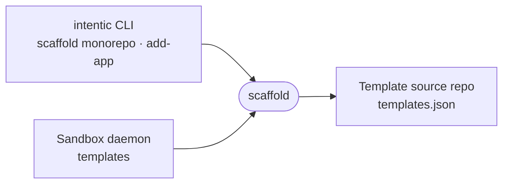

# scaffold

The app monorepo scaffolding the intentic CLI and the sandbox daemon share: a monorepo shell and its apps, built from a
template source repository.



- Running git is not here: the runner (`defaultGit`, `forkedExec`, the git verbs and stale-lock clearing) is
  [`@intentic/base/git`](../../_tools/base/src/git/index.ts). (2026-10-06: it moved there from this package, which is
  named for the skeleton, rather than into a package of its own, since a name npm has never seen fails the release plan
  until it is registered by hand.)
- `scaffoldMonorepo` and `addAppsToMonorepo` build an app monorepo from a template source repository described by
  its `templates.json`; `DEFAULT_TEMPLATE_SOURCE` is the default, and a workspace overrides it in
  `.intentic/config/templates.json`.

## Key files

- [src/inject-template.ts](src/inject-template.ts) — template fetch, monorepo shell and app injection.
- [src/template-manifest.ts](src/template-manifest.ts) — the `templates.json` a template source describes itself with.
- [src/index.ts](src/index.ts) — the single export surface.

## Commands

```sh
pnpm --filter @intentic/scaffold test
```
