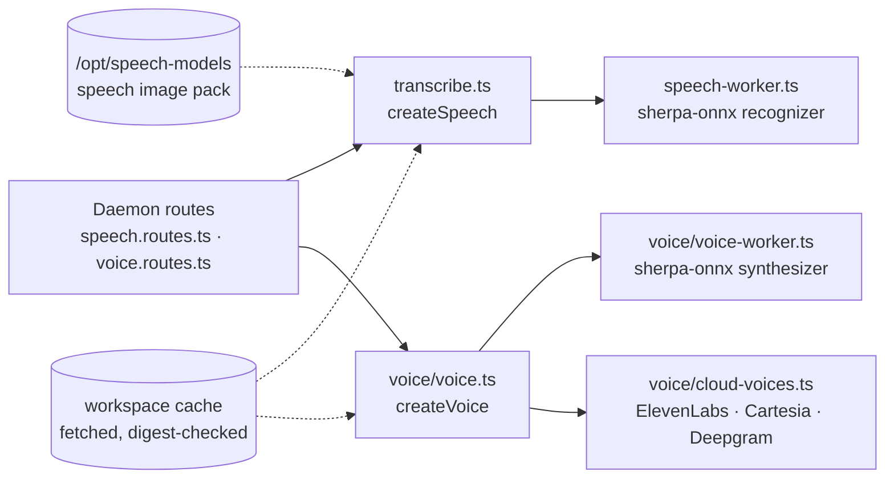

# speech

Hears and speaks on this machine: dictation by Parakeet and Whisper, replies read aloud by Kokoro and Piper or the owner's own voice provider, each local engine in a child process of its own.



- Each local engine runs in a process forked from the file beside it (`speech-worker.ts`, `voice/voice-worker.ts`), so a
  loaded model's memory goes back to the box when it idles, sherpa-onnx's ONNX Runtime never shares an address space
  with the one OCR loads, and a native crash takes down only that process. From source under node the fork goes
  through `tsx`, which is why it is a dev dependency here; bun and the built `dist/` need nothing.
- Dictation hears 25 European languages with Parakeet, baked into the standard image by the `speech` pack, and the rest
  with Whisper, fetched the first time one is spoken. Speaking picks a voice from the text's own language: the owner's
  pick, else their provider where it speaks the language, else Kokoro or a Piper voice fetched on first use.
- Every model is pinned by size and sha256 (`speech-models.ts`, `voice/voice-models.ts`) and fetched into the cache
  directory the caller names, resumed after an interruption and never given its final name until its digest matches.
- The HTTP and socket routes, and the `spoken-reply` model job, stay in the daemon ([`@intentic/sandbox`](../sandbox)),
  which builds both engines in its composition and hands them the workspace's cache directory.
- `scripts/fetch-speech-models.mjs` fetches the baked models for the image build
  (`_tools/scripts/image/prepare-image-trees.sh`), importing the pins rather than repeating them.

(2026-10-16: this was the engine half of `src/speech/` inside the daemon until it became its own package. The daemon's
path helper and its `opt` spread helper were the only things it reached back for: the cache directory is now passed
in, and the few optional fields are added in statements.)

## Key files

- [src/transcribe.ts](src/transcribe.ts) — `createSpeech`: status, model fetching and a phrase's words.
- [src/speech-engine.ts](src/speech-engine.ts) — the dictation process: forked on first use, stopped when idle.
- [src/speech-models.ts](src/speech-models.ts) — the dictation models, pinned by revision and digest.
- [src/voice/voice.ts](src/voice/voice.ts) — `createVoice`: which voice says a text, and its audio a sentence at a time.
- [src/voice/voice-text.ts](src/voice/voice-text.ts) — text made speakable: code and tables announced, paths said short.
- [src/voice/cloud-voices.ts](src/voice/cloud-voices.ts) — the providers the owner can speak through instead.

## Commands

```sh
pnpm --filter @intentic/speech test
```
