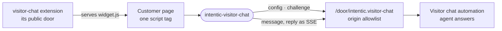

# webchat-widget

The Visitor chat widget: one script a website loads so its visitors can talk to a sandbox agent in a floating chat panel.



- Runs in a visitor's browser on the customer's site. The build is a single IIFE file (`vite.config.ts`) that finds
  its own `<script data-automation>` tag, fetches the chat's config and mounts `<intentic-visitor-chat>`. A sleeping
  sandbox or a disallowed origin renders nothing.
- By default, the panel shows a short AI disclosure in the visitor’s browser language (English, Polish, German, French or Spanish; English fallback). A Visitor chat can set its own line or explicitly switch it off with `aiDisclosure: false`. The line remains visible beside the conversation.
- The launcher and panel live in a shadow root so the host's CSS and the widget's never mix. Google sign-in and
  Cloudflare Turnstile are the exception: third-party iframes need the light DOM, projected through a `<slot>`. A
  script of theirs that fails to load is fetched again the next time the panel opens.
- A visitor is a thread id kept in `localStorage` per automation, or a Google ID token the sandbox verifies. A typed
  name is display only. The first message of a thread spends a proof-of-work or Turnstile challenge: a proof goes to
  the door's `proven` route in its headers, which the door checks before the extension hears of it, and the next
  message goes without one until the sandbox refuses the thread as expired (a 403, which reopens the check).
- Replies stream back as SSE over a `POST`, in the event names the contract's embed module shares with the extension.
  Answers written later (an approval-gated reply, a human writing as the agent) arrive by polling, which backs off
  while the sandbox is unreachable. Every message after the first carries the recent transcript, which the daemon reads
  only when it has expired the thread and starts a fresh conversation.
- The accent's label colour, the default orange and HTML escaping come from the same embed module as the bug
  reporter's, so the two embeds pick the same readable label for the same accent.
- The [visitor-chat extension](../../_extensions/visitor-chat) serves the built file from its public door and answers
  every call the widget makes, so the widget and its routes ship together in the image; its build copies this
  package's `dist/widget.js`, so build this one first (turbo does). The package stays outside the extension because it
  shares the contract's `embed` module with the bug reporter, which an extension may not import. A snippet pasted
  before 2026-11-26 names `/webchat/widget.js`; the daemon forwards it, and the widget it loads talks to the door.

## Key files

- [src/main.ts](src/main.ts) — embed entry: find the script tag, fetch config, mount the element.
- [src/element.ts](src/element.ts) — `VisitorChatElement`: launcher, panel, sending and reply polling.
- [src/transport.ts](src/transport.ts) — the calls to the extension's door and the SSE reader.
- [src/identity.ts](src/identity.ts) — thread ids, display names and Google sign-in, per automation.
- [src/challenge.ts](src/challenge.ts) — the Turnstile bot check.

## Commands

```sh
pnpm --filter @intentic/webchat-widget build
pnpm --filter @intentic/webchat-widget test
```
