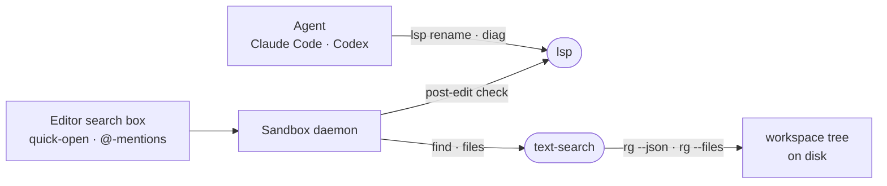

# Search

The code tools in the sandbox: compiler-backed rename and diagnostics for agents, and the ripgrep searches behind the editor's search box.

| Package | Role |
| --- | --- |
| [lsp](lsp) | The `lsp` CLI: TypeScript rename and diagnostics over the native compiler. |
| [text-search](text-search) | The search box's text and file-name searches, each a ripgrep walk of the tree with no index. |

Both run inside the sandbox. The `lsp` CLI is on `PATH`, and the daemon imports its client for the post-edit check. The daemon runs each text or file-name search in its own process; nothing stays resident and no index is kept on disk.
