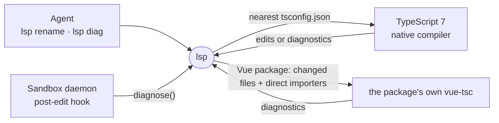

# lsp

The `lsp` CLI, which renames a TypeScript symbol across its project and reports compiler diagnostics by running the native TypeScript compiler, or a Vue package's own vue-tsc, once per question.



- Nothing stays resident. `lsp diag` runs the released TypeScript 7 compiler over the file's project and exits; `lsp rename` holds one short language-server conversation with `tsc --lsp` and applies the same edit an editor would. The platform binary is resolved from this package's own TypeScript dependency, so a project's legacy compiler cannot select it.
- The CLI takes a symbol name. The first matching declaration in the file's outline anchors the rename; failing that, word-boundary occurrences are offered to the server in order.
- A project that cannot load cleanly (a broken config, missing type foundations) is reported as unavailable instead of producing false errors, and so is a compiler that crashes, is killed, or reports errors this reader cannot parse. A rename refuses in that state, since it could miss usages.
- The CLI keeps the agent-CLI contract the other agent tools do: refusals and usage errors go to stdout, since an agent drops stderr, and the exit code is 0 for an answer and 2 for anything else.
- A `*.test.ts` file is checked against a sibling `tsconfig.test.json` when one exists. In a plain TypeScript project `.vue` imports are left unchecked.
- A file of a Vue package (one whose `typecheck` script runs `vue-tsc`) is checked by that package's own `vue-tsc`, over the files asked about and the package's files that import them directly, found in an import graph of the package (relative imports and the tsconfig's `paths`, static and dynamic, `.vue` script blocks included, followed into sibling libraries; cached by mtime under `<package>/.cache/lsp-changed/`). The run reads a temporary `tsconfig.lsp-changed.<pid>.json` there that extends the package's own and lists only those files and its ambient declarations, removed when it ends; the heavy-command table queues it in a lane of its own by that name. Errors in those files are the answer; errors in the files they import are counted, not listed. A `.d.ts`, a tsconfig, a `package.json`, or a file more than 300 of the package's files import at some depth is refused: only the full check answers for what it reaches, and the message leaves that to CI, naming the full command for whoever is asked to run it. Measured on `_editor/web` (2026-10-27): 5-55 s and 1.0-3.9 GiB on an idle machine, against the full check's 418-571 s and 6.8 GB; queued behind other conversations' checks, short of memory, the scoped run took 10-30 minutes the same day.
- `lsp diag --changed` checks every file changed since the branch left `main` (its merge base, else HEAD), untracked files included, each package by its own checker. `lsp diag --from <package> <file...>` checks other packages' files through one Vue package's importers of them, for the end-of-turn check's dependents.
- The daemon's post-edit hook imports `./client`, where concurrent asks for one project pool into a single compiler run. In the sandbox the CLI is on `PATH` and the `lspTools` setting decides whether agents get its skill.

## Usage

```sh
lsp rename src/app.ts createServer startServer
lsp diag src/app.ts src/routes.ts
lsp diag --changed
```

## Key files

- [src/cli.ts](src/cli.ts) — the two verbs and their exit codes.
- [src/rename.ts](src/rename.ts) — symbol anchoring and the language-server rename.
- [src/checker.ts](src/checker.ts) — one compiler run per project, and when it refuses.
- [src/client.ts](src/client.ts) — `diagnose`, the pooled entry point the sandbox hook uses.
- [src/report.ts](src/report.ts) — parsing compiler output into diagnostics and refusals.
- [src/vue-check.ts](src/vue-check.ts) — a Vue package's changed-files check: what it covers, when it refuses, the run.

## Commands

```sh
pnpm --filter @intentic/lsp test
```
