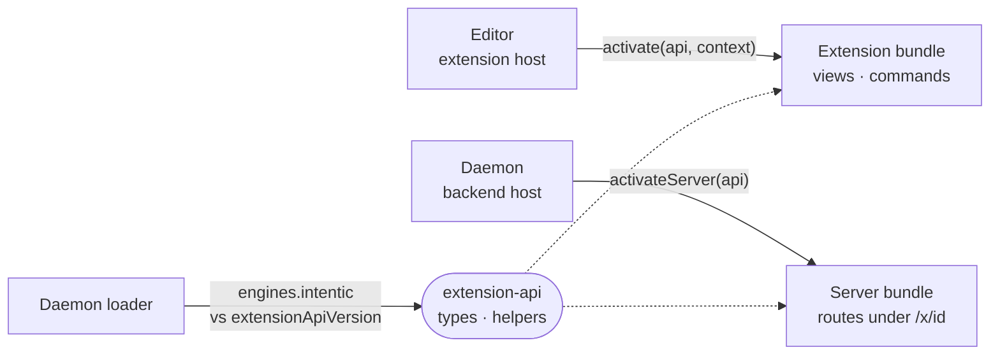

# extension-api

The versioned public API an intentic extension compiles against: `IntenticApi` for its browser half, `ExtensionServerApi` for its backend half, and the helpers both halves share.



- There is no ambient global. The host hands `IntenticApi` to `activate(api, context)`, and everything registered
  returns a `Disposable`. A manifest's `server` bundle gets `ExtensionServerApi` in a Node process shared by every
  enabled extension, and reaches daemon routes only as far as `permissions.daemon` allows. The browser half reaches
  its own backend through `api.backend`, by a path relative to its namespace, never by spelling `/x/<id>`.
- The backend api is one shape wherever an extension's Node code runs. `./runtime` builds it: `createServerApi` for the
  daemon's backend host, and `connectExtensionProcess` for a declared process, which gets the same api less the
  slots only the host serves (`ExtensionProcessApi`: no `routes`, `tools`, `approvals`, `automations`, nor the turn's
  `browser`, `ownerBrowser` and `jobs`). Besides the daemon it carries the
  extension's own `stateDir` and `cacheDir` (keyed by its identity, made before its code runs, deleted with it),
  `document` (a JSON file there, evolved by the same `conversions` as `sandboxDocument`), `settings` (its own values,
  secrets included, and `onDidChange`) and `workspace` (file, ref and repository changes). Settings and events ride two
  routes every extension token reaches without declaring them. `./runtime` also exports the backend's types, so a
  gateway's program never loads the browser half's, which name Vue's.
- `activateServer` may hand back `{ deactivate, health }`. With a `deactivate`, a change to that extension alone (a
  rebuild, an update, dev mode) reloads it in the running host and every other backend keeps running; without one, the
  host restarts. Stopping the host deactivates every backend first. `health` answers `ok`, `starting`, `degraded` or
  `failed` with a sentence, read on the host's sweep and shown on the extension's row; a failed one after an update
  counts as a failed update. Both run under the host's deadlines.
- `./testing` holds `fakeExtensionApi`: the real backend api on a fake daemon that judges every call by the reach rule
  the daemon's grant applies (extension-manifest's `extensionRouteReach`), answers the extension's own settings and
  event stream, and hands the rest to the test. A backend's activation, routes, tools, health and deactivate run as the
  host runs them, and so do its holds (`holds`), its commands (`exec`, answered by the test's `exec`, kept in `execs`),
  its fire handlers (`fire`), the caller a request carries (`route(path, init, { caller })`) and its public routes
  (`publicRoute`), each refused undeclared as the daemon refuses it.
- An extension gives the agent tools one way: `contributes.tools`, served by `api.tools.serve((card) => [...])` in
  the backend. The host owns the MCP transport, each call's deadline and the card lookup, and hands the card's
  settings with every call; the daemon mounts the server into every turn on every runtime. Each tool may declare its
  `effect` (`read`, `write` or `destructive`, the `ToolEffect` words the daemon's own tools use), which the host lists
  as MCP annotations with both hints spelled out; a tool that declares none is listed without them, and Claude Code
  runs it alone as a destructive write. A plugin's `.mcp.json` is
  deprecated, and a cli card's `mcp` is kept one release as an alias.
- A backend may carry out approved actions itself: `api.approvals.perform(handler)`. An approvals-queue action whose
  `performer` names the extension reaches the handler from the daemon's approvals executor alone, through a host door no
  `/x` route reaches, after the daemon matched a person's recorded yes against the item and spent it. The handler gets
  the pinned digest, the details as approved, who approved and when, and the daemon's action rules; it answers `done`,
  `refused` (nothing went out) or `uncertain` (it may have), and holds its credentials itself.
  `api.approvals.publish(handler)` is the same door for a post (2026-11-26, 2.54.0): a post whose `platform` names a card
  of the extension declaring `channel.publish`, with a target its pattern matches and no attachments, reaches the
  handler as `ApprovedPost` (its words, title and target exactly as approved, the yes and the action rules), in place of
  an agent turn driving the logged-in browser. `fakeExtensionApi`'s `publish(post)` hands one over as the daemon does.
- A card states what the core used to keep in tables keyed by provider name (2026-11-26, 2.54.0): `channel.messageLimit`
  (the approvals inbox counts a post against it; a gateway reads its own with connector-runtime's
  `declaredMessageLimit`), `channel.publish` and `channel.posting` (what a publishing turn reads about the platform),
  `processors` (where it sends people's data, for the Data protection page) and, on a cli card, `status: { from:
  "listener" }` (its status is its listener's report, with where a pairing code is typed). A public route may require a
  Cloudflare Turnstile token (`turnstile.secret`, verified by the daemon; `PublicRouteVerification.turnstile`), let an
  automation that opts in admit an unlisted browser with its key (`keyFromBrowsers`), or, GET-only, count no day
  (`dailyMax: "none"`). A listener message may name the one automation that hears it (`automationId`), and a streamed
  dispatch names a held wake and the conversation it will run in (`heldWake`).
- Four calls let a backend do what only the daemon's own engines could (2026-11-26, 2.50.0), each a power the manifest
  declares under `permissions`, refused by the runtime before anything is sent and by the daemon when asked:
  `api.events.onRunSettled` hears a run end in a conversation the extension itself started through POST /agent with
  its own token (`events: ["run"]`), and `api.events.onActivity` whether any agent turn runs (`events: ["activity"]`),
  over the same stream as `api.workspace`; `api.work.hold(label)` keeps the sandbox awake and an update or restart
  waiting until it is disposed or the backend dies (`work: true`); `api.exec(argv, { class })` runs one command under a
  workload class, admitted by the memory budget and, for `toolchain`, queued with every agent's builds (`exec`); and
  `api.automations.onFire(name, handler)` (backend only) is woken by an automation whose target is
  `{ kind: "extension", extension, handler }`, which only the extension itself saves (`fires`). A fire the backend
  could not take is kept and handed over once it is back, `coalesced` counting the fires it stands for, with the same
  `id` on every try. A process gets the first three, its declarations read from `INTENTIC_EXTENSION_DECLARED`.
- A backend checks the watch kinds its manifest declares (`contributes.watchKinds`, 2026-11-26, 2.51.0):
  `api.checks.serve(kind, handler)` answers one `WatchCheck` (the source's parameters, what the last pass saw, and the
  credential-gateway addresses of the extension's own cards the kind names, never a credential) with
  `{ pass: true, output }` or `{ pass: false, detail }`. The daemon's automations engine alone reaches it, through a
  host door no `/x` route reaches; serving an undeclared kind throws. `fakeExtensionApi(...).check(kind, check)` hands
  one over as the engine does. A process serves none.
- An extension declares the jobs it starts agent runs for (`contributes.modelRoles`, 2026-11-26, 2.52.0): an id, a
  label, an explanation, an icon and the setup it is suggested. The owner puts each on a model setup in Sandbox ▸ Agent
  ▸ Models beside the sandbox's own jobs, a run the extension starts through POST /agent names its job as `job` (one of the ids the sandbox's own table held
  until then may ride as `runRole`, which an older sandbox reads too),
  and `api.models.agentRun(role)` (and the kit's `useAgentRunPick`) take its id to name the model a press will spend.
  Switched off, its jobs leave that page and the owner's choices for them are kept. The ids the core's table held for
  the pipelines, deployments, maintenance, documentation and acceptance extensions are theirs now, unchanged.
- Three doors the core kept to its own features (2026-11-26, 2.53.0). A request through `/x/<id>` carries who is
  calling: `api.caller(request)` answers a person signed in (their tier, area ids, and the workspace `folders` those
  come to, with `reaches(path)`), a panel, a program's control token, another extension, or nobody on a sandbox without
  sign-in, read off an assertion the daemon mints for that extension alone, signed with a key no extension holds and
  good for two minutes. `api.daemon.asCaller(caller)` hands it back: POST /agent then starts the turn as that person,
  held to their access as the roster has it then; a panel, an agent or a person's own bearer cannot present one, and
  every other route answers by the extension's own reach. `contributes.publicRoutes` declares routes anyone on the
  internet may call at `/door/<id>/<path>`, each a power the owner approves: the daemon checks a call against the route's
  declaration (size, per-minute window, daily ceiling, an automation's allowed origins or its door key, proof of work, a
  provider's signature with a sandbox secret the extension never sees, a redelivery answered `duplicate`) before
  `api.publicRoutes.serve(handler)` hears it with a `PublicRouteVerification` saying what was checked; never through
  `/x`. And `contributes.listener.strangers` (`visitor` or `report`) holds a source anyone on the internet reaches to the
  owner's floor for those wakes. `fakeExtensionApi` models them: `route(path, init, { caller, mintedAgoMs })` attaches
  an assertion, its fake daemon believes only those it minted and records the caller a call carried (`calls[].caller`),
  and `publicRoute(path, init, verified)` refuses a path no declared route answers, as the daemon does.
- `api.backend.available` reads the daemon's installed manifest. It is false when the manifest has no server and undefined when the host has no inventory for the extension. It describes the declaration, so the server may still be starting. It is read again at each access from the newest extension list the page holds, so a view left open across a daemon rebuild follows the rebuilt daemon.
- A backend hears CI and writes the activity feed (2026-11-26, 2.56.0): `api.events.onCi` hears each frame of the CI feed
  as the core's ingestion hears it from a forge (`events: ["ci"]`; a failed job's frame carries what the forge said of
  it, `failed`), one frame a batch and an empty batch after a gap in the stream; `api.activity.append(row)` writes a row
  in the sandbox's activity feed as the extension's own, undeclared. `fakeExtensionApi` emits `ci` frames and keeps the
  rows (`activities`). Main's fix agent, the pipelines extension's since then, is the first to use both.
- An agent tool acts within the turn calling it (2026-11-26, 2.55.0), each power declared under `permissions.turn`,
  refused by the runtime before anything is sent when undeclared and by the daemon for anything the turn does not
  hold. A call's `ToolCallContext` carries `grants` (the sandbox browser accounts the turn holds, each with the sites it
  signs in on; the owner's browsers it holds; the cards of the extension's own kinds it holds) and a `ticket` good while
  the call runs. `api.browser.call(context, { account, tool, args })` drives the turn's own signed-in browser for an
  account it holds (`browser`), with the page's own tools only (`EXTENSION_BROWSER_TOOLS` in the contract's
  extension protocol) and only on the account's sites; `api.ownerBrowser.call(context, { browser, tool, args })` calls
  the owner's browser the turn holds through its peer door (`owner-browser`); `api.jobs.start(context, spec)` files a
  background job in the calling conversation (`jobs`), optionally in a lane of the extension's own, answers its id at
  once (the agent's `wait` collects it), and runs `spec.run(job)` in the backend once its turn comes, the job's `say`,
  `signal` (aborted on a stop) and its own ticket on the same grants in hand. Each rejects with the daemon's words when
  refused; a credential never comes back. `fakeExtensionApi` hands a call `grants` (the options' or the context's) and a
  ticket, answers `browser` and `ownerBrowser` calls with the test's handlers (`browserCalls`, `ownerBrowserCalls`),
  and runs jobs at once (`jobs`, `jobEnd(id)`, `stopJob(id)`), refusing what the daemon refuses.
- A cli card's `commandActions` entry says who decides its rule: `gatedBy: "sandbox"` (the default, the command guard
  refuses a denied or held command before it runs) or `"backend"` (the card's backend carries it out and asks the
  outward-action door, which decides, records it and drafts the approval on a hold), and what it comes to while no rule
  names it, `unruled: "allow"` (the default) or `"hold"` (2.52.0). `selfGated: true` is deprecated and read as both.
- This package is published to npm, and its API only grows within a major. `extensionApiVersion` moves
  with every surface change (additive is a minor), and a manifest's `engines.intentic` range is matched against it at
  load, failing closed. The editor's `surface-guard.test.ts` fails when the surface moves without a new entry in
  `src/surface.json`, which records the api's members, from 2.20.0 a digest of the whole generated manifest
  schema, since a host's parse drops a field it does not know at any depth, from 2.21.0 `ToolDefinition`'s fields,
  from 2.22.0 `api.sideViews`' members and `SideViewRegistration`'s fields, from 2.31.0 the names
  [extension-ui](../extension-ui) exports (`uiKitExports`), and from 2.33.0 what an author must change as of that
  version (`uiKitDeprecated`: each deprecated kit name and retired prop or recipe member, `<what> → <use instead>`).
  The package exports the record as `./surface.json`, which the kit's `intentic-kit-check` reads to hold an
  extension's `engines.intentic` floor to the names it imports.
- From 2.44.0 the record also versions the part of `@intentic/sandbox-contract` an extension reads (`wireExports`).
  The contract moves with the product release, so `EXTENSION_WIRE` (`./wire`, [src/wire.ts](src/wire.ts)) names the
  bare package and the subpaths an extension may import, and the record holds, per one, its runtime export names and a
  sha256 of every zod schema it exports as JSON Schema: a reshaped schema an extension parses fails the guard until a
  new version is recorded. A subpath joins in a minor and leaves only in a major. The `_extensions/**` lint override
  and `intentic-kit-check` (which reads the list off the newest record, so it needs no build) refuse any other.
  From 2.36.0, settings choices can carry `enumItemLabels` and `enumDescriptions` for their labels and explanations.
- A bundle links by name both this package's runtime exports (`moduleExports`) and the UI kit's, so those two grains
  are held to semver as well: a version that adds a name is at least a minor, and one that drops a name is a major, for
  a name declared deprecated first (the kit's in its `names.mjs`) and at or past the floor that declaration gives. The
  guard fails naming what moved and the bump it needs. (2026-10-15: the kit's `RepoRail` was removed on 2026-10-12 with
  no version, and installed extensions importing it failed to load; nothing recorded the kit before 2.31.0.)
- A cached read is keyed through the api, never spelled: `api.sandbox.readKey(procedure, input)` for one contract
  read, which is the host's own key for it, so a view shares the shell's entry and every push the daemon makes for that
  procedure; `api.sandbox.key(...names)` for anything else (a `json` route, a composite). The entry holds the
  procedure's whole answer, so a reader that wants part of it reshapes with `select` (2026-10-12: two packs had each
  keyed `roles`, one storing the answer and one a bare list, and whichever filled the entry broke the other). The
  editor's `queryKeys.guard.test.ts` reads the in-repo packs for a contract read under a hand-picked name. A paged
  (infinite) read is the exception: its entry holds pages, not the answer, so it keeps a name of its own.
- A view reads the daemon through `api.sandbox.query(spec)` (2.28.0), which is the shell's own `useSandboxQuery`. It
  asks only while the sandbox answers, is timed with the shell's reads, and reports a schema refusal as version drift
  in `error` rather than raw validation output. A paged or multi-query read still uses vue-query directly.
- Helpers every extension needs live here too: sandbox-scoped module state (`sandboxRef`, cleared on every sandbox
  switch), background polling for rail badges, `sandboxLedger` (whose writes reject rather than overwrite a file they
  could not read), `sandboxDocument` (a file of the extension's own read through the `conversions` its shape has had,
  by the contract's `readDocument`, and written with what a newer version of the extension put in it kept; every handle
  on one path shares one write queue), SSE and ndjson stream reading, and the
  payload for `api.workspace.openDiff`.
- Contribution points: `agent`, `automationTemplates`, `bin`, `capabilities`, `commands`, `documents`,
  `environment`, `files`, `listener`, `modelRoles`, `processes`, `publicRoutes`, `settings`, `sideViews`, `tools`,
  `viewers`, `views` and `watchKinds`, plus the
  manifest's top-level fields, all read off `CONTRIBUTION_POINTS` in
  [extension-manifest](../extension-manifest/src/points/index.ts).
- A side view (`sideViews`, `api.sideViews`) is something an extension shows in the editor's side panel for one input,
  beside whichever section the reader is in: the host owns the panel and the tab, the extension says what the tab reads
  (`describe`), where "Open in …" goes (`home`, also where a phone goes, having no side panel), and draws the body with
  the input bound. Its input is plain values, since a tab survives a reload and travels between windows, and its body
  never touches `api.route`, which belongs to the section beside it. With `links: true` it may `claim` links the chat
  renders, which then open beside the chat instead of in a new browser tab.
- A view that badges (`badge: true` on its manifest entry) may also itemise what a person owes it: `asks` returns one
  `ViewAsk` per decision, which the host draws in its Needs you inbox beside what agents are waiting on, with up to
  three presses answered in place and an `open` path back to the view for editing, scheduling and history. Read it off
  module state that stays current while the view is closed (`sandboxPoll`), as the badge is.
- `./protocol` exports only the version and the engines matcher, for the daemon, which cannot load the Vue-dependent
  barrel. `./runtime` and `./testing` are Node-only and free of Vue too.

## Key files

- [src/api.ts](src/api.ts) — `IntenticApi`, `ExtensionContext` and the module shape a bundle exports.
- [src/server.ts](src/server.ts) — `ExtensionServerApi`, the backend half.
- [src/runtime.ts](src/runtime.ts) — the backend api built for the host and for a process, activation and its deadlines.
- [src/testing.ts](src/testing.ts) — `fakeExtensionApi`, a backend under test on a fake daemon.
- [src/version.ts](src/version.ts) — `extensionApiVersion` and what each version added.
- [src/surface.json](src/surface.json) — the recorded public surface, the UI kit's names included, per version.
- [src/scope.ts](src/scope.ts) — module state that belongs to one sandbox.
- [src/background.ts](src/background.ts) — `sandboxPoll` and `sandboxLedger` for work done off screen.

## Commands

```sh
pnpm --filter @intentic/extension-api test
```
