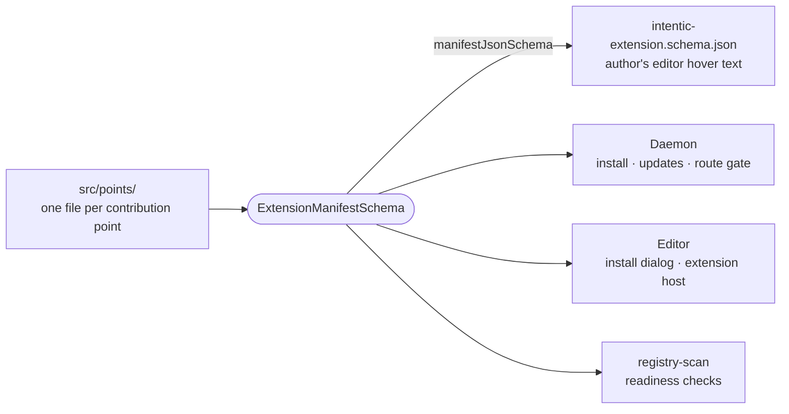

# extension-manifest

The schema of `intentic-extension.json`: what an extension declares it contributes and may reach, which the install dialog shows and the host holds every registration to.



- `manifest.ts` is the envelope. Each contribution point (views, commands, capabilities, listener, processes and the
  rest) is a `ContributionPoint` in `src/points/`, carrying the sentence an author sees as hover text.
- The runtime parse is lenient and the authoring schema strict, since an unknown key in an author's file is a typo.
  The generated schema is committed twice, here and in the site's `public/` behind `MANIFEST_SCHEMA_URL`, and the
  editor's `manifest-schema.test.ts` fails when either copy is stale.
- A cli card whose credential is a delegated OAuth sign-in declares `refreshToken` (the secret field it lives in and
  the fields it is bound to), so its own CLI and listener can store a new or rotated token through the daemon's
  write-only oauth-token route instead of printing it for someone to paste, and `probe.oauth`, which trades the token
  for an access token before the card's connection test (Microsoft's identity platform only, today).
- A field declaring `signIn` is that refresh token's field filled by a sign-in button instead of a box. `google`: the
  platform's own OAuth client runs the consent, and the card's CLI and listener get access tokens from the daemon's
  `oauth-access` route, since the client secret stays on the platform. `microsoft`: the sandbox runs the device-code
  sign-in the card's `refreshToken.deviceCode` declares, against the card's own app.
- A card's `probe.ok` names a path in the answer that must hold `true`, for a service that answers 200 either way
  (Slack's `auth.test`). Its `catalog.links` are links a connected card offers on its row (Discord's invite), built
  in the browser from the connection's non-secret settings, so a template naming a secret field fails the parse. A
  field's fixed `value` may sit under a `when`, one per arm of a choice (PostHog's region pins each cloud's host).
- A card for a service not spoken to over HTTP declares `probe.connect` (`tcp`, `postgres`, `mysql`, `imap`) with the
  host, port and sign-in as templates over its fields, in place of `url`; the daemon dials it as that service's own
  client would. A field whose answer is not typed is declared on the field (`points/capability-field-shapes.ts`):
  `connection` makes it a picker of the owner's connections of one kind, storing the chosen one's name; `keyValue`
  draws a `KEY=VALUE` block as rows of a name and a value, storing the same text; `keyRequest` has the sandbox make a
  private key and show only a certificate request for it.
- `sandboxRouteAllowed` is the permission rule: an entry is `"<METHOD> <path-glob>"`, and each `*` stands alone
  between slashes and matches one whole path segment, never a `.` or `..` the URL would resolve away. A malformed entry
  (`**`, a `*` inside a segment, an unknown method, a relative path) fails the manifest parse rather than the first
  call it gates.
- `extensionRouteReach` is the whole rule for an extension's own token: the routes every extension reaches about
  itself (`EXTENSION_OWN_ROUTES`: its settings and its event stream, the doors its other `permissions` open, and since
  2026-11-26 the turn doors its tools' calls open, each judged by the daemon on its own declaration and the call's
  ticket), its own listener provider's routes, and whatever
  `permissions.daemon` declares. The daemon's grant and the SDK's test fake both judge by it, and `./permissions` exports
  the rule alone, for a process that should not load the manifest schema.
- What a field MEANS to the host is declared on the field, with `.meta({ power, effect, mintsServer })`
  (`meaning.ts`), and read from there: the powers `diffPowers` folds a manifest into (so an update re-asks only
  when it adds one), the effects a card discloses in the capability catalog, and the capability kinds whose ids
  become `mcp__<id>__` servers in the contract's reserved-name check. A new field is either given a meaning where it
  is defined or has none.
- `automationTemplates` takes every field the daemon's own templates carry (a `once` or webhook trigger's fields, `tz`,
  `afterSessions`, a watch's `source`, `fireOn`, `until` and `target`), shaped loosely here and parsed by the daemon's
  own template schema when it builds the catalogue, which drops what would not save (2026-11-26).
- `watchKinds` (`points/watch-kinds.ts`, 2026-11-26) declares a ready-made check the extension's backend answers: its
  id, label, the sentence a source of it reads as, and its parameters as fields. `watchSentence` and
  `watchParamsProblem` are the one reading of a declaration, which the daemon, the Automations view and the approval
  card share; the `automations` command repeats the sentence rule in plain JavaScript. A `superRefine` on the envelope
  holds a kind to a `server` bundle and to the extension's own cards.
- `modelRoles` (`points/model-roles.ts`, 2026-11-26) declares the jobs the extension starts agent runs for, which the
  owner puts on model setups beside the sandbox's own: an id (`MODEL_ROLE_ID`, the key a stored choice and a run's
  `job` name), a label, an explanation, an icon and the setup it is suggested. The contract serves a declaration as
  a job (`contributedModelRole`), always a whole session, suggested `medium` unless it says otherwise. An id declared
  twice in one manifest fails its parse.
- `publicRoutes` (`points/public-routes.ts`, 2026-11-26) declares routes anyone on the internet may call at
  `/door/<id>/<path>`, each a power whose sentence names the route and the secret a signed one is checked against: a
  path of lowercase words and lone `*`s, its methods, and which of the core's protections apply (`automation` reads an
  automation of the extension's own listener from the first `*`, `origins: "listed"` holds a browser to its allowed
  origins and `key` lets a caller with no Origin present its door key instead, `signature` names a scheme and a sandbox
  secret, `turnstile` names the sandbox secret a Cloudflare Turnstile token is verified with, `keyFromBrowsers` lets an
  automation that opts in admit an unlisted browser with its key, `proofOfWork`, `rate`, `dailyMax` (a number, or
  `"none"` on a GET-only route), `bodyMax`, and (2026-11-27) `wakes`, a power of its own: a call at the route's wake
  URL may wake a sleeping hosted sandbox, its only `*` an automation's). `publicRouteFor` is the one reading of which declared route a
  request lands on, which the daemon's door and the SDK's fake share; a `superRefine` holds the routes to a `server`
  bundle and an automation's route to the extension's own `contributes.listener`.
- `listener.strangers` (`visitor` or `report`, 2026-11-26) says anyone on the internet reaches the source, which holds
  its wakes to the owner's admission floor for a website visitor or a bug report instead of a team chat's; the daemon
  reads it in place of a table of provider names. It is a power of its own.
- A cli card may declare `sleepWatch` (`points/sleep-watch.ts`, 2026-11-27): the one credential Intentic's servers may
  hold while a hosted sandbox sleeps, for a service that delivers only over a live connection (`discord`, the only one
  the platform speaks). It names the secret field and a consent field, which the parse holds to a switch (`boolean`)
  declared `hosted: true` and off by default; a field declaring `hosted` is drawn only on a sandbox Intentic hosts.
  `sleepWatchConsented` is the one reading of the switch. A `processors` path may sit under a `when` over the card's
  answers, as Discord's path to Intentic sits under that switch.
- A card states facts about its platform (`points/channel-facts.ts`, 2026-11-26), which the core reads in place of its
  own tables keyed by provider name: `channel.messageLimit`, `channel.publish.target` (a pattern of the targets its
  backend publishes an approved post to, which must compile), `channel.posting`, `processors` (one entry per path its
  data takes: a flow the Data protection page words, operator, region, third country, hosts, a `hostField`), and on a
  cli card `status: { from: "listener" }`. Each only describes, so none is a power.
- A cli card's `commandActions` entry says who decides its rule (`gatedBy`: `sandbox`, the command guard, or `backend`,
  the card's backend asking the outward-action door) and what it comes to while no rule names it (`unruled`: `allow` or
  `hold`). `commandActionGate` is the one reading, `selfGated: true`, deprecated since 2.52.0, counting as `backend`
  and `hold`.
- `toolServersOf` is the one reading of which MCP servers a manifest serves the agent: `contributes.tools`, or a cli
  card's `mcp`, its alias for one release. A `superRefine` on the envelope says what no single field can: tools need
  a `server` bundle or a declared process to serve them.
- `HOST_PUBLISHED_SPECIFIERS` lists the only bare imports a published bundle may use: the modules the shell's import
  map provides. `bundleProblem` finds a bundle's imports with a small tokenizer rather than a line regex, since a
  minified bundle puts them all on one line and a string or comment may spell the word.
- The same reading names what each static import takes (`bundleImportedNames`: `RepoRail` of
  `import { RepoRail as e }`, `default` of a default import). `missingImports` compares that with what a host's modules
  export, which the caller hands in, and `bundleProblem` says it in words when given them. The editor's loader runs it
  before linking a bundle, over only the imports at the bundle's head (`leading`), where a bundler puts them all. That
  takes a fraction of a millisecond where reading a 700 KB bundle whole took about 20 (2026-10-15), and an import it
  does not reach fails to link as it would have.

## Key files

- [src/manifest.ts](src/manifest.ts) — `ExtensionManifestSchema`, the envelope.
- [src/points/index.ts](src/points/index.ts) — every contribution point, assembled into `contributes`.
- [src/permissions.ts](src/permissions.ts) — the sandbox-route allowlist rule.
- [src/meaning.ts](src/meaning.ts) — the meaning a field declares, and the walk that reads it off a manifest.
- [src/powers-diff.ts](src/powers-diff.ts) — what an update asks for, as set arithmetic over powers.
- [intentic-extension.schema.json](intentic-extension.schema.json) — the generated authoring schema.

## Commands

```sh
pnpm --filter @intentic/extension-manifest schema   # regenerate both copies of the authoring schema
pnpm --filter @intentic/extension-manifest test     # the bundle scanner, the permission grammar, every power counting
```
