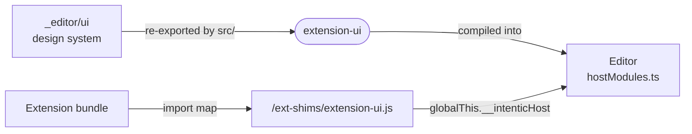

# extension-ui

The UI kit extensions render with: a curated slice of the editor's design system that the host supplies at runtime, so extension views use the shell's own component instances.



- `src/index.ts` re-exports chosen components and helpers from `@intentic/ui` (`_editor/ui`) plus the PrimeVue
  primitives extension views use. Nothing is reimplemented, so an extension view looks and behaves like the shell
  around it. This dependency on `_editor/ui` is a recorded exception to the [`_shared/` boundary](../README.md).
- At runtime the host supplies the kit: `hostModules.ts` publishes the editor's own module instances on
  `globalThis.__intenticHost`, and the import map in the editor's `index.html` resolves `@intentic/extension-ui` to a
  shim that reads them. A second copy would render unthemed, outside the app's reactivity and its query cache.
- `scripts/build.mjs` compiles the published package from `_editor/ui`'s sources: declarations pruned to what the kit
  re-exports, and a `dist/index.js` bridge that throws when loaded outside an intentic host.
- `names.mjs` lists the runtime export names by hand, because the `.vue` graph cannot load in Node. The editor's shim
  generator reads it, a dev-time assertion in `hostModules.ts` catches drift, and `extensionUiNames.test.ts` fails it.
- A bundle links these names, so they are versioned with the extension API. `surface.json` in
  [extension-api](../extension-api) records them per `extensionApiVersion` (`uiKitExports`, from 2.31.0), and the
  editor's `surface-guard.test.ts` holds them to semver: a new name moves the version a minor, and a name leaves only
  if `extensionUiDeprecated` in `names.mjs` lists it, in a major at or past the floor it gives. An extension whose
  `engines.intentic` range the host satisfies then finds every name it was built with. One that asks for a name anyway
  is stopped before it links: the editor's loader reads the bundle's imports and says which name is missing and that
  the extension needs updating, where the browser would only say the module "does not provide an export named …".
- `RepoRail` and `errorMessage` are deprecated and stay until 3.0.0 (`RepoPicker` and `messageOr` replace them).
  (2026-10-15: `RepoRail` left the kit on 2026-10-12 with no version moving, and every installed extension still
  importing it stopped loading. It is back unchanged, and nothing recorded the kit's names before this.)
- `./diff`, `./format`, `./i18n` and `./worker` skip the component barrel, for extension tests that run without a Vue
  compiler. Each is published as a bridge holding what `src/index.ts` re-exports from that file, so a name a subpath
  file exports must also be re-exported from the barrel and listed in `names.mjs`, or an extension installed from git
  fails to link it; `extensionUiNames.test.ts` reads every subpath in `package.json`'s `exports` and fails the one left
  out. `registerExtensionMessages` is left out on purpose: mounting a catalog is the host's job. `./worker` is also what a worker module imports `serveWorkerCall` from. A worker has no host bridge, so an
  extension built outside this repository bundles that module into its worker instead of marking it external.

## Key files

- [src/index.ts](src/index.ts) — the kit: every name an extension may import, with usage notes.
- [scripts/build.mjs](scripts/build.mjs) — builds the published types and the host bridge from `_editor/ui`.
- [names.mjs](names.mjs) — the runtime export names the shims and the host check read, and the deprecated ones.
- [../../_editor/web/src/extension-host/hostModules.ts](../../_editor/web/src/extension-host/hostModules.ts) — where the shell publishes its instances to extension bundles.

## Commands

```sh
pnpm --filter @intentic/extension-ui build
```
