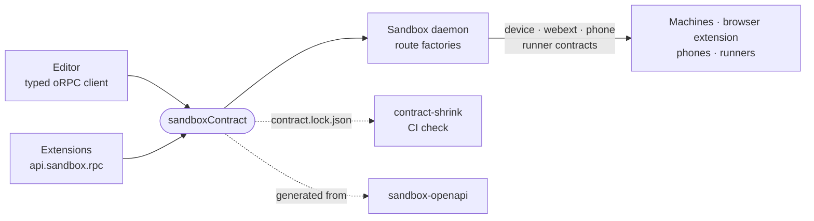

# sandbox-contract

The wire contract between the editor and the sandbox daemon: every route, its schemas and its access policy, as one oRPC contract both ends compile against.



- Each subject pairs a route group in `src/contracts/*.contract.ts` with its wire shapes in `src/schemas/`.
  `src/index.ts` assembles them into `sandboxContract`, which the daemon implements per domain and the browser calls
  through one typed client.
- Policy sits beside each route: `procedure()` declares how a request authenticates, which member tier it needs and how
  far a control token reaches. Routes outside oRPC (streams, WebSocket upgrades, `/health`) are listed in
  `RAW_ROUTES`. One that answers plain JSON (`/members`, `/environment`, `/engines`, `/definition`) has its input and
  answer schemas in `RAW_JSON_ROUTES` under the same key, which the editor's `sandboxRaw` fetches by and parses with;
  any other caller builds the path with `rawRouteUrl` (or `procedurePath` for a procedure it calls without oRPC's
  client), so no route is spelled a second time. A route whose body is bytes (a file, a WAV, a tar) is marked `bytes`,
  and its caller passes a Blob, an ArrayBuffer or a string.
- Four contracts run the other way. `deviceContract`, `webextContract`, `phoneContract` and `runnerContract` are served
  by a user's machine, the browser extension, the phone app and a runner over the socket each one opens, with the
  daemon as the client. The phone's is carried as plain JSON-RPC (`src/protocol/doors/phone-protocol.ts`), since its far end is
  a Kotlin app; `golden/phone-wire.json` holds example frames that both ends test against.
- The daemon names the routes it implements on the `/events` hello frame, and the browser diffs that list against its
  own build, so a route an older daemon lacks shows as a missing feature instead of a 404. The desktop app's folder
  sidecar sends the same frame with `surface: "folder"` and only the few routes it serves, which the browser offers
  and never reads as out of date.
- `settings.agentDomain` reads the execution-domain policy; `settings.setAgentDomain` requires the owner's bearer,
  never a panel, agent or control token. This policy is stored in the daemon's auth root, not in the agent-writable
  settings manifest. Its rollout default remains `root`; a daemon build whose execution boundary is incomplete
  refuses activation of `unprivileged` even for the owner, rather than promising protection it cannot enforce.
  A turn refused for an unsupported or unreadable protected policy carries `agent-domain-refused`, an admission
  refusal: its queued words remain owed, not consumed as an executed failure.
- Some rules live here as code, not only shapes, because both ends must reach the same answer. The main one is
  whether an account can serve a turn: `serviceState` in `src/models/plan-pools.ts` turns a revoked sign-in, a lost
  seat, a translator bench, a standing refusal and the plan limits into one `AccountState` (`ready` · `spent` ·
  `blocked` with its `fix` · `unknown`), and `SPENT_UTILIZATION` is the only spent line. The daemon runs it for every
  picker and publishes it as `state` on each account row. The editor reads that field and never judges a row itself: a
  row without it (a daemon from before v1.313) reads as `unknown`, and the editor says the sandbox needs an update.
- So are the rules the daemon and a device must agree on about the owner's machine. `DEVICE_PROGRAM_TOOLS` in
  `src/policy/device-programs.ts` says which device tools carry a program and how to read it, and
  `sandboxPowerCommands` in `src/policy/sandbox-power.ts` recognises a command that starts, stops or replaces a
  sandbox. The rules `ic`'s Rust must agree with are here too, each pinned to it by a golden file under `golden/`:
  the update probation policy (`src/state/update-probation.ts`), the one shape of `restart-intent.json`
  (`src/schemas/restart-intent.ts`), and the answer of `ic sandbox swaps --json` (`src/schemas/device-swaps.ts`).
- What a credential looks like is decided here too: `CREDENTIAL_ISSUERS` in `src/policy/credential-material.ts` (each
  issuer's prefix and token body, as data) and `SECRET_REFERENCE` in `src/schemas/needs.ts` (the `{{secret:name}}`
  pattern, non-global, so each site that scans derives its own `/g` copy). The terminal output filter
  (`@intentic/output-cleaners`) imports only node builtins and keeps copies of both; the daemon's
  `src/secrets/terminal-masking-parity.test.ts` fails when a copy parts from these.
- `./documents` is the vocabulary stored files evolve by, shared by the daemon's stores and an extension's own files
  (`sandboxDocument`): guarded, pure conversions of raw JSON that settle on their own output, the passthrough that
  keeps what a build does not know on its writes, and `readDocument`, the one read every store makes of a file (JSON,
  conversions, parse, whole or one entry at a time), whose problems carry a `reason` a reader matches on.
- The sandbox's own transcript notices (a land, a memory hold, a renewal, a stop) keep their English sentence in
  `text`, which older editors, stored records and agents reading their own history go on reading, and carry
  `noticeCode` beside it: which notice it is and the facts it was worded from (`src/events/sandbox-notice.ts`), so the
  editor says it in the reader's language and audience. On the wire the code is any string; `SandboxNoticeSchema` is
  the typed list a reader decodes with, and a code it does not know draws `text`. (2026-09-29: a closed enum was
  rejected, since the editor parses every answer with its own schema and one newer code would fail the whole page.)
- What a runtime's own extensions show has one lane, whichever runtime ran them (`src/events/agent-ui.ts`). An
  `agent_status` frame is a keyed status entry (text, or null to clear it), a turn fact that replays to a late joiner and
  is gone when the turn ends. An `agent_notice` frame (level `info` · `warning` · `error`, text, optional `source`) folds
  into a `notice` row carrying `agentNotice`, so a reopened chat still says it. A dialog an extension opens is not part of
  this lane: it rides the ordinary `question` card. Pi's extension UI and the Claude Code loop's informational lines
  feed it today. (2026-10-04: a widget kind of its own was rejected: a widget's lines are a status entry's text, and
  nothing yet draws a placement beside a composer.)
- `StatePlanSchema` and `StateStatusSchema` are what `ic` reads by field name: the update pre-flight's line (embedded
  verbatim in the staged-update marker) and `/health`'s `state`. So are `UpdateOutcomeSchema` and
  `PreparingUpdateSchema`, the files `ic` writes beside an update for the daemon to read. `golden/` holds an example of
  each, which the contract's tests keep current and ic's Rust tests parse or produce field for field.
- `/health` is served raw, and its shape is `DaemonHealthSchema` (`src/schemas/system.ts`); every reader outside the
  daemon (the platform's hosted gate, the editor's recovery screen, the onboarding lane) parses it with
  `DaemonHealthReadingSchema`, where any field may be missing or of an old shape. `ic` reads it in Rust and keeps its
  own loose reading of `boot`, `state` and `announce`. What the machine agent prints for a bring-back, and so what
  the editor reads off the desktop app's `intentic:project` event, is `src/schemas/project-bring-back.ts`.
- One reading each of three small grammars every tier parses: `src/protocol/sse.ts` is the WHATWG event-stream parser
  (CRLF, CR or LF; data lines joined; `event`, `id`, `retry`) with the idle window a daemon stream ends after;
  `globMatcher` in `src/policy/search-globs.ts` matches a "files to include" glob as Bun.Glob does, so the daemon and
  the desktop folder server admit the same files; `compareVersions` in `src/state/versions.ts` orders versions as
  semver does, a release above its own prereleases.
- The wire no oRPC route carries is defined by the Rust crates that speak it (`_sandbox/netd/crates`): `tunnel` (the
  `/tunnel/v2` door, its headers and lanes, the stream multiplexer, close codes, liveness, ALPN and the transports an
  edge declares; what the daemon announces as its transfers is `protocol/tunnel-bulk.ts`, held to the edge's reading by
  the shared `ingress-contract.fixture.json`), `browser-wire` (what a browser sees: the terminal socket and its messages, netd's vitals,
  the WebTransport path, the edge's verdict) and `netd-wire` (netd's control socket with Node, its env vars and its patience). The
  vitals are read at the package root: `protocol/vitals.ts` gives `VITALS_PATH` and `parseVitals`, which reads any
  other body (an older sandbox's 404 from Node) as undefined. Their tests
  write TypeScript and a JSON manifest each into `src/netd/generated/`; `src/netd/browser-wire.ts` and
  `src/netd/netd-wire.ts` are the entries to them, and `wire-manifests.test.ts` holds every value TypeScript restates
  to those manifests.
- `contract.lock.json` is every exported schema as canonical JSON Schema, plus those three manifests under `wire:`
  names, so a changed tunnel header or a gone control message is a shrink like any other, plus who reaches each route
  under `access:METHOD /path`: every reach field of its `RouteMeta` with the default filled in (`routeAccess`). A
  field is recorded even when a route leaves it out, so a lowered floor or a new `guest`, `agent` or `panel` grant is a
  changed value, which counts as a shrink, never as growth that passes. The lock test names the route and the field
  that moved. Rewrite it by hand with `pnpm --filter @intentic/sandbox-contract lock`. A conversation that changed the
  contract has it rewritten in its own worktree before it lands (the repository's fixers,
  `_tools/scripts/verify/fixers.mjs`), so the lock rides the land that moved it. `src/state/contract-lock.test.ts`
  fails while the lock and the schemas disagree. `_tools/checks/contract-shrink.mjs` fails CI for a pushed branch
  that shrinks it with no commit declaring the break (`type!:` or `Breaking-Note:`); nothing checks the push itself.

## Key files

- [src/index.ts](src/index.ts) — `sandboxContract`, the route tables derived from it, and every public export.
- [src/protocol/route-meta.ts](src/protocol/route-meta.ts) — the per-route policy fields and their defaults.
- [src/protocol/raw/raw-routes.ts](src/protocol/raw/raw-routes.ts) — every route the daemon serves outside oRPC, and `rawRouteUrl`.
- [src/protocol/routes.ts](src/protocol/routes.ts) — route naming, `streamOf` for streamed routes, and the route list a daemon advertises.
- [contract.lock.json](contract.lock.json) — the committed fingerprint of the wire surface.
- [src/webext/index.ts](src/webext/index.ts) — a narrow entry point, one of several that keep small bundles off the barrel.

## Commands

```sh
pnpm --filter @intentic/sandbox-contract lock   # rebuild, then rewrite contract.lock.json
pnpm --filter @intentic/sandbox-contract test
```
