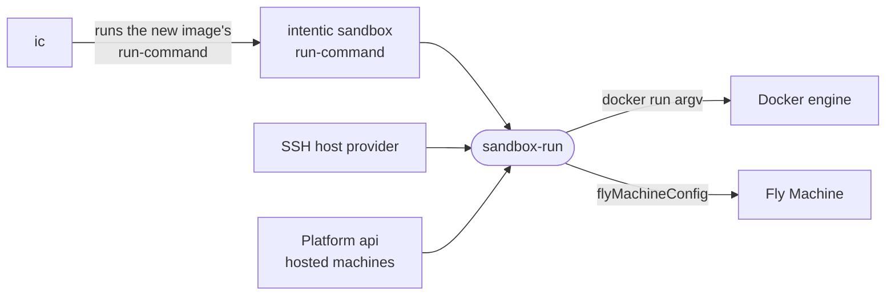

# sandbox-run

The sandbox container's run contract: names, privileges, resource caps, the env a recreate replays, and the `docker run` line and Fly Machine config built from them.

- One definition for every way a sandbox starts. TypeScript callers import it, so drift is a compile error. `ic`
  runs the target image's own `intentic sandbox run-command` and executes the line it prints, so each image starts
  with its own flags.
- Privilege arrives only through `RUNTIME_DIRECTIVES`, an allowlist read from an overlay's `# intentic:runtime` lines
  and the owner's `SANDBOX_RUNTIME`. An `OPTIONAL_DIRECTIVES` entry such as `--gpus=all` is probed on the host and
  dropped when the host cannot honour it.
- `REPLAY_VARS` is what a recreate carries over: one row per variable, with the role it plays (layout, platform,
  identity, machine, choice, purpose) and whether it is a credential. A move to another machine keeps every role but
  `machine`. A copy keeps neither `identity` nor `machine`. `REPLAY_ENV` and `REPLAY_SECRET_ENV` are derived from
  it. `parseNulEnv` reads the values NUL-framed because one can be a multi-line private key. The table includes the
  paths of optional mounted at-rest keys, never their contents.
- `localDaemonPort` derives a sandbox's host loopback port from its id, so a recreate lands on the same port and the
  editor and machine agent compute it without being told.
- `SANDBOX_VOLUMES` lists a sandbox's storage: the workspace, `/history` and the sandbox's own Docker engine. The run
  line mounts each one, and a swap in `ic` must carry each over unchanged; ic's copy (`storage.rs`) is held to
  `golden/volumes.json`. A volume an environment bundle does not walk says why (`unbundled`), and the bundle's report
  repeats it.
- `DATA_MOUNTS`, derived from the volumes plus the optional `/agent-auth`, names where the daemon's converted files
  live and the state planner's flag for each. The update pre-flight in `ic` mounts exactly these, read-only, and its
  copy is held to `golden/data-mounts.json`.
- `./quote` holds the shell, SQL and env-file quoters the daemon, providers, CLI and editor share. It imports
  nothing, so a browser bundle can take it. `powershellQuote` doubles all five characters PowerShell reads as a
  single quote (`'` and the typographic `‘ ’ ‚ ‛`), not only the ASCII one.
- `./slug` reads a sandbox's names back: the slug off a container name (`sandboxSlugOf`, which never guesses from a
  name that is not a sandbox's), off a daemon's address (`slugOfDaemonUrl`, guarded and lowercased, undefined rather
  than a throw), and the 12-hex id off a connect token through Web Crypto (`sandboxIdOfToken`, the browser's twin of
  the contract's `sandboxIdFromToken`). It imports nothing, so the editor takes it without the run emitter.
- `flyMachineConfig` declares no Fly service or check: a hosted machine is reached only down the tunnel its daemon
  dials to the edge, like every other sandbox, so nothing on Fly routes to it.

## Key files

- [src/index.ts](src/index.ts) — names, volumes, capabilities, caps, directives, replay env and `sandboxRunArgv`.
- [src/fly.ts](src/fly.ts) — the hosted flavour: `flyMachineConfig` and the single-volume layout.
- [src/quote.ts](src/quote.ts) — quoters to compose outward, one per parser a value crosses.
- [src/slug.ts](src/slug.ts) — a sandbox's slug and id read back off a container name, an address or a token.
- [src/index.test.ts](src/index.test.ts) — the emitted argv and directive handling, by example.

GPU preflight uses `gpuProbeArgv` to exercise an actual Docker `--gpus=all` device request with an image already on the host. `gpuProbePassed` requires a physical GPU listing; a registered NVIDIA runtime or CDI setting alone is insufficient. Fly machines stamp GPU access as unsupported.
