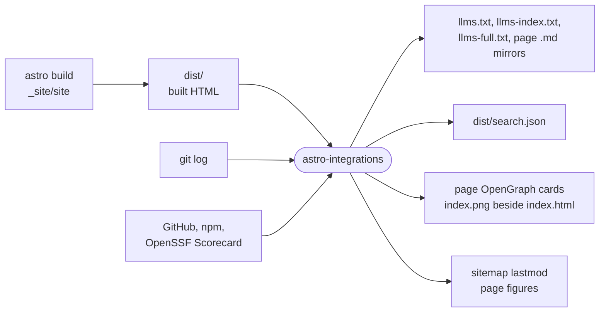

# astro-integrations

Build-time Astro integrations and helpers for intentic.dev that write Markdown mirrors, llms.txt, the docs search index and OpenGraph cards, date the sitemap from git, and fetch the figures its pages quote.



- Runs in Node during the site's build, never in the browser. Plain `.mjs` with JSDoc and `src/index.d.ts` for types.
  `build` and `check` syntax-check the integrations; `typecheck` checks the git date helper and its regressions as JavaScript.
- `llmsText` and `docsSearch` read the HTML Astro just wrote to `dist/`, so tables rendered from expressions are indexed as a reader sees them. Pages marked `noindex` stay out of llms.txt. Both use the parser in `html-to-markdown.mjs`, which handles Astro's own well-formed output and nothing wider.
- `ogImages` (the `./og-images` entry, kept out of the index so satori and resvg never reach the page bundle) draws a card beside every built page whose `og:image` is its own card URL, `ogImageUrl` in the index, which the layout uses to name it. It reads the og: tags from `<head>` with a regex, lays the site's `render` tree out with satori, and rasterizes with resvg's `renderAsync` on libuv's thread pool, up to eight cards in flight. `render` also gets `rasterize`, for a layer every card shares and should draw only once: the site bakes its window shadow that way, since blurring it per card was most of the build.
- `gitStats`, `latestRelease`, `npmDownloads` and `scorecard` return `null` on any failure, so a page leaves a figure out instead of printing a wrong one; the network readers say so in the build log. The network readers keep the promise of their one read, so pages rendering concurrently share it. `gitStats` counts commits authored by `agent@intentic.dev` and needs a full clone.
- `lastModForUrl` maps a URL back to its source files and returns the last commit date touching any of them. Comparison
  details fall back to `src/pages/compare/[slug].astro`; both details and the `/compare/` hub include
  `../site-content/src/compare.ts` alongside their page template. Pages whose words live in a content module (the home
  page, `/about/`, `/pricing/`, `/facts/`) also count that module, listed in `pageContent`. Paths resolve from `process.cwd()`, the site being built.
  Its cache lives on `globalThis`, because a build loads the module twice (the page bundle's copy for each page's
  `dateModified`, then astro.config's for the sitemap) and both ask about the same URLs.

## Key files

- [src/index.d.ts](src/index.d.ts) — every export with its types and a one-line contract.
- [src/llms-text.mjs](src/llms-text.mjs) — llms.txt, llms-full.txt and the per-page `.md` mirrors. With `compact`,
  llms.txt is a short index of the pages an agent should read first and the full one moves to llms-index.txt.
- [src/docs-search.mjs](src/docs-search.mjs) — splits built docs pages into heading-led search blocks.
- [src/html-to-markdown.mjs](src/html-to-markdown.mjs) — the HTML parser and Markdown writer both integrations share.
- [src/git-lastmod.mjs](src/git-lastmod.mjs) — URL to source files to last commit date.
- [src/og-images.mjs](src/og-images.mjs) — the OpenGraph card integration: og: tags in, PNG beside the page out.

## Commands

```sh
pnpm --filter @intentic/astro-integrations test git-lastmod.integration.test.mjs
pnpm --filter @intentic/astro-integrations typecheck
```
