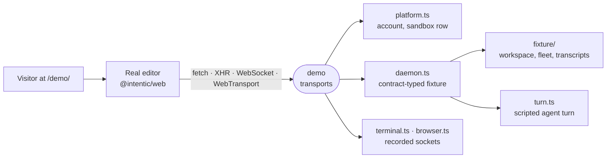

# demo

The interactive demo at intentic.dev/demo/: the real editor built from `@intentic/web` source, with its network replaced by an in-browser fixture of the platform and a sandbox daemon.



- Runs entirely in the visitor's browser. `main.ts` swaps `fetch`, `XMLHttpRequest` and `WebSocket` for handlers bound to `*.demo.invalid` origins, and answers a `WebTransport` session there as one that never opens, so terminals take the socket shim, seeds a session and open chat tabs into the storage keys the app already reads, then imports the app's own `main.ts`. No app module knows the demo exists, and a request that escapes the handlers dies on the reserved `.invalid` TLD.
- The fixture daemon is typed by `@intentic/sandbox-contract`. `@intentic/contract-serve` resolves a request with the contract's own route matcher and parses its input, so a contract change breaks this package's typecheck before it breaks the landing page.
- `unserved.ts` lists every contract route the fixture doesn't answer, each with its reason: not an editor call, real sign-in or real infrastructure, or not simulated yet (the gaps a visitor can reach). The typecheck holds it to the contract both ways, so a new route fails here by name until it is served or listed, and a listed route the fixture starts serving fails as an unknown key. An unanswered request answers 404 and logs its reason, and the console boot line reports how many routes are served.
- The switcher chrome picks a mode: `Minimal`, `Curated`, `Everything`, `Showcase`, `Desk`, a documents-instead-of-code workspace, or `Fresh`, a sandbox on its first day with nothing in it and only the free trial to run on, which is where the getting-started checklist and the first-run board are seen (`?mode=minimal|default|full|showcase|desk|fresh`). `?mode=first` is an account with no sandbox at all, and `?mode=welcome` the same before signing in: the two faces of Home's first run (`HomeNoSandbox.vue`), which no other mode reaches since each serves at least one sandbox. `?as=maintainer|collaborator|viewer|guest` shows the app as a lesser grant, and its daemon holds that grant to every route's floor with the daemon's own check, answering what it would refuse with the daemon's own refusal and logging it (`src/floors.ts`): the editor foresees those and never sends them, which `_tools/e2e/access/` checks screen by screen. `?ai=<keys>` holds that lesser grant to some AI accounts, as Access ▸ People writes them (`?ai=codex:chatgpt-ada`, or `?ai=gemini` for every account of a provider), which is how the model picker's "not shared with you" states are looked at; `?ai=all` lifts it. All three stick per tab, and switching reloads. `Showcase` is what the site's and the repository README's screenshots are taken of. Every mode but `Everything` is served quiet: the same agents, files and conversations without the states the recording otherwise packs in to be explored (cooling caches, reactions, open needs, a failing pipeline, a plugin's warning). `Everything` keeps them all; the screenshots harness can quiet it too, through a session key only it writes (`src/mode.ts`, `demoQuiet`). `?outage=busy|restarting|down|fixing|needs-you|fixed|hosted|asleep` acts out a sandbox that stops answering, at the same seams a real one does (`src/outage.ts`), so the diagnosis and the recovery panel can be looked at; `?outage=none` ends it. `?models=none` serves a sandbox with nothing a chat can run on (no account, no trial, no endpoint), the first run the chat's account notice and Home's in-place Models are checked against (`src/mode.ts`, `noModels`); `?models=any` ends it.
- `vite.config.ts` reuses the app's `vite.shared.ts` and builds into `_site/site/public/demo/` (gitignored), so the demo ships same-origin with the site. The marketing screenshots (`_tools/e2e/shots/capture.mts`) and the promo recording (`_tools/e2e/promo/record.mjs`) are taken from the demo.
- `/demo/home?mode=home` shows three sandboxes with custom marks in the left rail (a shop, Research, Personal), connected Claude and Codex plan limits on the right, and a home conversation per sandbox that **plays a turn of real work** when it is first opened: the shop's agent walks the checkout in the browser, finds Germany shipping free, fixes the rate table, tests it and asks before putting it live; Research sends three subagents to rival shops at once and writes a brief; Personal checks the calendar, finds trains, asks before paying, books them and sends them on. Each story is a list of agent events (`fixture/home/shop.ts`, `research.ts`, `personal.ts`, written with `story.ts`), played by `turn.ts` through `/agent/attach` as a real run streams, so the real chat draws it; a question it parks on answers itself with its first choice after seven seconds unless the visitor answers first. The sandboxes are told apart by their daemon addresses (`fixture/home/sandboxes.ts`: each has its own `*.demo.invalid` origin, and a handler reads the one it was asked at from `ProcedureCall.url`), so a switch in the rail switches the conversation, the turn and the home card the board and the chat's status line read (`daemon/homeCards.ts`); a turn keeps playing while another sandbox is on screen. `fixture/home/logos.ts` supplies the sandbox images. `?mode=hero` serves the same home recording with the showcase's board behind it, so every place a visitor clicks next has something in it; the screenshot harness captures it as `hero-home` in both site themes, on the shop's first frame, before its first step.
- **The landing page's hero runs this demo live** in an iframe named `intentic-demo-hero` (`:light` appended on the site's light skin), which is how `src/embed.ts` knows it is embedded: the name survives the frame's reloads, where a query parameter would not. Embedded, the demo serves the `hero` mode and opens on `/home`; swaps `localStorage` and `sessionStorage` for in-memory stores and refuses every IndexedDB open, so nothing played in the hero reaches the visitor's own `/demo/` and every visit plays its turns from the start; shows tool calls inline, so the work is seen as it is done; holds programmatic focus until the visitor presses inside the frame and puts the page's scroll back after every scroll the app asks for; lets wheel and touch scrolling chain to the page; signs out into the demo rather than the site; and posts `intentic-demo:ready` to the page once the app marks its first view (`boot:view`). The page's half is `_site/site/src/components/landing/live-demo.ts`.
- `fixture/offices/office.ts` supplies fictional EZD RP and e-Doręczenia cards and snapshots for
  `/demo/ext/e-urzad/office-ezd` and `/demo/ext/e-urzad/office-ed`. Their overview, refresh and connection-test requests
  stay in the fixture transport. No government service or credential is used; the snapshots share the extension's wire type.

The fake platform also answers the public model browsing feed from `DEMO_CATALOGS`, using the same model IDs and
labels as the fake daemon. A fresh sandbox therefore exercises disconnected browsing separately from account access.

## Key files

- [src/main.ts](src/main.ts) — boot order: transports, seeded storage, switcher, then the app.
- [src/transport.ts](src/transport.ts) — which requests the demo claims and which pass through.
- [src/daemon.ts](src/daemon.ts) — every served procedure, raw route and recorded socket, plus the live state `/events` re-broadcasts.
- [src/unserved.ts](src/unserved.ts) — every route the demo leaves unanswered, and why: its real coverage.
- [src/platform.ts](src/platform.ts) — the platform's answers: session, sandbox list, billing plan and fictional organisation policy reads.
- [src/mode.ts](src/mode.ts) — the modes, the viewer tier and the extension override.
- [src/embed.ts](src/embed.ts) — the landing page's hero: how the demo knows it is embedded, and what changes when it is.

## Layout

| Path | Role |
| --- | --- |
| `src/turn.ts` | Scripted agent turns streamed on `/agent/attach`, parking on plans and questions |
| `@intentic/contract-serve` | The dispatcher standing in for the daemon's OpenAPI handler, and the event-iterator wire format |
| `src/terminal.ts`, `src/browser.ts` | Recorded terminal and browser-view sockets |
| `src/switcher.ts` | The mode buttons, plain DOM, mounted before the app |
| `src/fixture/` | The data: files, repos, fleet, transcripts, automations, the desk workspace |
| `vite.config.ts` | Shared app build, base path, port, output directory, the shared optimizer cache and a managed preview's idle stop |
| `scripts/dev.mjs` | `pnpm dev`: Vite in the foreground by hand, this conversation's managed preview in an agent's turn |
| `scripts/smoke-daemon.ts` | One request per served procedure, answers parsed by the contract schemas |
| `vendor/` | [Pinned first-party extensions](vendor) the demo runs |

## Dev server: by hand, or one managed preview per conversation

`pnpm dev` (`scripts/dev.mjs`) syncs `vendor/` and then starts Vite one of two ways (2026-10-27):

- **By hand** (no conversation stamp in the environment): in the foreground on `http://127.0.0.1:47146/demo/`, as
  before; arguments go to Vite.
- **In an agent's turn** (`INTENTIC_TURN_OWNER` names its conversation): the conversation's **managed preview**,
  which the `preview demo` command also starts. A second start finds the first; a new one starts in the background
  on the conversation's own port in 47150-47199, at `http://<conversation>.demo.localhost:<port>/demo/`, so each
  conversation's seeded sign-in and chosen look stay in its own origin. The command prints the address once the server
  answers and returns; the server outlives the turn. It writes a record (`@intentic/constants/dev-previews`), which
  `vite.config.ts`'s `previewKeeper` keeps current while the page is used and which the daemon reads to spare the
  server from the sweep that ends a finished turn's processes (`_sandbox/sandbox/src/processes/dev-previews.ts`).
  It stops by itself after 10 minutes with no request and no open HMR client, and at most 3 run across the sandbox:
  starting a fourth stops the least recently used. The reason is kept, and that conversation's next start prints it.
  `--stop` and `--list` stop this conversation's and list every one. `INTENTIC_PREVIEW_DIRECT=1` forces the
  foreground server in a turn.

Why: on 2026-10-26 five to seven conversations each ran a demo server of their own at 1.5-1.9 GB, up for the whole
turn and idle most of it, on one 21 GB sandbox, and the skill's `pkill -f vite`, run by one of them, stopped all of
them. One server measured 0.8 GB resident warm and 2.2 GB at its peak while the optimizer bundled (2026-10-27).

The optimizer cache is not in `node_modules/.vite`: it is shared between every tree with the same lockfile, config
and optimizeDeps list, under `/tmp/intentic-vite/demo-<hash>/` (`_editor/web/vite.shared.ts`, `sharedCacheConfig`).
A cold key takes a minute or two to bundle monaco, mermaid and shiki; every later start reuses it.

## Commands

```sh
pnpm -C _site/demo dev        # by hand: http://127.0.0.1:47146/demo/; in a turn: this conversation's preview (`preview demo`)
pnpm -C _site/demo dev --stop # in a turn: stop this conversation's preview
pnpm -C _site/demo build      # into _site/site/public/demo/
pnpm -C _site/demo smoke
pnpm -C _site/demo typecheck
```

The demo typecheck includes the editor source and uses the same 8 GiB V8 heap limit as the editor.
The previous 6 GiB limit exhausted its heap on a cold CI check (2026-10-25).
