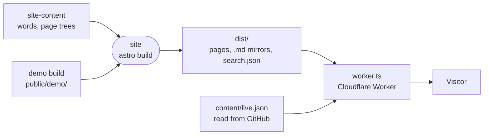

# site

The Astro site behind intentic.dev, prerendered to static pages and served by a Cloudflare Worker that adds redirects, versionless downloads and a live notice.



- Pages are `.astro` files under `src/pages/`; their words, navigation and metadata come from `@intentic/site-content`. `/docs`, `/developers` and `/api` share one layout, sidebar and search index (`src/components/docs/`), and `/api` is generated from `@intentic/sandbox-openapi`.
- `/accessibility/` and `/pl/deklaracja-dostepnosci/` share `src/components/legal/AccessibilityStatement.astro` and are linked
  in the footer. The Polish page sets `lang="pl"`; the statement records the scoped axe review and tells public offices
  to assess and publish a statement for their own deployment. Update its date and findings after each new review.
- Every build also writes a Markdown mirror of each page, `llms.txt`, `search.json`, a sitemap dated from git (all via `@intentic/astro-integrations`) and OpenGraph cards. The cards are skipped when the Inter fonts under `scripts/fonts/` are missing.
- **The site's counter** (2026-10-15). `src/lib/visit.ts` counts page views and presses on links into the app, carries a visit's source (`utm_*` tags, or the referring site) on its links into the app, and stores nothing in the browser. It posts to the Worker's `/wire/site`, which `src/lib/site-wire.ts` checks and forwards to PostHog under a daily-rotating hashed visitor id. The Worker needs two secrets, `POSTHOG_KEY` (the PostHog project key, the same one the app uses) and `WIRE_SALT` (any long random string); without the key it counts nothing. Chosen over loading posthog-js (about 290 KB on every page) and over a cookie (a consent question for every European visitor).
- Comparison detail routes share `src/pages/compare/[slug].astro`; their copy comes from `site-content/compare`. `ComparisonFaq.astro` renders the same FAQ entries passed to the layout's structured data. Source-review dates are page-specific, while git modification dates account for the shared copy and route template.
- `worker.ts` runs before static assets (`run_worker_first`). It redirects http and moved paths, serves the install scripts at vanity paths (`INSTALL_SCRIPTS` in `@intentic/constants`) from `public/scripts/`, serves the same scripts with their arguments injected at the one-liner routes (`/<verb>/<arg>`, below), resolves `/desktop/*` to the latest GitHub release asset, falls back to the demo's shell under `/demo/`, and applies [content/live.json](content/live.json) to every HTML page outside `/demo/`.
- The `/extensions/` gallery reads the registry repository at build and falls back to `src/lib/registry.fallback.json` when GitHub is unreachable.
- `scripts/readme/` draws the repository README's pictures into `docs/marketing/readme/`: it photographs the demo build, frames each shot in the site's window, and renders the diagrams, once for GitHub's dark scheme and once for its light one.
- The Worker name `intentic` in `wrangler.jsonc` is the Worker bound to intentic.dev, so a deploy under any other name never reaches the live site.

## One-liner routes

Every command the product hands out is `curl -fsSL https://intentic.dev/<verb>/<arg> | sh` or `irm https://intentic.dev/<verb>/<arg> | iex`. The verb table lives in `@intentic/constants` (`one-liner.ts`), so the Worker that serves a URL and the editor and sandbox that hand it out read the same patterns. [src/lib/worker-verbs.ts](src/lib/worker-verbs.ts) does the serving:

- PowerShell gets the `.ps1` script when the User-Agent says `PowerShell`; everything else gets sh. A trailing `.ps1` or `.sh` on the last segment overrides that.
- sh: right after the shebang come `set -- '<args>'`, `INTENTIC_SCRIPT_URL='<url>'` (for a script that re-runs itself under `sudo`) and the verb's env lines.
- PowerShell: the script is wrapped as `& { … } -Param '<value>'`, so its `param(...)` binds as if it were called by name.
- `uninstall` carries nothing in its URL and keeps what the person adds: its sh gets `set -- "$@"` and its PowerShell block ends in `@args`, so `| sh -s -- --dry-run` and `& ([scriptblock]::Create((irm …))) -DryRun` reach the script. Every other verb's URL replaces anything typed (the table's `typed` flag).
- Each argument must match its verb's pattern and hold only `[A-Za-z0-9._~/-]`; anything else gets a one-sentence 400 and no script. Responses are `no-store` and vary on the User-Agent.

The flat paths (`/connect`, `/fix.ps1`, …) keep answering as before.

## Key files

- [astro.config.mjs](astro.config.mjs) — integrations, sitemap priorities, llms.txt sections and the dev proxy for `/demo`.
- [worker.ts](worker.ts) — request-time routing and the live-content rewrite in production.
- [wrangler.jsonc](wrangler.jsonc) — Worker name, build command (demo first, then Astro) and the asset binding.
- [src/layouts/BaseLayout.astro](src/layouts/BaseLayout.astro) — the head, JSON-LD, OpenGraph tags and notice strip every page shares.
- [src/components/Landing.astro](src/components/Landing.astro) — the home page.
- [src/lib/live.ts](src/lib/live.ts) — the schema, limits and link allowlist for the live document.

## Commands

```sh
pnpm -C _site/site dev          # astro dev; /demo proxies to the demo's dev server
pnpm -C _site/demo dev          # start it alongside to see /demo in dev
pnpm -C _site/site build
pnpm -C _site/site test         # desk palette and mark alignment checks, then the Worker's verb-route tests
pnpm -C _site/site test:compare --content-only  # copy and research-map invariants
pnpm -C _site/site test:compare  # after build: generated comparison HTML and FAQ parity
pnpm -C _site/site run deploy   # wrangler deploy, then IndexNow submission
pnpm -C _site/site readme       # README pictures, from the demo's dev server (DEMO_URL)
```
