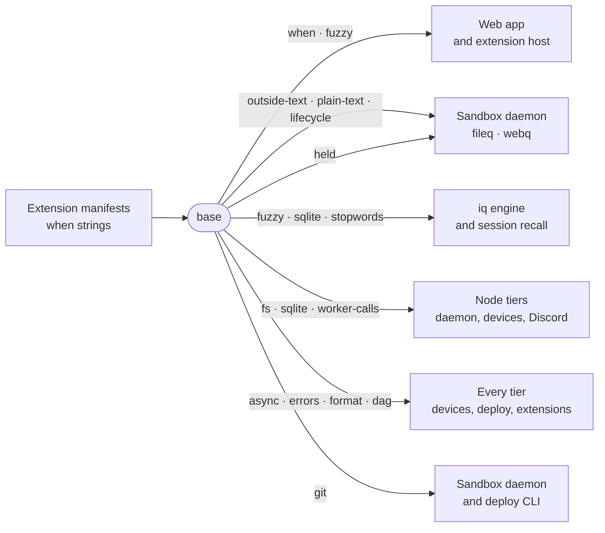

# base

Runtime primitives that every tier, from the daemon to the browser, must run identically: when-expressions, disposal, async schedulers, untrusted-content tags, size and token formatting, fuzzy path scoring, the stopwords every full-text query drops, and the file, SQLite, worker-thread, whisper and git-runner plumbing the Node tiers share.



- One implementation per rule that more than one tier applies: two copies of a condition, a size label or a
  quick-open ranking disagree on screen. Anything only one surface renders belongs next to that surface.
- Subpath exports only, with no index, so a browser bundle pulls nothing it does not use. `outside-text` uses Web
  Crypto, so it does not tie a caller to Node, and `one-line`, `capped-read`, `escape`, `json` and `fetch-json` need nothing but
  the language and fetch; `fs`, `contained`, `json-lines`, `process`, `sqlite`, `worker-calls`, `web-stream`,
  `ws-tcp-pump`, `acme` and `git` are Node's.
- `when.ts` is a closed grammar with no arithmetic, calls or property access, because its strings arrive from
  installed extensions.
- `outside-text.ts` wraps chat, pages and tool results in `<untrusted-content>` tags whose close carries a fresh id,
  so content cannot forge its own end. It marks taint and does not defend against a hostile model.
- `lifecycle.ts` is teardown as a store: whatever needs undoing registers when it is created, a member that throws
  does not stop the rest, and failures surface together. Every scheduler in `async.ts` is disposable.
- `async.ts` cancels with an `AbortSignal`, never with a counter compared after an await:
  - `Latest` aborts the previous attempt when the next one starts.
  - `anySignal` links a caller's signal into your own.
  - `retry` and `pollFor` stop waiting the moment their signal aborts, and `pollFor` expires at its deadline rather
    than on the tick after it.
  - `withDeadline` aborts the work when time runs out. `withTimeout` and `within` only stop waiting for it.
  - `unlessAborted` stops waiting at an abort. Racing every read of a loop against one promise that stays pending
    instead keeps every value raced alive until that promise settles.
  - `within` clears its timer however the race ends and can unref it, so a CLI's bounded close or a daemon's
    best-effort wait never holds the process open.
  - `startPeriodic` runs a chore on a timer: a warm-up, then a run every interval, never two at once (a tick that finds
    the last run going is skipped), unref'd timers, and one dispose for all of it. Hand-rolled copies kept missing one of
    the four.
  - `Delayer` takes a `maxWaitMs` ceiling for a source that never goes quiet, `pollFor` a `maxProbes` cap that holds
    when the clock does not move, and `retryAfterMs` is the one reading of a `Retry-After` header (seconds or a date).
- `ssh-config.ts` is the one reading of a managed `Include` line in someone's `~/.ssh/config`: only a live line counts
  (a commented-out one is not an include), ours goes first, and every other line is left byte for byte. The daemon's
  ssh hosts and the machine agent's sync aliases both write theirs through it, with `writeFileAtomic`.
- `utf8-text.ts` cuts a UTF-8 file into text windows and says when one is lossy (any window that is not UTF-8), the
  twin of `utf16-text.ts`; the daemon's /work reads and the desktop folder server both use it, so a Latin-1 file opens
  read-only from either.
- `node/ws-tcp-pump.ts` is desktop sync's SSH byte pump, run by both ends of the WebSocket: binary frames only, a chunk
  copied before an async send, backpressure each way, and a ceiling on a WebSocket that cannot pause.
- `held.ts` is how a reading kept between asks states its two limits: the change feed that makes it stale, and
  `maxAgeMs`, how late a change that feed missed may show. `freshness` is one reading, `held` is readings by key. The
  daemon's directory reads and compiled `.gitignore` matchers, land standings and history index use it.
  `cachedAsync` is the sibling for a reading that costs a round trip: askers share the load in flight, a failure is
  never held, and `maxEntries` caps it. `BoundedMap` is a Map that drops its oldest entry past a limit, for memory kept
  by a key the process cannot bound itself.
- `dag.ts` layers a dependency graph by generation for the two graphs extensions draw, workflows and CI pipelines,
  so a cycle or a self-need is handled one way in both: a cycle lands in one final layer.
- `cloudflare.ts` is the Cloudflare v4 client the platform and the deploy engine's providers both call: a bearer, the
  success envelope checked by hand (no schema library here; each caller validates `result` with its own), 30 seconds per
  call, and the zone list's paging. A 401/403 is a `CloudflareTokenError` and a zone out of DNS records (81045) a
  `CloudflareZoneFullError`, so each caller words those for its own reader (2026-10-06; the two used to keep a copy each,
  and only the platform's knew 81045).
- `node/process.ts` (`./process`) is one bounded child process for every Node tier but the daemon (which keeps
  `runCheck` for its workload classes): its own process group, ended whole at a deadline or abort (SIGTERM, then
  SIGKILL; `taskkill /T /F` on Windows), settled once it exits even while a grandchild still holds its pipes, and its
  output kept as head and tail with a `… [N characters cut] …` marker, decoded so a split UTF-8 character arrives
  whole. `execBounded` throws execFile's rejection shape, so a `promisify(execFile)` caller moves over unchanged
  (2026-10-12; the device agent's shell and adb runners each had a copy, and its sync runner had none of it and could
  hang past its own timeout). `runBoundedSync` / `runBoundedSyncBytes` are the same bound for a caller that cannot
  await (a module's load, an exit hook, a CLI's synchronous path): Node's `spawnSync` timeout signals only the direct
  child, so these give the command its own group and end the rest of it once spawnSync returns from a deadline or a
  full buffer. A run that hands over the person's own terminal (`stdio: "inherit"`) stays on `spawnSync`, so Ctrl-C
  reaches it.
- `fetch-json.ts` (`./fetch-json`) is one JSON call over HTTP: a deadline of its own combined with the caller's signal,
  a refusal's body quoted in the error and cut at 300 characters, and a `kind` that tells a timeout from a server that
  could not be reached. No schema library, like `cloudflare.ts`: each caller validates the body with its own.
- `escape.ts` (`./escape`) holds `escapeHtml` (all five HTML-active characters, the apostrophe included),
  `escapeRegExp` and `isRecord`, which a dozen packages each kept a copy of.
- `errors.ts` lets a catch name the failure it expects: `isMissing` is ENOENT or ENOTDIR only, and
  `undefinedIfMissing` answers undefined for "not there" while EACCES, EIO and a bug's TypeError still arrive.
- `json.ts` (`./json`) reads text that may not be JSON: `parseJsonOr` hands back its fallback for a SyntaxError and
  rethrows anything else, and `parseJsonWith` runs a schema over the value, undefined when the text is not JSON or the
  schema refuses it. The schema is anything with zod's `safeParse`, so base still depends on no schema library.
- `node/fs.ts` is the one atomic write: staged beside the target under a random name (worker threads share a process
  id, and two containers on one volume may both be pid 1), renamed over it, the staging file removed on any failure, a
  given mode exact rather than cut by the umask. `renameOver` is the rename retried while Windows holds the target open,
  for any rename that replaces a file someone may have open. A durable write flushes the file and then its directories
  through `syncDirectories`, which is best effort by contract: a directory it cannot open or a filesystem that cannot
  flush one never fails a write that already happened. `queueOnFile` serializes one path's read-modify-write across
  every handle in the process. `readTextIfExists` (and its `Sync` twin) and `readJsonIfExists` read a file
  that may be absent: undefined when it is missing, or for JSON, not JSON or refused by its schema, while EACCES, EISDIR
  and EIO still throw.
- `node/contained.ts` asks whether a path is inside a root one way: by whole segments, so `..notes` is a name and
  `/work/a-other` is not under `/work/a`, with the root itself inside and another Windows drive outside. `realInside`
  follows links first, for a disk where a folder can be a link elsewhere. `windowsHolds` is the one rule for a name NTFS
  can hold.
- `node/json-lines.ts` reads newline-delimited JSON off a stream: decoded across chunks, split at LF only (readline also
  splits at U+2028, which JSON allows raw in a string), `\r` dropped, a last record without its LF kept. It yields lines;
  `parsedJsonLines` skips a line that is not JSON instead of ending the stream at it.
- `capped-read.ts` reads a fetched body with a ceiling on the bytes that arrive, cancelling the stream at the cap,
  since a checked Content-Length is not a ceiling on a chunked answer.
- `text/one-line.ts` is outside text as one bounded line: whitespace flattened, control and format characters (ESC,
  BEL, bidi overrides) removed, cut at a character boundary with the `…` inside the limit.
- `sqlite.ts` has two doors. A cache store holds the `SqliteDb` seam, whose `transaction` is a plain BEGIN that does
  not nest. A store holding a `DatabaseSync` opens it with `openSqlite` (WAL, a busy timeout, foreign keys) and
  groups writes with `immediateTransaction`, which takes the write lock at BEGIN and joins a transaction already open.
- `workers/worker-calls.ts` is a call-and-answer channel to a worker thread, spawned on first call and again after a
  crash, and `workerPool` spreads independent calls over a few of them.

- `acme/acme.ts` orders a certificate over DNS-01 and tells the CA to look only once the zone's own nameservers serve the
  challenge (`authoritative-dns.ts`), since an early look fails the authorization for good. When that never shows —
  the host's network blocks direct DNS, or the nameservers answer without the value because something on the network
  answers in their place (the interception production hit) — a caller's `confirmChallenge` (the DNS provider reading
  the record back) plus `PROVIDER_SETTLE_MS` stands in for it, with a warning that says which of the two it saw;
  without one the wait's deadline fails the order.
- `git` (`git/`) is how the sandbox daemon and the deploy CLI run git and other short commands. `defaultGit` is the
  `GitRunner` behind almost every git call the daemon makes: it forks git from a small resident child (`forker.ts`,
  kept beside `runner.ts` so `new URL("./forker.js", import.meta.url)` finds it in `dist/`) rather than from the
  large daemon process, retries only on `index.lock` contention, and marks pathspecs literal so a file named `[slug]`
  matches only itself. `forkedExec` runs the daemon's other polled commands (tmux, status probes) from the same child:
  a spawn from a large process first copies its page tables, 52 ms at 778 MB, where a request to the child costs
  0.04 ms. `setRunnerEnv` adds what every command it starts carries and the process's own environment must not: the
  daemon's ssh agent socket, which its own git signs through and its other children would inherit from `process.env`.
  `politeGit` runs bulk agent work under `nice` and `ionice`. `commands.ts` holds the generic verbs over an
  injectable `GitRunner`, and `locks.ts` clears a lock only while no git process runs. (2026-10-06: moved here from
  `@intentic/scaffold`, which is named for the workspace skeleton; a new package was rejected because a name npm has
  never seen fails the release plan until it is registered by hand.)

## Key files

- [src/when.ts](src/when.ts) — `parseWhen` and `evaluateWhen`, the condition language manifests carry.
- [src/async.ts](src/async.ts) — `Delayer`, `Coalescer`, `SingleFlight`, `keyedLock`, `startPeriodic`, `within`, `pollFor`, `retry`, `createBackoff`.
- [src/lifecycle.ts](src/lifecycle.ts) — `IDisposable`, `DisposableStore` and `MutableDisposable`.
- [src/text/outside-text.ts](src/text/outside-text.ts) — `wrapOutsideContent`, the envelope for outside text.
- [src/held.ts](src/held.ts) — `freshness`, `held` and `cachedAsync`: a change feed and a time bound for anything kept, and `BoundedMap`.
- [src/fuzzy.ts](src/fuzzy.ts) — `fuzzyScore`, `rankByFuzzy` and the per-keystroke `fuzzyRanker` both quick-open ends share.
- [src/node/fs.ts](src/node/fs.ts) — `writeFileAtomic` (its synchronous twin for a write on the way out, and `writeChunksAtomic` for content produced a chunk at a time), `renameOver`, `syncDirectories`, `queueOnFile`, `pathExists` and `freePort`, the file primitives of every Node tier.

## Commands

```sh
pnpm --filter @intentic/base test
```
