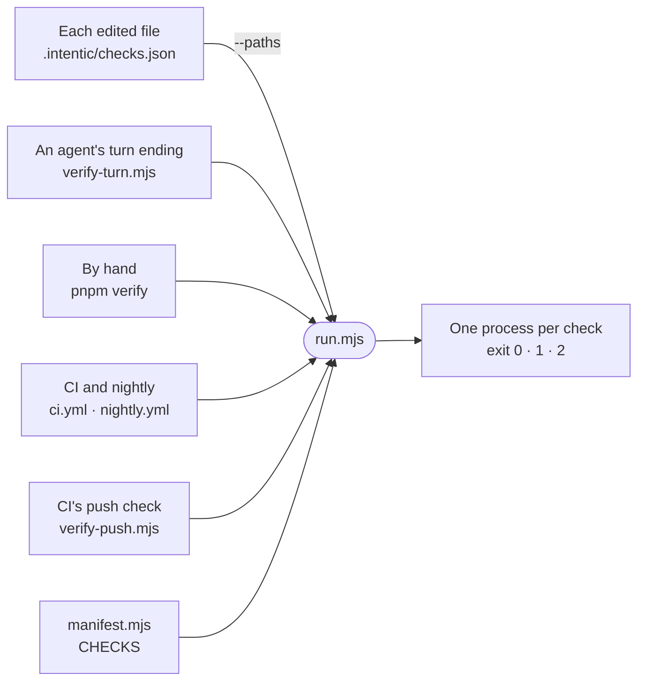

# checks

The repository's invariant checks: one Node script per rule, listed once in `manifest.mjs` and run by `run.mjs` after each edit, as an agent's turn ends and in CI.



- Checks run before `pnpm install`, so they read the tree by shape (regex, `lib/repo.mjs`) instead of importing the
  code they judge, and each runs as its own process.
- To add one, write `<name>.mjs` and answer through `lib/report.mjs`: `finish` prints problems to stderr and exits
  1, or prints what it vouched for and exits 0; `cannotMeasure` exits 2 when the check could not look. Then add an
  entry to `CHECKS` in `manifest.mjs`.
- An entry's `needs` says what it may read (`checkout`, `git` history, or `node_modules` when installed). A `code`
  gate fails every run that reads it. A `tidy` gate fails only what a pushed range adds, and fails the nightly tidy
  job on main. A new check enters as `tidy`.
- `scoped: true` means the check takes `--paths a,b` and reaches the same verdict on those files as on the whole
  tree. A check that can repair the tree itself (`lockfile`, `i18n`) says so in its failure, with the `--fix` that
  does it.
- After each edit, `.intentic/checks.json` runs `run.mjs --paths {file}`: scoped checks only, silent unless one
  fails. What it prints returns with the edit and never stops the turn. As an isolated agent turn ends, its `turn`
  entry runs `_tools/scripts/verify/verify-turn.mjs`: every check on the turn's tree, new files included, and only
  what the change added against where it left `main` is said back to the agent, once. Nothing runs them at a push.
  CI's preflight runs them all with `--tidy=warn`, and its `quick` job's push check
  (`_tools/scripts/verify/verify-push.mjs`) runs them again and fails on the tidy lines the pushed range added. The
  turn check and the push check judge a change the same way (`measure-change.mjs`), so what one charges the other
  does. `pnpm verify` runs them all when asked, and the nightly with `--gate=tidy`.
- Ratcheted checks (`ratchet: true`) keep their standing backlog in `baselines/` (`lib/ratchet.mjs`), which may
  shrink and never grow unasked. A check run never writes one: it fails on growth and only says where the tree beats
  it. Before a conversation's work lands, the fixers in its worktree (`_tools/scripts/verify/fixers.mjs`) run each
  ratcheted check with `--tighten <the change's paths>`, which lowers only the entries those paths touch. Growth is
  declared with a reason, which the baseline records:
  `layout.mjs --allow <dir> --reason "<why>"` for one entry, from any checkout, or
  `<check>.mjs --write-baseline --reason "<why>"` to adopt every finding, which runs only in the primary checkout.
- A pushed range is judged against the commit it is built on, as a multiset of findings keyed by path, rule and the
  source line each anchors to (`_tools/scripts/verify/turn-findings.mjs`), so a second copy of a standing finding is
  the change's. The count baselines stay: the per-edit run and the nightly tidy job judge a tree, not a change, and on
  a sample of 15 recent lands, judging with the baselines removed changed 5 verdicts (an edited line carrying a
  standing finding, and the per-file totals the checks print, both read as new).

## Code shape

`code-shape` holds file length, function length and complexity where the tree stands, in CI as well as after each
edit: a file new to the tree may run to 600 lines, and a file over that, a function over 100 lines or a function over
the cyclomatic or cognitive cap of `.oxlintrc.plugins.json` may not grow past its entry in `baselines/code-shape.json`.
Complexity is oxlint-plugin-complexity's score under that config's options, so it is the number the linter prints (the
per-edit linter no longer reports it, so one voice speaks); function names and spans come from nav's parser, over
nav's source files less suite fixtures (`testing.ts`), vendored copies and what the plugins config ignores. Without an
install it measures file length alone and says so. Entries are keyed per function (`path#symbol#metric`, with `~2` for
a second function of one name in a file, and an anonymous one named after its enclosing function), and a function
pairs with its own name's entries by score, so a reorder moves nothing. A function with no entry may take over an
orphaned one of its metric that holds its score: in its own file (a rename) or of its own name elsewhere (a move, a
`git mv`). A file past what it may hold takes the excess from a file entry the tree now holds less of, preferring the
same name gone (a `git mv`) and then the same directory (a split), so the excess over the cap never grows. `--tighten`
writes what was taken under the new key and drops or lowers the old (`lib/ratchet.mjs`'s `lent`). Per-file sums of
excess were the other option (2026-10-16): simpler to key, but a function could then grow on what its neighbour gave
up.

## Door checks

Most tier checks answer one question: does this file reach past a concern's one door? `clipboard-tiers`,
`format-tiers`, `primitive-tiers`, `process-tiers`, `home-dir`, `tones` and `run-settings` are each one entry in
`doors.rules.mjs` (the subjects, what counts as prose, the patterns or a `find`, the door, an optional baseline, the
report) run by `lib/doors.mjs`; their `<check>.mjs` only names the entry. `buttons`, `inputs` and `rows` walk a tag
stack and `recipes` parses call arguments, so they keep their own loops over `lib/templates.mjs`.

## Exceptions

A finding that is right where it stands is excused in one of three ways, and no other:

- `allow(<check>): <reason>` at the site, where `<check>` is the manifest id: `// allow(…)` (or `/* … */`) in code,
  `<!-- allow(…) -->` in markup, `{/* allow(…) */}` in JSX, on the flagged line or in the comment block right above
  it. In a template a finding inside a tag's attributes is excused above the tag itself. It sits on what it excuses,
  so a rename carries it and a deletion takes it away. `lib/allow.mjs` reads it (parsed in
  `@intentic/constants/allow`, so a guard suite such as `_editor/web/src/moduleState.guard.test.ts` reads it the same
  way). The door checks report an `allow(<id>)` comment that excuses nothing, so a stale one cannot linger.
- A baseline in `baselines/`, for the standing backlog only (`lib/ratchet.mjs`, above): it may shrink and never grows
  unasked, with a reason on each entry that grew.
- `Allow: <check> — <reason>` as a commit trailer, for a whole change: CI's push check (`verify-push.mjs`) accepts what
  that range adds to a tidy check with that manifest id.

A reason is required in all three. A table that says what a rule IS is not an exception and stays in its check: the
door modules (`OWNERS`, `HOME`, `SUPERVISORS`), `licences`' `REVIEWED`, `extension-siblings`' list, the `marks`
selectors, `layout`'s `INDEX_DIRS`, and the exceptions `shared-boundary` and `i18n-shared` name. `Test-Note:` and
`Breaking-Note:` are not check exceptions either: they are declarations the land writes into its commit and CI's
checks, the release notes and the assertion ratchet read (a weakened test, a removed behaviour), and they keep their
own names.

## Commands

```sh
node _tools/checks/run.mjs --list            # every check: needs, gate, per-file or whole-tree
node _tools/checks/run.mjs --only paths,md-links
node _tools/checks/run.mjs --paths _tools/README.md
pnpm checks                                  # all of them; pnpm checks:tidy for the tidy gate
```

## The checks

| Check | Refuses |
| --- | --- |
| [control-chars](control-chars.mjs) | literal control bytes in tracked text |
| [skill-descriptions](skill-descriptions.mjs) | a skill description over its catalog budget |
| [lockfile](lockfile-drift.mjs) | a lockfile that has drifted from the manifests |
| [peer-deps](peer-deps.mjs) | an unmet, missing or conflicting peer dependency |
| [licences](licences.mjs) | a shipped dependency whose licence forbids handing it on |
| [test-programs](test-programs.mjs) | a test outside a type-check program, its budget or build order |
| [workflows](workflow-policy.mjs) | a workflow crossing the fork boundary or a permission ceiling |
| [release-notes](release-headings.mjs) | release headings the writer and parsers spell differently |
| [contract-shrink](contract-shrink.mjs) | a shrunk wire contract with no breaking-change declaration |
| [hooks-armed](hooks-armed.mjs) | a non-executable git hook, re-armed in place |
| [invariant-registry](invariant-registry.mjs) | a daemon subsystem with no runtime invariant or stated reason (ratcheted: `baselines/invariant-registry.json`) |
| [daemon-boundaries](daemon-boundaries.mjs) | a new whole-`Services` taker, cycle between daemon subsystems, or cycle between the subunits of a unit `layers.json` lists in `subunits` (`agent/`, `conversations/`: `daemon-subunits.json`) |
| [editor-boundaries](editor-boundaries.mjs) | a static import cycle between web editor modules, a new cycle between its subsystems, or a new cycle between the subunits of a unit `layers.json` lists in `subunits` (`editor-subunits.json`) |
| [shared-boundary](shared-boundary.mjs) | a `_shared/` package depending on another part |
| [extension-deps](extension-deps.mjs) | an extension manifest naming an `@intentic/*` package outside the extension SDK |
| [runtime-deps](runtime-deps.mjs) | shipped code importing a package its manifest names only as a devDependency |
| [contract-paths](contract-paths.mjs) | a contract route, or a platform route the daemon calls, called by spelling its path |
| [publish-set](publish-set.mjs) | a publish list that is not dependency-closed and ordered |
| [publish-retry](publish-retry.mjs) | retry patterns that ride out the wrong release failures |
| [release-api](release-api.mjs) | a `github.sh` helper that masks a failed write |
| [engines](engines-blessed.mjs) | an `engines.json` version this repository does not pin |
| [tool-pins](tool-pins.mjs) | a tool the sandbox image pins (ripgrep, gh, cloudflared, pnpm…) at two versions in two places |
| [daemon-indexes](daemon-indexes.mjs) | the daemon's generated `state-registry.ts`, `app-raw-routes.ts` or `slice-registry.ts` drifted from the definitions in its source (`--fix` rewrites them) |
| [scripts-kit](scripts-kit.mjs) | an install script whose generated kit or download region drifted from its source in `_site/site/scripts-kit/` (`--fix` rewrites it) |
| [layer-tables](layer-tables.mjs) | a layered package's README table drifted from its `layers.json` or its `src/` directories (`--fix` rewrites it) |
| [build-cache](build-cache-mounts.mjs) | a sandbox image fragment without BuildKit cache mounts |
| [mirror-roots](mirror-roots.mjs) | replacing a directory an agent turn overlays instead of emptying it |
| [paths](path-literals.mjs) | hand-spelled roots and `../..`-counted ones |
| [vocabulary](vocabulary.mjs) | a retired word spelled again |
| [terminal-output](terminal-output.mjs) | `ic` or `intentic-machine` printing to a person around its renderer, `ui.rs` or `ui.ts` (ratcheted) |
| [silent-catch](silent-catch.mjs) | a new handler that throws an error away unnarrowed |
| [code-shape](code-shape.mjs) | a new file over 600 lines, or a file, a function over 100 lines or a function over the complexity caps growing past its baseline (ratcheted: `baselines/code-shape.json`) |
| [daemon-doors](daemon-doors.mjs) | the editor reaching the daemon's JSON routes around `sandboxRaw`: a path spelled to `sandboxJson`/`sandboxRequest`, or a fetch of a `rawRouteUrl` path (ratcheted: `baselines/daemon-doors.json`, empty) |
| [process-tiers](process-tiers.mjs) | a daemon process started by hand instead of through `runCheck`, `spawnAs` or `@intentic/base/git`'s `exec` (ratcheted: `baselines/process-tiers.json`) |
| [quote-splices](quote-splices.mjs) | a value spliced into a command between bare quotes instead of through `@intentic/sandbox-run/quote`, or a file carrying secrets to a host that stopped importing it |
| [home-dir](home-dir.mjs) | `homedir()` in the device agent (`_devices/machine/src`) instead of `homeDir()` from `@intentic/local-agent` |
| [primitive-tiers](primitive-tiers.mjs) | a hand-rolled copy of a job with one shared door: a header-only body cap, a local hop-by-hop list, a `..` prefix containment test, an inline sleep, a card deadline, raw browser storage, a promisified `execFile`, and, in a package that depends on `@intentic/base`, an inline `errorMessage`, a local `isRecord` or a hand-rolled write-then-rename for `writeFileAtomic` ([conventions](../../docs/architecture/conventions.md#one-door-per-concern); ratcheted: `baselines/primitive-tiers.json`) |
| [dependency-text](dependency-text.mjs) | a new branch on another program's wording (a failure's message, a child's stderr) where its structure says the same ([conventions](../../docs/architecture/conventions.md#reading-another-programs-output); ratcheted: `baselines/dependency-text.json`) |
| [time-zones](time-zones.mjs) | a cron, date format or day bucket with no zone |
| [format-tiers](format-tiers.mjs) | a number or date the editor or an extension formats by hand instead of through the kit (ratcheted: `baselines/format-tiers.json`) |
| [clipboard-tiers](clipboard-tiers.mjs) | the clipboard reached through `navigator.clipboard` in the editor or an extension instead of through the kit |
| [reduced-motion](reduced-motion.mjs) | the OS asked about reduced motion outside `@intentic/ui/motion`, a CSS animation utility or `motion-reduce:` variant in the app shell, the kit or an extension, or a skeleton that moves by CSS animation |
| [layout](layout.mjs) | ghost, over-full, twin, colliding or dead directories |
| [package-readmes](package-readmes.mjs) | a package with no `README.md`, or one with no H1 and lead sentence, found the way `intentic-docs validate` finds packages |
| [dead-code](dead-code.mjs) | a new unused export, type or file, or a new unused, unlisted or unresolved dependency, as knip reads `knip.json` (ratcheted per file in `baselines/dead-code.json`, per manifest in `baselines/dead-code-deps.json`; an export kept for something knip cannot see takes knip's `/** @public */` tag) |
| [md-links](md-links.mjs) | a relative documentation link that does not resolve |
| [metaphor-home](metaphor-home.mjs) | the four-noun picture defined twice or on the home page |
| [alias-targets](alias-targets.mjs) | a resolver alias pointing at a missing path |
| [ignored-imports](ignored-imports.mjs) | a relative import of a path `.gitignore` ignores, which lands without its file and fails every clean checkout |
| [i18n](i18n-catalogs.mjs) | translation keys, placeholders or plurals English lacks, and any key English has that Polish lacks (Polish has users, so it must be complete) |
| [i18n-literals](i18n-literals.mjs) | English typed into a Vue template, or handed to a notice, a receipt or a failure line from a `.ts` module (ratcheted against `baselines/i18n-code-literals.json`, empty since the 2026-10 sweep, so any finding fails) |
| [i18n-keys](i18n-keys.mjs) | a missing `t()` key, an unused message, a message that does not compile |
| [i18n-shared](i18n-shared.mjs) | a `shared.*` message that is not a noun phrase: a conjunction, a pronoun, a verb, a placeholder, a fragment, a numbered twin |
| [tooltip-words](tooltip-words.mjs) | a hover label longer than a word or two, where a `Tip` card belongs (ratcheted) |
| [tailwind](tailwind-bypass.mjs) | arbitrary colours or pixel sizes in class attributes |
| [display](display-descenders.mjs) | clipped display type without descender clearance |
| [marks](mark-alignment.mjs) | a mark or an `<Icon>` placed by a hand-tuned offset instead of `.mark` / `.ui-icon` |
| [rows](row-tiers.mjs) | a list row that sets its own density, padding or height; a section header drawn or decorated by hand; a card in a card; sections with nothing spacing them |
| [buttons](button-tiers.mjs) | a hand-styled action button instead of `<Button>` |
| [inputs](input-tiers.mjs) | a hand-styled field instead of `ui-field-box` |
| [recipes](recipe-tiers.mjs) | a kit recipe (`ui.iconButton`, `ui.textButton`, …) handed a size, an ink or a radius its variants own, a retired recipe name (`ui.sectionLabel` outside the kit), `ui-chip-on` by hand, or a selection marked a second way (ratcheted: `baselines/selection-tints.json`) |
| [tones](tone-tiers.mjs) | a status colour at an opacity (`bg-danger/10`) written outside `_editor/ui/src/lib/tone.ts` |
| [run-settings](run-settings-tier.mjs) | effort, thinking or speed controls drawn outside `PickerRunSettings.vue` |
| [model-labels](model-labels.mjs) | a model named by its raw id |
| [astro-scripts](astro-scripts.mjs) | a `<script` inside an `.astro` frontmatter |
| [bun-check-scripts](bun-check-scripts.mjs) | a `check` script where `bun check` runs, which runs it instead of the type checker |
| [vue-templates](vue-templates.mjs) | a `.vue` template that does not compile |
| [submit-guards](submit-guards.mjs) | an Enter-bound async handler that accepts a second press |
| [extension-siblings](extension-siblings.mjs) | an unlisted repository under the workspace's `extensions/` |
