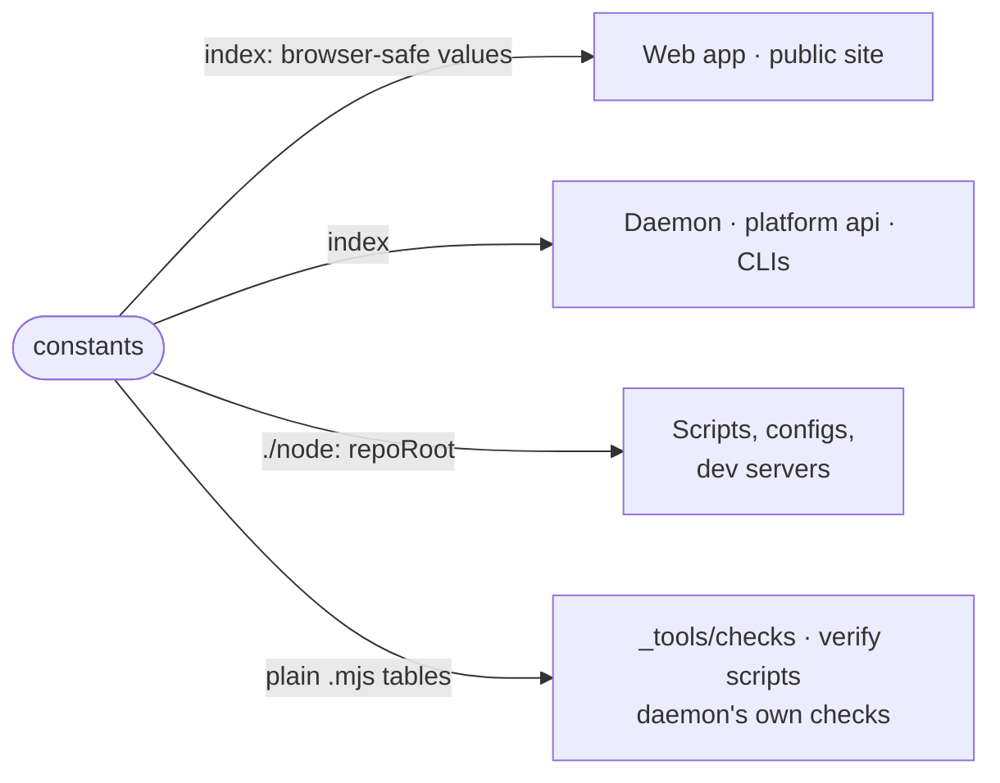

# constants

The values several packages must agree on (ports, workspace paths, origins, install-script URLs, sign-in parameters, name limits, the hosted price ladder), defined once so no copy drifts.



- The index has no Node imports, so the web app and the public site bundle the same values the daemon reads.
  It also carries the provider logos, the arrival profiles (`profile.ts`) and the hosted machine ladder
  (`hosted-tiers.ts`), whose prices the site, the Billing page and the platform config all state.
- The package includes the TypeScript sources selected by `@intentic/src`, so pnpm's injected workspace copies
  can load the index and its modules as well as the compiled exports.
- `turn-preamble.ts` is how a reader outside the sandbox takes the daemon's turn notes off a stored prompt: the
  separator, the two dependency-notice openings, and `stripInjectedPreamble`. Session recall uses it. The daemon
  builds its own notes with the same separator and openings, and its tests check every header it parses against it.
- `./node` holds `repoRoot` and `packageRoot`, which find the monorepo by walking up to `pnpm-workspace.yaml`
  instead of counting `../..`. The `paths` check refuses counted roots.
- The `.mjs` modules (`control-bytes`, `contract-shrink`, `assertion-measure`, `mirror-roots`, `test-suites`,
  `vocabulary`, `ci-infra-steps`, `memory-room`, `allow`, `heavy-rules`, `dev-previews`) are plain JavaScript with `.d.mts` types, so
  the checks and the verify scripts import them by path before any install or build, and the daemon applies the same
  rule from the same file.
- `heavy-rules.cjs` is the one heavy-command table (which programs queue, their pools, max-holds and deadlines, and
  the owner's overrides merged on top); `heavy-hook.cjs` (a `node --require` preload) and `heavy-exec.cjs` (behind the
  sandbox's wrappers for native programs) judge a program by what it is as it starts. CommonJS, so the hook loads
  on any Node an agent's project pins. A rule may also match the program's working directory (`cwd`), name its memory
  price (`size`), and be judged under a program that already holds a slot (`nests`): the editor's `vue-tsc` takes the
  `vue-typecheck` lane, one at a time, from under a `pnpm -r typecheck`. Only a pool no `nests` rule names may wait on
  one that does, so the waits cannot form a cycle. `cargoBuildArgs` translates supported `cargo run` options into
  a build; `heavy-exec.cjs` queues that build in a child and starts the original run once its slot is released.
  Unknown arguments retain the original invocation. The prebuild stays local even when ordinary Cargo builds
  are offloaded, so its artifacts warm the original run.
- (2026-11-19) A repository declares its own heavy commands in `.intentic/heavy.json` (`classes`), which
  `classRules` turns into rules matched before the shipped ones: by script path (`scripts`, the program's arguments
  resolved against its directory, so `python3 scripts/x.py`, `./scripts/x.py` and a worktree's copy are one file) or by
  first words (`commands`), each with its own pool (`group`), limit, MiB price and `exclusive` / `quiet` flag. The
  sandbox's wrappers for interpreters (python3, bash, sh, uv, make) ask node only about an argument named like a
  declared script (`heavyWords`). `heavy-launch.cjs` runs after queue-run's `--` for a match that needs more than a
  slot: it sets cargo's jobs and test threads from the cores and memory it was given (the command's, the
  environment's or the project's own choice wins), waits for a class's idle `cpus` and pins it, and runs the quiet
  lane (`quiet` in the sandbox), printing the load and CPU conditions beside the result.
- `memory-room`'s `SIZE_BYTES` prices a toolchain command by its measured shape instead of its class: `targeted` (a test
  run aimed at named files), `editor-typecheck` (the editor's full `vue-tsc`, 7 GiB) and `scoped-typecheck` (`lsp diag`
  on a Vue package, 4 GiB), and `cargo-build` (7 GiB per admission, based on Shinobi's 2026-11-02 Rust build peaks).
  Two Cargo reservations fit an 18 GiB sandbox with headroom; the price does not cap compiler RSS.
- (2026-11-22) A heavy command is priced at least at what the same command took last time: `heavy/command-peaks.mjs`
  says which runs are one command (the rule, the repository by its git directory and the folder in it, the program, and
  for cargo its subcommand and package and target selectors, never a test filter, `-j`, an environment variable, a
  wrapper, a redirection or a pipe), and `learnedCostBytes` prices it at the larger of its rule's price and its recent
  peak plus 15% (`PEAK_MARGIN`), capped at the sandbox's limit. `memory-room` reads the command queue-run's process runs
  and sends that signature with its ask; the daemon keeps the peaks, measures each run, and answers with the price and
  why, which the wait line quotes. A command never measured is priced as before. Shinobi's owner table priced every
  cargo command at 512 MiB, and one test binary peaked at 13.5 GB.
- `memory-room` is the one formula for whether the sandbox has room (limit, used, free, stall, and what each workload
  class costs). A size may also be a MiB count (`6144m`), a declared class's price. `heavy/memory-floor.mjs` is what the
  `memory-room` command does with a command still short at its deadline: below `START_FLOOR_BYTES` free (a person's
  turn's room) it goes on waiting, naming the biggest processes, and at its `--ceiling` exits 75 so queue-run does not
  start it; above it, it starts as before. The daemon's resource budget judges by it, and it is also the `memory-room` command `queue-run` asks:
  it asks the daemon's room socket, and applies the formula itself where no daemon answers. (2026-11-02) A reading may
  carry `host`, the machine the sandbox runs on as the daemon last heard from it: work nobody waits on then also waits
  while its cost would take that machine under `host.reserveBytes`. Only the daemon adds it, so the fallback formula
  never has a host to answer to.
- `dev-previews` is the record of a conversation's managed dev preview (its demo server): where the records live
  (`/tmp/intentic-previews`), what makes one trustworthy (pid, start tick, conversation stamp, pid namespace), the cap
  of three and the ten-minute idle bound, the conversation's own port in 47150-47199, and how a preview is stopped
  with its reason kept for the next start. The demo's dev script writes the records, the server keeps its own
  current, and the daemon's keeper and the `preview` command read them.
- `./allow` reads the two exception forms every check and guard suite honours: the site pragma
  `// allow(<check>): <reason>` and the commit trailer `Allow: <check> — <reason>`.
- `WORKSPACE_ROOT` and `HISTORY_ROOT` are defaults only: a running daemon reads its real roots from config.

## Key files

- [src/index.ts](src/index.ts) — ports, workspace paths, origins, install scripts and the Google client id.
- [src/node.mjs](src/node.mjs) — `repoRoot` and `packageRoot`, the found-not-counted roots.
- [src/hosted-tiers.ts](src/hosted-tiers.ts) — every hosted machine rung, what it costs to run and what it sells for.
- [src/profile.ts](src/profile.ts) — the named arrival profiles the site, the app and the platform share.
- [src/vocabulary.mjs](src/vocabulary.mjs) — the words this repository retired and what each became.

## Commands

```sh
pnpm --filter @intentic/constants test
```
