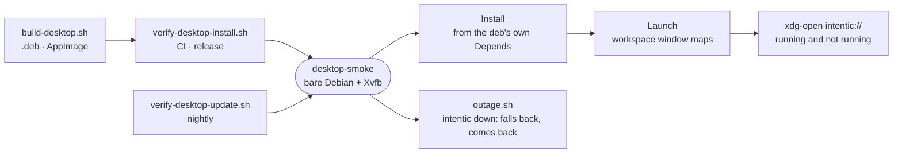

# desktop-smoke

A bare Debian image that installs a built Linux desktop artifact, launches it under Xvfb and fires a real `intentic://` deep link at it.



- The image carries no GUI libraries, so the `.deb` must pull everything it links against through the `Depends`
  field Tauri's bundler writes, which nothing else in the pipeline reads. The AppImage meets the same bare host,
  plus only the libraries its excludelist leaves to the host.
- Assertions read window titles with `xdotool` and observe a local CLI stand-in, selected through `IC_BIN`.
  Accepting the deep link must run that stand-in in the background and keep the workspace's original window.
  The link is fired at a running app (single-instance forwarding) and at one that is not running (startup argv).
- Hermetic: `INTENTIC_APP_URL` points at a stub page baked into the image and `INTENTIC_DISABLE_UPDATE_CHECK=1`
  keeps the updater off.
- `outage.sh`, reached the same way and run by `verify-desktop-install.sh` on the deb when `DESKTOP_SMOKE_OUTAGE=1` (the
  nightly sets it; CI and release leave it out until it has passed there), launches the installed app at a workspace address that does not answer, then at one answering a
  Cloudflare-style 530, each in config, data and cache directories of its own, with the Rust side's calls sent to a
  dead proxy and the platform on a `.test` name. WebKitGTK has no debugger in a release build and the frame is titled
  "Intentic" whatever it shows, so the witness is the address itself (`outage_stub.py` logs every request): the
  offline page is proved by doing what only it does, going back to the address the moment it answers, and by not
  loading the 530 again while it still answers 530. The Windows half, which can read the page itself, is
  `@intentic/desktop-smoke-windows`' `outage` tier.
- `update.sh`, reached by overriding the entrypoint, runs two AppImages built with a throwaway signing key and a
  loopback release endpoint, and asserts the app replaces itself with the newer release and still starts.
- The `FROM` tracks `_tools/ci-base`'s Debian release, because the binary needs at least the glibc it is built
  with. Bump the two together. The floor users are promised is declared separately, in
  `_editor/desktop-app/src-tauri/tauri.conf.json`, and `verify-desktop-bundle.sh` fails a build that outgrows it.

## Key files

- [Dockerfile](Dockerfile) — the bare host and why each package on it is there.
- [smoke.sh](smoke.sh) — the install, launch and deep-link assertions, per artifact kind.
- [update.sh](update.sh) — the self-update drill.
- [outage.sh](outage.sh) — intentic down: the app falls back to its offline page and comes back.

## Commands

Both need only Docker; the install tier reads `_editor/desktop-app/dist-bin` unless given a directory.

```sh
bash _tools/scripts/desktop/verify-desktop-install.sh
bash _tools/scripts/desktop/verify-desktop-update.sh
```
