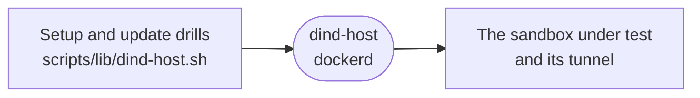

# dind-host

A Docker-in-Docker image the nightly and CI setup drills use as a clean machine: `ic` installs a sandbox into it, off the runner's own Docker daemon and away from other jobs' containers.

- `scripts/lib/dind-host.sh` starts it privileged with an empty `DOCKER_TLS_CERTDIR`, waits for its daemon and runs
  each drill step inside it. `entrypoint.sh` starts dockerd, waits until it answers, then runs sshd in the foreground.
- Published as `ghcr.io/intentic/dind-host`, a single amd64 image the CI drills pull (`INTENTIC_HOST_IMAGE`). Run by
  hand, the drills build it from this directory.

## Key files

- [Dockerfile](Dockerfile) — the dind base plus sshd.
- [entrypoint.sh](entrypoint.sh) — dockerd in the background, sshd in the foreground.
