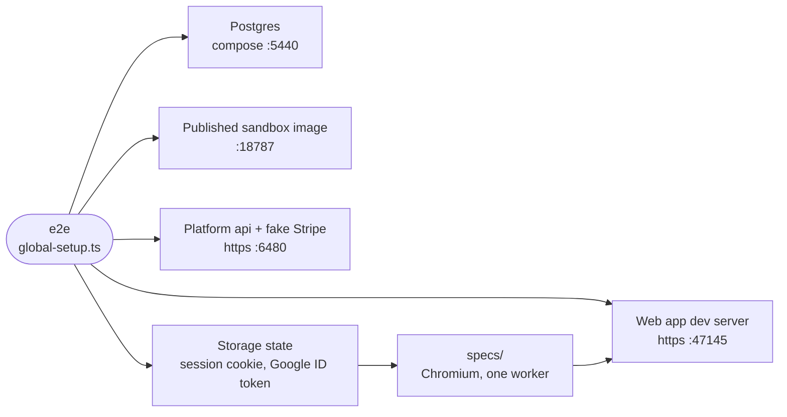

# e2e

Playwright harnesses that drive the real web app in Chromium: the sign-in gate, the N-1 check against the released sandbox, the local-stack browser tier, the post-deploy sign-in smoke, the mobile geometry gate, the desktop app's local face, the site's screenshots and the promo take.



- `signin/` is the sign-in gate, and the platform deploy waits on it (`e2e-signin` in ci.yml). A new person signs in
  four ways: on the web, through the desktop app from a signed-out browser, from a browser already signed in (no
  press), and after "Ask an agent about this" on a file. Everything it runs is what ships: the `vite build` output
  served as the web image serves it (`serve-web.ts`), the api's own app from `_platform/api/src/e2e/browser-api.ts`,
  and Postgres through testcontainers with the migrations replayed. Google is replaced at its two edges only
  (`google.ts`): a fake Identity Services script whose button returns an RS256 ID token, and the matching JWKS
  answered inside the api's process, so Better Auth's real one-tap verification accepts it. The desktop app's half
  (`desktop.ts`) is `auth.rs` in TypeScript: the state and verifier, the `intentic://` links read off Chrome
  DevTools, and the landing the app points its window at. `SIGNIN_E2E_REUSE_BUILD=1` serves the `dist` already there;
  `SIGNIN_E2E_DATABASE_URL` skips the container.
  - 2026-09-30: written after 1.318.0 shipped a router guard that took `handoff` off the desktop sign-in's landing.
    Each piece passed its own tests, and nothing ran the chain. It is Chromium-only and hermetic because it gates a
    deploy: a real Google account in CI would make the gate fail for reasons that are not ours (the smoke below is
    what checks Google itself).
- `compat/` is the N-1 check: today's editor against the daemon owners run. It boots the sign-in tier's stack, then a
  daemon from `ghcr.io/intentic/sandbox:stable` (`COMPAT_E2E_IMAGE` picks another, a version tag or a local build)
  through testcontainers, so it runs in a CI job container as the sign-in tier does. A new person signs in, is given a
  sandbox row pointing at that daemon, and walks the agent board, the files, a chat and the Sandbox page. It fails on a
  call the daemon refused, a read that failed, an uncaught error, any gate left standing, or the "too old" page. The
  daemon runs with its auth off, so its session is seeded in the browser rather than exchanged, which the sign-in tier
  and the daemon's own suites cover. CI runs it as `e2e-compat` before the platform deploys and nightly as
  `compat-stable`.
  - 2026-10-15: written after the editor on main called `org.policy` on every released daemon, none of which had it.
    Pointed at 1.248.0 it stops on the too-old page; with the `org.policy` gate taken out it fails on twelve 404s.
- The browser tier (`playwright.config.ts`, `specs/`) tests the browser-daemon contract. Its stack lives on
  localhost, where a CI job cannot reach it, so it runs on a developer machine. `global-setup.ts` reuses anything
  already running and `global-teardown.ts` stops only what it started.
- Sign-in is seeded: the setup writes a signed Better Auth session cookie and a fake Google ID token in
  `localStorage` into Playwright's storage state, and the daemon runs with `SANDBOX_ALLOW_UNAUTHENTICATED=1`.
- `smoke-signin.mjs` is the one gate that meets Google's real origin check: after each platform deploy, CI opens
  `/login` on app.intentic.dev and asserts the Google button renders. It also opens the desktop sign-in's landing
  with a made-up handoff and asserts the page reaches the api's redeem call instead of stopping on "link is
  incomplete".
- `mobile/audit.mts` walks the hermetic demo build at a phone viewport and fails on blank routes, overflow, small
  targets and scrollers that do not move. `shots/capture.mts` photographs the same build into
  `_site/site/src/assets/product/` (and `product-light/`): the demo's quiet `showcase` recording, wearing the Mist
  wallpaper over Sanctum and over the light look. Both need only Chromium.
- `specs/accessibility.spec.ts` uses axe-core on the seeded full stack: sign-in, sandbox home, a chat message,
  composer and settings. It reports every WCAG 2.1 A/AA finding and fails for serious or critical rule/target pairs
  absent from `accessibility/baseline.json`. Each accepted pair needs a note explaining why it remains. The baseline
  starts empty. `accessibility/scan-demo.mts` scans the backend-free demo and public site on local dev servers;
  findings from the development-only design kit are reported separately from user screens.
- `accessibility/demo.playwright.config.ts` runs the real editor with fixture backends and no sign-in. Its WCAG 2.2
  A/AA axe checks require no violations at any severity across Light, Dark and Sanctum, plus English/Polish reflow at
  320px. Interaction cases cover keyboard bypass, native agent buttons, the command palette, modal focus, office
  loading/error/empty/success states, organisation policy tabs and switches, 200% root text size and OS reduced-motion/forced-colour preferences.
  Off-switch track and handle contrast is measured separately because axe does not detect every non-text contrast failure. These
  checks do not establish screen-reader or legal conformance. `A11Y_DEMO_URL` reuses an explicitly chosen demo;
  without it the suite starts its own server on port 47237 and refuses to reuse another session's server.
- `local-face/` boots the desktop app's local face (`_editor/desktop-app`, `dist/files`, built by its global setup) the
  way a window on a folder boots it, without Tauri: the bundle behind a server that resolves paths as the app's asset
  protocol does, the real `intentic-files` sidecar from source granted a temp folder on its stdin, and
  `__INTENTIC_LOCAL__` injected before any script. It lists, opens, edits and saves, and fails on an uncaught error,
  a console error, a request leaving loopback, or any sidecar request answering 404, printing the unserved paths.
  CI runs it as `local-face` whenever the desktop app's graph moves. `LOCAL_FACE_REUSE_BUILD=1` skips the rebuild.
- `window-sync/` runs the app's floating-window hand-off modules in a bare page; [promo](promo) records the
  product video.

## Key files

- [signin/signin.spec.ts](signin/signin.spec.ts) — the sign-in gate: web and desktop sign-in, end to end.
- [compat/compat.spec.ts](compat/compat.spec.ts) — the N-1 check: this commit's editor on the released daemon.
- [stack.ts](stack.ts) — origins, ports, seeded rows and the Better Auth cookie recipe.
- [global-setup.ts](global-setup.ts) — boots the stack in order and writes the storage state.
- [playwright.config.ts](playwright.config.ts) — the browser tier: serial, one retry, seeded session.
- [smoke-signin.mjs](smoke-signin.mjs) — the post-deploy check against Google's real origin check.
- [mobile/audit.mts](mobile/audit.mts) — the phone geometry gate.
- [accessibility/audit.ts](accessibility/audit.ts) — shared WCAG 2.1 A/AA axe scan and per-rule summaries.

## Commands

```sh
pnpm e2e:signin                                   # builds the web first; needs Docker
pnpm e2e:compat                                   # the same, plus a daemon from :stable; COMPAT_E2E_IMAGE picks another
pnpm e2e:browser                                  # SANDBOX_E2E_IMAGE picks the daemon image
pnpm e2e:mobile                                   # builds the demo first
pnpm e2e:local                                    # builds the local face first
pnpm -C _site/demo dev --port 47160                # separate terminal, backend-free editor
pnpm -C _site/site dev --port 47149                # separate terminal, public site
node --experimental-strip-types _tools/e2e/accessibility/scan-demo.mts
node --experimental-strip-types _tools/e2e/shots/capture.mts [--light | --desk] [shot names]
pnpm --filter @intentic/e2e smoke:signin https://app.intentic.dev
cd _tools/e2e && pnpm exec playwright test -c window-sync/window-sync.playwright.config.ts
pnpm -C _tools/e2e exec playwright test -c accessibility/demo.playwright.config.ts
```
