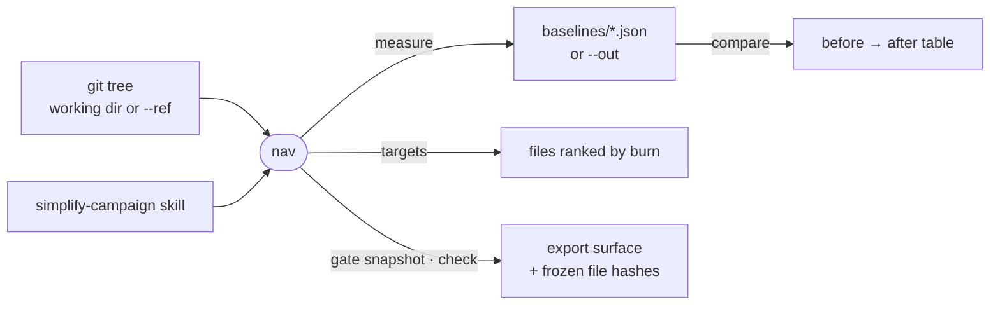

# nav

Measures what the codebase costs an agent to read, in tokens, and checks that a refactor removed no export, so a decomposition round is judged by numbers.



- Offline and deterministic. Tokens come from a character-based estimator in `lib/tokens.mjs`: an absolute count is order-of-magnitude, a delta is real. `calibrate` checks the estimator's chars-per-token band; `NAV_TOKENIZER=real` uses `gpt-tokenizer` when installed, and `compare` refuses to mix the two.
- `targets` ranks files by burn: the tokens spent on a file across every lookup that lands in it.
- `gate.mjs check` fails when an export that existed at the snapshot is gone or a frozen file (SQL, Prisma, migrations, locales, schemas, OpenAPI, the api and sandbox contracts) changed. Moving an export is free and growth is expected.
- `baselines/` holds the retained `baseline.json` / `head.json` comparison and ignored local measurements. Workspace search excludes this directory because its historical symbols and paths are not current source. Take a fresh export snapshot for each refactor; the retired September export snapshot and intermediate measurements remain in git history.
- `trend.mjs` is the nightly record (`nav-trend` in `.github/workflows/nightly.yml`): the job measures the tree with `--out`, keeps the JSON as a 90-day `nav-trend` artifact, finds the last nightly that kept one (`previous-run`, whatever that run's other tiers did), and writes the before → after table to the job summary (`summary`, the same rows as `compare` through `lib/compare.mjs`). It fails nothing; the first night says there is no previous record.
- Working-tree measurements include tracked files and untracked, nonignored additions, and omit deleted paths. `--ref` reads only that committed tree. Both use git listings rather than directory walks.
- `--in` scopes source, tests and internal import metrics to a repository-relative directory or file. Imports outside that scope are excluded from the graph. Scope does not limit the frozen-file guard: it still protects frozen files throughout the repository.
- `structure-stats.mjs` reads conversation transcripts under `HISTORY_ROOT` to measure what finding a symbol costs, where `bench.mjs` measures opening one.

## What the numbers mean

| Section | Measures | Better is |
| --- | --- | --- |
| Size | physical, code, and comment+blank lines, plus tokens; read the rows together | lower |
| Can an agent load it | files over 32k and 128k tokens | lower |
| Shape | file and function length, complexity, if/else chains, nesting; tests excluded | lower |
| Naive lookup (`bench.mjs`) | tokens to read the defining file of every first-party import in the tests | lower |
| Skilled lookup (`lookup.mjs`) | grep plus a read window over a seeded sample, paired by symbol name | lower |
| Fixed tasks (`replay.mjs`) | owning file tokens, simulated read-window tokens, literal search output and recorded missing paths for stable symbols | compare each row; this is a simulation, not measured agent time |
| What it cost | modules, import edges, fan-out, largest cycle | expected to rise; judge by how much |

## Key files

- [run.mjs](run.mjs) — `measure`, `targets`, `compare` and `calibrate`.
- [lib/compare.mjs](lib/compare.mjs) — the before → after rows `compare` prints and the nightly trend renders.
- [gate.mjs](gate.mjs) — `snapshot` and `check` of the export surface and frozen files.
- [metrics.mjs](metrics.mjs) — the size, shape and cost numbers.
- [lib/tokens.mjs](lib/tokens.mjs) — the token estimator and the optional real tokenizer.
- [replay.mjs](replay.mjs) — fixed task measurements; `sandbox-tasks.json` records symbols and sampled session identifiers.

## Commands

```sh
node _tools/nav/run.mjs measure --label baseline
node _tools/nav/gate.mjs snapshot --out _tools/nav/baselines/surface.json
node _tools/nav/run.mjs targets --top 20
node _tools/nav/gate.mjs check _tools/nav/baselines/surface.json
node _tools/nav/run.mjs compare _tools/nav/baselines/baseline.json _tools/nav/baselines/head.json
node _tools/nav/run.mjs measure --out /tmp/nav/after.json
node _tools/nav/trend.mjs summary /tmp/nav/before.json /tmp/nav/after.json
```

For a scoped before/after pair, keep the tokenizer, scope and task list identical:

```sh
node _tools/nav/run.mjs measure --in _sandbox/sandbox/src --tasks _tools/nav/sandbox-tasks.json --out /tmp/nav/before.json
node _tools/nav/gate.mjs snapshot --in _sandbox/sandbox/src --out /tmp/nav/surface.json
# Apply the refactor, then run the same measure command with --out /tmp/nav/after.json.
node _tools/nav/gate.mjs check /tmp/nav/surface.json
node _tools/nav/run.mjs compare /tmp/nav/before.json /tmp/nav/after.json
node --test _tools/nav/lib/files.integration.test.mjs
```

`targets` also accepts `--in`. `gate check` inherits its snapshot's scope; `compare` refuses different scope strings.
The fixed task JSON is an array of `{ task, symbol, session?, guessedPaths? }`. Symbols may be private but must have
exactly one definition in the measured source. Guessed paths are repository-relative and retained across runs;
a renamed file does not erase an earlier session's wrong guess. `replay` is stored in each measurement JSON, and
`measure` prints each task's owning file and estimated file/window tokens. The aggregate `compare` table remains
the general navigation benchmark; compare the same `replay` symbols separately for a task-level result.

The simulated lookup uses the existing read-window model; literal search rows count substring matches in source
and tests separately. Neither runs `iq`, executes an autonomous session, nor measures elapsed task time. A smaller
file can reduce whole-file reading while leaving a skilled window unchanged or increasing import-line matches.
