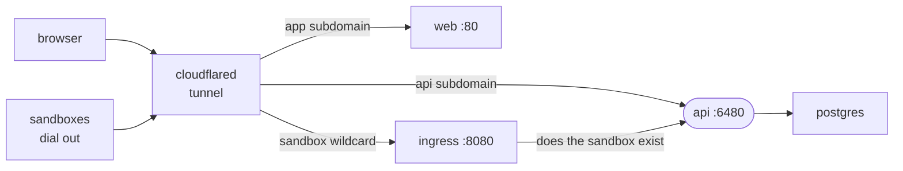

# Self-hosted platform

A Docker Compose stack that runs the intentic platform on a host of your own: Postgres, the api, the web app and the sandbox edge, published through a Cloudflare tunnel.

- It runs sign-in, the sandbox registry and setup; the sandboxes themselves run elsewhere.
- Every optional setting passes through empty, and the api reads empty as unset, so defaults live only in [config.ts](../../../_platform/api/src/config.ts). Compose forwards only what it names: a new config field needs its line in [docker-compose.yml](docker-compose.yml) too.
- Optional lanes switch on with their credentials: the free trial, hosted sandboxes on Fly, the paid hosted plan, the `/admin` surface (`ADMIN_EMAILS`), email (sign-in codes and invites) and tracing. [.env.example](.env.example) explains each one.
- Without the `ingress` service and `INGRESS_SIGNING_KEY`, no sandbox can be made reachable and setup offers only the attach lane. This file runs the edge on one host; a platform with hosted sandboxes runs it on Fly instead ([ingress](../../../_platform/ingress)).

## Setup

## Security requirements for self-hosting

Encrypt the host disks that hold `/work`, `/history`, the auth volume, and backups: use LUKS/dm-crypt on Linux or
BitLocker on a Windows host running WSL/Docker. Store the disk recovery key separately and test restoring a backup.
The sandbox's optional store encryption covers four auth-root JSON files containing pasted secrets, capability and
extension credentials, and privacy-shield values, plus provider account JSON files, in copied volumes and backups. It does not encrypt `/work`,
`/history`, runtime-owned native CLI login files, or arbitrary application data. A root process in a running sandbox can still read
decrypted values; this is not a barrier against the agent.

For an `ic` sandbox, put a 32-byte random key in the office's key store, expose it as a host file **outside all sandbox
volumes**, and set `INTENTIC_AT_REST_KEY_HOST_FILE` to its absolute path when connecting the sandbox. `ic` mounts it
read-only at `/run/secrets/intentic-at-rest-key` and sets `INTENTIC_AT_REST_KEY_FILE` in the container. The file may
contain 32 raw bytes, 64 hex digits, or base64 of 32 bytes. Keep a recoverable copy of each key with the backup:
without it, encrypted stores cannot be opened. To rotate, mount the new key as the active file, mount the old key
separately with `INTENTIC_AT_REST_PREVIOUS_KEY_HOST_FILE` when reconnecting; `ic` sets
`INTENTIC_AT_REST_PREVIOUS_KEY_FILE` to its read-only mount. Restart the sandbox. Boot re-encrypts the covered stores
under the new key; reconnect with `INTENTIC_AT_REST_DROP_PREVIOUS_KEY=1` after confirming the restart and backup to
remove the previous-key mount. Do not remove either key
while backups still depend on it. For a manually composed sandbox, use Docker Compose `secrets:` with a host file
outside the volumes, mount it at `/run/secrets/intentic-at-rest-key`, and set `INTENTIC_AT_REST_KEY_FILE` to that path.

1. `cp .env.example .env`. Generate `BETTER_AUTH_SECRET` and `SECRETS_KEY` with `openssl rand -base64 48`, and keep `POSTGRES_PASSWORD` URL-safe.
2. Google sign-in uses the client whose id is `GOOGLE_CLIENT_ID` in [constants](../../constants/src/index.ts). Put its id and secret in `.env` and authorize `WEB_ORIGIN` as a JavaScript origin and `API_URL/api/auth/callback/google` as a redirect URI. Google is optional but recommended: without it the login page offers only email codes, and nobody gets the free hosted machine, the trial or the Repair agent, which need a Google sign-in.
3. For sign-in by emailed code, set `EMAIL_API_KEY` and `EMAIL_FROM` (Resend), and put an Ed25519 key of its own (not the ingress pair of the next step) in `IDENTITY_SIGNING_KEY`, made with `openssl genpkey -algorithm ed25519` and written on one line the same way. Without the mail settings only Google is offered. Without the key, a person who signs in by email reaches a sandbox only with a passkey, or as the owner of a hosted one.
4. Make an Ed25519 pair with `openssl genpkey -algorithm ed25519 -out ingress-key.pem` and `openssl pkey -in ingress-key.pem -pubout`. The private half goes in `INGRESS_SIGNING_KEY`, the public half in `INGRESS_PUBLIC_KEY`, each on one line with `\n` escapes inside double quotes. Set `INGRESS_ZONE` and `INGRESS_URL`.
5. Create a Cloudflare tunnel, put its token in `PLATFORM_TUNNEL_TOKEN`, and add public hostnames: `app.<zone>` → `http://web:80`, `api.<zone>` → `http://api:6480`, and both `ingress.<INGRESS_ZONE>` and `*.<INGRESS_ZONE>` → `http://ingress:8080`.
6. `docker compose up -d`. The api applies migrations before it serves, and dumps the database into the `migration-backups` volume first whenever there is one to apply. A failed dump stops the boot; [the api README](../../../_platform/api/README.md#restoring-from-a-pre-migration-backup) says how to restore one.
