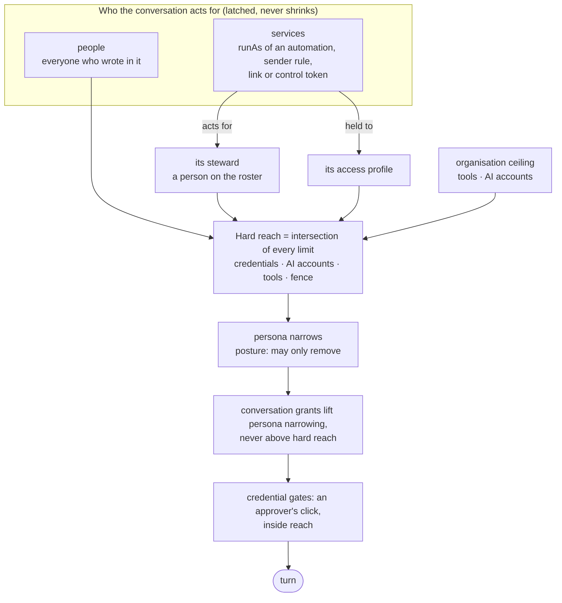

# Access

Every turn acts for someone, and what it may reach is decided by who that is: the people who wrote in its conversation, or the service an unattended run acts as, each held to an access profile. A persona only shapes how the turn behaves inside that.

## Four nouns

- **A principal** is who a turn acts for. A *person* is the owner or someone on the roster ([`members.ts`](../../_shared/sandbox-contract/src/schemas/members.ts)). A *service* ([`services.ts`](../../_shared/sandbox-contract/src/schemas/services.ts)) is a named non-human, such as "Marketing bot" or "Nightly fixer", that a person stewards. Automations, sender rules, inbound links and control tokens run as a service by naming it in `runAs`.
- **An access profile** ([`access-profiles.ts`](../../_shared/sandbox-contract/src/schemas/access-profiles.ts)) is the hard layer: the areas a holder sees and edits, whether their conversations run agents, the connections and secrets they may spend, the AI accounts their turns may run on, a ceiling on tools, and which assistants a guest talks to. It is named and reusable, and one shape serves both kinds of principal, so an intern and the marketing bot can hold the same one. A person holds one profile or answers of their own written on their row. A service holds one profile or none.
- **A persona** is posture: prompt, skills, briefing, preferred models, starting folder and the accounts it speaks through. It can narrow what a turn reaches (a read-only reviewer, a card that only posts as `reddit-work`), and it never widens it.
- **An assistant** is how someone reaches an agent. A guest's assistants are the personas their profile lists, or every persona that works in their areas. An outward assistant (a website chat, a Discord bot) is a listener automation: its persona, the service it runs as, and its sender rules.

## How a turn's reach is worked out

The conversation latches who it acts for as its turns begin ([`identity-latch.ts`](../../_sandbox/sandbox/src/conversations/actor/identity-latch.ts)): `people` grows with each person who asks it for a turn, and `services` with each service a turn runs as. Neither ever shrinks, and a spawned child or a peer's message brings its speaker's along. What the conversation may reach is then the intersection of every limit in that chain ([`principal-chain.ts`](../../_sandbox/sandbox/src/access/principal-chain.ts)), read live on every use:

| Limit | Comes from |
| --- | --- |
| A person | their roster row: the owner every answer, anyone on the roster what their row says (a maintainer runs every tool but may be held to some AI accounts, connections and secrets), someone no longer on the roster nothing |
| A service | its steward, as a person above, intersected with its profile. A service, steward or profile that no longer exists reaches nothing |
| The organisation | the ceiling a bound sandbox's policy carries, on tools and AI accounts |

That intersection decides four things, each where the daemon already enforced it for people:

- **Credentials**: a capability outside it is never mounted, its variables and skill are left out, and every exit that spends a secret refuses it ([`credential-reach.ts`](../../_sandbox/sandbox/src/secrets/credential-reach.ts)).
- **AI accounts**: a turn naming an account outside it is refused, one left to the sandbox's pick runs inside it, and a conversation remembering one outside it is moved ([`account-reach.ts`](../../_sandbox/sandbox/src/agent/run/decide/account-reach.ts)). The editor reads the same list off `GET /members/self` and applies the same rule ([`aiReach.ts`](../../_editor/web/src/models/providers/aiReach.ts)), so nothing is found out at Send. A provider none of whose accounts the person may use is "not shared with you": the model picker folds it behind one row and refuses its rows, with no Connect beside them. A new chat opens on a model they may use. A chat sitting on a model they may not use says so above the composer, offering another model, or a request to the owner when nothing is theirs. A model counts as spent when the person's own accounts are. The editor reads the person's own row only: an organisation's ceiling and the other people in a shared conversation are held by the daemon alone.
- **Tools**: the ceiling caps the persona's shelves after conversation grants are laid over them, so neither a card nor a grant lifts a shelf the chain withholds ([`turn-premise.ts`](../../_sandbox/sandbox/src/agent/run/decide/turn-premise.ts)). An agent asking for such a shelf with `grants request` is refused rather than shown a card, since no answer could open it.
- **The fence**: a conversation is born inside its starter's areas. A service's run is born inside its steward's areas intersected with its profile's, as area ids.

## Services

A service always acts for its steward, so the oldest rule here still holds for unattended work: an agent never holds more than the person it acts for. A steward is the owner or someone on the roster who runs agents here. The profile narrows that further, and naming one is how unattended work stops reaching everything its steward can.

- Before a fire starts a turn, the daemon checks the service still stands ([`service-standing.ts`](../../_sandbox/sandbox/src/access/service-standing.ts)). One whose steward left the roster, or whose service or profile was deleted, is recorded as skipped with that reason rather than run on nothing.
- An automation save is refused when its persona speaks through an account its service's profile leaves out, or when none of the models it may run on is an AI account the service may use: the run could only fail.
- `runAs` left out keeps what unattended work always did: it acts for the sandbox's owner with no profile, and the No accounts posture keeps signed-in accounts away from it.

## Profiles on a person

A member's row holds either answers of its own or `profile: <id>`. A row holding a profile carries that profile's answers written out on it, so every reader of the row (the route floors, the authorizer, the platform's copy of the tier, the presence list) reads one shape. Saving a profile rewrites the rows of everyone who holds it and closes their open sockets, as a re-grade does, and answers with each holder's tier so the editor can bring the platform's copy along. A profile cannot make a maintainer: that tier holds the owner's operating authority and is granted to a person, never through something shared.

## Where a person's access ends

A person below the owner opens the same editor, so every place, press and read has to know what they may do before it
is drawn. One check answers that on both sides: the daemon refuses with it ([`member-reach.ts`](../../_shared/sandbox-contract/src/protocol/member-reach.ts)
`memberRefusal`: each route's floor, a guest's list, running agents off), and the editor asks the same function over the
same facts (their tier and `GET /members/self`) through [`useAccess`](../../_editor/web/src/client/sandbox/access/useAccess.ts).
A route whose handler holds a stricter tier declares it as its floor too (`GET /members` is the owner's), so the
declaration tells the truth.

- **Nothing is sent that would be refused.** The fetch layer asks the check before every request to the active
  sandbox ([`forecast.ts`](../../_editor/web/src/client/sandbox/access/forecast.ts)) and answers a refusal itself, in the
  daemon's own body marked `predicted`. A read refused that way is `locked`, not failed: never retried, never logged as
  a failure, never drawn as "couldn't load", and the background loader counts it as done. A refusal the editor did not
  foresee asks for the person's access again, since its record is stale, and is reported as `query.refused`.
- **A refusal is said in the app's words.** Its reason (a tier, agents off, a guest's door, a folder outside the areas,
  an organisation's lock) reads as one sentence from [`accessWords`](../../_editor/web/src/client/sandbox/access/accessWords.ts),
  wherever it is drawn, never as "maintainer access required".
- **What it looks like** depends on what was refused. A place the person can never open is not in the rail, the hub,
  the palette or search, and a link to it opens a gate saying who it is for (`AccessGate`), never a silent redirect. A
  place they can read but not change is drawn read-only, its edit controls gone and one quiet line saying why
  (`AccessNote`). The one press they came for becomes an explained substitute (Request land, a read-only composer, a
  card saying whom it waits on); every other press they cannot make is not drawn. A tone is never `danger`: being
  read-only is how the place is for them, not something that broke.
- **They can ask.** The gate and the line carry "Ask for access" (`POST /members/requests`), which records what stood
  in the way and where they were ([`access-requests.ts`](../../_sandbox/sandbox/src/auth/members/access-requests.ts)). The
  owner sees the requests above the roster on Access ▸ People and counted on the sandbox's attention; granting the
  person anything answers theirs, and the asker's own answer says they asked. An organisation's lock and the owner's
  own tier offer no ask: no grant could change them.
- **Checked by walking it.** The demo's daemon holds `?as=<tier>` to the same floors ([`floors.ts`](../../_site/demo/src/floors.ts)),
  and [`demo-access.spec.ts`](../../_tools/e2e/access/demo-access.spec.ts) walks every screen as a maintainer,
  collaborator, viewer and guest, failing on any request the daemon refused and any refusal shown in its words.

## Where it is stored

Profiles and services are on the history volume beside the roster (`identity/access-profiles.json`, `identity/services.json`), and they do not travel with an export bundle. An automation that arrives in another sandbox naming a service that sandbox lacks is skipped with that reason until someone gives it one there.

## Organisations

A bound sandbox's policy may carry profiles of its own and a ceiling ([`organisation.ts`](../../_shared/sandbox-contract/src/schemas/organisation.ts)). The organisation's profiles are listed beside the sandbox's own as read-only, and a local profile cannot take one of their ids. The ceiling (tool shelves switched off, the AI accounts every turn is held to) is one more limit in every turn's chain, the owner's included. Writing profiles and services counts as a change to the Access section, so locking Access locks them too ([`org-locks.ts`](../../_shared/sandbox-contract/src/policy/org-locks.ts)).

## Decisions

- **Posture and access are two things** (2026-10-26). Before this, a persona was soft for a watched chat and the only boundary for an unattended one, since a run with no person in its conversation reached every credential and every AI account. The same card meant two things depending on whether anyone was watching, and an automation had no owner to answer for it.
- **A service acts for a person** (2026-10-26). The alternative was a service with authority of its own. Tying it to a steward keeps one rule for all work, makes a leaver's automations stop by construction, and gives spending and audit a person to name.
- **One profile per principal** (2026-10-26), not a union of several: `agents` (off, chat, run, home) has no union that means anything. Sharing one profile between holders is the reuse.
- **Written onto the row** (2026-10-26). Reading a member's profile live at every request was the alternative. Every reader of the roster, the platform's copy of the tier included, would then have had to learn profiles at once, and a profile edit would have moved tiers with nothing telling the platform.
- **Off the workspace** (2026-10-26), unlike areas, which are tracked so their edits show up in review. A profile bounds unattended runs, and a run that could edit the file bounding it would hold nothing; the roster left the workspace on 2026-10-06 for the same reason.
- **The built-in personas stay, as postures** (2026-10-26). The first sketch removed Full access and No accounts. Automations and links already name them, and once the ceiling comes from the chain they are exactly the two postures worth having built in.
- **Access is a state, not an error** (2026-10-26). Before this the editor asked first and drew whatever came back: a
  viewer met red "maintainer access required" notices with a Try again that could never work, a composer that looked
  live, cards saying "Waiting on you" for answers the daemon refused them, hub links that bounced to Overview without a
  word, and a guest's shell polled about two refused reads a second. Gating each surface by hand had already been tried
  (159 places, six treatments, about forty-five phrasings); predicting every refusal from the contract in one place is
  what keeps a new surface from regressing.
- **Managing is not spending** (2026-10-27). Full access (the maintainer tier) used to refuse any list of AI accounts or
  credentials, on the grounds that a person who can open a terminal and reveal secrets would hold a line on a screen
  rather than a boundary. Owners needed people who change every setting, providers included, while their turns run only
  on the accounts picked for them, and the alternative was a member tier that sees almost none of the sandbox. A
  maintainer's row now carries both lists like anyone's and every turn worked for them keeps to them; the terminal and
  revealing a secret still reach past them, which the panel says, so the limit is a rule for people trusted to operate
  the box. A tool ceiling and a profile stay refused on a maintainer.
- **The sandbox cannot open its own network fence** (2026-10-27). A sandbox's outbound traffic to private networks is
  fenced by `ic` on the host ([`egress.ts`](../../_shared/sandbox-contract/src/schemas/egress.ts)), off by default.
  Tightening it is any maintainer's device op. Loosening it from the editor needs the owner's passkey over the exact
  change: the daemon is inside the boundary the fence draws, so a rule it could relax by itself would hold nothing
  against a turn that owns it. The editor signs the change document, the daemon relays it with the owner keys it holds
  ([`egress/owner-keys.ts`](../../_sandbox/sandbox/src/hosts/egress/owner-keys.ts)), and the machine agent checks the
  signature against the keys it pinned for the sandbox. An owner with no passkey adds one under Access ▸ Sign-in, or
  changes the fence on the machine itself with `ic sandbox egress`.
- **Previews follow the roster** (2026-10-27). With the preview guard on, a pass goes to the owner and to anyone on the roster above a guest, checked when the editor asks for one. A guest reaches its assistants, not the workspace's apps. A pass does not name its holder, so a change that takes someone's previews away replaces the key, and every member's browser fetches a new pass with its next preview. The alternative was netd asking the daemon about each request, which would have put the daemon on the path of every byte a preview loads ([sandbox.md](sandbox.md#the-process)).
- **No separate assistant record** (2026-10-26). An outward assistant is already a listener automation (persona, `runAs`, sender rules), and an inward one is a persona a profile lists. A third record would have said the same thing twice. Under a guest's own authority the guest's fence still has to hold an assistant's starting folder, so a listed assistant must work in the guest's areas.

## Key files

- [access-profiles.ts](../../_shared/sandbox-contract/src/schemas/access-profiles.ts): the profile, its tool ceiling and how it caps a persona's shelves.
- [services.ts](../../_shared/sandbox-contract/src/schemas/services.ts): the service principal.
- [principal-chain.ts](../../_sandbox/sandbox/src/access/principal-chain.ts): who a conversation acts for, resolved to limits.
- [credential-reach.ts](../../_sandbox/sandbox/src/secrets/credential-reach.ts): credentials and AI accounts within the chain.
- [service-standing.ts](../../_sandbox/sandbox/src/access/service-standing.ts): whether a service may still run.
- [member-reach.ts](../../_shared/sandbox-contract/src/protocol/member-reach.ts): the one check a request meets, asked by the daemon and the editor alike.
