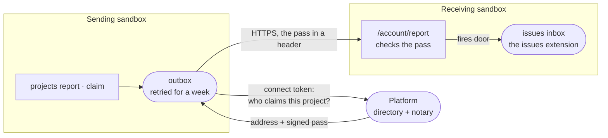

# Account-level routing

One person is in several sandboxes: their own, and others where they were given a tier. Account-level routing lets one of those sandboxes send something to another without the person carrying it by hand. The platform says where the other sandbox is and signs a short pass saying who is asking. What travels goes straight from one daemon to the other, so the platform never holds it.

A report is keyed on the sending sandbox's owner and the project's claim. Everything else (a drop, a read, a task) is keyed on the person a conversation acts for, by one rule:

> An agent acting for a person may move things between sandboxes only where that person could do it by hand, with their own access in each.

The outbox, the pairings and the inbox are on the history volume, out of the agents' reach.

## What exists

**Project claims.** A claim says which of the owner's sandboxes answers for a project, named the way its remote names it (`github.com/acme/app`, [`project-id.ts`](../../_shared/sandbox-contract/src/ids/project-id.ts)). The platform keeps one claim per project per account (`ProjectClaim`).

Only the owner, signed in to the platform, writes a claim ([`projects.orpc.ts`](../../_platform/api/src/projects/projects.orpc.ts)). There are three ways to make one:

- **On a card.** An agent proposes one with `projects claim <project>`. That raises a `claim` need in its chat ([`claim-need.ts`](../../_sandbox/sandbox/src/needs/kinds/claim-need.ts)). The owner's press on the card calls the platform from their own browser, then answers the need. The daemon meets the need once the platform lists the project for this sandbox.
- **From a suggestion.** Settings ▸ Projects lists what the open sandbox's repos could claim. The daemon reads each repo's origin, including a brokered remote, for the upstream it stands for ([`project-suggestions.ts`](../../_sandbox/sandbox/src/account-routing/project-suggestions.ts), `GET /account/projects/suggest`). `projects suggest` prints the same list.
- **By hand**, in Settings ▸ Projects.

A claim another sandbox held moves to the new one.

**The directory and the pass.**

- **Asking.** A daemon asks `POST /projects/resolve` with its connect token. The connect token is the only word on who is asking: `from` is read from it, and only that owner's claims are searched ([`projects.routes.ts`](../../_platform/api/src/projects/projects.routes.ts)).
- **The answer** is the claiming sandbox's address and a pass. The pass is an Ed25519 statement under the platform's identity key, prefixed `sp1.` so it can never stand in for an identity assertion. It names both sandboxes and the project, and lives ten minutes ([`sandbox-pass.ts`](../../_shared/sandbox-contract/src/protocol/doors/sandbox-pass.ts)).
- **Checking.** The receiving daemon checks the pass against the key it learned from its own announce.

**The outbox** ([`account-outbox.ts`](../../_sandbox/sandbox/src/account-routing/account-outbox.ts)). A sandbox that is asleep or offline cannot take a report.

- What cannot be delivered waits, one file per entry, on the history volume (`account-outbox/`), out of every turn's reach. It sat in `.intentic/records/outbox/` before 2026-11-24, where an agent could rewrite a queued report before it drained; a boot step moves what waited there.
- An entry is a `report` or a `drop`, with the one person it routes as when there is one. Each kind is delivered by its own hook; a drop with none registered waits.
- A repeated report folds into a count.
- Waiting entries are retried with a growing wait for up to a week.
- `projects outbox` says what waits and why.

**Scopes on the pass** ([`sandbox-pass.ts`](../../_shared/sandbox-contract/src/protocol/doors/sandbox-pass.ts)). A pass names what it admits its holder to: `report`, `drop`, `read` or `task`, and for every scope but `report` the one person it routes as (`sub`).

- Only a report pass carries a project. A daemon from before scopes reads any pass with a project as a report, which is why no other scope may carry one.
- An unknown scope is refused, never misread.

**The route** ([`route-resolve.ts`](../../_platform/api/src/projects/route-resolve.ts), `POST /projects/route`). It answers a pass for one scope.

- **The person must be on the asking sandbox**: its owner, or a member who accepted. Otherwise it answers 403.
- **The target is a sandbox that person also reaches**, whoever owns it. A report finds its target by the project's claim among those sandboxes; with no person named, the asking sandbox's owner's own claims decide it, as `/projects/resolve` does. Every other scope names its target by id or name.
- **Ambiguity is the sender's to settle.** When two sandboxes the person is in claim the project, or share the name, it answers 409 with the candidates.

So a sandbox can only ever name its own people, toward sandboxes those people are already in.

**Who is asking** ([`who-asks.ts`](../../_sandbox/sandbox/src/account-routing/who-asks.ts)). A send names its conversation, and the daemon believes the name only with the turn proof beside it (`x-intentic-turn-proof`, [`workload-stamp.ts`](../../_sandbox/sandbox/src/seams/workload-stamp.ts)), as fleet reads do.

- A proven conversation acts for the people its principal chain names ([access.md](access.md)), or the owner when it names none.
- Exactly one person rides the pass.
- A conversation acting for several people can only report, naming nobody.
- With no proven conversation there is nobody: only a report goes, naming no person. A maintainer's shell or a background job never routes as the owner.
- A turn that may not hand work on (started by outside content, or its role does not delegate) may not send at all.

**Resolving** ([`route-client.ts`](../../_sandbox/sandbox/src/account-routing/route-client.ts)). The daemon asks `POST /projects/route` for a scope, a person and a target.

- It keeps each answer per (scope, person, target) until a minute before its pass expires.
- It asks once more when the far side refuses the pass in its own words. The bare `unauthorized` of a daemon too old for the door is not that.
- Several sandboxes claiming one project answer 409, a refusal naming each of them.
- A platform without the route answers 404 for the route itself; a report then asks `POST /projects/resolve`, as reports always did.

**The door** ([`account.routes.ts`](../../_sandbox/sandbox/src/account-routing/account.routes.ts)), `POST /account/report`:

- It admits only a report pass addressed to this sandbox, through the admission every pass-admitted door shares (below).
- A person on the pass is attribution only. Kept on the issue's sender when this sandbox's roster knows them, it puts them on the wake's title ("From ops for ada@acme.test"); otherwise the report is filed without one.
- It hands the report, with the sender the pass names, to the extension that owns the `issues` listener (intentic.issues), through that extension's `account-report` fire handler: the backend host's fires door, which no person's, panel's or agent's token reaches, so the sender stays the platform's word. The extension files it through its intake's own pipeline: grouped by fingerprint, waking an agent only when the problem is new or escalated. With no issues intake set up, it is still recorded, under `account`, and wakes nobody.
- Nothing is kept at the door. While no extension keeps the inbox (it is not installed or switched off, or its backend is restarting), the door answers 503 and the sending sandbox's outbox keeps the report and tries again for a week, so installing the extension later still delivers it. (2026-11-26: until then the daemon filed it into an inbox of its own, which left the core for the extension.)

**The pairing** ([`pairings-store.ts`](../../_sandbox/sandbox/src/account-routing/pairings-store.ts), [`route-secrets.ts`](../../_sandbox/sandbox/src/account-routing/route-secrets.ts), [`pairing.routes.ts`](../../_sandbox/sandbox/src/account-routing/pairing.routes.ts)). The platform's word alone opens nothing but an inbox: every other scope also needs a secret the person gave the asking sandbox.

- The person gives it once per pair of sandboxes, by pressing Allow on a `route` card in the asking sandbox ([`route-need.ts`](../../_sandbox/sandbox/src/needs/kinds/route-need.ts), [`NeedRouteBody.vue`](../../_editor/web/src/features/needs/routing/NeedRouteBody.vue)). A send that finds no secret raises the card ([`require-pairing.ts`](../../_sandbox/sandbox/src/account-routing/require-pairing.ts)); `projects allow <sandbox>` asks ahead. Only that person may press it.
- Their editor is signed in to both. The press mints the secret at the target (`POST /account/pairings`, for the signed-in person themself, never a guest), then keeps it here (`POST /account/routes/secret`).
- The receiving sandbox stores the SHA-256 of the 32-byte secret per (asking sandbox, person) on its history volume (`account-pairings.json`), not on the member row, since the owner has none. `GET /account/pairings` lists one's own, and `DELETE /account/pairings/{from}` revokes one; a maintainer lists and revokes anyone's.
- The asking sandbox stores the secret in its auth root beside the vault (`route-secrets.json`, mode 0600), where no agent reads it. `GET /account/routes` lists what it holds, never a secret.
- The secret rides beside the pass as `x-intentic-route-secret`.
- So a platform breach cannot read or act in a sandbox as its people, as [topology.md](topology.md#trust-model) promises.

**The receiving checks** ([`admit-route.ts`](../../_sandbox/sandbox/src/account-routing/admit-route.ts)), at every pass-admitted `/account/*` door, cheapest first:

- The pass: signed by the platform's key, addressed to this sandbox, for this door's scope.
- A minute per sender and scope (30 reports, 30 drops, 120 reads, 10 tasks), spent before the secret is checked, so guesses are limited too.
- For any scope but a report: the person on this roster now; their floor for the scope ([`member-reach.ts`](../../_shared/sandbox-contract/src/protocol/member-reach.ts) `scopeRefusal`, which the editor can ask too); and the pairing secret, compared in constant time.
- The floors: a report or a read is open to anyone on the roster, guests included, since the reader cuts what they see. A drop needs collaborator or above, never a guest, and one that wakes a conversation also needs running agents. A task needs running agents here, never a guest or a home-only member.
- Each refusal says what to do, with a `code` the sending side branches on. `pairing` is the one it turns into the person's `route` card.

**Tasks as a person** ([`person-tasks.ts`](../../_sandbox/sandbox/src/links/person-tasks.ts), [`person-task.routes.ts`](../../_sandbox/sandbox/src/links/person-task.routes.ts), [`linked-destinations.ts`](../../_sandbox/sandbox/src/links/linked-destinations.ts)). An agent acting for one person hands a task to another sandbox that person is in, with no link card: `agents delegate --to <sandbox>`, or `delegate(to, task)` on the `subagents` tool server (a link card keeps its own `mcp__<card>__delegate`).

- **Asking.** Only a turn that may hand work on, and one acting for exactly one person ([`person-routes.ts`](../../_sandbox/sandbox/src/links/person-routes.ts)). It routes for `task` as that person to the sandbox named; without their pairing it raises their `route` card and answers `open`, sending nothing.
- **Followed like a linked child.** The task is a `linked` subagent filed with `via: "person"`, on the follower links use ([links.md](links.md)): filed before it is asked, the same request id on a re-ask after a restart, the follower list on the history volume. Each call asks the route client for a pass (from its cache), carries the person's secret, and goes to the `/account/task` doors. A pass the far side refuses as a pass is asked for once more before the task is given up. A refusal for the pairing drops the secret here, so the next hand-over raises the card again. A daemon too old for the doors answers a bare `unauthorized`, said as a build too old.
- **The doors.** `POST /account/task`, `GET /account/task/{id}?after=&wait=`, and `messages`, `answer` and `stop` under it. Every call is admitted afresh for `task`, so a removed person or a revoked pairing stops the next call, not only the next start. They reach only the conversations that (asking sandbox, person) opened, kept on the history volume (`links/person-tasks.json`), and the hourly allowance (20 starts) is keyed by the same pair.
- **What runs.** A conversation named `route-…` that acts for the person: they are its owner, so it latches them among its people and their credential reach and model accounts apply. It is fenced to their areas and has no role and no service. It lands by their own rule: by itself only for one who may land here, otherwise held for a maintainer. It is still drawn as a program's words (`dev for ada@acme.test`) and carries outside content, since an agent wrote it.
- **Cards.** A card it raises waits for the person, who reads the conversation as their own: permission, plan and question cards answer to whoever may reach the conversation, and the owner's own cards (a guard to loosen, a payment) stay the owner's. From the asking side only a plain question is answered, as over a link.
- **Hops** count links and person routes alike toward `LINK_MAX_HOPS`.
- `operate` is not offered over a person route: operating a sandbox is a link's term, set by that sandbox's owner.

**A drop** ([`drop.routes.ts`](../../_sandbox/sandbox/src/account-routing/drop.routes.ts)): a note and files one of a person's sandboxes hands another they are in, starting no turn there.

- **Sending.** `sandboxes send <sandbox> [files…] --note "…" [--wake <conversation>]` goes only as the proven conversation's one person (`POST /account/drops`). The command reads the files itself, as the agent, so the daemon never opens a path an agent names: at most 20, 10 MB in all, regular files only.
- Without the person's pairing for the target, it raises their `route` card and sends nothing (exit 3 while the card waits). Otherwise the files are staged on the history volume beside an outbox entry and delivered now or retried for a week.
- **Receiving** (`POST /account/drop`): one JSON body, each file's bytes in base64, admitted by a drop pass beside the pairing. A retry of the same drop lands once. A target whose build is too old to take drops answers a bare `unauthorized`, and the outbox keeps the drop, saying so.
- **The inbox** ([`drop-inbox.ts`](../../_sandbox/sandbox/src/account-routing/drop-inbox.ts)): one folder per drop on the history volume (`account-inbox/<id>/`), with its manifest (from which sandbox, as whom, `crossesOrg`, the note, the files, when). Never the workspace, where an agent could forge a manifest. At most 200 drops wait.
- **Waking.** With `--wake`, the target conversation must be that person's own and one they may read. The note is said into it as outside content only while a turn of it runs; a drop never starts a turn the person did not have going. Either way it waits in the inbox.
- **Reading it** ([`inbox.routes.ts`](../../_sandbox/sandbox/src/account-routing/inbox.routes.ts)): `inbox`, `inbox show <id>`, `inbox take <id> <folder>`, `inbox delete <id>`, and the Overview's Received card (Take into a folder, Delete), counted on the sandbox's attention mark. A drop is shown to the person it names and to maintainers; a turn sees the drops naming a person it acts for, and a shell naming no conversation sees none, since an agent that unsets its own variables would make the same call; a maintainer reads them all in the app.

**A read** ([`read.routes.ts`](../../_sandbox/sandbox/src/account-routing/read.routes.ts), [`account-records-relay.ts`](../../_sandbox/sandbox/src/links/account-records-relay.ts)): another sandbox reading this one's conversations and records as one person, without starting a turn.

- **Asking.** `agents ls|find|show|bundle --on <sandbox>` and `diagnostics … --on <sandbox>` read over a link card by that name, as before. With none, they route as the person with a read pass and the pairing, raising the card when it is missing.
- **Answering** (`GET /account/read/agents`, `…/{handle}`, `…/{handle}/bundle`, `POST /account/read/diagnostics`): what the fleet's own reads answer, cut to what that person may read here (`visibleTo` for every tier). Never the everything-for-a-maintainer shortcut, which also reads conversations the registry does not know and other members' homes, so a private conversation is never read by anyone but its readers.
- Diagnostics are a maintainer's, as this sandbox's own logs are. Each read is logged with the asking sandbox and the person.

**Redirecting a message** ([`redirect-need.ts`](../../_sandbox/sandbox/src/needs/kinds/redirect-need.ts), [`person-opening.ts`](../../_sandbox/sandbox/src/account-routing/person-opening.ts), [`NeedRedirectBody.vue`](../../_editor/web/src/features/needs/routing/NeedRedirectBody.vue)): a person's message that reached the wrong one of their sandboxes, sent on to the one it was meant for by the person themself. Nothing crosses between the daemons and no pass or pairing is used: the person's own editor does what they would do by hand.

- **Asking.** The agent names where the message belongs: `agents redirect <sandbox>`, or `agents redirect --project <repo>` for the sandbox claiming it. Only a turn that may hand work on may ask. The always-on guidance tells every turn to offer this rather than work around a message that names a project this workspace lacks.
- **The words are the daemon's.** It keeps the words a person last opened a turn with in each conversation, from `run.started` with a person speaker and no re-run, and how many files went with them. The agent never writes them. They live in memory, so after a restart there is nothing to offer until the person speaks again. Past 20,000 characters only the head goes, and the card says so.
- **Finding the target.** By name, the platform's `/projects/route` is asked for a `read` as the words' author. By project, it is asked for a `report` as them, which finds the claim among the sandboxes they are in. A project this sandbox claims is refused first: the message belongs here. The pass that comes back is never sent; only its target's id, name and address go on the card.
- **The card** (`redirect` need) shows the words whole, the files that stay behind, and Send to ‹target› or Keep it here. Only the author may answer. Send records the answer first, so a refused press sends nothing and a second press cannot send twice. Then the editor opens a new chat placed in the target (`startAgent` with `box`) and sends the words there, as typing them would: their access, their accounts, their sandbox's rules.
- **Afterwards.** The kind wakes on a no (`wakesOn: "declined"`). Kept here, the conversation is woken or steered to carry on with the message. Sent on, nothing is left to do here, so no turn is woken to say so. A call still holding for the answer hears either way.

**Organisations.** A report crosses an organisation's line freely but never silently. When the two sandboxes are not in the same organisation (one personal and one bound, or two different organisations), the platform says so in the answer and in the pass (`crossesOrg`). The receiver keeps it on the issue's sender and puts it on the wake's title ("From ops (Acme → personal)").

**On the Access map** each sandbox that claims projects carries a folder mark with their count. Its hover lists them. The claims are read from the platform, the one tie no daemon describes ([accounts.md](accounts.md)).

**Shared run-outs** ([`pool-signals.ts`](../../_sandbox/sandbox/src/agent/providers/accounts/pool-signals.ts), [`pool-signals.routes.ts`](../../_platform/api/src/pool-signals/pool-signals.routes.ts)). Two of one owner's sandboxes signed in to one subscription spend one allowance. When it runs out in one, the others hear it. Sandboxes of different owners never do.

- **Telling.** When a turn is refused for a spent allowance on an account, the daemon posts `POST /pool-signals/report` in the background. The report names the account's fingerprint, the pool, when it ran out and when the provider said it reopens. A refusal a person marked by hand is not sent, and neither is one heard from another sandbox.
- **The fingerprint** is an HMAC-SHA256 over the provider and the provider's own ids for the account, keyed with the owner's pool key. No id, credential or usage reading leaves the sandbox.
  - The key is 32 random bytes the platform mints the first time any of the owner's sandboxes asks (`POST /pool-signals/key`) and keeps in `provider_pool_key`. Every sandbox of one owner gets the same key, so they name a shared account alike. The same account in two owners' sandboxes gets two unrelated fingerprints. The daemon keeps the key in memory and asks again after an hour.
  - With no key (a platform from before the route, or one it cannot reach) the daemon reports nothing and asks for nothing.
  - Claude: the account uuid and the organisation uuid together. A Team organisation's uuid covers every seat, and each seat is metered on its own. Both are stored with the account at sign-in, or at its next token refresh.
  - Codex: the ChatGPT account id and user id from its OpenID token, for the same reason.
  - Gemini: the Google account's email and its project.
  - Kimi and the providers that publish no plan limits are left out. Kimi's credential names no stable account id.
- **Hearing.** Every five minutes, and when the `providers` listing is built (at most once a minute), the daemon asks `POST /pool-signals/read` for the fingerprints of the accounts it holds. The platform answers only run-outs that the caller's owner's other sandboxes reported. Each live run-out goes into its per-account refusal ledger with `source: "another-sandbox"`, on the local account with that fingerprint. Run-outs that other sandboxes reported for accounts this one does not hold never reach it. A platform without the route answers 404, which reads as no run-outs.
- **What it changes.** The ledger judges a heard run-out like the account's own refusal: placement, the budget planner and the editor's meters read the account as spent until the provider's reset. The `providers` listing and the meter's card say it ran out in another sandbox. A turn answered on the account here settles it, and the same run-out is not filed again. `run-outs.json` is left alone: it counts this sandbox's own agents, and it cannot say which local account another sandbox meant.

## Decisions

- **A directory and a notary, never a mailbox** (2026-11-17). Report content (stacks, paths, what an agent saw) goes daemon to daemon and never rests on the platform.
- **Claims are the owner's** (2026-11-17). A daemon proposes a claim on a card and never makes one, since a claim decides where the owner's other sandboxes send what they see.
- **Crossing an organisation is allowed and labelled** (2026-11-24). Refusing it was the alternative; the owner chose to see it instead.
- **Routed as the person, not the owner** (2026-11-24). Keyed on the sending sandbox's owner, a member's conversation in a shared sandbox spent the owner's reach into sandboxes the member is not in. A person who is in two sandboxes of different owners could not route between them at all.
- **Pass plus pairing** (2026-11-24). A pass naming a person would otherwise let the platform's signature alone read, drop into or act in any sandbox as its people, including owners who sign in with Google. Two alternatives were rejected:
  - Admitting only people the sandbox already accepts the platform's word for (email sign-in) would leave most owners out.
  - Accepting the wider trust would break the trust model.
- **Run-outs stay inside one owner, under a key per owner** (2026-11-24). Every row belongs to the reporting sandbox's owner, unique per owner, fingerprint and pool, and a read answers only the caller's owner's rows. The first version keyed rows by fingerprint alone, a plain sha256 shared by every owner, and answered anyone naming one. That let the platform link the Intentic accounts whose sandboxes held one provider seat, and a hash over a Google email could be confirmed by guessing the address. Two alternatives were rejected:
  - Keying the HMAC with the owner email the daemon is bound to. The address is guessable, so the email hash stays confirmable. It is also not one value across the owner's sandboxes: an unbound sandbox has none, and a changed address splits them.
  - Reading across owners, so a member's own seat in the owner's sandbox and in the member's would hear each other. Each side now learns a run-out at its own next refusal, as before.
- **An unproven send names nobody** (2026-11-24). Reading a send with no proven conversation as the owner's was the alternative; it would let a maintainer's shell or a background job route as the owner, so such a send can only report, unnamed.
- **A task as a person is the person's conversation, drawn as a program's words** (2026-11-24). Its owner is the person and its speaker is the asking sandbox, the one door where an owner does not come from the speaker ([`turn-starter.ts`](../../_sandbox/sandbox/src/seams/turn-starter.ts)). Two alternatives were rejected. A person speaker would read an agent's words as the person typing. No owner would leave it nobody's, outside the person's reach and accounts. It is followed on the links' own follower rather than a second one, so restarts, hops and the roster behave the same.
- **A drop's files are read by the command, not the daemon** (2026-11-24). The daemon reading paths an agent names would let a turn send the daemon's own state (the history volume, the auth root) to another sandbox; the command reads only what the agent itself can.
- **A misdirected message goes on by the person's press, never by the agent** (2026-11-25). Two alternatives were rejected:
  - Forwarding it on the agent's word, as a task routed as the person (`delegate(to)`). It would arrive over there as an agent's words and stay a child of the wrong conversation, with its report coming back here. Making it arrive as the person's words instead would let any agent, a misled one included, speak as them in every sandbox they are in.
  - Prefilling the composer over there and leaving the send to a second press. The card already shows the words verbatim, so a second press adds nothing. The owner chose one press.
- **The redirect is taught in every turn's guidance** (2026-11-25). The links skill alone was the alternative. An agent that cannot find what a message names searches harder rather than asking whether it is in the wrong sandbox, so it would rarely load the skill. The owner chose a line in every turn.
- **Fleet keeps its own token** (2026-11-24). Moving the `fleet` card to a grant checked with the connect token would let anyone holding that token and the grantor's address make and remove sandboxes, against the deliberate split between the two credentials ([capabilities.md](capabilities.md#credentials)).

## Key files

- [sandbox-pass.ts](../../_shared/sandbox-contract/src/protocol/doors/sandbox-pass.ts): the pass, its scopes and its checks.
- [projects.routes.ts](../../_platform/api/src/projects/projects.routes.ts) and [projects.orpc.ts](../../_platform/api/src/projects/projects.orpc.ts): the directory the daemons ask, and the claims the owner writes.
- [account-outbox.ts](../../_sandbox/sandbox/src/account-routing/account-outbox.ts), [account-send.routes.ts](../../_sandbox/sandbox/src/account-routing/account-send.routes.ts), [route-client.ts](../../_sandbox/sandbox/src/account-routing/route-client.ts): the sending side.
- [account.routes.ts](../../_sandbox/sandbox/src/account-routing/account.routes.ts), [admit-route.ts](../../_sandbox/sandbox/src/account-routing/admit-route.ts): the receiving door, its hand-off to the issues inbox, and the checks every pass-admitted door shares.
- [person-tasks.ts](../../_sandbox/sandbox/src/links/person-tasks.ts), [person-task.routes.ts](../../_sandbox/sandbox/src/links/person-task.routes.ts), [linked-destinations.ts](../../_sandbox/sandbox/src/links/linked-destinations.ts): a task routed as a person, on both sides.
- [redirect-need.ts](../../_sandbox/sandbox/src/needs/kinds/redirect-need.ts), [person-opening.ts](../../_sandbox/sandbox/src/account-routing/person-opening.ts), [NeedRedirectBody.vue](../../_editor/web/src/features/needs/routing/NeedRedirectBody.vue): a message sent on to the sandbox it was meant for.
- [drop.routes.ts](../../_sandbox/sandbox/src/account-routing/drop.routes.ts), [inbox.routes.ts](../../_sandbox/sandbox/src/account-routing/inbox.routes.ts), [read.routes.ts](../../_sandbox/sandbox/src/account-routing/read.routes.ts): a drop, the inbox it lands in, and a read as the person.
- [claim-need.ts](../../_sandbox/sandbox/src/needs/kinds/claim-need.ts), [NeedClaimBody.vue](../../_editor/web/src/features/needs/routing/NeedClaimBody.vue): the claim card.
- [SettingsProjects.vue](../../_editor/web/src/features/settings/SettingsProjects.vue): claims and suggestions.
