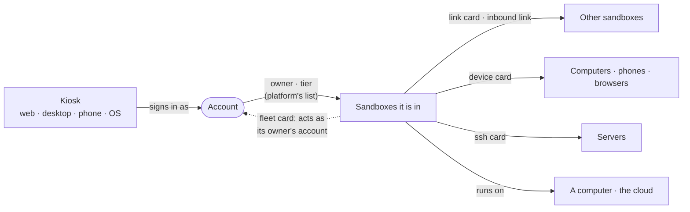

# The account's reach

A person signs in once, as one account, at any kiosk (the web editor, the desktop app, a phone, Intentic OS), and from there reaches every sandbox they are in and, through those sandboxes, other sandboxes, computers and servers: this page says who knows each part of that graph, how the editor puts it together for Settings ▸ Access map, and how fresh each part is.

The public docs draw the same graph for a reader rather than a maintainer, at [/docs/big-picture/](https://intentic.dev/docs/big-picture/): its words are [`site-content/src/big-picture.ts`](../../_site/site-content/src/big-picture.ts) and its figure is [`BigPictureFigure.astro`](../../_site/site/src/components/figures/BigPictureFigure.astro). Change it when an edge here changes what a person can reach.

## Who knows which edge

Nothing holds the whole graph, on purpose. Each edge is known, and enforced, where it is decided:

| Edge | Known by | Read through |
| --- | --- | --- |
| The account is in a sandbox, at a tier | the platform's copy (`SandboxMember`, `sandbox.list`); the daemon's roster is the enforced one | `sandbox.list`, and the daemon's own word in its reach answer |
| A sandbox is bound to an organisation | the daemon holding the policy (and the platform's `Sandbox.orgId`) | the reach answer's `self.org` |
| A sandbox hands work to another | the asking daemon (its `link` card) and the taking daemon (its inbound link and terms) | both reach answers, joined |
| A sandbox's agents reach a computer, phone or browser | that daemon's `device`, `phone`, `webext` cards and enrollments; the machine enforces its own switches | the reach answer's `devices` |
| A sandbox's agents sign in to a server | that daemon's `ssh` card | the reach answer's `servers` |
| A sandbox may make sandboxes on its owner's account | that daemon's `fleet` card and the platform's `ApiToken` | the reach answer's `fleet` |
| A sandbox runs on a computer or in the cloud | the daemon's host label, the platform's host report, the hosted machine row | the reach answer's `self.runsOn`, `sandbox.list`'s `hostReport` and `hosted` |

The platform never learns the links, the devices or the servers: a link token is minted by the owner's editor on the taking daemon and held by the asking one ([links.md](links.md)), and a device enrollment is between the machine and the daemon ([topology.md](topology.md)).

## How the editor puts it together

Every daemon answers one route about its own edges, shaped for whoever asks: `GET /system/reach` ([`sandbox-reach.ts`](../../_shared/sandbox-contract/src/schemas/sandbox-reach.ts), built in [`reach-builder.ts`](../../_sandbox/sandbox/src/secrets/reach/reach-builder.ts)). For each card it says whether the reader's own conversations may use it (they run agents there and their credential reach allows it, the rule [access.md](access.md) describes) and, for someone who runs people and access, how many other people's conversations may. Inbound links and the machine it runs on are for the owner and Full access, as they are on the Access page. Nothing in it is a credential. The daemon reads it from what it stores and the connections live now, never by calling a machine; the only thing it asks anyone else is each link card's far sandbox (`GET /link`), whose answer it keeps for a minute.

The editor is the one party signed in to every sandbox the account is in, which is why it, and not the platform, joins the answers ([`useAccountReach.ts`](../../_editor/web/src/features/settings/access-map/useAccountReach.ts), [`accountGraph.ts`](../../_editor/web/src/features/settings/access-map/accountGraph.ts)). It joins them by ids both sides hold: a sandbox by its platform id, else its address's host name; a computer by its machine id, else its host name; a server by its host name. A tie seen from both ends (a link both sandboxes answer for) is one edge: the asking side says who can drive it, the taking side's terms win. A sandbox met only at the far end of a link is drawn outside the account.

The daemon's word on the reader's tier wins over the platform's copy, and where the two disagree the map says what the platform still lists.

## How fresh it is

Access changes while nobody looks: an owner narrows a tier, revokes a link, unpairs a computer. The daemon re-reads the roster on every request, so a revoked grant stops working at once; the map is a reading of it with a time on it.

- Each sandbox is read when the page opens, again every five minutes while it stays open, when the window comes back, and on Read again.
- Its last answer is kept in the account's own persisted cache, so a sandbox that cannot be asked now (asleep, its machine off, no session to read it under) is drawn as it last answered, marked by why.
- Nothing wakes a sleeping sandbox to read it, and nothing raises a sign-in: these reads run in the background, and a sandbox with no session offers Read, which asks in the foreground.
- A daemon older than the route answers 404 and is drawn as older than the page, with no ties, rather than rebuilt from other routes ([app-plane.md](app-plane.md)).

## What deserves reading first

The map leads with every tie through which someone other than the reader can act on something: other people's agents that can act on a computer or sign in to a server, run commands in another sandbox through an operating link, or make sandboxes on the reader's own account through a fleet card; and a sandbox outside the account that hands work to one of the reader's. None of these is wrong in itself. Each is a grant an owner should know they made, and per-sandbox screens could not show it, since it needs two sandboxes, or a sandbox and a computer, read together.

## Decisions

- **Federated, not central** (2026-11-22). A central relationship store in the platform, in the manner of Zanzibar-style systems (SpiceDB, OpenFGA), would answer "who reaches what" with one query, but it would make the platform an authority over links, devices and servers it is kept out of today, and a platform breach would then reach them ([topology.md](topology.md#trust-model)). Each daemon already enforces its own edges; it now also describes them, and the kiosk the person is signed in at joins the descriptions, the way pairing two sandboxes is already the editor's job.
- **One route per daemon, shaped by the daemon** (2026-11-22). Reading the capabilities list, the devices view, the inbound links and the reader's own row from each sandbox was the alternative: five requests per sandbox, one of which (`system.devices`) asks every connected machine, and a rule about what a reader may see of each repeated in the editor. One answer per sandbox, filtered where the rule is enforced, costs a map of ten sandboxes ten cheap reads.
- **The organisation from the daemon, not the platform** (2026-11-22). Adding the binding to `sandbox.list` was the alternative; the daemon is what enforces the policy, so its word is the one the map draws, and an asleep sandbox keeps its last one.
- **Transitive reach stops at the far sandbox** (2026-11-22). A task handed over a link wears that link's role on the far side, and which cards that role reaches is the far side's to know. The map says what the link lets its holder do there (tasks, records, operate) and lights the far sandbox, rather than guessing which of its computers the task could reach.
- **What a tie allows is drawn on the card it lands on, not said in a caption** (2026-11-23). The map first said its focus's ties in sentences under the drawing, one clause per switch, so an owner with five computers on full access read the same ten clauses five times, far from the lines they described. Each tie now draws its switches as a row of glyphs on the computer, server or sandbox it reaches, every switch in a fixed place and faint when off, so equal grants draw equal rows and a missing switch is a gap in the same place ([`tieStrip.ts`](../../_editor/web/src/features/settings/access-map/tieStrip.ts)). Pointing at a glyph names it; a screen reader hears the tie in words. A hover card per card and a top-to-bottom layout were the alternatives: the first still hides the answer until pointed at, and the second only buys room the rows do not need.

## Not yet

- **Signing an account out everywhere.** A daemon session is minted by each daemon and lasts thirty days; signing out of the platform does not end it, and the only revocation a daemon has is rotating its key, which signs everyone out ([`session.ts`](../../_sandbox/sandbox/src/auth/session.ts)). A per-person cut-off (a "not before" per address, checked with the session) would let the account page sign one person out of every sandbox they are in at once, the per-account half of what continuous-access-evaluation designs send between parties.
- **The kiosks.** Where the account is signed in (the platform's sessions, the native push devices) is not on the map yet; it belongs on its left, before the account.
- **A machine's identity for where a sandbox runs.** A sandbox's host is joined to a computer by name, since the daemon knows its host's label and not its machine id; the platform's active host carries the machine id and could hand it over.

## Key files

- [sandbox-reach.ts](../../_shared/sandbox-contract/src/schemas/sandbox-reach.ts): the answer each daemon gives about its own edges.
- [reach-builder.ts](../../_sandbox/sandbox/src/secrets/reach/reach-builder.ts): what the reader is told of them, by the rules the daemon enforces.
- [reach.routes.ts](../../_sandbox/sandbox/src/secrets/reach/reach.routes.ts): what the daemon gathers for it, without calling a machine.
- [accountGraph.ts](../../_editor/web/src/features/settings/access-map/accountGraph.ts): the answers joined into one graph, and what deserves reading first.
- [useAccountReach.ts](../../_editor/web/src/features/settings/access-map/useAccountReach.ts): every sandbox read in the background, kept, and read again.
- [tieStrip.ts](../../_editor/web/src/features/settings/access-map/tieStrip.ts): what one tie allows, as the row of glyphs the map and the list draw.
