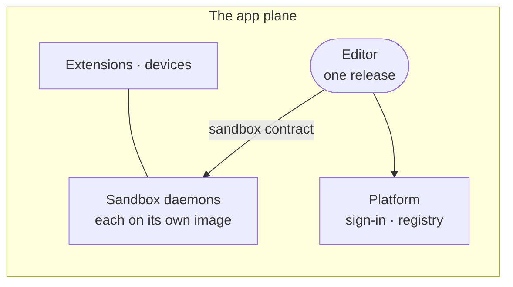

# The app plane

The app plane is the product the owner looks at and drives: the editor, the sandbox daemons it talks to, and the thin platform between them.

## What is in it

- [`_editor`](../../_editor): the web app at `app.intentic.dev` and the desktop, phone and share-view shells around it.
- [`_sandbox`](../../_sandbox): the daemon, netd (its network daemon), and the libraries and services baked into the sandbox image.
- [`_agent-tools`](../../_agent-tools): the CLIs an agent runs inside a sandbox (`lsp`, `fileq`, `webq`) and the editor's text search.
- [`_hosts`](../../_hosts): what runs on the machine under a sandbox: the `ic` host CLI and the Intentic OS image.
- [`_platform`](../../_platform): sign-in, the sandbox registry, hosted machines and the ingress.
- [`_extensions`](../../_extensions) and [`_devices`](../../_devices): features added through the extension manifest, and the programs that let an agent reach the owner's own machines.
- [`_shared`](../../_shared): the contracts the parts above are written against. The sandbox contract ([`_shared/sandbox-contract`](../../_shared/sandbox-contract)) is the wire between editor and daemon; the api contract ([`_shared/api-contract`](../../_shared/api-contract)) is the wire between editor and platform.

## What is not

- **The website** ([`_site`](../../_site)) is the public site and its playable demo, which renders the editor against fixtures.
- **Plumbing** ([`_tools`](../../_tools)): checks, test harnesses and release scripts. `_tools` also holds the runtime foundation product code imports (`base`, `constants`, `code-read`), which ships inside the parts above rather than standing as a part of its own.

## One editor, many daemons

The hosted editor ships with each release, the same build as that release's sandbox image ([`ship-web.sh`](../../_tools/scripts/platform/ship-web.sh)), while each sandbox runs the daemon from whatever image it last pulled. A new sandbox matches the page; one that has not updated yet is older than it, and the app plane is built for that:

- The daemon advertises the routes it implements, and a fingerprint of each one's shape, in the opening frame of `/events`, with a second print (`wire`, `core`) that tells an optional part one side lacks from a payload that may misbehave. The route list is derived from the contract itself (`contractRoutes` in [`routes.ts`](../../_shared/sandbox-contract/src/protocol/routes.ts)).
- The editor compares that list with the contract it was built against ([`useDaemonRoutes.ts`](../../_editor/web/src/client/sandbox/useDaemonRoutes.ts)). A feature gates on `supportsRoute`, and a route the daemon predates shows as a named gap instead of an unexplained 404.
- A window reads several sandboxes at once (Home's tiles, the rail's door to Home) and is pointed at one. Each daemon's advertised routes are held per sandbox, so a call aimed at another box is gated on that box's own hello, and a component names the sandbox it speaks of with a scope ([`useSandboxScope.ts`](../../_editor/web/src/client/sandbox/scope/useSandboxScope.ts), `<InSandbox>`) instead of reading the active one. Code not moved onto a scope keeps reading the active sandbox, and the `sandbox-scope` check keeps that set from growing.
- A field a newer daemon adds to a payload is optional in the contract, and the editor does not rebuild it from an older daemon's raw data. A view that needs it shows what the daemon did send, and a notice ([`SandboxOutdatedNotice.vue`](../../_editor/web/src/parts/sandbox/SandboxOutdatedNotice.vue)) says the sandbox is older, what the view lacks until it updates, and how to update it. A feature that needs a route the daemon predates says the same instead of taking an older path to the same end: moving a chat to another account needs `agent.switchAccount`, and without it the chat offers no move and never judges an account itself.
- [`contract.lock.json`](../../_shared/sandbox-contract/contract.lock.json) records the wire surface and who may reach each route. [`contract-shrink.mjs`](../../_tools/checks/contract-shrink.mjs) reports a push that removes or narrows part of it with no commit declaring the break, without refusing the push, and the package's lock test fails in CI while the lock and the schemas disagree.
- Every way a sandbox starts composes its `docker run` from one run contract ([`_shared/sandbox-run`](../../_shared/sandbox-run)). An update recreates the container from it while the `/work` and `/history` volumes stay.
- The agent programs inside a sandbox update without a new image: each sandbox on the `blessed` channel reads [`engines.json`](../../engines.json) hourly.
