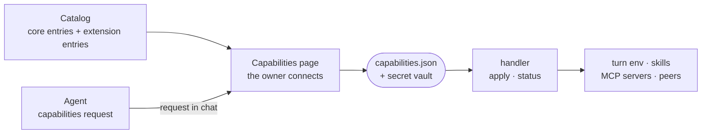

# Capabilities

A capability is anything the owner connects to a sandbox, such as a CLI account, an MCP server, a device, a browser identity or Docker, stored as one `{ id, kind, config }` entry and applied by a per-kind handler.

## The shape

- `CapabilityKindSchema` in [`capabilities.ts`](../../_shared/sandbox-contract/src/schemas/capabilities.ts) lists the kinds. Roughly: tools for the agent (`cli`, `mcp`, `plugin`, `agent`, `endpoint`, `localmodel`), accounts (`identity`, `browser`, and `webext`, the owner's own browser, which a role reaches only by naming it the way it names a site account: [`role-capability.ts`](../../_shared/sandbox-contract/src/policy/role-capability.ts)), machines (`device`, `ssh`, `docker`), the network (`vpn`, `exit`, `netdisk`), and the sandbox's own reach (`extension`, `wallet`, `fleet`, `link`).
- The active set is `.intentic/config/capabilities.json`. Each kind has one handler in [`handlers/`](../../_sandbox/sandbox/src/capabilities/handlers), with an idempotent `apply` and a `status` probe; [`registry.ts`](../../_sandbox/sandbox/src/capabilities/registry.ts) is the total map, so a kind without a handler does not compile.

## Adding a kind

Each step below is a table keyed by `CapabilityKind`, so a kind left out of one does not compile, or fails a test that pins the tables to each other.

1. Add the kind to `CapabilityKindSchema` with its config arm ([`capabilities.ts`](../../_shared/sandbox-contract/src/schemas/capabilities.ts)).
2. Give it a row in `CAPABILITY_KIND_TRAITS` ([`capability-kinds.ts`](../../_shared/sandbox-contract/src/policy/capabilities/capability-kinds.ts)). The row holds its Map group, whether a person's reach can hold it back, whether it is a signed-in account or a sandbox browser profile, whether its credential is a mount, whether it mounts at a turn's start, its peer door, whether it is a tunnel, what provider it mints, whether its id names an MCP server, and where its tile comes from. The contract, the daemon, the editor and the demo all read these facts from the row. Before 2026-11-23 they were a dozen hand-kept lists, and a new kind was silently missing from some of them (`webext` was missing from the signed-in accounts until 2026-10-25).
3. Write its handler in [`handlers/`](../../_sandbox/sandbox/src/capabilities/handlers) and name it in [`registry.ts`](../../_sandbox/sandbox/src/capabilities/registry.ts). A handler can also set `removal`, the sentence the extension-removal plan uses for one of its connections.
4. Say what it does to the sandbox in `KIND_EFFECTS` ([`effects.ts`](../../_shared/capability-catalog/src/effects.ts)).
5. Give it a tile. A `tile: "catalog"` kind gets an entry in `CAPABILITY_CATALOG` ([`index.ts`](../../_shared/capability-catalog/src/index.ts)). A `tile: "card"` kind gets an arm of `CapabilityContributionSchema` ([`points/capabilities.ts`](../../_shared/extension-manifest/src/points/capabilities.ts)) and a card from an extension. Tests hold each set equal to its rows.
6. Pick its fallback glyph in `KIND_ICONS` ([`kindIcons.ts`](../../_editor/web/src/models/capabilities/kinds/kindIcons.ts)). A peer kind also needs its door in `PEER_DOORS` ([`usePeerConnect.ts`](../../_editor/web/src/models/sandbox/devices/usePeerConnect.ts)).
7. Give it an entry in `KIND_SLOTS` ([`kindSlots.ts`](../../_editor/web/src/features/capabilities/kinds/kindSlots.ts)), an empty one (`none`) when the page draws nothing of its own for it. Its slots are what the editor draws for the kind: the dialog a peer's row pairs through (`pairing`, with the props it opens with), the parts its setup form opens with (`formLead`, `addLead`, `formExtra`), what sits above its list (`headerExtra`), whether its rows dial a live link (`liveLinks`), the sentence its answers add up to (`answersSummary`), what its save checks or writes besides the daemon's add (`refuseSave`, `beforeSave`, `afterSave`), and how a need's card answers it (`inlineInNeed`, `needLead`). The page, the form, a connection's row and a need's card read these instead of naming kinds, and a test pins which kinds bear each slot. A kind whose facts line a live source knows more of (a machine's OS, a browser's sites) has its row in `ROW_FACTS` ([`rowFacts.ts`](../../_editor/web/src/features/capabilities/model/rowFacts.ts)) instead, outside the registry, since the Sandbox map reads those lines and must not import the page's dialogs. Until 2026-11-23 they branched by name, and the Connected slice's facts line had no case for `webext` while the tile's own rows did.

## The catalog

- [`_shared/capability-catalog`](../../_shared/capability-catalog) holds `CAPABILITY_CATALOG`, the core entries the Capabilities page offers: name, kind, category, the fields the owner fills in, a setup guide, and whether only one may exist.
- Extensions add entries through `contributes.capabilities` ([`points/capabilities.ts`](../../_shared/extension-manifest/src/points/capabilities.ts)), limited to the kinds `cli`, `browser`, `device`, `webext`, `phone` and `agent`. Kinds that carry real privilege stay core-only, so a manifest cannot grant them. [`contributions.ts`](../../_sandbox/sandbox/src/capabilities/contributions.ts) merges them; the first declaration of an id wins.
- [`_extensions/connectors`](../../_extensions/connectors) holds its cards as data, and its one piece of code is a backend checking the npm and GitHub release watch kinds (2026-11-26): each CLI connector names its fields, an environment template, a skill that teaches the agent the tool, and optionally a probe, a Dockerfile fragment and links a connected card offers (Discord's invite, built from the card's non-secret settings). [`_extensions/devices`](../../_extensions/devices), [`_extensions/browsers`](../../_extensions/browsers) and [`_extensions/acp-agents`](../../_extensions/acp-agents) contribute the other kinds the same way.
- A field that names another of the owner's connections (a network disk's `via`, an identity's code mailbox and exit, a site account's exit) declares `connection` with the kind, and the card for a kind several cards share: the form offers the connections that exist ([`tiles.ts`](../../_editor/web/src/models/capabilities/tiles.ts) `withConnectionPickers`), and an add naming one that does not is refused ([`connection-refs.ts`](../../_sandbox/sandbox/src/capabilities/connection-refs.ts)). The value stored is the connection's name, as when it was typed. 2026-11-11: chosen over free text, whose typo was found only when the disk would not mount.
- A card's Test is one request ([`probe.ts`](../../_sandbox/sandbox/src/capabilities/probe.ts)), or for a service not spoken to over HTTP a dial its manifest names with `probe.connect` ([`probe-dial.ts`](../../_sandbox/sandbox/src/capabilities/probes/probe-dial.ts)): PostgreSQL and MySQL sign in through `pg` and `mysql2` with TLS when offered, as `psql` and `mysql` do, and name the server's version and database; IMAP signs in with LOGIN; `tcp` only connects. A refusal is said by what it means: an address pg_hba or a MySQL grant does not admit, a wrong password, no route from the sandbox.

- A setting added to a card after connections were saved must not move them when one is opened again. The form answers such a choice with whichever of its options reproduces what the connection holds ([`form.ts`](../../_editor/web/src/models/capabilities/form.ts), `answerNewChoices`): a PostHog connection saved with only `https://eu.posthog.com` opens on the EU region, not the default. 2026-11-11: chosen over a stored-data conversion, which would put one connector's fields into the daemon's store.

## How agents use them

- **CLI connectors** reach the agent as environment variables and a skill. [`cli-env.ts`](../../_sandbox/sandbox/src/capabilities/cli-env.ts) expands each template with a per-instance suffix, and every turn's shell gets them. A connector that declares a `broker` (every HTTP one shipped) puts no credential there: its secret-bearing variables hold an inert placeholder, and each route's variable holds a credential-gateway address minted for the conversation (below). A connector whose extension serves its kind tools (`contributes.tools` with `perCard`) is also an MCP server named by the card's id, handed the card's settings with each call; that is why a cli card's id may not be a name the daemon reserves for its own servers. The card's own CLI reaches the same server from the turn's shell, at `POST /tools/<card>` ([`card-tools.routes.ts`](../../_sandbox/sandbox/src/extensions/backend/card-tools.routes.ts)): the conversation it names is believed only with its turn's proof, and only while a running turn of it mounted that card's tools. A connector whose credential its backend uses this way (IMAP, Microsoft 365) puts none of it in the turn's environment, only the settings that name the account (2026-11-26). A card the owner put behind a named approver refuses its tools' calls, by either door, until the conversation holds a release ([`extension-mcp.ts`](../../_sandbox/sandbox/src/extensions/backend/extension-mcp.ts)), as the gateway refuses a gated card's request.
- **Chat connectors** (Slack, Discord, Telegram, WhatsApp, IMAP, Google Workspace) are extensions whose gateway process holds the provider connection, built on [`_shared/connector-runtime`](../../_shared/connector-runtime).
- **What a card says about its platform** (2026-11-26, [`channel-facts.ts`](../../_shared/extension-manifest/src/points/channel-facts.ts)), so the core keeps no table keyed by provider name. `channel.messageLimit` is the one-message limit the approvals inbox counts a post against and the card's gateway splits a reply at; `channel.publish.target` the targets its extension's backend publishes an approved post to itself (Discord's channel ids), and `channel.posting` what an agent turn publishing one there reads; a post's `platform` names the card's id, and the social extension's sites declare theirs on their browser cards. `processors` is where a card sends people's data, one entry per path, for the Data protection page ([`facts.ts`](../../_sandbox/sandbox/src/compliance/facts.ts)): its flow (`team-chat`, `email-imap`, `email-smtp`, `connector`), operator, region, whether that is a third country, the hosts beyond the card's `hosts`, and a field naming its server, the path existing once that field is filled (IMAP's `host` and `smtpHost`); a card declaring none is one generic connector path over the hosts its credential is meant for. A cli card whose settings anyone could type (a phone number) declares `status: { from: "listener" }`: it reads as connected only once its gateway reports the connection ready, and while it pairs it shows the code the gateway reports with where it is typed (`pairingSteps`). Until then the daemon kept these for named providers: a table of message limits in the contract, Discord as the one platform it posted to itself, compliance's team-chat and mail tables (whose hosts had drifted from the manifests'), and a WhatsApp branch in the cli handler.
- **Accounts** are browser identities. The agent drives them through the `accounts` tools ([`accounts-tools.ts`](../../_sandbox/sandbox/src/browser/tools/accounts-tools.ts)), which type a stored password into the page without it entering the model's context, and only on the account's own site: a page whose host is not where the account signs in (its card's sign-in and home URLs, an identity's mail provider) is refused before any approval is asked. An extension's agent tool drives an account's browser only for a turn that holds the account, through that turn's own browser router, only with the page's own tools and only on the account's sites, and never types its credential (2026-11-26, [extensions.md](extensions.md), what its tools may do with the turn).
- **Machines**: a `device` (the owner's computer, through [`_devices/machine`](../../_devices/machine)) or a `webext` (their browser, through [`_devices/webext`](../../_devices/webext)) dials into the sandbox as a peer ([`peer.ts`](../../_sandbox/sandbox/src/peers/peer.ts)), and its tools are forwarded to the agent. The device enforces its own permission switches. An extension's agent tool reaches the owner's browser only when the calling turn holds it, through the same door the agent's calls take (2026-11-26, [extensions.md](extensions.md)): the [chatgpt](../../_extensions/chatgpt) extension's tools with `browser` call the ChatGPT kit the browser extension runs, as its own tools, that way. The daemon names no ChatGPT tool of a browser's any more, save `chatgpt_send`, whose `files` its door tickets as it tickets `upload_file`'s, since every version of the browser extension in the field refuses a file without one. Renaming such a card is a label change: its enrollments move to the new name in one write, each keeping its token, and each live connection is held under the new name with its socket untouched (`rekey` in [`peer-hub.ts`](../../_sandbox/sandbox/src/peers/peer-hub.ts)). `ssh` goes the other way: the sandbox dials the host.
- **MCP servers**, whatever serves them, reach every runtime the same way. An `mcp` card, a `device` or `webext` card's peer bridge, an extension's tools and the turn's browser routers are mounts at the daemon's one MCP door, `/mcp/<name>`, on a bearer of the turn's own that reaches only what that turn mounted (an ACP agent's warm session shares its conversation's, one live turn at a time) ([`turn-mounts.ts`](../../_sandbox/sandbox/src/agent/tools/turn-mounts.ts)). Every granted `device` card rides one mount, `devices`, whose tools each take `device` naming the card ([`devices-server.ts`](../../_sandbox/sandbox/src/hosts/devices/devices-server.ts)); a Claude Code turn starts with only `mcp__reach__devices`, which adds that server to the running session when the turn first needs a computer ([`devices-on-demand.ts`](../../_sandbox/sandbox/src/agent/run/harness/devices-on-demand.ts)). (2026-11-16: one server per device repeated the same ~46 tools, about 11k tokens each, for every computer connected; the rejected alternative, mounting the set only when the prompt names a device, is what a runtime that cannot add a server mid-session would need, and those keep the one `devices` mount from the start.) What each server's tool definitions cost a turn is on record in `logs/tool-schemas.jsonl`, read with `diagnostics tools`. [`turn-tools.ts`](../../_sandbox/sandbox/src/agent/tools/turn-tools.ts) composes them into the turn's one `remote` list, which Claude Code, Codex, Cursor and ACP agents all project, so a server the owner granted reaches every loop or none. What each runtime takes beyond that list is its `mcp` capability ([`agent-runtimes.ts`](../../_shared/sandbox-contract/src/models/agent-runtimes.ts)). Every runtime is also told about what it mounted from the same guidance ([`guidance.ts`](../../_sandbox/sandbox/src/agent/prompt/guidance.ts)), composed from the mounts once its arm has made them ([`runtime-guidance.ts`](../../_sandbox/sandbox/src/agent/prompt/guidance/runtime-guidance.ts)); what differs is only a tool a runtime lacks and how its tool list spells an MCP tool. (2026-10-25: the paragraphs naming a mount had reached the Claude Code loop alone, and two X automations on OpenCode asked the owner's own browser for x.com while the sandbox's `x` account sat signed in.)
- **A remote MCP server** (an `mcp` card) is reached at the same door (`/mcp/<card>`), which forwards the agent's request with the card's credential: a pasted token as it is, a sign-in's access token renewed as it lapses ([`mcp-remote.ts`](../../_sandbox/sandbox/src/capabilities/mcp-oauth/mcp-remote.ts)). The door is also where a secret reference in a `tools/call`'s arguments becomes its value, for every runtime alike: through the same gates as a command's, the card's address standing as the one host the call sends it to, so a secret whose host guard lists that host goes unasked, one whose guard does not raises a card while the turn's watchdog is held, and one whose guard is off goes, as it would typed into a page there; a refusal answers the call as the tool's own error and nothing reaches the server, and a batch goes whole or not at all. A `|file` reference and a secret a computer's keyring holds are refused there, the keyring having no word for the lane. Every message the server answers with is masked back to the references, a JSON body whole and an event stream event by event, and each use is on the ledger under the lane `mcp`. 2026-11-25 (issue #57): chosen over resolving references in every MCP tool's arguments, since only a server that is itself the destination gives the host guard something to check, and the daemon's own servers pass a value on to whatever place their arguments name (a page a browser navigates to, a file on a computer, another model); `type_secret` stays the way to put a value there. Until then a pasted token's card was handed to the runtime at its own address, token and all, and nothing between the agent and the server could resolve or mask anything. The sign-in reads endpoints out of metadata the server publishes, so every request that fetches metadata or carries a code, verifier, client secret or refresh token goes through one guard ([`oauth-fetch.ts`](../../_sandbox/sandbox/src/capabilities/mcp-oauth/oauth-fetch.ts)): https (http on loopback only), redirects followed by hand and checked at every hop (never across origins with a credential), answers capped at 1 MiB, and, while the MCP server itself is public, every endpoint must resolve to public addresses only, checked again by the socket's own lookup so a name re-pointed between the check and the connect is refused. A server the owner runs on loopback or a private network keeps signing in there. 2026-11-24: until then a hostile server's metadata could aim the token request at the daemon's own loopback routes or the owner's network.

- **Linked sandboxes** (the `link` kind) are another of the owner's sandboxes this one may hand tasks to ([links.md](links.md)). They sit with the devices: the card is under Your devices, each is mounted on a turn's lease as a tool server named after it (`mcp__<card>__delegate`, `mcp__<card>__about`), and a role picks them on its devices list, with its delegate shelf also required. The card holds the far address and a token that sandbox's owner minted; the editor usually fills both in by pairing the two sandboxes. What a task may do over there is set on that side, never on the card.

- **Claude Code plugins** (the `plugin` kind) are git checkouts under `.intentic/records/plugins/<id>` that every Claude turn the role grants loads ([`plugin.handler.ts`](../../_sandbox/sandbox/src/capabilities/handlers/plugin.handler.ts)). The install resolves the branch, tag or commit the owner named to a full commit and stores it as `commit`, so anything re-applying the stored entry (a rotated token) checks out the same code; adding the plugin again is the update. Its hooks and hooks module run only once the owner approves them, like any other workspace hook (`guard/settings-hooks.ts`).
- **A plugin's or an extension's private repository** is read with a token of the card's own, else with the token of the GitHub or GitLab card connected for the repository's host ([`git-connection.ts`](../../_sandbox/sandbox/src/capabilities/credentials/git-connection.ts)): the one the card names in `gitConnection`, else the first such card by id, skipping one whose git access is off. The install form names that card and offers the choice when several match, by the same rule ([`git-connections.ts`](../../_shared/sandbox-contract/src/policy/git/git-connections.ts)), so it says what the clone will use. The daemon presents the token itself, in the clone's environment as for a pasted one; the agent's git reaches the same account through the credential gateway instead and never holds it. A borrowed token is tried with `ls-remote` before the clone, so a repository that card cannot read is refused naming the card rather than as a git exit code. The version picker's read and an extension update's preview borrow the same way. 2026-11-11: until then a private repository needed its token pasted on the card, even with that account connected.

## Asking the owner

An agent that needs something unconnected runs the in-sandbox `capabilities` command ([`bin/capabilities`](../../_sandbox/sandbox/bin/capabilities)): `list` shows what could be connected and what the workspace looks like it wants, and `request <id> --why "…"` asks, with `--target` for the site or host and `--set` for the settings it can fill in; the same command asks for a setting changed on a connected one (a device switch, a Docker engine option) or for a refused credential to be replaced (`--reconnect`). Each ask is a need ([needs.md](needs.md), [`capability-need.ts`](../../_sandbox/sandbox/src/needs/kinds/capability-need.ts)): a card in the owner's chat that outlives the turn, with the connection's own form inside it for the kinds whose form finishes the setup, and an answer that continues the conversation whenever it comes. What the turn can already reach is checked first, so a connection the role withholds, one for another host, or one whose credential is refused is answered as exactly that. The agent never connects anything itself and never sees the credential the owner enters.

## Credentials

- Secret values live in a vault file readable only by its owner ([`secret-vault.ts`](../../_sandbox/sandbox/src/capabilities/credentials/secret-vault.ts)), outside what the file API and the search box can reach. `capabilities.json` keeps the rest of the config.
- An `ssh` card can have the sandbox make its key: `POST /capabilities/ssh-key` builds an ed25519 pair in memory ([`ssh-keys.ts`](../../_sandbox/sandbox/src/capabilities/credentials/ssh-keys.ts)), answers only the public half, and holds the private half under a one-time token ([`secret-stash.ts`](../../_sandbox/sandbox/src/capabilities/credentials/secret-stash.ts)) that the form's save redeems into the vault. The private key never reaches a browser.
- A card whose service issues a certificate from a request (e-Doręczenia's system registration) declares `keyRequest` on its private-key field: `POST /capabilities/certificate-request` makes an RSA 2048 key in memory and a PKCS#10 request whose subject the card's templates fill from the form ([`certificate-request.ts`](../../_sandbox/sandbox/src/capabilities/credentials/certificate-request.ts), [`key-requests.ts`](../../_sandbox/sandbox/src/capabilities/credentials/key-requests.ts)), answers the request, and holds the key in the same stash, bound to that card's field, until the save redeems it. The request is kept beside the key as a non-secret field, so the card shows it again until the issued certificate is pasted.
- The vault keeps credentials out of reads and searches, not out of the shell: the daemon and the agent share one container. What keeps a credential out of the agent's hands is the gateway and the ssh agent below, which use it for the agent without handing it over.
- A stored credential leaves the daemon for extension code in three ways only. One is `GET /capabilities/<id>/connection`, on the extension's own token, answered only for a card whose kind that extension contributes (or its own install record), and only if its manifest declares the route. Another is a listener gateway's `/listeners/<provider>/state`, answered only to the extension that declares that provider and holding only the connectors it contributes. The third is a card's tools (`contributes.tools` with `perCard`), whose backend the daemon hands the card's settings with each call it forwards from a turn granted the card. None is reachable by the panel token, a control token or a signed-in person.
- A card whose credential is a delegated OAuth sign-in (Microsoft 365, an IMAP mailbox on OAuth2) declares `refreshToken` in its manifest. Its sign-in runs on the agent's request (Microsoft's device-code flow: the person types a short code on Microsoft's own page), in the extension's backend for those two since 2026-11-26 and in the CLI for the others, and stores what it got through `POST /capabilities/{id}/oauth-token` ([`refresh-token.ts`](../../_sandbox/sandbox/src/capabilities/refresh-token.ts)), which the agent token and the declaring extension's own token reach: write-only, into that one field, only from a caller presenting the card's current token, and only while the fields the token is bound to still hold what they held at sign-in. Each rotation the provider hands out is stored the same way, without a manifest version per write. 2026-10-13: chosen over printing the token for the owner to paste, which puts a long-lived credential in the transcript. Its `probe.oauth` trades the token for an access token in memory for the card's Test.
- A card whose provider would otherwise need the owner to create an OAuth client (Google Workspace) marks its refresh-token field `signIn`. The editor draws a sign-in button there: a popup runs the provider's consent on the **platform's own** OAuth client with PKCE, comes back to a static page on the editor's origin ([`public/oauth/google.html`](../../_editor/web/public/oauth/google.html)), and the platform trades the code for the signed-in session that started it ([`google-connect`](../../_platform/api/src/google-connect)). The token fills the form and the ordinary Save stores it. Because a refresh needs the client secret, which never leaves the platform, the card's CLI and listener ask the daemon for each hour's access token (`POST /capabilities/{id}/oauth-access`, [`oauth-access.ts`](../../_sandbox/sandbox/src/capabilities/oauth-access.ts)), which trades the card's own token at the platform with this sandbox's connect token; the caller names the card and never handles either credential. 2026-11-11: chosen over shipping the client secret in every sandbox, where it would be public in effect and could not be rotated without breaking every card, and over asking each owner to create a Cloud project and paste a refresh token from the OAuth Playground. Gmail and Drive scopes are Google-restricted, so the platform's client needs Google's verification and yearly CASA assessment before it leaves the 100-user unverified cap; the owner's own client stays available under Advanced, and `gw auth login` on it stores the grant on the card itself.
- What reaches the agent is chosen per kind: a CLI connector's variables do; a TOTP seed never does, only single codes ([`totp.ts`](../../_sandbox/sandbox/src/capabilities/credentials/totp.ts)); a `fleet` or `link` token stays with the daemon. A credential gate ([`credential-gate.ts`](../../_sandbox/sandbox/src/secrets/gates/credential-gate.ts)) can require a named approver before a credential is used.
- The `fleet` card's token is minted by the editor, not pasted (2026-11-11): its Allow calls the platform's own token mint under the owner's session, as Settings ▸ Tokens does, names the token after the sandbox, and saves it with its platform id (`tokenId`, [`fleetAllow.ts`](../../_editor/web/src/features/capabilities/model/fleetAllow.ts)). Only the sandbox's owner is offered it, since the token acts on the account of whoever mints it. A card holding a minted token revokes it when it is removed or its token replaced ([`fleet.handler.ts`](../../_sandbox/sandbox/src/capabilities/handlers/fleet.handler.ts)): the daemon presents the token to `POST /fleet/release`, which revokes only the token presented, so a removal through the agent's approved ask ends it as the editor's Remove does. A pasted token carries no id and is left alone, since it may also be another sandbox's.
- **A person's reach** ([`credential-reach.ts`](../../_sandbox/sandbox/src/secrets/credential-reach.ts)) is the owner's answer to which connections and stored secrets one member's conversations may spend, written on their roster row (`credentials`, absent meaning all of them; a maintainer may be limited too, since 2026-10-27, see [access.md](access.md)). A conversation records every person who has asked it for a turn (`identity.people`; a spawned child or a peer's message brings the people behind the conversation that spoke), and it may spend only what all of them may, read live from the roster. Outside it a capability is not mounted for the turn, its variables (gateway addresses included) and skill are left out, and the one gate every credential exit shares refuses it before any approver is consulted, so no card releases it. Only the kinds that reach a turn through something handed to it per turn can be held back (`REACHABLE_CREDENTIAL_KINDS`); Docker, a VPN, a network disk, an exit, a local model, the wallet and extension settings reach every turn with a shell. 2026-10-13. Like the gateway, a hard boundary only once the agent's processes cannot read the auth root: an area-fenced turn runs in its own sandbox without it, an unfenced one still shares the container.
- A secret can need a person in two ways, set side by side on its row of the Secrets view and listed together by `secrets gates`: a named approver (above), and its host guard ([`host-guards.ts`](../../_sandbox/sandbox/src/secrets/guards/host-guards.ts)), an on/off setting with a list of hosts (exact or `*.domain`), kept in `secret-hosts.json` beside the gate policy and edited with `secrets hosts`. A CLI connector names its service's hosts in its manifest (`hosts`), and its credential starts with the guard on, set to them. With the guard on, where a reference becomes its value ([`host-guard-gate.ts`](../../_sandbox/sandbox/src/secrets/gates/host-guard-gate.ts)), a use goes unasked only when every stage of its text can be read and every URL it names is on every guarded secret's list ([`secret-destinations.ts`](../../_sandbox/sandbox/src/secrets/secret-destinations.ts)). A readable stage is a `curl`, `wget` or `git` command with its remote written out, a plain variable assignment, or a utility that connects nowhere, runs nothing and writes nothing a later stage reads (`jq`, `grep`, `cd`, …); a script, an interpreter, any other program, a subshell, a redirect anywhere but `/dev/null` or another descriptor, a value only filled in when it runs, or another host raises a permission card, whatever the safety judge said and whether or not it answered, and with no live conversation to ask in it is refused; an unattended turn's card waits for the owner like any other. With it off, the guard never asks, and a command using the secret is left to the judge alone, which lets it through when it cannot be reached. Anybody who may use secrets can turn a guard on or take hosts off it; turning one off or adding a host is the owner's, and the agent's `secrets hosts … add` or `… off` asks them on a card. A secret the agent asks for with `secrets ask NAME --host H` starts guarded: the card shows each proposed host for the person pasting the value to keep or drop, and the guard is turned on with the ones kept before the value is stored, only where no guard is on yet ([`secret-need.ts`](../../_sandbox/sandbox/src/needs/kinds/secret-need.ts), `startGuard` in [`host-guards.ts`](../../_sandbox/sandbox/src/secrets/guards/host-guards.ts)). A send card for a use whose hosts can be read also offers "Always allow <secret> to <host>", which adds those hosts to the list when the owner picks it (`addGuardHosts`); anyone else's pick lets that one use go. 2026-11-25: chosen over holding every credential command for the owner whenever the safety judge has no verdict (issue #36), since a secret stored by hand had no guard at all until somebody turned one on, so with the judge unreachable it went anywhere unasked; starting it guarded with hosts a person confirmed closes that per secret without making any command wait on a model's availability. The check reads the command, not the machine: a `.curlrc`, a git config or `/etc/hosts` can still point a named host elsewhere, a value a command writes somewhere is beyond it, and a credential handed to the agent as it is (a connector with no gateway route, or one the owner set to raw delivery) never passes through it.
- Stored values reach the model as their `{{secret:name}}` reference wherever they appear in a tool's output ([`agent-redaction.ts`](../../_sandbox/sandbox/src/agent/tools/agent-redaction.ts), and the terminal filter in [output-cleaners](../../_sandbox/output-cleaners/README.md)), down to a 12-character floor (`SECRET_MASK_MIN`). A shorter value masks only in a secret-like context, after a key, flag or URL that names a secret ([`short-secrets.mjs`](../../_sandbox/output-cleaners/src/short-secrets.mjs)), since masked bare it would blank ordinary text. The inventory names such values on their rows (`tooShort`), the Secrets view says the model reads them in full elsewhere, and for a value a person set it offers one press to replace it with a random one (`POST /secrets/regenerate`: the owner's routes only, not the agent's `secrets generate`, which refuses a name already held). A connection's password or a keyring's entry is never replaced from here: it must match the account or the computer, so the view says to change it there.
- **The credential gateway** ([`src/broker/`](../../_sandbox/sandbox/src/capabilities/broker/)) is where a brokered connector's credential is attached, and the only place it is. The daemon binds it on `127.0.0.1:8790` itself, beside netd rather than behind it, so nothing the tunnel or the published port relays reaches it. A turn's address is `/<session>/…`, the session signed with a key beside the vault and naming the card, the route and the conversation; the gateway takes the upstream from the connector's live declaration (`broker.routes`: base URL, the variable carrying the address, and how the credential rides: headers, a Basic pair, a path prefix, or fields of a url-encoded token exchange), never from the request, so an address cannot be pointed anywhere else, and a settings change that moves the upstream retires it. Every request is checked there, on the request itself: the owner's host guard for the card, the owner's action rules on the outward action it performs (below), the card's method and path rules (`broker.rules`, first match deciding; `ask` holds the request on a permission card, guarded action `credential.request`), and its named approvers (lane `gateway`); then the placeholder and any header the credential rides in are dropped, the credential set, and the request forwarded with redirects returned rather than followed. Git is pointed at the gateway through `GIT_CONFIG_*` rewrites, folded in after the role and approver filters so a card they removed rewrites nothing; the daemon's own git (following a remote, the turn-start sync, Fetch, Pull, Back up) gets the same rewrites signed for no conversation ([`daemon-git-env.ts`](../../_sandbox/sandbox/src/capabilities/broker/daemon-git-env.ts)), so a forge only the gateway reaches (an extension's Forgejo card) is followed too, and a rule that asks a person or a named approver refuses there with its reason; GitHub and GitLab are left out of it, since their git access hook already writes git's https credential; npm gets one placeholder line in `~/.npmrc` for the gateway's host. A `{{secret:<card>/<field>}}` reference to a gateway-held credential is refused at every exit, pointing at the route variable instead. The owner's per-card policy (`credential-policy.json` beside the vault, `GET`/`PUT /secrets/policy/{id}`, the Secrets view, `secrets policy`) replaces a connector's rules or sets delivery to `raw`, handing the agent the real value for a tool that needs it; a connector with no route (a database, a mail server, a request signature) is `direct`, and both are labelled as such. 2026-10-06: chosen over an egress proxy that intercepts TLS, since the gateway's addresses need no trust-store changes and the upstream is never the client's to choose. The gateway is the enforced path for everything an agent does normally; it is a hard boundary only once the agent cannot read the vault or the daemon's memory, which today's root shell in the same container still can (the unprivileged agent domain is not built yet). Both credentialed doors (the gateway and an MCP card's) carry a bounded number of calls at once, per conversation and for the door, with long-lived event streams in a pool of their own, and cut an open call or stream within a sweep (ten seconds) of its card being removed, its credential replaced, or the conversation's reach narrowed ([`open-calls.ts`](../../_sandbox/sandbox/src/capabilities/credentials/open-calls.ts)); the MCP door also holds a request body to 8 MiB.
- **Outward actions through the gateway** ([`broker-actions.ts`](../../_sandbox/sandbox/src/capabilities/broker/broker-actions.ts)). A connector names the outward actions its requests perform in `broker.actions`: an action key below the card's id (`message.send`), the methods and paths that perform it (the rules' globs), and where the request names its channel (a body or query field, or the path segment after a fixed one) and its content (a body field). On each request of a card that declares any, the gateway takes the first action covering its method and path, or `api.call` when none does, and holds `<card id>.<action>` to the owner's action rules (`settings.actionRules`, guarded action `outbound.send`, the verdict the command guard gives a command, [`outbound-guard.ts`](../../_sandbox/sandbox/src/guard/outbound-guard.ts)): `deny` refuses with the rule's reason, `hold` refuses with the redirect to draft an approval instead, since nothing parks an unattended turn's request. Each such request, refused or forwarded, leaves an Activity row in the shape a command's has ([`outbound.ts`](../../_sandbox/sandbox/src/activity/outbound.ts)): the action, the method, the path below the service (never the query, nor a path prefix the credential rides in), the channel and content read from a copy of the body's first 256 KiB as it is forwarded, and the outcome read from the status and a JSON answer's own refusal (`ok: false`, a `code` beside a `message`); it is filed under the conversation the address was minted for and that conversation's running turn. A command-line tool of an extension's own declares its actions as the card's `commandActions` instead, which the command guard holds to the same rules before the command runs and the turn's record recognises once it ends. What an action comes to while no rule names it is its declaration's `unruled`: `allow` unless it says `hold`, which the command guard then refuses with the same redirect. One carried out by the extension's backend with the card's credential (IMAP's and Microsoft 365's senders) declares `gatedBy: "backend"`: the command guard lets the command run whatever the rule says, so a held send reaches the backend, which asks the daemon's outward-action door before acting (`POST /capabilities/{id}/outward-action`, [`outward-door.ts`](../../_sandbox/sandbox/src/capabilities/broker/outward-door.ts)), and the turn's record leaves its row to the door. The door gives the same verdict for an action the card declares, holding the mail senders' while no rule names it (`unruled: "hold"`), as those tools always did; it records the refusal or the hold in Activity, and the outcome of an allowed action once the backend reports it; and on a hold it writes the approvals-queue item naming the extension as its `performer`, so the send goes out only through `approvals.perform` after the approvals executor matched and spent a person's yes. 2026-11-26: until then each of those CLIs read the rules and the approval's status from workspace files the agent writes, while the card's credential sat in the agent's environment. The same day `gatedBy` and `unruled` replaced `selfGated`, which said both at once (left to the backend, and held while unruled) and is still read that way for a manifest that has it. The enabled extensions' actions, less those that only read, are what Guardrails and the public-office preset offer a rule for (`GET /settings/outward-actions`). 2026-11-25: until then the daemon matched Discord's, Slack's and Telegram's addresses and WhatsApp's command in the agent's shell text, and since the chat skills reached their services through the gateway's variables (2026-10-06) none of their sends was recorded or held to a rule. A card the owner set to raw delivery, or a credential pasted into a command, goes around the gateway and is neither recorded nor held here.
- **The ssh agent** ([`ssh-agent.ts`](../../_sandbox/sandbox/src/capabilities/broker/ssh-agent.ts)) is the gateway's SSH half: the one place a private SSH key is used. An `ssh` card's key and a git account's key (git access) live only in the key store beside the vault ([`ssh-key-store.ts`](../../_sandbox/sandbox/src/capabilities/ssh-key-store.ts), `ssh-keys/`, root-only); the alias under `~/.ssh/intentic-hosts` names the public half (`IdentityFile <alias>.pub`, `IdentitiesOnly yes`), so ssh asks the agent for the signature. The daemon speaks OpenSSH's agent protocol on Unix sockets in `/run/intentic/ssh` ([`ssh-agent-sockets.ts`](../../_sandbox/sandbox/src/capabilities/broker/ssh-agent-sockets.ts)) and answers only a key listing and a signature; adding, removing or locking keys is refused. The socket is who is asking: the owner's terminal gets `owner.sock` through the tmux server's environment, the daemon's own git (a background fetch, a pull from the editor) through its git runner (`setRunnerEnv`, set in [`main.ts`](../../_sandbox/sandbox/src/main.ts)), and each conversation its own (`SSH_AUTH_SOCK` in the turn's environment, named by the conversation's id and a tag made with the broker key, re-opened after a restart from a list beside the sockets). A conversation signs with a machine's key through that card's named approvers (lane `ssh`), and the use lands in the ledger; a git account's key is the owner's alone unless the card is set to raw, since a turn's git goes through the gateway (all three remote spellings are rewritten onto it) where the card's rules apply. Boot moves any key an older build left beside its alias into the store ([`ssh-hosts.ts`](../../_sandbox/sandbox/src/capabilities/ssh-hosts.ts)). Two credentials stay files the agent can read, labelled as such: a key with a passphrase (the agent could never sign with it, and the passphrase protects it), and a password-auth machine's `.pass` file for `sshpass`, since no agent can sign for a password. A card's optional admin password is not one of them: it stays in the vault and the agent spends it as `{{secret:<alias>/adminPassword}}`, piped into the `as-admin` helper the card writes beside the aliases ([`ssh-as-admin.ts`](../../_sandbox/sandbox/src/capabilities/handlers/ssh-as-admin.ts)), which types it to `sudo` or `su` as the card's `adminPasswordOf` says; only that choice lands beside the alias (`<alias>.admin`). 2026-10-31: on the card rather than a free-standing secret, so it belongs to its machine, goes when the machine goes, and the skill can name it. 2026-10-06: an agent of the daemon's own rather than OpenSSH's `ssh-agent`, which refuses a client of another uid and could neither attribute a signature to a conversation nor ask its approvers. Every message the agent does not answer is cut to its type before ssh2's `AgentProtocol` reads it (`agentMessages`): its catch-all never steps past a message's body, so the `session-bind@openssh.com` extension OpenSSH 8.9+ sends before each listing put every later reply one late and `ssh` signed in with no key. 2026-10-07: the daemon's socket goes to its git runner and not onto `process.env`, which every other child (an extension backend, a turn bound no socket of its own) would inherit. Like the gateway, a hard boundary only once the agent's processes cannot read the auth root.
  (2026-09-29) Checked at substitution and not by the command judge: the judge is a model, and a command it could not rule on went through; a guard is the owner's rule, so neither a judge's allow nor its absence can let a guarded use past it. Per secret rather than a global "judge unreachable asks": a global switch would refuse every unattended automation that sends a credential whenever the judge is down, so the owner chooses, secret by secret, which ones always ask.

## Connections hub

A connection made in one sandbox can be kept on the owner's own computer and taken into any other of their sandboxes ([`hub/`](../../_sandbox/sandbox/src/hub/), [`connection-hub.ts`](../../_shared/sandbox-contract/src/schemas/connection-hub.ts)). The hub is the computer's keyring ([`_devices/keyring`](../../_devices/keyring/README.md)), and nothing new runs there. Each hub item is an ordinary `text` entry named `CONNECTION_…`. Its value is a JSON envelope holding one card (its settings and credential) or one static model account.

- **What travels.** Only credentials that do not rotate: a CLI connector card, a tool server reached by URL with a pasted token, a model endpoint, and the Cursor, Devin, Z.ai and Meta keys. Anything a sign-in renews stays where it was made: a Claude or Codex subscription, a card whose manifest declares `refreshToken`, and a tool server signed in with OAuth. Two copies renewing one sign-in would sign each other out, so each sandbox signs in to those itself.
- **Saving** (`POST /hub/save`) sends the envelope, sealed to the keyring's inbox key, through the keyring's inbox. The person at the computer says yes; a locked keyring holds the item until its next unlock. The entry is then shared back here in `copy` mode. Saving the same connection again replaces that entry, so a rotated token reaches every sandbox that took it.
- **Taking** (`POST /hub/take`) is the keyring's own need. The entry's only host is `<connector>.cli.connections.invalid`, `mcp.connections.invalid`, `endpoint.connections.invalid` or `<provider>.account.connections.invalid`, so asking for that host finds it. The person picks the entry and shares it here. The Passwords app's "Always" for a sandbox does the same from the computer.
- **Making.** After every keyring read, the hub makes each `CONNECTION_…` copy shared here into what it describes, using the same install sequence a person's add runs ([`connection-install.ts`](../../_sandbox/sandbox/src/hub/connection-install.ts)). When the copy's value changes, it makes it again over itself. When the computer stops sharing the entry, the hub removes the card or account it made. A connection this sandbox saved itself was its own first, so it stays. What was saved and made is kept in `auth/connection-hub.json`, as names only.
- **Never an agent's secret.** The `.invalid` host guard means a reference to a hub entry can never be sent anywhere. The secret registry also leaves hub entries out, so an agent cannot spend or list one by name. The card made from an entry is vaulted and brokered like any other card.
- 2026-11-11: this replaced accounts links, which copied keys and lent Claude sign-ins between sandboxes ([links.md](links.md)).
