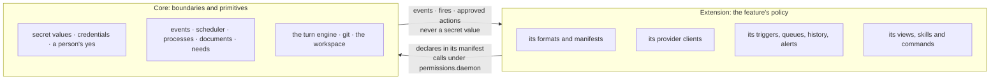

# Core and extensions

Which code belongs in the core (the daemon, the editor and the contract between them) and which belongs in a feature's extension, with the cases that set the line.

## The rule

The core holds three things, and only these:

- **Boundaries.** Secret values and credentials, every yes a person gives (grants, approvals, releases), tokens, and what an agent or an extension may reach. A boundary has to be enforced by code the agent cannot step around, which means the daemon.
- **Primitives.** Mechanisms more than one feature builds on, or that extensions build on: the event bus, the scheduler, process supervision, stored documents, the needs lifecycle, the credential gateway, the listener routes.
- **What every sandbox needs**, whether or not it uses a given feature: the turn engine, git and landing, the workspace, the agent's own tools.

Everything else is a feature's policy, and it belongs in that feature's extension: the files it reads (a `stacks.json`), the providers it talks to (GitHub, Slack, Komodo), when it acts (triggers, matching, the schedules it picks), what it remembers (queues, history, ledgers), how it judges (monitors, verdicts, alerts), and its views, skills and commands. A sandbox that never uses a feature should not carry its code, and switching the extension off should switch the feature off.

## Telling them apart

Any of these, found in core code, usually means a feature's policy has leaked in:

1. A sandbox that never uses the feature still runs or ships the code.
2. A provider's or product's name in a core path, or a core table keyed by provider (`DIRECT_PUBLISH_PLATFORMS = {"discord"}`).
3. A core module whose only consumer is one extension's views. The extension is then a shell over logic the core owns.
4. A need kind, model role, trigger source, route or CLI command added to a closed core list for one feature.
5. An extension id checked in core code (`extension.id === "intentic.maintenance"`).
6. A comment saying the extension API cannot do something, so the code lives here.

The inverse mistake is a boundary in extension code. A check the agent can step around is advice, not enforcement. The IMAP extension's send command, for example, reads the owner's action rules and the approval's status from workspace files the agent can write, while the SMTP password sits in the agent's environment ([`cli.ts`](../../_extensions/imap/src/cli.ts)). A check like that belongs behind a core door.

## When the extension API cannot do it

Policy almost always lands in core because the extension API lacks something the feature needs. Building the feature in core "for now" is the tempting fix, and it is the wrong one. Do this instead:

1. Name the gap: the call, event or power the extension lacks.
2. Add the smallest general primitive that closes it, to the core and the extension API, written for any extension rather than for this feature. An event any backend may subscribe to, not a callback into one engine.
3. Build the feature in its extension on top of it.

If the feature has to go into core first anyway, say so in the plan the owner approves and name the gap there. Put a dated note beside the code naming the gap, and add a row to [Known exceptions](#known-exceptions) so the next person does not copy it.

These are the gaps known so far, and what each one keeps in core:

| Gap | The primitive that closes it | Keeps in core |
| --- | --- | --- |
| A backend hears only its settings and the workspace's file, ref and repository changes ([`own.routes.ts`](../../_sandbox/sandbox/src/extensions/runtime/own.routes.ts)). A finished CI run reaches its consumers by direct calls inside the daemon ([`events.ts`](../../_sandbox/sandbox/src/ci/events.ts) calls main's fix agent, deploys and automations in turn). The bus ([`domain-events.ts`](../../_sandbox/sandbox/src/seams/domain-events.ts)) carries no CI event and is closed to extensions. The scheduler can only wake an agent. | Domain events (CI runs and jobs, turns settling, live or idle) on the bus, open to a backend through a declared permission. An automation target that fires the extension's code instead of an agent. | Main's CI repair, deploy triggers and their monitor, the chores probe runner, workflows |
| A backend cannot use a connected card's credential or a stored secret. | Calls through the credential gateway on a card's declared routes. `{{secret:}}` references filled at a core door under the owner's grants, the value never returned. | Three forge clients (CI, deploys, publishing a repository), the GitHub release watch, filling a stack's `.env` |
| Extension routes (`/x/<id>`) sit behind sign-in, so an extension has no public door. | A manifest-declared public route, wrapped in the protections of the core's own public door ([`public-door.ts`](../../_sandbox/sandbox/src/automations/public-door.ts): signature, rate, origin allowlist, proof of work), forwarding the verified body. | CI webhooks, bug-report intake, visitor chat, the workflow release gate |
| Lists in the contract are closed: need kinds ([`need-kinds.ts`](../../_shared/sandbox-contract/src/schemas/need-kinds.ts)), model roles ([`model-roles.ts`](../../_shared/sandbox-contract/src/models/model-roles.ts)), watch kinds, trigger sources, webhook signature schemes, outward action keys, message limits, data processors. | One contribution point per list, read from the manifest. Examples: a generic extension need kind whose card renders from its subject, and broker routes that name the outward action they perform. | The `deploy` and `redirect` needs, five extensions' model roles, the npm and GitHub release watches, the outbound sniffer, compliance's provider tables |
| The daemon calls into an extension only to carry out an approved action ([`approval-performers.ts`](../../_sandbox/sandbox/src/approvals/approval-performers.ts)), and only for `action` items, not posts. | Named handlers an extension serves and the daemon calls through the backend host, the way `approvals.perform` is reached. | Reading a sign-in code over IMAP inside the browser tools, Discord direct publish |
| A request through `/x/<id>` carries no person, so an extension's button cannot start a turn as whoever pressed it. | A short-lived signed assertion of the caller, attached by the proxy and accepted by `POST /agent`. | The CI Fix button, bug-report Investigate |
| An extension cannot keep the machine awake for work in flight, or run a tool inside the daemon's workload classes. | A `hold(label)` handle and a workload-admitted exec. | Workflows, code-health probe runs |
| An extension's tools do not see the turn's grants, cannot drive a sandbox account's browser, and cannot start a background job. | The turn's grants on the tool call's context, a browser call scoped to them, and the daemon's job lanes. | The ChatGPT site kit |

State across a backend restart is mostly not a gap. A backend keeps its records in `api.document` under its own state directory and picks them up again on activation, which is what the core's own engines do at boot. A backend that hands back `deactivate` is reloaded on its own when it changes, and every other backend keeps running.

## Precedents

These are the cases that set where the line is, each dated by its decision.

**Moved out, with the missing primitive added first or alongside.**

- 2026-08-03: git history left the editor for an extension. The git operations it lacked (stash, undo) and the ref-change event extensions now hear were added to the daemon in the same change.
- 2026-08-03: the capability catalog moved into each extension's `contributes.capabilities`. The core kept one handler per kind, and the kinds that carry privilege ([capabilities.md](capabilities.md)).
- 2026-08-11 and 2026-08-13: Drafts and Logs left the editor, and Logs left the image. The daemon's log service stayed in core, since the turn engine and diagnostics use it too.
- 2026-10-07: every backend got its own settings and events routes, reachable without declaring a daemon permission.
- 2026-10-12: the Needs inbox became an extension view. The needs lifecycle stayed in core.
- 2026-10-15: `approvals.perform`. e-urzad's office acts are carried out by the extension, after the core has matched and spent the person's yes. Before, an agent turn ran them.
- 2026-11-23: e-urzad and prawo left the image for repositories of their own ([extensions.md](extensions.md)).

**Built into core, then split (2026-11-25).** The deploy engine that replaces Komodo went into the daemon's `deploys/` although a deployments extension already existed. Three reasons were given: a backend could not hear CI results, could not fill secrets into a stack's `.env`, and was thought to lose in-flight deploys when the backend host restarted. On review, only four parts belonged in core: filling secrets at a core door under owner-only grants, the grant card, the work on the machine itself, and a CI event a backend can subscribe to. The stack manifest, the queue, history, rollback and promotion, trigger matching, the monitor and its alerts, and reporting to the forge were deploy policy, and the split moves them to the extension. The three gaps are small primitives next to the engine they kept in core, and the same primitives unblock most of the rows below.

**Core, and right to be.**

- The automations engine (scheduler, fires and their journal, held wakes, who may wake an agent) is core, and the automations extension is only its interface, kept switched on (`ESSENTIAL_EXTENSIONS` in [`installed-extensions.ts`](../../_sandbox/sandbox/src/capabilities/extension-inventory/installed-extensions.ts)). The engine fires on its own, chat extensions, CLIs and other features build on it, and switching a view off must not stop a schedule.
- The listener routes ([`listener-state.ts`](../../_sandbox/sandbox/src/extensions/listener/listener-state.ts)), the connector catalog and the credential gateway ([`broker/`](../../_sandbox/sandbox/src/capabilities/broker)) are the pattern to copy. A chat extension declares its events, its card, its broker routes and its rules in its manifest, and runs its gateway as a process. The core holds the credential and enforces the rules without knowing any provider by name.
- Loops, account routing, push notifications, panels and ports, the browser's sessions and credentials, the door to the owner's own browser, devices, phones, the wallet, VPNs and network disks. Each is a boundary, or a primitive with several consumers.
- The git operations only git history uses (stash, rebase, reset) stay in the daemon, because writes to the main tree take the repository lock that landing also takes.
- The editor keeps the Run view and a repository's own sandboxed UI, which reach internals no extension can ([`coreViews.ts`](../../_editor/web/src/core-views/coreViews.ts)).

## Known exceptions

This is core code that held a feature's policy as of 2026-11-25. None of it is a pattern to copy. Each row waits on the gap named in it. Remove a row in the change that moves its code.

| In core | Belongs in | Waits on |
| --- | --- | --- |
| `ci/`: main's fix agent (streaks, failure digests, turn limits, [`main-fixer.ts`](../../_sandbox/sandbox/src/ci/main-fixer.ts)), the Pipelines board's backend, and the GitHub and GitLab clients and webhook registration. The pipelines extension has no backend of its own. | pipelines, with the forge clients in a connector extension | CI events, credentialed calls, a public door, the caller's identity, contributed model roles |
| `chores/` and the contract's chore probes. They run in every daemon, gated by the maintenance extension's id ([`composition.ts`](../../_sandbox/sandbox/src/composition.ts), [`catalog.ts`](../../_sandbox/sandbox/src/automations/catalog.ts)). | maintenance | turn activity events, a workload-admitted exec, contributed model roles |
| [`issues/`](../../_sandbox/sandbox/src/issues): bug-report intake, grouping and the inbox. The account outbox beside it is account routing and stays. | issues | a public door, the caller's identity |
| [`webchat/`](../../_sandbox/sandbox/src/webchat): the widget, its greeting, the reply outbox. Its public door and visitor identity stay. | a visitor-chat listener extension | a public door, a listener that strangers may reach |
| The ChatGPT site kit in the browser tools ([`chatgpt-kit.ts`](../../_sandbox/sandbox/src/browser/tools/chatgpt-kit.ts)). | a site-kit extension | the turn's grants, a browser call, background jobs |
| The outbound sniffer ([`outbound.ts`](../../_sandbox/sandbox/src/activity/outbound.ts)) and the outward action keys. Its URL patterns match only a provider's literal address, not the gateway variables the chat skills teach. | each chat extension's broker routes | broker routes that name their action |
| The core automation templates and the `npm` and `github-release` watch kinds ([`watch-sources.ts`](../../_sandbox/sandbox/src/automations/watch/watch-sources.ts)). | connectors, maintenance, automations | the full template shape in the manifest, contributed watch kinds |
| Discord direct publish ([`direct-publish.ts`](../../_sandbox/sandbox/src/approvals/direct-publish.ts)), per-platform post prompts, [`message-limits.ts`](../../_shared/sandbox-contract/src/policy/message-limits.ts). | discord, social | a `performer` on posts, channel facts on listener entries |
| The `deploy` and `redirect` need kinds and their cards in the editor. | deployments, account routing | contributed need kinds |
| WhatsApp's card status ([`cli.handler.ts`](../../_sandbox/sandbox/src/capabilities/handlers/cli.handler.ts)), compliance's table of chat providers ([`report.ts`](../../_sandbox/sandbox/src/compliance/report.ts)). | whatsapp, each provider's catalog entry | card status taken from the listener's report, processor facts on catalog entries |
| The repo-apps package graph and app templates in `workspace/`, which also parse the documentation extension's `repo.json` ([`package-graph.ts`](../../_sandbox/sandbox/src/workspace/deps/package-graph.ts)). | a repo-apps backend | nothing: it can move today |
| In an extension, the other way round: the IMAP and Microsoft 365 send gates. | a core door for bins and processes that checks an action rule and claims a recorded yes, and broker support for mail and refresh-token credentials | that door |
