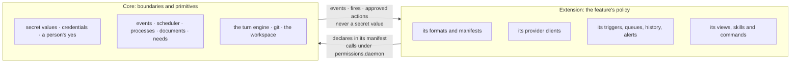

# Core and extensions

Which code belongs in the core (the daemon, the editor and the contract between them) and which belongs in a feature's extension, with the cases that set the line.

## The rule

The core holds three things, and only these:

- **Boundaries.** Secret values and credentials, every yes a person gives (grants, approvals, releases), tokens, and what an agent or an extension may reach. A boundary has to be enforced by code the agent cannot step around, which means the daemon.
- **Primitives.** Mechanisms more than one feature builds on, or that extensions build on: the event bus, the scheduler, process supervision, stored documents, the needs lifecycle, the credential gateway, the listener routes.
- **What every sandbox needs**, whether or not it uses a given feature: the turn engine, git and landing, the workspace, the agent's own tools.

Everything else is a feature's policy, and it belongs in that feature's extension: the files it reads (a `stacks.json`), the providers it talks to (GitHub, Slack, Komodo), when it acts (triggers, matching, the schedules it picks), what it remembers (queues, history, ledgers), how it judges (monitors, verdicts, alerts), and its views, skills and commands. A sandbox that never uses a feature should not carry its code, and switching the extension off should switch the feature off.

## Telling them apart

Any of these, found in core code, usually means a feature's policy has leaked in:

1. A sandbox that never uses the feature still runs or ships the code.
2. A provider's or product's name in a core path, or a core table keyed by provider (the `DIRECT_PUBLISH_PLATFORMS = {"discord"}` that stood in the contract until 2026-11-26).
3. A core module whose only consumer is one extension's views. The extension is then a shell over logic the core owns.
4. A need kind, model role, trigger source, route or CLI command added to a closed core list for one feature.
5. An extension id checked in core code (`extension.id === "intentic.maintenance"`).
6. A comment saying the extension API cannot do something, so the code lives here.

The inverse mistake is a boundary in extension code. A check the agent can step around is advice, not enforcement, and it belongs behind a core door. (2026-11-26) The IMAP and Microsoft 365 send commands were the case: each read the owner's action rules and the approval's status from workspace files the agent can write, while the card's password or refresh token sat in the agent's environment. Now the credential stays in each extension's backend, which the CLI reaches through the turn's shell door onto the card's tools ([`card-tools.routes.ts`](../../_sandbox/sandbox/src/extensions/backend/card-tools.routes.ts)), and the backend asks the daemon's outward-action door for the verdict ([`outward-door.ts`](../../_sandbox/sandbox/src/capabilities/broker/outward-door.ts)), which on a hold drafts the approval the extension carries out through `approvals.perform` once a person says yes. The extension keeps only its policy: what each action is and what the owner reads before saying yes.

## When the extension API cannot do it

Policy almost always lands in core because the extension API lacks something the feature needs. Building the feature in core "for now" is the tempting fix, and it is the wrong one. Do this instead:

1. Name the gap: the call, event or power the extension lacks.
2. Add the smallest general primitive that closes it, to the core and the extension API, written for any extension rather than for this feature. An event any backend may subscribe to, not a callback into one engine.
3. Build the feature in its extension on top of it.

If the feature has to go into core first anyway, say so in the plan the owner approves and name the gap there. Put a dated note beside the code naming the gap, and add a row to [Known exceptions](#known-exceptions) so the next person does not copy it.

These are the gaps known so far, and what each one keeps in core:

| Gap | The primitive that closes it | Keeps in core |
| --- | --- | --- |
| Closed 2026-11-26. A backend heard only its settings and the workspace's file, ref and repository changes, and the scheduler could only wake an agent. | `api.events` over the extension's own event stream ([`own.routes.ts`](../../_sandbox/sandbox/src/extensions/runtime/own.routes.ts)), each kind declared in `permissions.events`: `run`, a run ending in a conversation the extension started through POST /agent; `activity`, whether any agent turn runs; `ci` (extension API 2.56.0), each frame of the CI feed as the core's ingestion hears it ([`ci-feed-bus.ts`](../../_sandbox/sandbox/src/seams/ci-feed-bus.ts)). An automation target `{ kind: "extension" }` that fires a handler the backend registers ([`extension-fires.ts`](../../_sandbox/sandbox/src/extensions/backend/extension-fires.ts), `permissions.fires`). | Deploy triggers and their monitor, workflows |
| A backend cannot use a connected card's credential or a stored secret. | Calls through the credential gateway on a card's declared routes. `{{secret:}}` references filled at a core door under the owner's grants, the value never returned. A watch's check is handed its kind's own cards' gateway addresses (2026-11-26), the first case. | The one forge module (CI ingestion, a deployment told to the forge, publishing a repository: [`forge/`](../../_sandbox/sandbox/src/forge), merged from three clients 2026-11-26), which CI ingestion stays core for; filling a stack's `.env` |
| Closed 2026-11-26. Extension routes (`/x/<id>`) sat behind sign-in, so an extension had no public door. | `contributes.publicRoutes`, served at `/door/<id>/<path>` ([`public-door.routes.ts`](../../_sandbox/sandbox/src/extensions/backend/public-door.routes.ts)) under the core's own public doors' protections, each declared per route: the body's size, a per-minute window and a daily ceiling ([`door-admission.ts`](../../_sandbox/sandbox/src/automations/door-admission.ts)), an automation's allowed origins or its door key, proof of work, and a provider's signature checked against a sandbox secret the extension never sees, a redelivery answered `duplicate` ([`webhook-signature.ts`](../../_sandbox/sandbox/src/automations/fire/webhook-signature.ts)). Only a call that passed reaches `api.publicRoutes.serve`, with what was checked. | CI webhooks (core's own CI ingestion, which stays) and the workflow release gate. GitLab's token header is not a scheme a route can name yet; a Cloudflare Turnstile token is since 2026-11-26 (`turnstile.secret`, verified by the core with a sandbox secret the extension never sees). |
| Lists in the contract are closed: trigger sources, webhook signature schemes. Watch kinds closed 2026-11-26 (`contributes.watchKinds`), model roles the same day (`contributes.modelRoles`; [`model-roles.ts`](../../_shared/sandbox-contract/src/models/model-roles.ts) holds the sandbox's own jobs), and message limits and data processors too (a card's `channel.messageLimit` and `processors`, [`channel-facts.ts`](../../_shared/extension-manifest/src/points/channel-facts.ts)). | One contribution point per list, read from the manifest. Outward actions are the precedent (2026-11-25, the credential gateway below), watch kinds the second, model roles the third, a card's channel facts the fourth. | The model providers' and cloud voices' operators in compliance's report, which are the core's own providers |
| The daemon calls into an extension only to carry out an approved action or (2026-11-26) publish an approved post on a platform its card declares (`api.approvals.publish`, [`approval-performers.ts`](../../_sandbox/sandbox/src/approvals/approval-performers.ts)); since 2026-11-26 also to fire an automation's handler and to check a watch kind (`api.checks.serve`, [`contributed-check.ts`](../../_sandbox/sandbox/src/automations/watch/contributed-check.ts)). | Named handlers an extension serves and the daemon calls through the backend host, the way `approvals.perform` is reached. | Reading a sign-in code over IMAP inside the browser tools |
| Closed 2026-11-26. A request through `/x/<id>` carried no person, so an extension's button could not start a turn as whoever pressed it, and a backend that reads the workspace could not hold a member to their areas. | The proxy attaches an assertion of the caller it verified (a person with their tier, areas and the folders those come to, a panel, a program, another extension, or nobody without sign-in), minted for that extension, signed with a key only the daemon holds and good for two minutes ([`caller-assertion.ts`](../../_sandbox/sandbox/src/extensions/backend/caller-assertion.ts)); a backend reads it with `api.caller(request)`, and `POST /agent` takes it back beside the extension's own token (`api.daemon.asCaller`) to start the turn as that person, as the roster holds them then. repo-apps' package graph holds a member to their areas through it. Every credential a caller sent is stripped before the backend sees the request. | Nothing: the CI Fix button moved onto it 2026-11-26 |
| Closed 2026-11-26. An extension could not keep the machine awake for work in flight, or run a tool inside the daemon's workload classes. | `api.work.hold(label)` (`permissions.work`), counted with turns and lands by what keeps the machine awake and what an update or restart waits for ([`working-now.ts`](../../_sandbox/sandbox/src/bootstrap/working-now.ts)). `api.exec` under the `command` or `toolchain` class (`permissions.exec`), admitted by the memory budget and queued with the sandbox's builds ([`extension-exec.ts`](../../_sandbox/sandbox/src/extensions/runtime/extension-exec.ts)). | Workflows |
| Closed 2026-11-26. An extension's tools did not see the turn's grants, could not drive a sandbox account's browser or the owner's, and could not start a background job. | A tool call's context carries what its turn holds (`grants`: the sandbox browser accounts with the sites each signs in on, the owner's browsers, the extension's own cards) and a `ticket` the daemon minted for that call ([`tool-grants.ts`](../../_sandbox/sandbox/src/extensions/turn/tool-grants.ts)). Handed back, the ticket opens the turn doors ([`tool-turn-doors.ts`](../../_sandbox/sandbox/src/extensions/turn/tool-turn-doors.ts)), each declared under `permissions.turn`: `api.browser.call` drives the turn's own browser router for an account it holds, held to the page's own tools and the account's sites ([`turn-browser.ts`](../../_sandbox/sandbox/src/extensions/turn/turn-browser.ts)); `api.ownerBrowser.call` reaches the owner's browser it holds through its peer door; `api.jobs.start` files a job in the conversation on the daemon's job lanes, its work run in the backend. Extension API 2.55.0. | Nothing: the ChatGPT site kit moved onto them the same day |
| An extension's tool is not told how long the turn's MCP client waits on one call (`MountCall.clientCeilingMs`, Cursor's 60 s), so it cannot fit a long wait to it. | The client's ceiling on a tool call's context, beside `grants`. | Nothing. The ChatGPT kit's waits, which the daemon cut to fit such a client, run uncut since 2026-11-26: the client gives up on a long one and `chatgpt_read` collects it. |

State across a backend restart is mostly not a gap. A backend keeps its records in `api.document` under its own state directory and picks them up again on activation, which is what the core's own engines do at boot. A backend that hands back `deactivate` is reloaded on its own when it changes, and every other backend keeps running.

## Precedents

These are the cases that set where the line is, each dated by its decision.

**Moved out, with the missing primitive added first or alongside.**

- 2026-08-03: git history left the editor for an extension. The git operations it lacked (stash, undo) and the ref-change event extensions now hear were added to the daemon in the same change.
- 2026-08-03: the capability catalog moved into each extension's `contributes.capabilities`. The core kept one handler per kind, and the kinds that carry privilege ([capabilities.md](capabilities.md)).
- 2026-08-11 and 2026-08-13: Drafts and Logs left the editor, and Logs left the image. The daemon's log service stayed in core, since the turn engine and diagnostics use it too.
- 2026-10-07: every backend got its own settings and events routes, reachable without declaring a daemon permission.
- 2026-10-12: the Needs inbox became an extension view. The needs lifecycle stayed in core.
- 2026-10-15: `approvals.perform`. e-urzad's office acts are carried out by the extension, after the core has matched and spent the person's yes. Before, an agent turn ran them.
- 2026-11-23: e-urzad and prawo left the image for repositories of their own ([extensions.md](extensions.md)).
- 2026-11-26: the IMAP and Microsoft 365 send gates left those extensions' CLIs for the core, the inverse of the rest of this list: the owner's rule is the daemon's outward-action door, the credential stays in each extension's backend, and a held send is carried out by `approvals.perform`. The core gained two general doors, one for a backend asking the rules about an action its card declares, one for a card's CLI reaching the card's tools from the turn's shell, and no extension API.
- 2026-11-26: four primitives for an extension's own code, written for any extension: `api.events` (its conversations' runs ending, the sandbox going live or idle), `api.work.hold`, `api.exec` under the workload classes, and an automation target that fires a backend handler. Each is declared under `permissions` and refused undeclared. They are what the code-health probe runner and main's fix agent need to leave the daemon; neither moved in that change.
- 2026-11-26: the core automation templates and the npm and GitHub release watch kinds left the daemon. The manifest's `automationTemplates` takes every field the daemon's own templates carry, and `contributes.watchKinds` declares a kind whose check the extension's backend answers (`api.checks.serve`) through the backend host's door, handed its own cards' gateway addresses. Each template went to the extension whose feature it is: the code chores (static in the manifest, generated from the chores book), the agent-work review and the dreaming session to maintenance, failing CI to pipelines, bug reports to issues, the release watches and the linked-sandboxes digest to connectors (which gained a backend for the two kinds, under their old ids, so no stored watch converts), a page watch to automations. The `intentic.maintenance` check left the catalogue; the Visitor chat's template stayed beside its core source and left with it (below).
- 2026-11-26: the model roles of five extensions' jobs left the contract's table for their manifests (`contributes.modelRoles`), under the same ids: pipeline fixes, deployment fixes, maintenance chores, documentation runs and acceptance runs. The daemon serves the sandbox's own jobs and the installed extensions' (`GET /settings/model-roles`) to the Models page, which shows those whose extension is on and keeps the owner's choice for the rest; a turn's `job` and the stored `roleSetups` take any job's id (`runRole` keeps its closed list beside `job`, since a far end in the field reads it), so main's fix agent, still in `ci/`, starts `pipeline-fix` by id. A sandbox that never placed its jobs stores no map and runs each on its suggestion, an extension's on its declaration's: until then the schema wrote the core table down at the first save of any setting. `refactor-run`, which nothing has started since the Health tab went, belongs to nobody and stays only in the record of the old table the editor shows an older daemon by.
- 2026-11-26: a command action says who decides its rule and what it comes to while none names it (`gatedBy`, `unruled`), so the IMAP and Microsoft 365 senders no longer declare `selfGated`, which bundled both, for the shell's guard to let a held send reach the backend that drafts its approval.
- 2026-11-26: three primitives for any extension, extension API 2.53.0. A public door: routes a manifest declares under `contributes.publicRoutes`, served at `/door/<id>/<path>` behind the protections the core's own public doors hold (size, rate, daily ceiling, an automation's origins or key, proof of work, a provider's signature with a secret the core keeps). The caller's identity: an assertion of who is calling through `/x/<id>`, minted by the proxy for that extension and signed with a key only the daemon holds, which a backend reads and `POST /agent` takes back to start a turn as that person; repo-apps' graph holds a member to their areas with it, which it had not since its move. And a listener strangers may reach (`contributes.listener.strangers`), whose wakes the owner's floor for a visitor or a bug report holds, read from the declaration where a table of the core's provider names decided it. Issues intake, visitor chat and the CI Fix button move onto them in their own changes.
- 2026-11-26: the channel facts left the core's tables for the cards of the extensions that own each platform, extension API 2.54.0 ([`channel-facts.ts`](../../_shared/extension-manifest/src/points/channel-facts.ts)). A card declares its one-message limit (`channel.messageLimit`; the contract's `MESSAGE_LIMITS` is frozen for the approvals inbox facing an older daemon and leaves at 3.0.0), the targets its backend publishes an approved post to (`channel.publish`, which the approvals executor hands over to `api.approvals.publish` after the yes is spent, as it hands an action to `perform`; the Discord-only fast path in `approvals/` and its channel-id pattern went to the discord extension's backend), what a publishing turn reads about the platform (`channel.posting`, Reddit's permalink rule), where it sends people's data (`processors`: flow, operator, region, third country, hosts, a field naming its server; compliance's team-chat and mail tables went, and their drift from the manifests' hosts with them), and that its status is its listener's report (`status: { from: "listener" }`, WhatsApp's linked phone). A conversation from an extension's listener is named by its declaration's label and drawn with its extension's mark in the editor. Platforms with no extension in this repository (Bluesky, LinkedIn, Mastodon) keep no core default: nothing here posts to them, and an older daemon's table still counts them for the inbox. A public route may require a Cloudflare Turnstile token, verified by the core with a sandbox secret, so visitor chat can move onto a public door.
- 2026-11-26: four primitives for an extension's agent tools, extension API 2.55.0, each a power declared under `permissions.turn` and written for any extension. A call is told what its turn holds and handed a ticket good while it runs; with it, a tool drives the turn's signed-in browser for an account the turn holds (through the router and guards the agent's `browser` tools use, held tighter: only the page's own tools, only on the account's sites, an answer from a page that left them withheld), calls the owner's browser the turn holds through its peer door, and files a background job the agent collects with `wait`, its work done in the backend and its lane, end and wake the daemon's. No credential reaches the extension, and anything the turn does not hold is refused at the door. The ChatGPT site kit, their first consumer, moves in its own change.
- 2026-11-26: the ChatGPT site kit left the daemon for the [chatgpt](../../_extensions/chatgpt) extension, the first consumer of the 2.55.0 turn primitives. `chatgpt_send`, `chatgpt_read` and `chatgpt_image` keep their names and arguments on the extension's own server: `account` drives a sandbox account's browser through `api.browser.call` (the `browser` router listed them until then), `browser` the owner's through `api.ownerBrowser.call`, and an image there is a job filed with `api.jobs.start` in a lane of the extension's own, as the peer door filed it before. The router's kit wiring, the peer door's image jobs, the client ceiling's ChatGPT cases and the ChatGPT rows of the owner's-browser skill note are gone; `WEBEXT_CHATGPT_SEND_TOOL` and its file tickets stay, since the browser extension in the field runs the kit as tools of its own and refuses a file without its ticket. The engine left `_shared/site-kits` for the extension, which an extension may name nothing else to carry, and the browser extension imports it through one entry (`CONSUMERS`), as the files sidecar imports ONLYOFFICE's. Moving it showed two things the 2.55.0 doors did not carry, fixed there for any extension: a file chooser the extension's own click opened could not be answered, since the browser door read where the page was first and @playwright/mcp refuses every other tool while a chooser waits ([`turn-browser.ts`](../../_sandbox/sandbox/src/extensions/turn/turn-browser.ts)), and the owner's-browser door answered only once the browser had, past the five minutes the backend host's Node fetch waits for headers, where a ChatGPT image takes nine ([`tool-turn-doors.ts`](../../_sandbox/sandbox/src/extensions/turn/tool-turn-doors.ts)). Not carried: fitting a long wait to a client that gives up sooner (the gap above).
- 2026-11-26: the repo-apps package graph left the daemon's `workspace/` for a backend of the extension's own, which reads the workspace from disk, with no new API ([repo-apps](../../_extensions/repo-apps/README.md)). The daemon's two routes went with it, and the views read them only from a daemon older than the backend. The add-app templates stayed in core: the same template manifest says how each app previews, which the Preview's targets and Start read as well.
- 2026-11-26: the code-health probes left the daemon's `chores/` for a backend of the maintenance extension, built on the four primitives above: it measures only while no turn runs (`api.events`, `activity`), runs each tool through `api.exec` (`command` to see whether the tool is there, `toolchain` to measure, queued with the sandbox's builds), and asks the daemon only for its repositories and its file search's count of a repo's code files (`permissions.daemon`). The probe cache and the ledger stay where the daemon kept them, `.intentic/records/chores/`, so a sandbox keeps its measurements and its verdicts, and the daemon's two document registrations went with the store. The `"intentic.maintenance"` check in `composition.ts`, the boot wiring and the three routes (`GET /chores`, `POST /chores/probe`, `POST /chores/ledger`) are gone; the views reach the backend through `api.backend`, and the extension's `engines.intentic` (^2.52.0) has an older daemon refuse its backend rather than half-run it. The chore book, its probes and its verdicts are the extension's own now, read by its views and its backend alike; the contract's `chores` subpath stays as a frozen copy only because the extension wire records it, and leaves at extension API 3.0.0 as a pure delete (`composeAsk`, `updateBrief` and the workspace-root exclusion moved to neutral modules the daemon and the editor import instead). No work hold: the daemon never kept the machine awake for a probe, and one cut by a restart is measured again on the next sweep.
- 2026-11-26: bug-report intake, fingerprint grouping, the inbox and escalation left the daemon's `issues/` for a backend of the issues extension, on the three doors added for it and no new API ([intentic/extension-issues](https://github.com/intentic/extension-issues)). The reporter and the report door are its public routes, `/door/intentic.issues/sdk.js`, `<intake>/config`, `<intake>/report` and `<intake>/written` (the same report behind a proof of work, for an intake that asks one of a person's written report but never of a crash). The `issues` trigger source is its listener, declaring `strangers: "report"`, and a wake is a listener message on the issue's own thread, so the scheduler's floor, holds and journal decide it as they did. Investigate starts its turn as the person who pressed it. The inbox stays at `.intentic/records/issues/` and the install probes at `.intentic/records/issue-installs.json`, in the shapes the daemon wrote, and an intake's key keeps working, since the door keys a keyed route's automation under the bug intake's own key store. Account routing stayed: its outbox, claims and suggestions moved to `account-routing/`, and a report another sandbox of the account sends is admitted at `POST /account/report` as before, then handed to the extension's `account-report` handler through the fires door, which only the daemon reaches, so the sender stays the platform's word; while no extension keeps the inbox the door answers 503 and the sender's outbox keeps the report. The `issues` field stays on the automation record: it is the intake's own settings, edited in the Automations view beside its allowed origins, and the extension reads it with `GET /automations`; moving it out would need a store for an extension's per-automation settings, which no API offers. The old `/intake/…` paths, in customers' pages and in apps that bundled the SDK, are forwarded onto the door for a release ([`moved-doors.routes.ts`](../../_sandbox/sandbox/src/extensions/backend/moved-doors.routes.ts)), the key and the proof the old SDK put in the body moved to where the door reads them. Four things the daemon did were not carried at first, each an API gap rather than a reason to keep the code, and came back the same day with extension API 2.54.0 as options any extension declares and the core enforces: a route's `keyFromBrowsers` (an automation that opts in, on its listener trigger, where the automations file's conversion moved `issues.keyFromBrowsers`, lets its key admit a browser whose Origin is not listed), `dailyMax: "none"` on a GET-only route (the reporter and an intake's settings, which every page view loads), a listener message naming its automation (`automationId`, so a report wakes only the intake it came through), and a held wake named on the dispatch stream with the conversation it will run in (`heldWake`).
- 2026-11-26: the Visitor chat left the daemon's `webchat/` for a built-in extension, visitor-chat, on the doors added for it and no new API ([visitor-chat](../../_extensions/visitor-chat/README.md)). The widget, a chat's settings, a visitor's message and the poll for later answers are its public routes (`/door/intentic.visitor-chat/…`), a thread's first message going to a route that asks a proof of work. A message wakes the chat's automation through the extension's own `webchat` listener, declaring `strangers: "visitor"`, streamed (`?stream=1`) and naming its automation, and the backend turns the dispatch's frames into the widget's events, which the public door relays unbuffered; a held wake's frame is the visitor's "a person will review it". The chat's own policy moved with it: its defaults and what a browser may see of its settings, its sign-in, its per-thread and per-day ceilings, and its threads, which now age by the chat's `sessionTtlMinutes` up to the listener's own week, a new generation carrying the widget's transcript as its history. A reply no stream carried (a held wake let, a person writing as the agent, a decline) is delivered to the listener's gateway like any channel's: the extension declares a gateway process on connector-runtime's shell that writes it into the visitor's outbox, so the listener outbox, "speak as the agent", restart replays and the needs path lost their `webchat` cases, and a need's ask now skips any source declaring `strangers`. Two things stayed in the core, and why: a signed-in visitor's identity, `POST /listeners/<provider>/identity`, which verifies a Google ID token against the site's own client id and says whether the address is the owner's or a member's, since the second half is the roster, which an extension should not read whole; and Turnstile, verified by the extension with each chat's own stored secret rather than the door's `turnstile.secret`, since a door route names one sandbox secret for every chat and checks every call, while a chat holds its site's own keys and asks once per thread. Stored data reads unchanged: `webchat` stays on the automation record, the outbox and the install probes stay at `.intentic/records/webchat-outbox.json` and `webchat-installs.json` in the daemon's shapes, and each chat's Turnstile secret stays where the owner set it. The `/webchat/…` paths, in every pasted snippet, are forwarded onto the door ([`moved-doors.routes.ts`](../../_sandbox/sandbox/src/extensions/backend/moved-doors.routes.ts)), streaming included, and say in the console when the extension is off; the snippet's script path stays for good. `GET /webchat/{id}/installs` left the contract for the extension's own `installs/<id>`, read by its install panel, a side view the Automations view opens with the `visitor-chat.install` command. The extension is built in and on, and like any other the owner may switch it off, which is never silent: each automation its listener fires records an error run saying which extension is off, the way an off watch kind's checks fail (a listener has no check, so it is said once, as the switch goes off, for any extension's listener: `extensions.routes.ts`), its source reads as unavailable in the Automations view, and the widget's old path says so in the site's console.

- 2026-11-26: main's one fix agent and the Pipelines board's backend left the daemon's `ci/` for a backend of the pipelines extension ([pipelines](../../_extensions/pipelines/README.md)), on the primitives above and two more, extension API 2.56.0: a `ci` kind on `api.events` (the CI feed's frames, a failed job's carrying what the forge said of it) and `api.activity.append` (the `ci.repair_*` rows the SDLC scoreboard counts). CI ingestion stayed core by the owner's decision: the webhook door and its signature check, the poller, the runs cache, edge detection and the feed, which pipelines, deployments and automations all read, and the forge clients, merged from three (CI, deployment reports, repository creation) into one module ([`forge/`](../../_sandbox/sandbox/src/forge)) that the extension reads through typed routes (failed steps, passed jobs, a job's log, annotations, a run, the workflow file a run ran, its failed jobs re-run, each repository's main line). What the core decided from the fixer's own setting became a claim the extension holds while its `autoRepair` is on (`POST /ci/main-lines/claim`, kept in the CI store and void while the extension is off), so a main line's failure still reaches no `ci` automation listening on every branch. The streaks, turn counts, passes, fleet re-runs and owner steps the daemon kept in `.intentic/secrets/ci.json` are handed over once (`POST /ci/repair/hand-over`), which also makes the fix agents the extension's conversations and writes an owner's `autoRepair` off into the extension's setting; the Agent tab's toggle went, and the sandbox setting stays only to be read by that hand-over. The Fix button starts the turn as whoever pressed (`api.caller`), and the board's views read the backend, falling back to an older daemon's own routes. `agents ci` reads the extension's `main_failures` tool through the turn's shell door, which gained an extension's own tool server (until then only a card's), and the sandbox's own test runs at main stayed the core's (`GET /ci/main/local`). The ci-fix conversation ids and the `ci-fix` errands stay readable: the extension names its fix agents in that family so the board and the fleet group their attempts, and its turns, said through POST /agent, carry no errand. `GET /ci/main`, `POST /ci/failures/forget` and `POST /ci/fix` left the contract. Device runners stayed machine-side; the notice naming the computer a failed runner is on reads them through the daemon's device routes.
- 2026-11-27: the PostHog card left connectors for product-health ([product-health](../../_extensions/product-health/README.md)), a built-in extension whose backend reads PostHog for the Product health rail view, since the daemon serves a connection's credential only to the extension contributing its card (`GET /capabilities/<id>/connection`), the rule that put Komodo's card in deployments. Saved connections keep their id, as `cli:posthog` resolves to whichever enabled extension declares it, and the card's skill and image fragment moved with it. No new API: its rounds, fix agents (POST /agent as whoever pressed), `posthog` listener (`strangers: "report"`), alert door and agent tools stand on doors the moves above added.

**Built into core, then split (2026-11-25).** The deploy engine that replaces Komodo went into the daemon's `deploys/` although a deployments extension already existed. Three reasons were given: a backend could not hear CI results, could not fill secrets into a stack's `.env`, and was thought to lose in-flight deploys when the backend host restarted. On review, only four parts belonged in core: filling secrets at a core door under owner-only grants, the grant card, the work on the machine itself, and a CI event a backend can subscribe to. The stack manifest, the queue, history, rollback and promotion, trigger matching, the monitor and its alerts, and reporting to the forge were deploy policy, and the split moves them to the extension. The three gaps are small primitives next to the engine they kept in core, and the same family of primitives carried every 2026-11-26 move above.

**Core, and right to be.**

- The automations engine (scheduler, fires and their journal, held wakes, who may wake an agent) is core, and the automations extension is only its interface, kept switched on (`ESSENTIAL_EXTENSIONS` in [`installed-extensions.ts`](../../_sandbox/sandbox/src/capabilities/extension-inventory/installed-extensions.ts)). The engine fires on its own, chat extensions, CLIs and other features build on it, and switching a view off must not stop a schedule.
- The listener routes ([`listener-state.ts`](../../_sandbox/sandbox/src/extensions/listener/listener-state.ts)), the connector catalog and the credential gateway ([`broker/`](../../_sandbox/sandbox/src/capabilities/broker)) are the pattern to copy. A chat extension declares its events, its card, its broker routes, its rules and the outward actions its requests perform in its manifest, and runs its gateway as a process. The core holds the credential and enforces the rules without knowing any provider by name. 2026-11-25: the outward actions joined the declaration (`broker.actions`, and `commandActions` for an extension's own command-line tools), and the gateway and the command guard classify, record and hold them to the owner's action rules from it ([capabilities.md](capabilities.md)). Until then the daemon's outbound sniffer matched four providers' addresses and commands in shell text and the contract listed every service's action keys, and once the chat skills reached their services through the gateway's variables no brokered send was recorded or gated.
- Loops, account routing, push notifications, panels and ports, the browser's sessions and credentials, the door to the owner's own browser, devices, phones, the wallet, VPNs and network disks. Each is a boundary, or a primitive with several consumers.
- Every need kind (2026-11-26). The deploy card became the stack-grant card that lets a stack receive named secrets, which is the owner's consent over secret values, and the redirect card belongs to account routing, itself core. So no extension needs to contribute a kind yet, and that primitive waits for a feature whose card is its own.
- The git operations only git history uses (stash, rebase, reset) stay in the daemon, because writes to the main tree take the repository lock that landing also takes.
- The editor keeps the Run view and a repository's own sandboxed UI, which reach internals no extension can ([`coreViews.ts`](../../_editor/web/src/core-views/coreViews.ts)).

## Known exceptions

None. Every row the 2026-11-25 audit found has moved (the 2026-11-26 precedents above), and a new one goes here as the rule above says, naming the gap that holds it.

What stays behind on purpose, each until a named retirement rather than as policy:

- Shapes a far end in the field still speaks. The contract keeps the `chores` subpath and `MESSAGE_LIMITS` because the extension wire records them (they leave at extension API 3.0.0), and the released `npm` and `github-release` watch-source arms and the deprecated `issues.keyFromBrowsers` because runners of an older release speak them on the runner door (they leave once that door's floor passes the release that moved them, `_tools/checks/lib/peer-floors.mjs`). `WEBEXT_CHATGPT_SEND_TOOL` and its file tickets stay for the owner's browser extensions already installed.
- Forwards for addresses already pasted into customers' pages: the old `/intake/…` and `/webchat/…` paths ([`moved-doors.routes.ts`](../../_sandbox/sandbox/src/extensions/backend/moved-doors.routes.ts)).
- The deprecated `autoRepair` sandbox setting, read once by the pipelines extension's hand-over to carry an owner's "off" into its own setting.

Not examined yet: the per-vendor agent runtimes under `runtimes/`. The Pi runtime is chosen by a reserved card id rather than by a declaration, and each vendor's runtime ships in every sandbox; making them contributed would need a runtime-adapter contribution point, which nothing has asked for.
