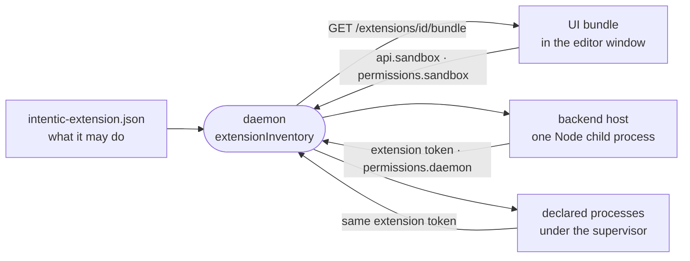

# Extensions

Extensions add views, commands, file viewers, agent skills, background processes and connectable capabilities to intentic through a declared manifest, without changing the editor or the daemon.

Whether a feature's code goes in an extension or the core, and what to do when the API below cannot carry it, is [core-and-extensions.md](core-and-extensions.md).

## The package

- An extension is a directory with an `intentic-extension.json` manifest (`ExtensionManifestSchema` in [`manifest.ts`](../../_shared/extension-manifest/src/manifest.ts)). Its id is `publisher.name`, and `engines.intentic` is a semver range over the host's extension API version, which versions the UI kit's exports as well as the API's, checked before activation.
- `contributes` declares everything it adds, one schema per contribution point in [`points/`](../../_shared/extension-manifest/src/points): views on the rail or in a sandbox, file viewers, side views (below), commands, settings, processes, capabilities, automation templates, watch kinds (below), model roles (below), a `bin` directory put on the agent's `PATH`, `tools` (an MCP server every runtime's turns get, below), and `agent` (the checkout is also a Claude Code plugin with skills and hooks; a `.mcp.json` in it is deprecated and warned about at load, since only Claude Code reads it).
- A side view (`contributes.sideViews`, `api.sideViews`) is something the extension can show in the editor's side panel for one input, beside whichever section the reader is in: a CI run beside the chat about it. The host owns the panel and the tab, a peek the next one replaces unless kept, and "Open in …" goes to the path the extension names, which is also where a phone goes, having no side panel. Unlike a view it owns no route: its input is plain values, so a tab survives a reload and travels between windows, and its body never touches `api.route`. With `links: true` declared it may claim links the chat renders, which then open beside the chat instead of in a new browser tab ([`side-views.ts`](../../_shared/extension-manifest/src/points/side-views.ts); the Pipelines extension's CI run is the first).
- What each field means to the host is declared on the field (`.meta({ power, effect, mintsServer })`, [`meaning.ts`](../../_shared/extension-manifest/src/meaning.ts)): the powers an update re-asks for, what adding a card discloses, and which kinds register an MCP server are read from there. [`surface.json`](../../_shared/extension-api/src/surface.json) records a digest of the whole generated schema per API version, so a field added at any depth needs a new version: an older host's parse drops what it does not know.
- `entry` is a prebuilt single-file ESM bundle exporting `activate(api, context)`; `server` is a Node bundle exporting `activateServer`. Both are optional, so an extension can be data only. The UI half reaches its own backend with `api.backend`, by a path relative to its namespace: the routing id is the install id, which for an extension installed by a card is the card's id, not `publisher.name`.
- `tools` gives the agent an MCP server: per granted card of one of the extension's cli kinds (`perCard`), or one for the extension. The backend serves it with `api.tools.serve((card) => [...])` and the backend host owns the transport, each call's deadline and the card lookup, and lists a tool's declared `effect` as the same MCP annotations the daemon's own tools carry (`toolAnnotations`, [`peer-mcp-server.ts`](../../_shared/sandbox-contract/src/protocol/peer-mcp-server.ts)); or a declared process answers on its port. A cli card's `mcp` stays one release as an alias for a backend path that speaks MCP itself ([`tool-servers.ts`](../../_shared/extension-manifest/src/tool-servers.ts)). A host-served call is also told what its turn holds and handed a ticket onto that turn (below, what its tools may do with the turn); a server answering the transport itself is told neither.
- A cli card names the outward actions it performs, each as a key below the card's id (`message.send` for `slack.message.send`): `broker.actions` for its requests through the credential gateway, by method and path, and `commandActions` for its own command-line tools, by the words that select the command ([`capability-broker.ts`](../../_shared/extension-manifest/src/points/capability-broker.ts)). The daemon classifies, records and holds them to the owner's action rules from these, and Guardrails and the public-office preset offer a rule for each the enabled extensions declare that is more than a read; nothing in the core matches a provider's address or command ([capabilities.md](capabilities.md), outward actions through the gateway). 2026-11-25, extension API 2.49.0. A command action also says who decides its rule, `gatedBy: "sandbox"` (the command guard, before the command runs) or `"backend"` (the card's backend, which asks the outward-action door and drafts the approval on a hold, while the shell lets the command run), and what it comes to while no rule names it, `unruled: "allow"` or `"hold"`, which Guardrails shows as its default (2026-11-26, 2.52.0; `selfGated`, which bundled both, is deprecated and read that way).
- A model role (`contributes.modelRoles`, [`model-roles.ts`](../../_shared/extension-manifest/src/points/model-roles.ts)) is a job the extension starts agent runs for: an id, a label, an explanation, an icon and the setup it is suggested. The daemon lists the sandbox's own jobs and every installed extension's (`GET /settings/model-roles`, [`declared-roles.ts`](../../_sandbox/sandbox/src/agent/models/declared-roles.ts)); the Models page shows those whose extension is on and places them on setups like its own, keeping the owner's choice for a switched-off one in `roleSetups`; and a run the extension starts through POST /agent names its job as `job`, which opens it on that setup's model when it names none. `runRole` beside it keeps the closed list of the jobs the core's table held until then, since a schema a far end in the field reads may only grow (`RunRoleSchema`), so those ids may still ride there for a sandbox from before. The sandbox's own jobs win an id, then the first installed declaration, an enabled one over a switched-off one. 2026-11-26, extension API 2.52.0: until then the contract's table listed five extensions' jobs, and a run naming any other was refused.
- [`_shared/extension-api`](../../_shared/extension-api) is the API an extension codes against (`IntenticApi` in [`api.ts`](../../_shared/extension-api/src/api.ts)), and [`_shared/extension-ui`](../../_shared/extension-ui) the component kit and translator it draws with. The host supplies both at runtime, so every extension shares the editor's own instances.
- What an extension may no longer take from the kit (a deprecated name, a retired prop, a look the kit decided) is recorded once in the kit's [`names.mjs`](../../_shared/extension-ui/names.mjs) and judged by the kit's published `intentic-kit-check`, which every extension runs in its `typecheck`, wherever its repository lives. It also refuses an `engines.intentic` floor below the version that brought a name the extension imports. The `extension-kit` check runs it over `_extensions/*` and the standalone checkouts beside this repository.
- The slice of the wire contract an extension reads is part of the versioned surface. `@intentic/sandbox-contract` moves with the product release, so an extension may import it bare and only the subpaths `EXTENSION_WIRE` lists ([`wire.ts`](../../_shared/extension-api/src/wire.ts), `@intentic/extension-api/wire`), and `surface.json` records each one's export names and a digest of its zod schemas per API version (`wireExports`, from 2.44.0): a schema there reshaped needs a new extension API version, which a standalone extension's `engines.intentic` and its `^` range on the contract then see. The lint override and `intentic-kit-check` refuse any other subpath.
- The in-repo extensions under [`_extensions`](../../_extensions) are `@intentic/ext-<name>` packages. [`_tools/extension-example/seed`](../../_tools/extension-example/seed) is the template an outside author copies, with one contribution of each kind.

## Where they come from

[`installed-extensions.ts`](../../_sandbox/sandbox/src/capabilities/extension-inventory/installed-extensions.ts) merges three sources:

| Source | Where | Trust |
| --- | --- | --- |
| Built in | baked into the sandbox image at `/opt/extensions` | ships with intentic |
| Installed | a git checkout pinned to a full commit sha, from a registry | the owner installed it; updates show a diff of new powers first |
| Workspace | a folder an agent wrote under `.intentic/config` | runs once a land carries it; one written straight into the workspace waits for the owner to approve the powers it declares |

A workspace extension's approval is a digest of its declared powers, kept in `/history` where no workspace write reaches ([`extension-approvals.ts`](../../_sandbox/sandbox/src/capabilities/extension-inventory/extension-approvals.ts)). Editing its code under the same powers keeps the approval; asking for more voids it. The owner can switch any extension off except automations, whose engine fires on its own.

A land is the approval for the extensions it carries ([`landed-extensions.ts`](../../_sandbox/sandbox/src/extensions/landed-extensions.ts)). On every land that reaches the workspace, pressed or automatic, the daemon reads which folders under `workspace-extensions/` the root repository's delta touched, and approves each one now waiting whose manifest in the workspace declares the same powers as the landed commit's. It then starts it the way the Approve press does and writes an Activity row naming the powers it gained. Review & land lists the same extensions before the press (`AgentChanges.extensions`), and the editor loads them without a reload: the approval pushes the extensions list, and a workspace row carries a `revision` of its manifest and bundle that the extension host compares with what it loaded ([`workspaceDrift.ts`](../../_editor/web/src/extension-host/workspaceDrift.ts)). An extension written straight into the workspace, or edited there to ask for more since the land, still waits for the Approve press. (2026-11-21: before, a landed extension waited for that press as well, so the owner decided the same change twice, once at the land and again in Extensions.)

A registry ([`_shared/registry`](../../_shared/registry)) is a git repository of curated listings; the official one is `github.com/intentic/registry`, and [`_tools/registry-scan`](../../_tools/registry-scan) proposes and re-checks its entries.

A built-in extension that leaves the image for a repository of its own is offered back to the sandboxes that used it. 2026-11-23: e-urzad and prawo moved out, as knowledge and maintenance did before. A sandbox that shows it used one (a card of a connector it contributed, records, state or cache it wrote, or the owner's switch or settings for it) gets a recommendation on the Extension tile: the install form, filled in with the repository and the commit pinned in [`moved-extensions.ts`](../../_sandbox/sandbox/src/capabilities/offers/moved-extensions.ts). The sandbox chip points at it too. The owner presses Add and approves its powers like any install. Nothing installs by itself, and the offer goes away once the extension is installed from that repository or the owner declines it.

## Dev mode

An installed extension runs from its pinned clone in `.intentic/local/extensions/<id>`, which every conversation shares live, nobody reviews, and the next update replaces. Changing that copy used to be the only way to see a change on reload, so agents changed it. Dev mode points the install at a checkout of its source instead, such as `extensions/maintenance` or a conversation's own copy of it, and the daemon serves the extension from there: its bundle, backend, processes, skills and contributions. The pointer lives in `.intentic/local/extension-dev.json`, which is never versioned, since it can name a conversation's worktree ([`extension-dev.ts`](../../_sandbox/sandbox/src/capabilities/extension-inventory/extension-dev.ts)).

- The inventory follows a pointer only to a checkout inside the workspace or a conversation's worktree, outside `.intentic/`, `refs/` and `public/`, holding the same extension id, declaring exactly the powers of the pinned version, and built, with every bundle a file inside the checkout (a symlink out of it is held, since the daemon would serve whatever it reaches). Otherwise the pinned clone keeps running and the row says why. New powers still come only through an update the owner approves.
- The install keeps `source: "installed"` and its pinned `commit`, so updates, Browse and the environment overlay read the pinned clone, and removal deletes that clone and the pointer, never the checkout.
- The bundle's ETag is its content hash while dev mode is on, and the row's `dev.revision` is the same hash, so a rebuild shows the editor's usual "Reload now".
- The agent's `extension` command drives it (`extension dev maintenance`, `extension reload maintenance`, `extension dev maintenance --off`). With no path, it finds the workspace repository cloned from the address the extension was installed from, and the calling conversation's copy comes first. The Extensions tab shows where the extension runs from and has a button to go back to the pinned version.
- One install has one checkout. The conversation that pointed it (`setBy` in the pointer) keeps it: another conversation's `extension dev`, `reload` or `--off` is refused naming the holder, while the owner's Extensions tab, which names no conversation, can always let go, and a checkout that is gone holds nothing.

## Loading

- **UI.** Extensions compiled into the editor are imported from [`builtins.ts`](../../_editor/web/src/extension-host/builtins.ts). Any other bundle is fetched from the daemon and imported as a module by [`loader.ts`](../../_editor/web/src/extension-host/loader.ts); its bare imports resolve through the page's import map to the host's own copies, and [`bundle.ts`](../../_shared/extension-manifest/src/bundle.ts) refuses any other import. Before the bundle links, the loader also checks each name it imports from extension-api and extension-ui against what the host exports, so a bundle built for another version is reported as needing an update instead of failing with the browser's link error ([`bundleLinks.ts`](../../_editor/web/src/extension-host/bundleLinks.ts)). There is no iframe: UI code runs in the editor's window.
- **Backend.** Every enabled `server` bundle runs in one Node child process beside the daemon ([`backend-supervisor.ts`](../../_sandbox/sandbox/src/extensions/backend/backend-supervisor.ts)), and the daemon proxies `/x/<id>/*` to it. Each extension loads in its own try/catch. Only a change to what the host runs touches it (the set of backends, a bundle's content, what each is handed at activation); a toggle, install or edit that moves none of those converges without one. When every backend such a change would replace or remove handed back a `deactivate` from its activation, the running host lets those go and loads them again in place (`POST /reload` on the host, [`backend-host.ts`](../../_sandbox/sandbox/src/extensions/backend/backend-host.ts)) and every other backend keeps running; otherwise the host restarts, and the MCP door holds a request meanwhile. Stopping the host deactivates every backend first, within the process-group grace. A sweep asks each running backend's own `health` every 30 seconds; anything but `ok` shows on its row (`degraded`, or `error` for `failed`), and a `failed` one after an update counts as a failed update. One process for all of them rather than one each, since a node process costs tens of megabytes before any extension code loads.
- **Processes.** `contributes.processes` run under the daemon's service supervisor, such as the chat gateways built on [`_shared/connector-runtime`](../../_shared/connector-runtime). Each is started with its extension's own token, never the panel token, and the rest of what `connectExtensionProcess` (`@intentic/extension-api/runtime`) builds the backend api from (`EXTENSION_PROCESS_ENV` in the contract's [`extension-protocol.ts`](../../_shared/sandbox-contract/src/protocol/raw/extension-protocol.ts)), so a process reaches the daemon, its settings, its directories and the workspace's events the way a `server` bundle does.

## What an extension's code is handed

- **Its own directories.** `api.stateDir` (under `.intentic/local/runtime/extensions/`) and `api.cacheDir` (under `.intentic/local/cache/extensions/`), keyed by the extension's identity (`publisher.name`) like its settings and its switch, so they survive an update, a re-install and dev mode. The daemon makes both before any of the extension's code runs ([`extension-state.ts`](../../_sandbox/sandbox/src/extensions/runtime/extension-state.ts)), and moves a first-party extension's older name-keyed directory into place once. Removing the extension lists both in the plan and deletes them. `api.document` reads and writes a JSON file there through the same `conversions` `sandboxDocument` gives the browser half.
- **Its own settings and events.** `api.settings` reads its values, secrets included, and `onDidChange` names the keys that moved, however they moved; `api.workspace` hears file, ref and repository changes. Both ride two routes every extension token reaches without declaring them, `GET /extension/settings` and `GET /extension/events` ([`own.routes.ts`](../../_sandbox/sandbox/src/extensions/runtime/own.routes.ts)), each answering only about the extension the token was minted for.
- **What it may hear, hold, run and be woken by, each declared** (2026-11-26, extension API 2.50.0). Under `permissions` beside `daemon`, each a power the install dialog shows, refused by the runtime before anything is sent and by the daemon when asked:
  - `events`: `run` hears a run end in a conversation the extension itself started through POST /agent with its own token, recorded at that door from the token under the history root ([`extension-conversations.ts`](../../_sandbox/sandbox/src/extensions/runtime/extension-conversations.ts)), and in no other conversation; `activity` hears whether any agent turn runs, as the stream opens and each time it flips. Both ride `GET /extension/events`, asked for by name (`?kinds=`); an undeclared kind is a 403.
  - `work`: `api.work.hold(label)` holds the door `POST /extension/work/hold` open, and while it is open the one answer to "is the sandbox busy" ([`working-now.ts`](../../_sandbox/sandbox/src/bootstrap/working-now.ts)) counts it beside turns and lands: the machine stays awake and an update or restart waits, naming it. The connection is the lease, so a backend that dies lets go of it, and the runtime holds again after a daemon restart.
  - `exec`: `api.exec(argv, { class })` runs one command under the `command` or `toolchain` workload class through `POST /extension/exec` ([`extension-exec.ts`](../../_sandbox/sandbox/src/extensions/runtime/extension-exec.ts)): admitted by the memory budget, and a `toolchain` run takes a slot in the heavy-command queue beside every agent's builds, in its class's CPU, IO and OOM rank.
  - `fires`: `api.automations.onFire(name, handler)` is woken by an automation whose target is `{ kind: "extension", extension, handler }`, after the scheduler's admission, holds and fire journal, through the backend host's `POST /fires/<id>` door ([`extension-fires.ts`](../../_sandbox/sandbox/src/extensions/backend/extension-fires.ts)). Only that extension saves an automation naming itself ([`extension-target.ts`](../../_sandbox/sandbox/src/automations/watch/extension-target.ts)); a person may edit one it saved, keeping the target. A fire its backend cannot take now is kept under the history root and handed over once it is back, after a daemon restart too, one fire standing for those made meanwhile. A declared process gets the first three, never fires.
- **The watch kinds it checks** (2026-11-26, extension API 2.51.0). `contributes.watchKinds` declares a ready-made check an automation can name instead of a guard command: its id, a label, a sentence a source of it reads as (`{key}` puts a parameter in, a `[…]` segment drops when one it names is absent), and its parameters as fields ([`watch-kinds.ts`](../../_shared/extension-manifest/src/points/watch-kinds.ts)). The Automations view's condition, the `automations` command (`automations kinds`, `--watch <kind> --with <key>=<value>`) and an automation's approval card draw a kind from that declaration, and saving holds a source's parameters to its fields (`watchParamsProblem`). `api.checks.serve(kind, handler)` answers one check with a pass and what it saw, or what it is still waiting for; the daemon calls it on the automation's trigger through the backend host's `POST /checks/<id>` door ([`contributed-check.ts`](../../_sandbox/sandbox/src/automations/watch/contributed-check.ts)), handing it the parameters, what the last pass saw, and the credential-gateway addresses of the extension's own cards the kind names in `capabilities`, as the automation's role reaches them, never a credential. A page (`url`) is the daemon's own kind; the connectors extension declares `npm` and `github-release`, which the daemon checked itself until then. A kind whose extension is off stays in the catalogue, switched off, and a watch naming it fails as an error on each run, saying which extension to switch back on.
- **What its tools may do with the turn calling them** (2026-11-26, extension API 2.55.0). The MCP door tells each `tools/call` it forwards to `api.tools.serve` what the calling turn holds, read off that turn's lease: the capabilities its role and its people's reach left it, and what it mounted ([`turn-mounts.ts`](../../_sandbox/sandbox/src/agent/tools/turn-mounts.ts) `TurnHolding`). The call's `ToolCallContext` carries it as `grants` (every sandbox browser account the turn holds, a browser card or an identity, with the sites it signs in on, sign-in families applied; the owner's browsers it mounted; the cards of the extension's own kinds it holds) and as a `ticket` minted for that extension and that call, alive only while the call runs ([`tool-grants.ts`](../../_sandbox/sandbox/src/extensions/turn/tool-grants.ts)). A tool can refuse by itself from `grants`; handed back, the ticket opens the turn doors ([`tool-turn-doors.ts`](../../_sandbox/sandbox/src/extensions/turn/tool-turn-doors.ts)), each a power the manifest declares under `permissions.turn`:
  - `browser`: `api.browser.call(context, { account, tool, args })` reaches the turn's own signed-in browser router for an account the turn holds (`POST /extension/turn/browser`), the router and guards the agent's `browser` tools use, the account set by the grant. It is held tighter than the agent, since nobody reads its calls as they go ([`turn-browser.ts`](../../_sandbox/sandbox/src/extensions/turn/turn-browser.ts)): only the page's own tools (the contract's `EXTENSION_BROWSER_TOOLS`: no `browser_run_code_unsafe`, which reaches every site's cookies, no network tools, no tab list), and only on the account's sites, a navigation elsewhere refused before it is sent, a call on a page elsewhere refused after reading where the page is, and a call that takes the page elsewhere answered with nothing it saw. Typing a stored credential stays `type_credential`'s, on a server no extension reaches. A file chooser or a dialog the page waits on, which stops every other tool, is answered (`browser_file_upload`, `browser_handle_dialog`) only when the extension's own previous call opened it on the account's sites (2026-11-26, the ChatGPT kit's files: a click, then the chooser). The turn's browsers close with it, so a job outlives this half.
  - `owner-browser`: `api.ownerBrowser.call(context, { browser, tool, args })` calls the owner's own browser the turn mounted, through the peer door the agent's own calls take (`POST /extension/turn/owner-browser`), where that browser's site switches, asks and file tickets apply, in the call's conversation. It answers its status at once and the browser's answer when it comes (2026-11-26), so a call may take as long as the browser's own tool does (a ChatGPT image, nine minutes) past the five minutes Node's fetch waits for headers.
  - `jobs`: `api.jobs.start(context, spec)` files a background job in the calling conversation (`POST /extension/jobs`), as a `run_in_background` command is one ([`daemon-jobs.ts`](../../_sandbox/sandbox/src/agent/tools/jobs/daemon/daemon-jobs.ts)): the agent's `wait` takes its id, the conversation's card lists it, `stop` ends it, and a turn that ended on it is woken by its end. It waits its turn in a lane of the extension's own ([`job-lanes.ts`](../../_sandbox/sandbox/src/agent/tools/jobs/daemon/job-lanes.ts): at most `most` at once once one went well, never two of one `key`), then its work runs in the backend with a ticket of the job's own on the same grants, saying lines and its end back (`POST /extension/jobs/{id}`). The job's stream is its lease: a backend that lets go of it ends the job as failed.
  Whatever comes back has every stored secret's value masked to its reference, as the MCP door masks it for the model. A process serves no tool through the host, so it holds no ticket and gets none of the three.
- **A test double.** `fakeExtensionApi` (`@intentic/extension-api/testing`) runs a backend on the real api against a fake daemon that judges every call by the same reach rule the daemon's grant applies (`extensionRouteReach` in [`permissions.ts`](../../_shared/extension-manifest/src/permissions.ts)). A request into `/x` carries the caller a test names (`route(path, init, { caller })`), the fake daemon believes only the assertions it minted and inside their window, and `publicRoute` refuses a path no declared public route answers, as the daemon does (2.53.0); `publish(post)` hands an approved post to `api.approvals.publish` as the approvals executor does (2.54.0). A tool call is handed `grants` and a ticket, and its `browser` and `ownerBrowser` calls and `jobs` are answered by the test and refused outside the grants, the declared powers and the page tools, as the daemon refuses them (2.55.0). [`compliance.test.ts`](../../_sandbox/sandbox/src/extensions/runtime/compliance.test.ts) holds every extension in this repository to what an outside one is held to: its manifest parses, this build activates it, the files it promises from source are there, and every route it declares is one the daemon serves.

## Isolation

- The host refuses any view, side view, command, viewer, setting or process the manifest did not declare ([`apiImpl.ts`](../../_editor/web/src/extension-host/apiImpl.ts)), and asks a side view about links only when its entry declares `links`, so the manifest is the approval surface the install dialog shows.
- A UI bundle's calls into the sandbox pass `permissions.sandbox`, a list of `METHOD path-glob` entries (`sandboxRouteAllowed` in [`permissions.ts`](../../_shared/extension-manifest/src/permissions.ts)). The browser enforces this list, since the code already runs with the owner's session in the owner's window.
- A backend and the extension's processes call the daemon with one token minted for that extension, which the daemon checks against `permissions.daemon` ([`grants.ts`](../../_sandbox/sandbox/src/auth/grants.ts)). It also reaches its own two routes (settings and events) without listing them, and an extension that owns a provider's listener reaches that one provider's `/listeners/<provider>/*` routes the same way, and no other provider's, whatever its globs say. `/state` hands it only the connectors whose card it contributes itself.
- A listener provider belongs to exactly one enabled extension ([`listener-state.ts`](../../_sandbox/sandbox/src/extensions/listener/listener-state.ts)): the declarer that also contributes the provider's connector card, else the first declarer in enumeration order (built-in, git-installed, then workspace by folder). Every other declaration of it is refused at load: the extension still runs, its listener is not granted, its gateway is not started, outbound replies go to the owner's gateway only, and the refusal shows on its row in the Extensions list (`problems`). The listener routes resolve the owner again on each request, so declaring a provider never lets a second extension fake its inbound messages.
- The panel token reaches no route that returns or uses a stored credential, hands back a code, a session, a ticket or a sign-in, or administers the sandbox for its owner: the people on it, tokens, links and pairings, passkeys, secrets, and the settings and safety policy that hold the agent back (`panel: false` in [`route-meta.ts`](../../_shared/sandbox-contract/src/protocol/route-meta.ts)). That token goes to every repo's operator panel, which an agent can start, and extension code never holds it.
- An extension's tools are mounted into a turn at the daemon's one MCP door, `/mcp/<name>`, under the card's id or the extension's name ([`extension-mcp.ts`](../../_sandbox/sandbox/src/extensions/backend/extension-mcp.ts), [`turn-mounts.ts`](../../_sandbox/sandbox/src/agent/tools/turn-mounts.ts)). Each turn holds a bearer of its own that reaches only what that turn mounted and is forgotten when it ends, so it opens only the cards that turn was granted, and two turns of one conversation at once never reach each other's mounts. An ACP agent's warm session keeps its MCP config, so its turns share the conversation's bearer, one live turn at a time, reaching nothing between turns. A card's server is granted by the card (the role's `connectors`); an extension's own server, and its agent plugin, by the role's `extensions` list (absent: every enabled extension). The door hands the extension the card's settings as the daemon holds them now (in the tools request, or `x-intentic-card` on a forwarded one), so a switch the owner flips binds on the next call, and holds a request briefly while the backend host restarts. The host serves tools on a route of its own, never under `/x`, and `/x/<id>/<mcp path>/…` is refused, so neither is reached with a panel's or a member's bearer.
- A request through `/x/<id>` reaches the backend with none of the caller's credentials: the proxy drops the bearer, cookies, every grant's header, the connect token and any header only the daemon may set ([`backend-proxy.ts`](../../_sandbox/sandbox/src/extensions/backend/backend-proxy.ts); until 2026-11-26 only the bearer was dropped, so a panel's or a control token's header rode on). In their place it attaches who the middleware verified ([`caller-assertion.ts`](../../_sandbox/sandbox/src/extensions/backend/caller-assertion.ts)): a person (their tier, the area ids their access holds and the workspace folders those come to, the parts they run), a panel, a program's control token, another extension, or nobody on a sandbox without sign-in, as an assertion minted for that extension, signed with a key the daemon holds only in memory and good for two minutes; one the caller sent is replaced. The backend reads it (`api.caller(request)`), holding a fenced member to their folders as the daemon's routes would; nothing in the host can mint one, and a restart retires every one outstanding. `POST /agent` takes one back only beside the token of the extension it was minted for (`api.daemon.asCaller`), and only a person's changes who the turn is for: that person as the roster holds them then, held to the route's floor, their areas the conversation's fence. A panel's, an agent's or a person's own bearer presenting one is refused, as is one past its window, minted for another extension or in another sandbox. Every other route answers by the extension's own reach, whoever pressed (2026-11-26, extension API 2.53.0).
- An extension's public routes (`contributes.publicRoutes`, [`public-routes.ts`](../../_shared/extension-manifest/src/points/public-routes.ts)) are the only way a stranger reaches its code: `/door/<id>/<path>`, each route a power the owner approved, answered by the daemon's door ([`public-door.routes.ts`](../../_sandbox/sandbox/src/extensions/backend/public-door.routes.ts)) and handed to the backend's `api.publicRoutes.serve` handler, never the `/x` one, only once the route's own protections passed the call, cheapest first: a declared path and method; for a route scoped to an automation, one listening on the extension's own listener provider (404), a browser's Origin on its allowed origins or, for a caller with none, its door key, or for a route declaring `keyFromBrowsers` whose automation opts in on its trigger (2026-11-26), that key from a browser on a site it did not list (403), switched on (409); the caller's minute (429); the body's size as it arrives (413); a solved proof-of-work challenge (403); a provider's signature over the body with a sandbox secret the manifest names and the extension never sees, a stale one refused and a redelivery answered `duplicate` (401); a Cloudflare Turnstile token the caller sends as `x-intentic-turnstile`, verified with Cloudflare under a sandbox secret the manifest names (`turnstile.secret`; 403, 2026-11-26, asked last since it is the one check that leaves the machine, and refused outright while the secret is unset); the day's ceiling (429; a GET-only route may declare `dailyMax: "none"`, for what every page view loads, and keeps its minute and size). The backend is told what was checked (the route, the automation, the origin or that a key stood in, the scheme and the provider's delivery id, the proof's caller, that a Turnstile token passed) and never sees the key, a secret or a credential. An automation on such a listener whose routes take a key gets one minted and listed like the bug intake's (`ingestKey`).
- A listener source anyone on the internet reaches says so (`contributes.listener.strangers`: `visitor` or `report`), and its wakes are held to the owner's admission floor for a website visitor or a bug report instead of a team chat's ([`wake-source.ts`](../../_sandbox/sandbox/src/automations/fire/wake-source.ts)). For every provider the extension owning its listener decides (2026-11-26: a table of the Visitor chat's and the bug intake's provider names decided it before; both are their extensions' own listeners since the same day, the visitor-chat extension's `webchat` and the issues extension's `issues`). A listener strangers reach may ask the daemon who a signed-in stranger is (`POST /listeners/<provider>/identity`, declared in `permissions.daemon`): a Google ID token verified against the site's own client id, and whether the address is the owner's or a member's, so the roster never reaches the extension (2026-11-26, the Visitor chat's).
- A message dispatched on an extension's own listener (`POST /listeners/<provider>/dispatch`) may name the one automation that hears it (`automationId`, 2026-11-26), still held to that automation's filters, sender rules and the owner's floor, so a source with one automation per door (an intake) wakes only the one its message came through; it only narrows, never widens. On a streamed dispatch, a wake held for a person says which held wake it is and the conversation it will run in once let (`heldWake`: its id, the conversation and its link), so the sender can link it before anyone decides ([`listeners.ts`](../../_sandbox/sandbox/src/automations/listeners.ts), [`run-fire.ts`](../../_sandbox/sandbox/src/automations/fire/run-fire.ts)).
- A watch's check reaches an extension's handler (`api.checks.serve`) through the backend host's `POST /checks/<id>` door alone, behind the host token like the fires door below, and only for a kind its manifest declares.
- An automation fires an extension's handler (`api.automations.onFire`) through the backend host's `POST /fires/<id>` door alone, which the host token reaches and no `/x` route, panel or agent token does, and only for an automation that extension saved itself and a handler its manifest declares. Its holds, commands and events each check the extension's own declaration at the daemon, whatever its runtime already refused.
- A turn door (2026-11-26) answers only a ticket the daemon minted for the calling extension's own tool call, or for a job that call started, and only for a power its manifest declares in `permissions.turn`; a ticket kept past its call, presented by another extension or naming an account or a browser of the owner's the turn did not hold, is refused. A job's ticket keeps the grants of the call that started it and no more, and reaches the turn's own browsers only while that turn runs.
- A backend may carry out approved actions itself (`api.approvals.perform`). An approvals-queue action whose `performer` names the extension goes to the backend host's `POST /approvals/<id>` door only from the daemon's approvals executor, after it matched a person's recorded yes against the item and spent it ([`approval-performers.ts`](../../_sandbox/sandbox/src/approvals/approval-performers.ts)). The door is behind the host token, never under `/x`, so no person's, panel's or agent's token reaches it, and the extension keeps the credentials and re-checks what it sends. e-urzad's office acts are carried out this way (2026-10-15); before, an agent turn ran the extension's command, which could judge the approval only from the workspace file any turn writes. The IMAP and Microsoft 365 held sends are too (2026-11-26), and there the daemon also writes the queue item: the backend asks the outward-action door (`POST /capabilities/{id}/outward-action`) for the owner's verdict on an action its card declares, and a hold comes back as the item, naming the extension and the digest of what it keeps ([capabilities.md](capabilities.md), outward actions). A post reaches a backend the same way (`api.approvals.publish`, 2026-11-26): one whose `platform` names a card declaring `channel.publish`, whose target matches the card's pattern and which attaches nothing, handed over with its words, title and target as approved ([`post-channels.ts`](../../_sandbox/sandbox/src/approvals/post-channels.ts)). The Discord bot publishes this way; until then the daemon posted to Discord itself from a table naming it. Every other post goes to an agent turn driving the logged-in browser, briefed with what each platform's card says about posting there (`channel.posting`).
- Kinds of capability that carry real privilege stay in the core catalog, so a manifest cannot contribute them ([capabilities.md](capabilities.md)).
- Extensions are trusted code inside the owner's sandbox and browser. The boundary is what they declare and what the owner approved, not a process sandbox.
