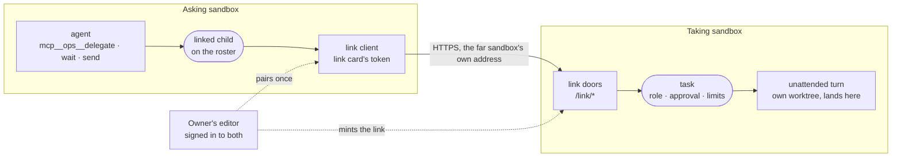

# Linked sandboxes

A link lets one of an owner's sandboxes hand tasks to another of theirs: the asking sandbox's agent calls that sandbox's `delegate` tool, and the task runs as a conversation of its own in the other sandbox, with that sandbox's repositories, connections and credentials, under terms only that sandbox's owner sets.

**Contacts first (2026-11-27).** Between two sandboxes that speak `s2s/1` (each answers `GET /s2s/identity`), what a link
carried is a contact's grants ([messages.md](messages.md)): its terms under their own names, its tasks as `task.*`
messages with their status pushed, its records and operating as calls. An existing link becomes such a contact by
itself (below, "Upgraded into a contact"), and the editor's pairing makes a contact instead of minting a link toward such
a sandbox. The `/link/*` doors are kept only for daemons that do not speak `s2s/1` (2026-11-27).

## The two halves

- **The taking side** holds an *inbound link* ([`inbound-links.ts`](../../_sandbox/sandbox/src/links/inbound-links.ts)): an `ilk_` token stored as its hash, the label of the sandbox that holds it, and its terms. The terms are the role every task wears, whether each new task waits for the owner (`approve`), and how many turns an hour the link may start. The owner mints, re-terms and revokes links on Sandbox ▸ Access ▸ Programs, and answers tasks that wait there; the tab counts them.
- **The link doors** ([`links.routes.ts`](../../_sandbox/sandbox/src/links/links.routes.ts), `/link/*`) check the token themselves. They answer only for the conversations their own link opened: the link's task list is the whole of its reach. The doors cannot read files, list other conversations or change settings, and they can never land.
- **A task** ([`link-tasks.ts`](../../_sandbox/sandbox/src/links/link-tasks.ts)) opens a conversation named `link-…`. Its turns are unattended, isolated in their own worktree, wear the link's role, and are drawn as a program's words (`<label> (linked sandbox)`). They also carry `outside` content, so the guard treats them as somebody else's words. A card such a turn raises waits for the taking sandbox's owner, except a plain question, which the asking agent may answer. The closing message of each turn is the task's report. A task keeps its opening words until its first turn is said; one a restart cut between filing and starting is started at boot from them, under the first try's message id, so a turn that did start is not started again (`startUnstartedTasks`). The link's hourly allowance is kept on the history volume, so a restart does not reset it.
- **The asking side** holds a `link` capability card under Your devices: the far address and the token, kept by the daemon and never put in the agent's environment. Each granted card is mounted on the turn's lease as a tool server named after it ([`link-mounts.ts`](../../_sandbox/sandbox/src/links/link-mounts.ts)): `mcp__<card>__delegate` and `mcp__<card>__about`, reaching every runtime the same way. A hand-over ([`linked-children.ts`](../../_sandbox/sandbox/src/links/linked-children.ts)) files the task as a `linked` subagent on the parent's roster. `wait`, `send`, `answer` and `cancel` reach it there like any child. A follower long-polls the far side (`GET /link/conversations/{id}?after=<version>&wait=25`) and moves the record. The ending wakes the parent the way a spawned child's report does, marked as outside content, since it is another sandbox's agent's account. The follower list is on the history volume, so a restart picks it up again. A hand-over is filed there before the far side is asked, with the ask kept until it is answered: a restart in between asks again under the same request id, which the far side answers with the task it already took, so nothing over there is orphaned and nothing runs twice. A settled task keeps its report on file (the newest 50), so a `wait` after a restart still hands it.

## Upgraded into a contact

A link already proves both sandboxes to each other, so once both speak `s2s/1` it becomes a contact with no pairing again
([`links/upgrade/`](../../_sandbox/sandbox/src/links/upgrade)). The link's token vouches for the asking side's key once.

- **When.** The asking side offers every `link` card to its far side at boot, again on a backoff (a minute, doubling, at
  most six hours) until it is a contact, and at once when a turn mounts the card, at most every ten minutes. A far side
  that does not serve `GET /s2s/identity` (a daemon from before) is asked again daily and left as it is meanwhile: the card
  and its token keep working.
- **Asking side.** It stops following the card's tasks, posts its own identity document, its grants and its wake secret to
  `POST /link/upgrade` under the card's token, and files the far side as an accepted sandbox-scoped contact (origin
  `link-upgrade`) from the answer, under the card's name, so `mcp__<card>__…` keeps its name as the contact's tool server.
  It gives the far side `message` and `wake`, so a task's report wakes it. Every task handed over through the card goes on
  as the contact's (`via: "contact"`), and the card is removed with its vaulted token. A far side that did not take the
  upgrade leaves the tasks followed again and the card as it was.
- **Taking side.** The door checks the token as every link door does, then that the document is the sandbox the link was
  minted for (its stored peer's id, and its host when the peer's address is known), then confirms it at its own address
  (the same key, the handshake's rule), files an accepted contact (origin `link-upgrade`) whose grants are the link's terms:
  `task` (`actsAs`, `runAs`, `approve`, `turnsPerHour`) while it takes tasks, `records`, `operate`, `message` and `wake`.
  Every task the link filed moves onto the contact's task book, where its status is pushed as `task.update` messages, a
  settled one included, so a report the asking side had not read still reaches it. The link's record stays on Access ▸
  Programs, marked with the contact it became, and its token opens no door but this one.
- **Once.** A repeat under the same token (the asking side never heard the first answer) reads the same answer again for
  fifteen minutes, for the same key, and changes nothing: not the contact's grants, its key, or one since removed or
  blocked (2026-11-28). After that the token opens no door at all. A contact for that sandbox already there when the
  link is upgraded keeps its grants, with the link's added; a blocked one is refused.

## A link, or delegating as yourself

Since 2026-11-24 a task can also go to another sandbox without a link, as the person the asking conversation acts for ([account-routing.md](account-routing.md), "Tasks as a person"). Each is for a different job:

- **A link** is for unattended work under a role the taking sandbox's owner chose, for a sandbox the person is not in, and for operating or reading a sandbox (`operate`, `records`). Its tasks are the taking owner's, held to the link's terms and approval.
- **A person route** (`agents delegate --to <sandbox>`, `delegate(to, task)` on the `subagents` server) is the person's own work in a sandbox they are already in. It needs no link and waits for no owner's Allow, only the person's one-time pairing. The task runs with their tier, areas, credential reach and model accounts there, and they read it there as theirs. It offers no `operate` and no records.

Both are followed by the same follower on the same roster, and both count toward `LINK_MAX_HOPS`.

## Tasks to a contact

Since 2026-11-27 a task can also go to a contact ([messages.md](messages.md#tasks)): the same work as `task.*` messages
under the `task` grant the contact gave this sandbox, with no token and no door held open. What carries over, and what
changes:

- **The same task over there.** The taking side files it with this page's code, its origin the contact rather than a
  link ([`link-tasks.ts`](../../_sandbox/sandbox/src/links/link-tasks.ts) `TaskOrigin`) for a sandbox-scoped contact,
  or as a person's routed task ([`person-tasks.ts`](../../_sandbox/sandbox/src/links/person-tasks.ts)) for a
  person-scoped one. The role, the approval, the hourly allowance (booked under `contact:<id>`), the `requestId` that
  answers a repeat with the task already taken, restart recovery and the report are a link's. Its words name a contact,
  which may be another owner's sandbox, not another of the owner's own.
- **The same record here.** The hand-over is a `linked` child with `via: "contact"`
  ([`contact-children.ts`](../../_sandbox/sandbox/src/links/contact-children.ts)), and `wait`, `send`, `answer` and
  `cancel` reach it. Nothing follows it: the far side pushes `task.update` messages, which move the record and wake the
  parent as the follower's settle does, marked as outside content.
- **Found first.** `delegate(to)` and `agents delegate [--to] <name>` look for a contact by that name before a person
  route or a link card, and each contact that gives tasks is a tool server of its own beside the link cards'
  (`mcp__<contact>__delegate`, `about`).
- **Allowed on the contact.** A task waiting for this sandbox's owner is allowed on the contact, on the Messages tab, not
  on Access ▸ Programs.

**What stays for a link not yet upgraded**: everything else on this page. The `ilk_` token, the link doors, the
follower's long poll (`wait=25`), the link card's tools and Access ▸ Programs keep working for a far sandbox that does not
speak `s2s/1`, and for daemons from before; a link both ends of which do is turned into a contact by itself
([messages.md](messages.md#across-versions)), after which its tasks go as messages.

## What a task costs

A task opens a conversation, and its first turn carries the taking sandbox's whole turn context: the project map, the instructions, the skills and the tools. The spike on 2026-10-13 drove this sandbox from outside, through its public address, with a control token: authenticate 0.43 s, start 0.30 s, the whole turn about 7 s. Its one-word answer (`pong`) ran on a 98,747-token context, nearly all of it written to the prompt cache on that first turn. So a link is for work worth a turn of its own, not for one-line lookups: batch small questions into one task, and a role with a lean prompt makes every task through its link cheaper.

## Decisions

- **Accounts links withdrawn** (2026-11-11). From 2026-10-29 a link could also carry model accounts: static keys were copied across it, and a Claude sign-in was lent turn by turn, with the lending sandbox keeping the refresh token. It put a lender branch in the Claude token path and made one sandbox's turns depend on another sandbox answering, while connector cards could not travel at all. Static credentials now go through the connections hub on the owner's computer ([capabilities.md](capabilities.md#connections-hub)); a sign-in whose refresh token rotates is signed in on each sandbox. Upgrading retires the accounts-link cards, the links minted only to lend, and the borrowed list.
- **The editor pairs, the platform never does** (2026-10-13). The platform never holds a credential that drives a daemon ([topology.md](topology.md#trust-model)). The owner's editor is the one party already signed in to both sandboxes, so it mints the link on the taking side under the owner's own session there, and fills the card on the asking side ([`linkPairing.ts`](../../_editor/web/src/components/linkPairing.ts)). It offers only the sandboxes the reader owns or maintains, the tier the taking side's own Linked sandboxes section and its `POST /system/links` floor ask for, each with the machine it runs on and whether it answers. Since 2026-11-11 the press that makes the link also adds the card, as the chat card's did: nothing is left to copy. Since 2026-11-27 the same press makes a contact holding the terms as its grants wherever this daemon serves contact pairing and the far one answers it ([`contactPairing.ts`](../../_editor/web/src/components/contactPairing.ts)), and mints a link only toward a daemon from before; an agent's card for a link is then met by that contact. The address and token fields stay under the card's Advanced, so a link another owner minted can still be pasted by hand. An agent's `capabilities request link --target <sandbox>` raises the same pairing inside its card in the chat, with the named sandbox chosen, so one press links them and saves the card (2026-10-15).
- **A waiting task points at its Allow** (2026-10-15). A task that waits for the taking sandbox's owner has no conversation to read yet, so its row on the asking side opens the Linked sandboxes section of that sandbox's Access ▸ Programs ([`linkedSubagent.ts`](../../_editor/web/src/models/fleet/linkedSubagent.ts)), switched to it, rather than an empty transcript. One handed to a contact waits on that sandbox's Messages ▸ Contacts instead, which its row opens (2026-11-27).
- **A link of its own, not a control token.** A `drive` control token would reach the taking sandbox's whole fleet, every transcript and every file. Its prompts would also read as the owner's own words. A link reaches only what it opened, and its words are always marked as outside content.
- **Not a runner.** A runner is the asking sandbox's own container: the conversation, credentials and landing stay with its parent, and runner mode rewrites `/work` from the parent. A linked task is the other way round. It belongs to the taking sandbox, and only its report comes back.
- **Device-like, not a device** (2026-10-13). To the owner, another sandbox is another place their agent can act, held to what that side allows, as a computer is. So it sits under Your devices and on the Devices page, a role picks it on the same devices list, and its tools are named after it. It is not the `device` kind: a device dials in and enforces shell and screen switches on its own machine, while a link is dialled out to, and its terms are a role, an approval and an hourly limit. The first cut was a `delegate(to)` tool in the subagents server, gated by the delegate shelf alone; the owner asked for this instead.
- **Not `spawn`.** `spawn` promises the child's work comes back into the parent's checkout. A linked task's work never does, so it gets its own verb (`delegate`) and its own row kind (`linked`). It shares the lifecycle verbs because supervising it is the same job.
- **No model setting of its own.** A task runs on the model the link's role names, else the taking sandbox's default. Everything about what a link's tasks are is set on the link, on Sandbox ▸ Access ▸ Programs, not on a second page.
- **Unattended on purpose.** Nobody on the taking side is watching, so the task gets no signed-in account unless the link's role carries one, and anything needing consent waits for that sandbox's owner.
- **Two hops at most** (`LINK_MAX_HOPS`). A task that came in over a link, or routed in as a person, may be handed on once more. Past that, both sides refuse, so two sandboxes cannot pass one task back and forth for ever. The asking side counts hops from the root of the parent's family.
- **Speaker, not schema.** A linked task is drawn as the existing `program` speaker, not a new speaker kind. A newer daemon would otherwise send a speaker kind an older editor cannot parse, and the whole transcript would fail with it.

## Links between owners: not yet

Today both sandboxes must be one owner's: pairing needs a session on each, and the link's terms assume the person setting them trusts the other side as their own.

A link between owners (an agency and its client, one team and another) needs three things this design does not have, so it waits for a decision of its own:

1. **An identity for the asking sandbox**, not just a token. The taking side should be able to say "sandbox X of account Y" in its records and its approvals. The platform could sign that the way it signs an email identity assertion: an Ed25519 statement naming the asking sandbox, its account and a nonce, which the taking daemon checks with the platform's public key. Each owner opts in per link, as they opt a person in to email sign-in. The platform would vouch for *who is asking* and still never hold the credential.
2. **Terms that bind the far owner's data**: what a report may carry back (no file contents, a size cap, redaction through the privacy shield), and a record of every task the other owner's agent ran, kept by the taking side and readable by both.
3. **Money**: whose model allowance a task spends. Today it is the taking sandbox's, which is right for one owner and wrong for two.

Until then, a person in the other organization is reached the way people already are: as a member of the sandbox, with their own reach.

## Records links

A link can also let the asking sandbox read this one's records, so a problem the owner met here can be looked into from
their other sandbox without starting a turn here. Its `records` term is off unless this sandbox's owner turns on **Share
records** on the inbound link. While it is on, four read-only doors answer the link token
([`link-records.ts`](../../_sandbox/sandbox/src/links/link-records.ts)): the roster or a phrase search, one conversation
with its transcript, one conversation's debug bundle, and one diagnostics query (the daemon log, the editor's reports,
turns, restarts, slow spans, resources, a conversation's timeline). Each answer is the one this sandbox gives its own
agents (`agents ls|find|show|bundle`, `diagnostics`), each read is logged with the link's name, and nothing through them
can change anything. They read as this sandbox's own tools do: every conversation but a private one, whoever's it is,
since sharing is the owner's choice for the whole sandbox. A link that shares records reaches no task door it did not
already reach.

On the asking side the agent reads them with `--on <link>` on those commands, which its daemon relays with the card's
token ([`link-records-relay.ts`](../../_sandbox/sandbox/src/links/link-records-relay.ts)), or with the link's tool server
(`conversations`, `conversation`, `diagnostics`). A turn reaches only the cards it was granted, the rule a delegated task
is held to, so a role that leaves a link out leaves its records out too.

**Over a contact** (2026-11-27, [messages.md](messages.md#calls)): the same four reads are `records.*` calls under the
`records` grant a contact gave this sandbox, answered by the same functions (`fleetReadAs`, `recordsDiagnostics` in
[`link-records.ts`](../../_sandbox/sandbox/src/links/link-records.ts), through
[`contact-calls.ts`](../../_sandbox/sandbox/src/links/contacts/contact-calls.ts)) and logged with the contact's name. A
sandbox-scoped contact reads as a link does; a person-scoped one reads what that person may read here, diagnostics only
as a maintainer, as a read routed as a person did ([account-routing.md](account-routing.md)). On the asking side `--on
<name>` names a contact before a link card, and the contact's tool server carries the same `conversations`,
`conversation` and `diagnostics` tools ([`far-records-tools.ts`](../../_sandbox/sandbox/src/s2s/calls/far-records-tools.ts),
which the link's server uses too).

Two other ways in, for a sandbox not linked: on one of the owner's computers, the machine agent's `inspect_sandbox` runs
the sandbox's own `agents` and `diagnostics` read-only through `ic sandbox inspect`, which refuses every other command;
and anywhere, a conversation's debug bundle (`agents bundle`, or the editor's download) carries the same reads in one
file.

## Operating links

Records answer what happened; they cannot fix anything. A delegated task cannot either when the fault is the sandbox's
own shared state: its turn works in a checkout of its own, so `/work/<repo>` in that turn is its worktree, and a repair
to the shared checkout (a `.git` pointer, a branch the land refuses) lands in the wrong copy. That is what happened in
targowisko on 2026-11-11, which was finally repaired through the host's `docker exec`.

So a link can also let the asking sandbox **operate** this one as its owner does from their own terminal. The `operate`
term is off unless this sandbox's owner turns on **Let it operate this sandbox** on the inbound link, or the pairing card
asks for it. While it is on, the operating doors answer the link token
([`link-operate.ts`](../../_sandbox/sandbox/src/links/link-operate.ts)): a command started and read again until it ends
(a long one is never one request held for minutes), a stop, a file's lines or a directory's listing, and a file written.
Each runs where a person's shell runs: in the main checkout, as root, or, while conversations here can be private, inside
the same jail every person's terminal gets ([`shell-jail.ts`](../../_sandbox/sandbox/src/terminal/shell-jail.ts)). That
jail hides the history volume and the workspace's secrets, and still leaves the main checkout and the git directories
writable. Every answer says which (`jailed`), and every call is logged with the link's name. A link reads and stops only
the commands it started.

On the asking side the link's tool server carries `run_command`, `read_file` and `write_file`
([`link-operate-tools.ts`](../../_sandbox/sandbox/src/links/link-operate-tools.ts)). Only a turn that may hand work on may
use them: a turn started by outside content, or one whose role does not delegate, is refused before anything is asked.
`delegate`'s own description sends an agent there when the work is the sandbox itself.

**Over a contact** (2026-11-27, [messages.md](messages.md#calls)): the five operations are `operate.*` calls under the
`operate` grant of a sandbox-scoped contact, run by the same operator (`createOperator` in
[`link-operate.ts`](../../_sandbox/sandbox/src/links/link-operate.ts)), in the same place, each command read and stopped
by the contact that started it alone, and logged with the contact's name. A person-scoped contact never operates: its
calls are refused `grant` whatever its row holds. On the asking side the contact's tool server carries the same
`run_command`, `read_file` and `write_file` ([`far-operate-tools.ts`](../../_sandbox/sandbox/src/s2s/calls/far-operate-tools.ts),
which `link-operate-tools.ts` now wraps), gated the same way: only a turn that may hand work on.

A door a far sandbox's build does not have yet is refused by its sign-in check as a bare "unauthorized". The asking side
reads that as a build too old for the door, not as a dead link
([`link-client.ts`](../../_sandbox/sandbox/src/sandboxes/link-client.ts) `TOO_OLD_FOR_DOOR`).

## Key files

- [inbound-links.ts](../../_sandbox/sandbox/src/links/inbound-links.ts): the taking side's store.
- [link-tasks.ts](../../_sandbox/sandbox/src/links/link-tasks.ts): what a task becomes there.
- [linked-children.ts](../../_sandbox/sandbox/src/links/linked-children.ts): the asking side's follower and roster records; [contact-children.ts](../../_sandbox/sandbox/src/links/contact-children.ts) the same records for a contact's task, moved by pushed updates.
- [link-mounts.ts](../../_sandbox/sandbox/src/links/link-mounts.ts): each linked sandbox as a turn's tool server.
- [link-records.ts](../../_sandbox/sandbox/src/links/link-records.ts) and [link-records-relay.ts](../../_sandbox/sandbox/src/links/link-records-relay.ts): a records link's doors, and the asking side's `--on`.
- [link-records.integration.test.ts](../../_sandbox/sandbox/src/links/tests/link-records.integration.test.ts): records off and on, and the relay between two daemons over HTTP.
- [link-operate.ts](../../_sandbox/sandbox/src/links/link-operate.ts) and [link-operate-tools.ts](../../_sandbox/sandbox/src/links/link-operate-tools.ts): an operating link's doors, and the asking side's tools.
- [contact-calls.ts](../../_sandbox/sandbox/src/links/contacts/contact-calls.ts): the records and operating doors' code answering a contact's calls.
- [link-operate.integration.test.ts](../../_sandbox/sandbox/src/links/tests/link-operate.integration.test.ts): operating off and on, commands, reads and writes over HTTP.
- [links.ts](../../_shared/sandbox-contract/src/schemas/links.ts): the wire shapes both sides share.
- [link-e2e.integration.test.ts](../../_sandbox/sandbox/src/links/tests/link-e2e.integration.test.ts): two sandboxes over HTTP, end to end.
- [link-upgrade-in.ts](../../_sandbox/sandbox/src/links/upgrade/link-upgrade-in.ts), [link-upgrade-out.ts](../../_sandbox/sandbox/src/links/upgrade/link-upgrade-out.ts) and [upgrade-sweep.ts](../../_sandbox/sandbox/src/links/upgrade/upgrade-sweep.ts): a link becoming a contact on each side, and when it is asked.
- [s2s-upgrades.integration.test.ts](../../_sandbox/sandbox/src/s2s/tests/s2s-upgrades.integration.test.ts): links and route pairings upgraded between two daemons over HTTP, a task in flight carried over, and a daemon from before left as it was.
- [person-task-e2e.integration.test.ts](../../_sandbox/sandbox/src/links/tests/person-task-e2e.integration.test.ts): a task handed over as a person, end to end: the pairing card, the floor, a revoke, hops and restarts.
