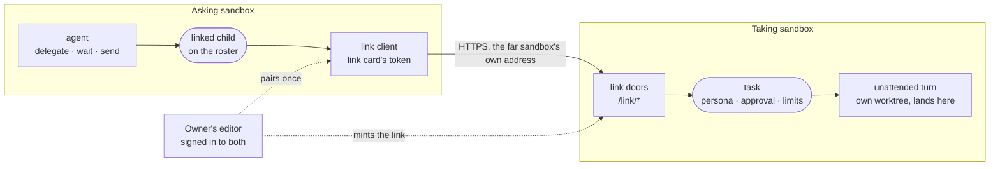

# Linked sandboxes

A link lets one of an owner's sandboxes hand tasks to another of theirs: the asking sandbox's agent calls `delegate`, and the task runs as a conversation of its own in the other sandbox, with that sandbox's repositories, connections and credentials, under terms only that sandbox's owner sets.

## The two halves

- **The taking side** holds an *inbound link* ([`inbound-links.ts`](../../_sandbox/sandbox/src/links/inbound-links.ts)): an `ilk_` token stored as its hash, the label of the sandbox that holds it, and its terms. The terms are the persona every task wears, whether each new task waits for the owner (`approve`), and how many turns an hour the link may start. The owner mints, re-terms and revokes links on Sandbox ▸ Access, and answers tasks that wait there.
- **The link doors** ([`links.routes.ts`](../../_sandbox/sandbox/src/links/links.routes.ts), `/link/*`) check the token themselves. They answer only for the conversations their own link opened: the link's task list is the whole of its reach. The doors cannot read files, list other conversations or change settings, and they can never land.
- **A task** ([`link-tasks.ts`](../../_sandbox/sandbox/src/links/link-tasks.ts)) opens a conversation named `link-…`. Its turns are unattended, isolated in their own worktree, wear the link's persona, and are drawn as a program's words (`<label> (linked sandbox)`). They also carry `outside` content, so the guard treats them as somebody else's words. A card such a turn raises waits for the taking sandbox's owner, except a plain question, which the asking agent may answer. The closing message of each turn is the task's report.
- **The asking side** holds a `link` capability card: the far address and the token, kept by the daemon and never put in the agent's environment. `delegate` ([`linked-children.ts`](../../_sandbox/sandbox/src/links/linked-children.ts)) files the task as a `linked` subagent on the parent's roster. `wait`, `send`, `answer` and `cancel` reach it there like any child. A follower long-polls the far side (`GET /link/conversations/{id}?after=<version>&wait=25`) and moves the record. The ending wakes the parent the way a spawned child's report does, marked as outside content, since it is another sandbox's agent's account. The follower list is on the history volume, so a restart picks it up again.

## What a task costs

A task opens a conversation, and its first turn carries the taking sandbox's whole turn context: the project map, the instructions, the skills and the tools. The spike on 2026-10-13 drove this sandbox from outside, through its public address, with a control token: authenticate 0.43 s, start 0.30 s, the whole turn about 7 s. Its one-word answer (`pong`) ran on a 98,747-token context, nearly all of it written to the prompt cache on that first turn. So a link is for work worth a turn of its own, not for one-line lookups: batch small questions into one task, and a persona with a lean prompt makes every task through its link cheaper.

## Decisions

- **The editor pairs, the platform never does** (2026-10-13). The platform never holds a credential that drives a daemon ([topology.md](topology.md#trust-model)). The owner's editor is the one party already signed in to both sandboxes, so it mints the link on the taking side under the owner's own session there, and fills the card on the asking side ([`linkPairing.ts`](../../_editor/web/src/features/capabilities/connect/links/linkPairing.ts)). The card's fields stay, so a link can also be made by hand.
- **A link of its own, not a control token.** A `drive` control token would reach the taking sandbox's whole fleet, every transcript and every file. Its prompts would also read as the owner's own words. A link reaches only what it opened, and its words are always marked as outside content.
- **Not a runner.** A runner is the asking sandbox's own container: the conversation, credentials and landing stay with its parent, and runner mode rewrites `/work` from the parent. A linked task is the other way round. It belongs to the taking sandbox, and only its report comes back.
- **A separate tool from `spawn`.** `spawn` promises the child's work comes back into the parent's checkout. A linked task's work never does, so it gets its own verb (`delegate`) and its own row kind (`linked`). It shares the lifecycle verbs because supervising it is the same job.
- **Unattended on purpose.** Nobody on the taking side is watching, so the task gets no signed-in account unless the link's persona carries one, and anything needing consent waits for that sandbox's owner.
- **Two hops at most** (`LINK_MAX_HOPS`). A task that came in over a link may be handed on once more. Past that, both sides refuse, so two sandboxes cannot pass one task back and forth for ever. The asking side counts hops from the root of the parent's family.
- **Speaker, not schema.** A linked task is drawn as the existing `program` speaker, not a new speaker kind. A newer daemon would otherwise send a speaker kind an older editor cannot parse, and the whole transcript would fail with it.

## Links between owners: not yet

Today both sandboxes must be one owner's: pairing needs a session on each, and the link's terms assume the person setting them trusts the other side as their own.

A link between owners (an agency and its client, one team and another) needs three things this design does not have, so it waits for a decision of its own:

1. **An identity for the asking sandbox**, not just a token. The taking side should be able to say "sandbox X of account Y" in its records and its approvals. The platform could sign that the way it signs an email identity assertion: an Ed25519 statement naming the asking sandbox, its account and a nonce, which the taking daemon checks with the platform's public key. Each owner opts in per link, as they opt a person in to email sign-in. The platform would vouch for *who is asking* and still never hold the credential.
2. **Terms that bind the far owner's data**: what a report may carry back (no file contents, a size cap, redaction through the privacy shield), and a record of every task the other owner's agent ran, kept by the taking side and readable by both.
3. **Money**: whose model allowance a task spends. Today it is the taking sandbox's, which is right for one owner and wrong for two.

Until then, a person in the other organization is reached the way people already are: as a member of the sandbox, with their own reach.

## Key files

- [inbound-links.ts](../../_sandbox/sandbox/src/links/inbound-links.ts): the taking side's store.
- [link-tasks.ts](../../_sandbox/sandbox/src/links/link-tasks.ts): what a task becomes there.
- [linked-children.ts](../../_sandbox/sandbox/src/links/linked-children.ts): the asking side's follower and roster records.
- [links.ts](../../_shared/sandbox-contract/src/schemas/links.ts): the wire shapes both sides share.
- [link-e2e.integration.test.ts](../../_sandbox/sandbox/src/links/tests/link-e2e.integration.test.ts): two sandboxes over HTTP, end to end.
