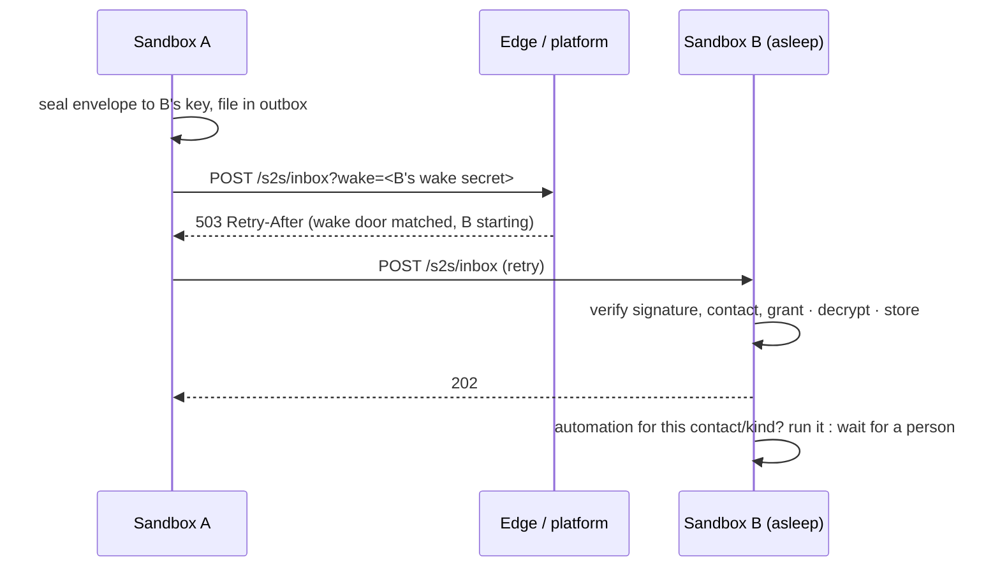

# Contacts and messages

A sandbox has an identity of its own (an address and a post-quantum key pair), keeps other sandboxes as contacts, and exchanges signed, encrypted messages with them directly, with no platform in between: one layer that people's messages, drops, reports, linked tasks, records reads and operating all travel on.

```mermaid
flowchart TB
  id["Identity<br/>address · hybrid key set · own domains · rotation"]
  contact["Contacts<br/>handshake or editor pairing · sandbox- or person-scoped<br/>grants: message · report · task · records · operate · wake"]
  msg["Messages<br/>signed + encrypted envelope · one outbox · inbox · automations"]
  call["Calls<br/>session key · request/response · nothing stored"]
  id --> contact --> msg & call
```



## Why one layer

Before this, three mechanisms moved things between sandboxes, each with its own credential, pairing, retry and inbox:
links (`ilk_` tokens minted through the editor, [links.md](links.md)), account routing (the platform's `sp1.` pass plus a
person's pairing secret, [account-routing.md](account-routing.md)), and nothing at all for two owners. Messages need
what links lacked (a stored message that starts no turn, an identity that crosses owners, a receiver that may be
asleep), and once that exists the other two are kinds and grants on top of it:

| Was | Becomes |
|---|---|
| Link task doors `/link/conversations*` | `task.*` messages under a contact's `task` grant; status pushed back as messages |
| Link records `/link/records/*` | `records.*` calls under the `records` grant |
| Link operate `/link/operate/*` | `operate.*` calls under the `operate` grant |
| `/account/report` (pass) | a `report` message, handed to the issues extension's `account-report` fire as before |
| `/account/drop` + Received card | a `message` with attachments, read on the Messages tab |
| `/account/read/*` (pass + pairing) | `records.*` calls under a person-scoped contact |
| `/account/task*` (pass + pairing) | `task.*` messages under a person-scoped contact |
| `ilk_` link pairing, `route` pairing card | one contact pairing (editor, both sides signed in) or one handshake (anyone) |
| `link-door.ts`, `admit-route.ts` | one admission (`s2s/admission`) |
| account outbox + links' re-ask and backoff | one outbox (`s2s-outbox/`) |
| long-poll followers (`wait=25`) | pushed `task.update` messages; a live view is a call made on demand |

Left as they are, on purpose: the runner protocol (a runner is the parent's own compute, not a peer), pool signals
(an owner-wide aggregate the platform keeps under a per-owner key), the redirect card (the person's own editor
re-sends their own words; nothing crosses between daemons), the fleet CLI and wake doors (platform functions).

## Identity

**The key set.** Each sandbox holds one current key set: Ed25519 and ML-DSA-65 for signatures, X25519 and ML-KEM-768
for key agreement. Every signature is hybrid (both algorithms, both must verify) and every key agreement combines both
shared secrets, so the scheme holds while either family does. The primitives are the `@noble` libraries
(`post-quantum`, `curves`, `ciphers`, `hashes`), which behave the same under Node, Bun and the browser; Bun has no ML-KEM
`encapsulate`, so `node:crypto` would split the code by runtime. Measured on Node 24 with `node:crypto`: ML-DSA-65 signs
in 0.7 ms and verifies in 0.13 ms; the noble implementation is slower and still well under a message's network time.

- The secret halves live in the auth root (`sandbox-identity.json`, mode 0600, classified in `AUTH_STATE_FILES`), out
  of every agent's reach. The file keeps the previous key sets too (at most three), so an envelope sealed to a key just
  rotated away still opens.
- **The identity document** (`SandboxIdentitySchema`) is public: the sandbox id, its display name, its current host,
  the own domains it has verified, the four public keys, the fingerprint, an optional recovery fingerprint, the
  protocols it speaks (`s2s/1`), when it was issued, an optional `prev` and its own hybrid signature. `prev` is a
  standing vouch, not a signature over the document: the previous key (or the recovery key) signs
  `{sandbox, successor fingerprint, by, fingerprint, at}`, so a recovered sandbox, which never keeps the recovery
  secret, can still re-sign its document later (to add a domain). Bytes are signed in canonical JSON (keys sorted, no
  whitespace), each behind a domain prefix (`intentic-s2s/1 <identity|identity-prev|envelope|session>\n`), so a
  signature made for one purpose never verifies for another.
- **The fingerprint** is `isk1:` and the base32 of the SHA-256 over the canonical public keys. It is what a person
  compares and what a contact pins.
- **Served** at `GET /s2s/identity` (`auth: "door"`, no credential). Answering it at all is how a far daemon says it
  speaks this protocol; a daemon from before answers 401 `unauthorized`, the existing "too old for the door" signal.

**Addresses.** A contact is addressed by a sandbox host (`<id>.<zone>`, what every sandbox has) or by an own domain.

- An own domain is claimed on the Messages tab's Identity section: the daemon shows the TXT record to publish,
  `_intentic.<domain>` = `v=isk1 fp=<fingerprint> host=<host>`, checks it (`node:dns` `resolveTxt`) on demand and
  daily, and lists the domain in its document only while the record matches.
- Resolving an address: look up `_intentic.<address>`; with a record, take its host and fingerprint; without one, the
  address is the host. Fetch `https://<host>/s2s/identity` (at most 64 KiB of it), check its signature, check the
  fingerprint against the record when there was one, and when the address is a domain, that the document lists it.
- **Only public hosts.** Nothing in this layer fetches from or posts to a loopback, private, carrier-grade NAT or
  link-local address (cloud metadata included), `localhost`, a name with no dot or under `.local`, `.internal`, `.lan`,
  `.home.arpa`, or this platform's `local.<zone>` (which every resolver answers with 127.0.0.1): not an identity fetch,
  not a stranger's request, not the outbox, not a call (`s2s-wiring.ts` `hostProblem`). Plain http goes only to a
  loopback daemon, so only behind the development switch (`S2S_PRIVATE_HOSTS`) that two local daemons, and the suites,
  run with. It reads the name alone: a public name whose DNS answers a private address is not caught.
- So a person who wants to speak as themselves keeps a sandbox of their own with a domain of their own: domain
  ownership plus the published key is the identity, and the sandbox can move hosts without changing it.

**Rotation and recovery.**

- Rotating makes a new key set whose document carries `prev`, signed by the old key, and tells every accepted contact
  with an `identity.rotated` message.
- A recovery key is made on request; its secret (`isrs1.<base64url>`) is shown once for the owner to keep off the
  sandbox, and only its fingerprint (`isr1:…`) is published. A sandbox whose volume was lost recovers by pasting it: the new key set's `prev` is signed
  by the recovery key.
- What a contact does when the key it pinned changes:

| What arrived | Contact state | Traffic |
|---|---|---|
| `prev` signed by the pinned key | accepted, notice `rotated` | flows |
| `prev` signed by the pinned recovery key | accepted, notice `recovered` | flows |
| no valid `prev`, but the contact is a domain and its TXT record names the new key | accepted, notice `rekeyed-by-domain` (warning) | flows |
| anything else | `key-changed` | held both ways until a person presses Trust new key, which gives back the state it had (a request still waits on a person) |

A contact that missed two rotations in a row meets `key-changed`: `prev` vouches one hop back only. A changed key is
weighed only for an envelope that verifies under the document its address serves now, and that document is fetched at
most twice a minute per address, so a forged envelope naming a key its sender does not hold changes nothing.

An address that changes is a new contact, unless the new document's `prev` is signed by the key the old contact
pinned (notice `moved`).

## Contacts

A contact row (`s2s/contacts.json` on the history volume) holds the address, the name, the pinned fingerprint and the
last verified document, the scope, the state, the grants this sandbox gives the contact (`grants`), what the contact
said it gives this sandbox (`theirGrants`, informational), notices, how it was made (`request`, `paired`,
`link-upgrade`, `pairing-upgrade`, `report-bootstrap`), the sandbox id someone else vouched for (`vouchedSandbox`),
whether it was ever handed this sandbox's wake secret (`wakeHeld`), and while its key is held as changed, the state it
had (`heldFrom`). Wake secrets live in the auth root (`s2s-secrets.json`): this sandbox's one inbound secret, and the
one each contact handed it.

**What a contact says of itself is its own word.** Its document's `sandbox` and `name`, and `theirGrants`, are whatever
it wrote, so none of them routes anything (2026-11-28):

- A document it sends (an accept, a rotation notice) replaces the pinned one only when it verifies, names the same
  sandbox, still names the address the contact is filed under (as its host or one of its domains), and keeps the
  pinned recovery fingerprint: one is added where none was pinned, and changed only by a rotation the table accepts.
  Otherwise the envelope is taken and the pinned document stays.
- A contact's sandbox id counts only where a party other than the contact vouched for it (`vouchedSandboxOf`): the
  platform's pass (a first report's introduction, a route pairing's upgrade), the person's own editor pairing (both
  documents read over their sessions), a link's upgrade bound to the peer the link was minted for, or the platform's
  zone, when the address the contact's key was confirmed at is `sandbox-<id>.<zone>` and its document names that id.
  Reports and drops go to a contact by that, or by the address its key was confirmed at being where the platform says
  the target is; never by a name or an id the contact gave itself.

Who sees and changes which: a sandbox-scoped contact is listed to, and changed by, the owner and maintainers, and used by
a turn acting for one of them; a person-scoped one is that person's own, listed to and used by them and the turns acting
for them (a maintainer reads its threads, the drops' rule, but does not list or use another person's route).

**Scope.** A sandbox-scoped contact is the sandbox speaking as itself, made by its owner or a maintainer. A
person-scoped contact is one person's route between two sandboxes they are in (what a route pairing was): made by that
person's own press, used only by conversations acting for them, and held at every use to their floor for the kind on
the receiving side (`scopeRefusal`, as the pass doors did: a message holds them to the drop floor, collaborator; a
report to the report floor; a task to the task floor). A person-scoped contact needs no owner's word on either side,
which keeps the rule "only where that person could do it by hand", and is made only by pairing: a `contact.request`
asking for one is refused 403 `grant`. It never holds `operate`.

**Grants** (`S2sGrantsSchema`), what this sandbox lets the contact do here: `message` (send messages, on by default
once accepted), `report`, `task` (`{ actsAs?, runAs?, approve, turnsPerHour }`, the link terms under their own names, so an upgraded link maps
over exactly), `records`, `operate`, and `wake`
(hand the contact this sandbox's wake secret). A grant the contact lacks is answered 403 `grant`, worded.

**Two ways to make one.**

- **Pairing**, when one person is signed in to both sandboxes (what link and route pairing were). The editor reads
  this sandbox's document (`GET /s2s/me`), posts it to the other sandbox under the person's session there
  (`POST /s2s/pairings`, with the scope and the grants the person chose), which makes an accepted contact and answers
  its own document, wake secret and grants, then hands that answer back here (`POST /s2s/contacts/paired`). No message
  crosses; both sides pin each other's key from documents fetched over the person's own sessions. The one exception:
  `GET /s2s/me` carries no wake secret, so when this side grants `wake` it hands the secret over in a `contact.update`
  once paired.
- **The handshake**, for anyone else. `POST /s2s/contacts` with an address resolves it, pins the far key provisionally
  and sends a `contact.request` (this sandbox's document, a note, the grants offered, a wake secret if `wake` is
  offered). The receiver checks the request's signature against the document inside it and confirms the document by
  fetching it from the claimed address itself, so nobody can request as an address they do not control. It files the
  contact `pending-in`, raises it on the Messages tab, and hands it to automations (below); with none, it waits for a
  person. Accepting sends `contact.accept` with the receiver's grants and wake secret. Blocking files the address and
  fingerprint as blocked; a blocked sender is answered as if accepted and nothing is kept, so a block is not a signal.
  "Confirms the document" means the same key: the fetched document must verify at that address and carry the
  fingerprint the request was signed with and embeds; a document re-signed since (a new domain) still confirms. An
  address that does not answer is 503 `unready`, so the request is retried rather than refused. The request is opened
  and checked against the document it embeds first, and only one that vouches for itself counts against the strangers'
  limits or makes this sandbox fetch anything; requests from one address are filed one at a time, so two racing make one
  contact.
- A request from an address that already has a row: two sandboxes that asked each other are accepted on the spot; an
  accepted contact that asks again has forgotten this one, and is sent the accept again; one that had removed this
  sandbox (notice `removed`) waits on a person again. `contact.remove` keeps the row here, marked `removed`.

An agent never makes or accepts a contact on its own: `messages contacts add` raises a `contact` card for a person to
press, and accepting through an automation's turn raises the same card unless the owner turned on
`contacts.agentMayAccept` (a sandbox setting) and the accept gives messages only. The press carries the handshake out
(`needs/kinds/contact-need.ts`).

Strangers may send nothing but `contact.request`, at most 3 an hour per address and 30 an hour in all, counted only once
the request verifies against its own document. Every in-memory limit forgets its idlest keys past 10,000, so a flood of
addresses costs bounded memory.

## Messages

**The envelope** (`S2sEnvelopeSchema`): `v`, `id` (UUIDv7), `from`/`fromFp`, `to`/`toFp`, `kind`, optional `thread`
and `replyTo`, optional `as` (the person of a person-scoped contact), `hops`, `sentAt`, the key agreement (`enc`: an
ephemeral X25519 key, an ML-KEM-768 ciphertext, a nonce), the sealed `body`, and `sig`.

- The body is the kind's payload as JSON, sealed with AES-256-GCM under
  `HKDF-SHA256(mlkem_ss ‖ x25519_ss, salt = SHA-256(canonical header and key agreement), info = "intentic-s2s/1")`, with the canonical
  header as associated data. The signature covers the header, `enc` and `body`.
- TLS ends at the edge ([topology.md](topology.md#trust-model)), so the envelope is what keeps the platform out:
  it can see who talks to whom and when, never what.
- Kinds: `contact.request`, `contact.accept`, `contact.update` (grants or wake secret changed), `contact.remove`,
  `identity.rotated`, `message` (`subject?`, `text`, attachments inline, at most 20 files and 10 MB, the drops' limits),
  `report`, `task.request`, `task.update`, `task.message`, `task.answer`, `task.stop`, and `receipt`.
- The body is capped at 16 MB; an unknown kind is refused 422, never misread. The signature covers the canonical
  envelope without `sig`.
- `sentAt` is when it was sealed, and the outbox seals afresh at every attempt, so an honest envelope is seconds old.
  One sealed more than a day before it arrives, or more than five minutes ahead of the receiver's clock, is refused
  `replay` (`S2S_ENVELOPE_MAX_AGE_MS`, `S2S_ENVELOPE_MAX_AHEAD_MS`): a day sits well inside the 30 days an id is
  remembered, so an envelope whose id was forgotten can no longer be taken (2026-11-28; a bound past the outbox's week
  was the alternative, needed only were `sentAt` set once at enqueue).
- Refusals carry a `code` (`S2S_REFUSAL_CODES`): `malformed` 400, `signature`, `not_contact`, `grant`, `floor`,
  `key_changed`, `unconfirmed` 403, `recipient`, `hops`, `task`, `replay` 409, `too_large` 413, `unknown_kind` 422,
  `rate` 429, `unready` 503, and for calls alone `session` 409. None is ever 401, which a sender reads as "daemon too
  old for the door".

**Sending.** `POST /s2s/messages` (a person in the editor, or an agent through the `messages` command with its turn
proof) files the message in its thread (`queued`) and the payload in the outbox (`s2s-outbox/`, one file per entry,
attachments staged beside it in `s2s-outbox-staged/<id>/`) and answers at once. The outbox seals at each attempt, with
this sandbox's current document and wake secret filled in, so a rotation on either side between attempts still
delivers. An agent's send is an outward action: the guard decides it as it decides a channel message, under the
owner's action rules (`messages.message.send`, `messages.*`), and leaves the same Activity row; a person's own send is
not gated.

**The `messages` command** (`_sandbox/sandbox/bin/messages`) is an agent's way in, with its turn proof: `messages`
lists the threads it may read, `messages show <thread>` one whole, `messages send <contact> [files…] --text "…"` sends
(the command reads the files itself, as `sandboxes send` does), `messages take <message> <folder>` copies a message's
files, `messages contacts` lists the contacts it may use, `messages contacts add <address>` and
`messages contacts accept <id>` raise the `contact` card, and `messages outbox` shows what waits.

**The outbox** retries on no answer, 404, 429, 5xx and "too old", honouring `Retry-After` (believed up to a day),
otherwise `min(30 s · 2^n, 30 min)`, for a week; then the message is marked undelivered in its thread, as a bounce. A
refusal in words (400, 403, 409, 413, 422) ends it at once and says why (`messages/outbox-rules.ts`). Each attempt to a
contact that gave this sandbox its wake secret carries `?wake=<secret>`. A message to a contact that has not accepted
yet, or whose key is held as changed, waits without being tried until it accepts or a person trusts the key; only the
handshake's own kinds go before. An undelivered entry stays listed (`GET /s2s/outbox`) for 30 days; at most 1,000 wait
at once.

**Waking.** A hosted sandbox registers one wake door for `/s2s/inbox` with the digest of its one inbound wake secret
(`wakeDoorsOf` gains an `s2s` source; the edge digests query values, and a sandbox may register 64 doors, so one door
per contact would not fit). Every contact granted `wake` holds that secret. Removing or blocking such a contact
replaces the secret and sends `contact.update` with the new one to the rest (taking the grant away does the same, and
sends that contact `wake: null`). That goes for any contact ever handed the secret (`wakeHeld`), whatever its state: a
request granting `wake` carries it before it is accepted, and a contact held as changed still has it. A person-scoped
contact whose person left the roster gives it back too, at the outbox's next drain (`sweepLeavers`). Only a collaborator
or above hands it over through a pairing they press; a viewer's or guest's pairing is made without the `wake` grant
(2026-11-28). The door is registered only while some accepted contact holds the grant. A stranger's
request carries no secret,
so it cannot wake the machine and waits in its sender's outbox until this sandbox is awake anyway. A sandbox on a
machine that is off cannot be woken; the outbox's week covers it.

**Receiving** (`POST /s2s/inbox`, `auth: "door"`), cheapest check first:

1. Parse and size (the door, 400 `malformed`, 413 `too_large`); `to` is one of this sandbox's addresses and `toFp` its
   current or a kept previous fingerprint; the kind is one this build knows (else 422 `unknown_kind`); `sentAt` within a
   day behind and five minutes ahead (else 409 `replay`).
2. A seen id answers 200 and changes nothing (ids kept 30 days, a line each in the `s2s/seen-ids.jsonl` ledger, read
   once into memory).
3. The contact for `from` (and `as`): the one filed under that address; else the one whose pinned document names it as
   its host or a domain and whose pinned key signed (a contact added by its own domain sends from its host); else, for
   anything but a request, the one row naming it while none is filed under it (its key just changed). A blocked address
   or key is swallowed; `key-changed` is 403; a contact not accepted yet sends only the handshake's kinds. None admits
   only a stranger's `contact.request` (the handshake above has its order).
4. The signature, against the pinned keys. A different key fetches the sender's document and applies the rotation
   table above.
5. The kind's grant; for a person-scoped contact, that person on the roster and above the kind's floor.
6. `hops` at most `LINK_MAX_HOPS`.
7. A per-contact minute limit by kind (messages 60, reports 30, tasks 10, as the passes had; receipts, a task's pushed
   `task.update` and the handshake's kinds count as messages).
8. A handler registered for the kind (`messages/kinds.ts`; none yet is 503 `unready`, retried), open the body (a
   stranger's request must embed the document its address serves, else 403 `unconfirmed`), store, remember the id,
   answer 202, then hand it on.

The checks are one function (`admission.ts`), whose parts (the contact, the signer, the grant, the floor) the calls door
reuses.

**The inbox** is threads on the history volume (`s2s-threads/`, attachments under `s2s-files/<message>/`), read and
unread, with sent messages beside received ones. Sandbox-scoped threads are read by the owner and maintainers;
person-scoped threads by that person and maintainers (the drops' rule). A proven turn reads the threads of a person it
acts for, and an automation's turn is handed the message it woke for. A thread's id is this sandbox's own; the envelope
names it by the id both sides share, filed per contact, so no contact writes into another's thread. Reading a thread
sends its contact one `receipt` for the newest message read. Bounded like the drops' inbox: 500 threads and 1,000
messages in one, past which a message is answered 429 and retried. A message's id is the envelope's, which its sender
picks, so an id already filed in another thread, or the other way (a contact sending back the id of a message this
sandbox sent it), is refused 400 `malformed` and never written over that message or its files.

**Automations, and nothing else.** A received message, report or contact request starts no agent by itself. It is a
core listener source, `s2s` (`CORE_TRIGGER_SOURCES`), dispatched through `dispatchListenerMessage` like CI, with events
`message`, `report`, `contact.request` and `task.request`, filterable by contact (the event's channel and sender, the
contact's address) and scope (its branch: `sandbox` or the person's email); the thread is the event's thread. What an
automation starts reads the message as outside content. A contact request from a stranger is a new stranger class,
`contact`, held to its own admission floor (held for approval unless the owner says otherwise), for an automation that
can hear one (no event filter, or `contact.request`). The composition root dispatches what the s2s module hears
(`heard.ts`), since automations sit above it.

## Calls

Records and operate are request and response, so they are calls, not messages: nothing is stored or retried.

- **A session**: `POST /s2s/session` carries a fresh key agreement to the callee's key and a hybrid signature by the
  caller over it, a timestamp and a nonce. The callee checks it with the inbox's own admission parts (the contact for
  `from` and `as`, the signature against the pinned key, a changed key through the rotation table above), its time within
  two minutes and its nonce never seen, and answers a session id, when it expires and `confirm`, an HMAC proving it
  derived the same key. The session key lives in memory for an hour; a contact holds at most eight at once, the oldest
  going first. A contact must be accepted; a blocked one is answered as a stranger is (`not_contact`), since a call is
  answered or it is not.
- **A call**: `POST /s2s/call/{method}` with `x-intentic-s2s-session`, its body and answer sealed under the session key
  with a fresh nonce, a timestamp within two minutes, and a nonce never seen in the session; each answer is bound to its
  call's nonce. One signature per hour, not per call, so `read_file` costs a symmetric seal. The answer opens to the
  method's status and body (`S2sCallAnswerSchema`): its output at 200, a refusal in words otherwise (a fleet read's own
  404 with its words, an ambiguous handle's 409 with its candidates), so the edge reads nothing of it, not even that a
  conversation was not found. What is refused before a call opens, or for its grant or floor, is answered in the clear:
  `session` (409: no such session, it expired, the callee restarted, or a key changed since it opened), `replay` (409: a
  call or session request seen before, or outside the two minutes), `signature` (403: sealed for another session or
  method), `grant`, `floor`, `unknown_kind` (422: a method this build does not know). Never 401.
- **Keys change, sessions end.** A session is bound to the key the contact signed it with: once the contact's pinned key
  is another, the callee drops it. A sandbox whose own key rotates ends every session on both sides
  (`announceRotation`). The caller opens a new one, on first need, signed by its current key.
- Methods: `records.fleet`, `records.show`, `records.bundle`, `records.diagnostics` (the `records` grant, or a
  person-scoped contact cut to what that person may read); `operate.exec`, `operate.status`, `operate.stop`,
  `operate.read`, `operate.write` (the `operate` grant, sandbox-scoped only, in the same jail a person's shell gets);
  `task.watch` (a task's live status, for a person watching it). `records.fleet` and `records.show` carry the rest of
  the read's query as `agents ls|show` spell it (`query`: `limit`, `transcript`, `last`, `grep`, `message`…).
- **Answered by the link doors' own code** (`links/contacts/contact-calls.ts`): the records methods are the link records
  doors' fleet reads and diagnostics query (`links/link-records.ts`), read as this sandbox's own tools read for a
  sandbox-scoped contact and as `personReader` (every tier held to `visibleTo`, a private conversation to its readers) for
  a person-scoped one, whose diagnostics are a maintainer's only; the operate methods are the link doors' operator
  (`links/link-operate.ts`), each command read and stopped by the contact that started it alone, and a person-scoped
  contact is refused `grant` whatever its row says; `task.watch` holds the task's status until it moves past `after`, as
  a link's status read did (`links/contacts/taking.ts`). Each call is logged with the contact's name and, for a person's
  route, the person.
- **The caller** (`s2s/calls/call-client.ts`) keeps one session per contact, opened on first need and let go a minute
  before it expires, opened again when either side's key changed, and once more, with the call asked again, on a
  `session` refusal. A call answered by nothing is said as such (status 0), never retried.
- On the asking side they are what link cards were: `--on <contact>` on `agents` and `diagnostics`, and a tool server
  per contact (`mcp__<contact>__…`) carrying `delegate`, `about`, the records tools and, where granted, `run_command`,
  `read_file` and `write_file`, mounted for the turns that may hand work on, as link mounts were. The server is composed
  from tool groups (`s2s/contacts/contact-mounts.ts` `CONTACT_TOOL_GROUPS`): each answers the tools it adds for one
  contact, from what that contact says it gives this sandbox (`theirGrants`), and a contact no group adds anything for is
  not mounted. One per accepted contact the turn may use (the scope rule above), named after the contact as a card's id is
  (lower case, `[a-z0-9_-]`), never a daemon server's name (`RESERVED_MCP_SERVER_NAMES`), a granted card's id, any other
  server the turn mounts or another contact's: a name taken goes to the next free `-2`, `-3`… in the contacts' order.
  Every answer a contact's server gives is wrapped as outside content (none is a control server), and a guest server
  that still names one already mounted is left out rather than replacing it (`turn-tools.ts` `withoutShadowing`,
  2026-11-28). The tools that act check
  the turn may hand work on when called, as a link's do. The call tools (`s2s/calls/call-tools.ts`) are the link cards'
  own (`far-records-tools.ts`, `far-operate-tools.ts`), over calls instead of a link's doors; the operating ones are
  never mounted for a person-scoped contact.
- `--on <name>` looks for a contact first, by its id or address, or by its name or server name while only that one
  sandbox and no link card answers to it, among those the caller may use (a
  person signed in, a proven turn, or, as for a link, the owner's own shell when no turn runs), then a link card, then a
  person route (`links/link-records-relay.ts`). A person watches a task this sandbox handed a contact at
  `GET /s2s/contacts/{id}/tasks/{request}/watch` (`?after=<version>&wait=<seconds>`, a `task.watch` call), for whoever
  may use that contact.

## Tasks

- **Asking.** The asking agent's `delegate` to a contact files a `linked` child with `via: "contact"` and sends
  `task.request` (the `LinkTask` fields) through the outbox (`links/contact-children.ts`). A name is looked for among
  the contacts first: `delegate(to)` on the subagents server and `agents delegate [--to] <name>` take a contact the
  conversation may use that says it gives this sandbox tasks (`theirGrants.task`), exactly by its id or address, or by
  its name or server name only while that name is no one else's: when it also names a contact of another sandbox or a
  link card (other than one for the very sandbox the contact's pairing vouched for), the hand-over is refused as
  ambiguous, in words naming each, so no contact can name itself into another's place (2026-11-28). Among one sandbox's
  contacts the person's own goes first for `--to`, the sandbox's otherwise; with none, a person route and the link cards
  are next; `mcp__<contact>__delegate` names its contact by id. Hops count from the root of the parent's family, a contact's
  task there like a link's, toward `S2S_MAX_HOPS` (= `LINK_MAX_HOPS`).
- **The first attempt answers.** Every `task.*` message a child sends waits up to eight seconds for its first attempt:
  a refusal in words comes back to the agent at once (a refused request files nothing), one not answered yet is said as
  queued and delivered when the contact answers, for a week. A refusal heard after that ends a request's child as
  failed, and is said on the row for anything else. The roster's `linked` names the contact (`contact`, its id) and the
  far conversation once the first update names it; `via` there stays the person route's alone, so an older editor reads
  the record.
- **Taking.** The taking side files it as a link task (sandbox-scoped, under the grant's role, approval and hourly
  limit, a book of its own, `s2s/contact-tasks.json`, its allowance under `contact:<id>`, conversations `link-…`) or as
  a person task (person-scoped: the person's conversation `route-…`, their floor, 20 starts an hour per (contact,
  person), keyed `contact:<id>` in the person tasks' book), exactly as the doors did, by the same code
  (`links/contacts/taking.ts` over `link-tasks.ts` and `person-tasks.ts`): a repeated `requestId` answers the task already
  taken, the task is drawn as a program's words (`<contact> (contact)`) and carried as outside content, and only a plain
  question is answered from the asking side. A refusal is answered in words under a code the asker's outbox does not
  retry: `hops`, or `task` (409: no such task, not allowed yet, declined, the grant's hourly turns spent). A request filed
  is heard by automations as `task.request`, whether or not one runs it.
- **Pushing.** The taking side pushes `task.update` (the `LinkTaskStatus`) whenever the status's version moves
  (`links/contacts/task-push.ts`), heard off the nudge a held link read waits on, with a look every five seconds for a run
  an owner's card unparked: at most one every five seconds, the latest when they are up, and always at once on settling.
  One update per task is in the outbox at a time, the next going once it lands, because a version is not an order (it
  falls back when a run unparks): the asker takes any version other than the last it took. A restart pushes every live
  task's status again, and every one settled within the hour; the asker takes one it has as nothing.
- `send`, `answer` and `cancel` on the child become `task.message`, `task.answer` and `task.stop`. Neither side holds a
  request open, so a hosted asker sleeps through a long task and the report wakes it, marked as outside content.
- **Waiting for the owner.** A sandbox-scoped contact's task whose grant says `approve` waits, listed by
  `GET /s2s/tasks` (to whoever may use its contact, waiting ones first) and allowed or declined with
  `POST /s2s/contacts/{id}/tasks/{request}` (`{approve}`, the owner's or a maintainer's), as a link's waited on Access ▸
  Programs; the push notification opens the contact on the Messages tab.
- A task spends the taking sandbox's model allowance, bounded by the grant's hourly limit, as a link's did
  (2026-11-27, decided without the owner: the alternative, a grant that bills the asker's own accounts, needs model
  accounts to cross between sandboxes, which [links.md](links.md) withdrew).

## Reports

A `report` message under the `report` grant goes to the issues extension's `account-report` fire, as `/account/report`
did, under the same UTC-day ceiling, with the contact as the sender: its sandbox, its name, its address, and the person
of a person-scoped contact. The project, which the pass carried, rides the payload (`project`); whether the two
sandboxes are in one organisation is the platform's word, which a contact does not carry, so a report as a message says
nothing of it. A report goes over a contact whose vouched sandbox id is the one the platform names, or whose address is
where the platform says that sandbox is; a contact whose document merely says it is that sandbox is never sent one. While no extension keeps the inbox, the kind answers 503 `unready` and the outbox keeps trying. Once
taken it is heard by automations (`report`).

Reports used to need no pairing between one owner's sandboxes: the platform's pass said both were one owner's. They
still need none. The account outbox still asks the platform which sandbox claims the project; when that sandbox speaks
`s2s/1` and this one holds no contact there granting it `report`, the first report is sent through
`POST /account/contact-bootstrap`, admitted by a report pass, carrying this sandbox's document. The receiver checks the
document is the sandbox the pass names and confirms it at its own address, as a handshake's, then files a
sandbox-scoped contact holding only the `report` grant (origin `report-bootstrap`), or adds `report` to an accepted
contact it already has, changing nothing else but recording the sandbox id the pass vouched for. The sender files its side from the answer, granting nothing back, and
every later report is a message. A repeat of a problem whose message still waits in the outbox counts in the account
outbox and goes as one message carrying the count once that one lands, so folding survives the move. A receiver from
before, or one that does not take the introduction (a contact there waiting on a person, a key held as changed), gets
the report at `/account/report`. The platform stays a directory (which sandbox claims a project, where a sandbox is)
and is a notary only for that one introduction.

## The editor

- **Messages** is a tab of the sandbox (`sandboxNav.ts`, group `reach`), badged with unread threads, waiting
  requests and contact tasks waiting for the owner. Its parts: **Inbox** (threads, a thread's messages, a composer with
  files, waiting and undelivered marks), **Contacts** (requests to accept or block and tasks waiting for an Allow, both at
  the top; each contact's key status, notices, grants and the tasks it handed this sandbox, with a link to each one's
  conversation; add by address, pair with one of your sandboxes), and **Identity** (the address, the fingerprint, own
  domains and the TXT record each needs, rotate, recovery key). `?section=contacts&open=<contact>` opens that contact,
  which is where the push saying a task waits lands.
- The Overview's Received card is gone: its attention item points at the Messages tab.
- The `contact` card answers an agent's ask to add or accept a contact.
- Access ▸ Programs keeps its Linked sandboxes section for links not yet upgraded and only counts the upgraded ones,
  pointing at Contacts; a waiting task from a contact is allowed on the Contacts part (`GET /s2s/tasks`,
  `POST /s2s/contacts/{id}/tasks/{request}`), never on Access.

## Across versions

- A daemon speaks this protocol to a far sandbox only when that sandbox answers `GET /s2s/identity`; otherwise it uses
  the old doors as before. The old doors keep answering, for daemons from before.
- **Drops.** `sandboxes send` goes as a `message` over the contact it finds: the person's own (person-scoped), or with
  no one person the sandbox's own, matched to the platform's answer for the name (asked as the person, or as the owner),
  or, when the platform says nothing, to the exact vouched sandbox id or address the send names; never by a name. Without one it goes as a drop, as before. `--wake` always goes as a drop: a message starts and steers no
  turn. A drop arriving at `POST /account/drop` from a daemon from before is filed as a message in a thread that names
  its sender itself (a sending sandbox and person, keyless, `legacy` on the thread record; no contact row, since a
  contact pins a key), shown to that person and maintainers like a person-scoped contact's thread; a message sent to it
  is refused, saying to answer with `sandboxes send`. The drops waiting in `account-inbox/` are moved into those threads
  once at boot (`account-inbox-into-threads`), and `inbox` runs `messages`.
- **Upgrades happen by themselves.** When both ends of a link speak `s2s/1`, the asking side posts its document to
  `POST /link/upgrade` under the link's own token; the taking side confirms the document at its own address, files a
  contact from the link's terms and answers its document, wake secret and grants; the asking side files that contact
  under the card's name and removes the card with its token, and the taking side retires the token. A route pairing does
  the same through `POST /account/pairings/upgrade` under a read pass and its secret, into the person's person-scoped
  contact on both sides, and the secret is forgotten. The old credential vouches for the new key exactly once.
  - The asking side tries each card and each pairing it holds at boot, on a backoff until it is a contact, and a card again
    when a turn mounts it; a far side that does not serve `GET /s2s/identity` is asked daily and left on the old path.
  - What the link or pairing carried carries over: a link's tasks move onto the contact's task book on the taking side,
    their status pushed from then on, and onto the contact on the asking side, whose followers stop before it asks, so a
    task in flight still reports. Each side gives the other `message` and `wake` at least; the taking side gives the
    link's terms, or what a person's route reached (`message`, `records`, `task`, `wake`, held to their floor).
  - The upgrade happens once (2026-11-28). The retired token and pairing keep their hash, the contact and the key they
    vouched for, for that one door: for fifteen minutes a repeat posting that same key reads the answer again (the
    contact as it stands, its grants, the wake secret) and changes nothing; another key, or a contact removed, blocked or
    re-keyed since, is refused 409; after that the credential opens no door at all, the upgrade door's included. An
    existing contact for the same sandbox keeps its grants, with the credential's added.
  - The posted document must be the sandbox the credential was for: a link's stored peer (its sandbox id, and its host
    when the link recorded the peer's address), a pairing's pass. A link minted without a peer binds only its token, as
    the link itself did.
  - [`links/upgrade/`](../../_sandbox/sandbox/src/links/upgrade) and
    [`pairing-upgrade.ts`](../../_sandbox/sandbox/src/account-routing/messages/pairing-upgrade.ts), both filing through
    [`contact-upgrade.ts`](../../_sandbox/sandbox/src/s2s/contacts/contact-upgrade.ts).
- Nothing new is minted as an `ilk_` token or a route pairing toward a sandbox that speaks `s2s/1`: the editor's link
  pairing and the route card's Allow make a contact wherever this daemon serves contact pairing and the other answers it,
  with the grants the old credential would have carried, and the old way only toward a daemon from before
  ([`contactPairing.ts`](../../_editor/web/src/components/contactPairing.ts)). An agent's card for a link to that sandbox, or
  for a route into it, is met by the contact, and a send as a person who has a contact there raises no `route` card.

## Decisions

- **The sandbox is the identity, not the person** (2026-11-27). A person has nowhere to keep a private key that is not
  a machine's keychain or the platform; a sandbox does. A person speaks as themselves through a sandbox of their own
  with a domain of their own. Person-to-person keys were the alternative.
- **Hybrid post-quantum from the first message.** Ed25519 and X25519 alone would have to be replaced under every stored
  message's feet later; ML-DSA and ML-KEM alone would rest on younger assumptions. Both cost little at these sizes.
- **Domain plus key, no authority.** The platform signs nothing a contact relies on after the first report's
  introduction. DNS and pinning were chosen over a platform-signed statement (the `sp1.` pass) so that two owners need
  nothing from intentic to trust each other.
- **Automations decide, not the protocol.** With no automation set, no agent runs for anything received.
- **Messages and calls share identity, contacts and admission, not transport.** Putting a `read_file` through an
  inbox would store and retry what must be answered now.
- **One wake secret per sandbox, not per contact.** The edge holds at most 64 doors per sandbox; a leaked secret is
  bounded by the edge's 48 starts a day, and replaced when any contact ever handed it leaves.
- **A call's answer is sealed whole, its status inside** (2026-11-27, decided without the owner). Answering a method's own
  refusal at its HTTP status would tell the edge which handles and commands exist over there; only what is refused before
  a call opens (no session, a replay, no grant) goes in the clear, which says nothing of the callee's records.
- **Upgrade, not re-pair.** Every existing link and pairing already proves both sides; making people pair again would
  have spent their trust for nothing.

## Key files

- [`protocol/s2s/`](../../_shared/sandbox-contract/src/protocol/s2s): the hybrid primitives, canonical JSON, the
  identity document, address resolution and the envelope's seal and open.
- [`schemas/s2s.ts`](../../_shared/sandbox-contract/src/schemas/s2s.ts): every wire and editor shape.
- [`s2s/identity/`](../../_sandbox/sandbox/src/s2s/identity): the key store, `/s2s/identity`, domains, rotation and
  recovery.
- [`s2s/contacts/`](../../_sandbox/sandbox/src/s2s/contacts) and
  [`s2s/admission.ts`](../../_sandbox/sandbox/src/s2s/admission.ts): contacts, pairing, the handshake and the one
  admission.
- [`s2s/messages/`](../../_sandbox/sandbox/src/s2s/messages): the outbox and its retry rules, the inbox door, the kind
  registry, threads and sending; [`s2s/s2s-service.ts`](../../_sandbox/sandbox/src/s2s/s2s-service.ts) composes them
  (`services.s2s`), and [`s2s/heard.ts`](../../_sandbox/sandbox/src/s2s/heard.ts) is what the `s2s` listener source
  hears.
- [`s2s/calls/`](../../_sandbox/sandbox/src/s2s/calls): sessions, the call door, the caller's session client, and the
  records and operating tools a contact's server and a link card's share;
  [`links/contacts/contact-calls.ts`](../../_sandbox/sandbox/src/links/contacts/contact-calls.ts) what each method
  answers, on the link doors' code.
- [`links/contacts/`](../../_sandbox/sandbox/src/links/contacts) (the taking side, the status push, the owner's routes)
  and [`links/contact-children.ts`](../../_sandbox/sandbox/src/links/contact-children.ts) (the asking side): tasks
  between contacts, on the link task code, which is why they sit above `s2s/`;
  [`s2s/tasks/`](../../_sandbox/sandbox/src/s2s/tasks) the asking side's reach into the outbox and the task tools;
  [`s2s/contacts/contact-mounts.ts`](../../_sandbox/sandbox/src/s2s/contacts/contact-mounts.ts) each contact as a turn's
  tool server.
