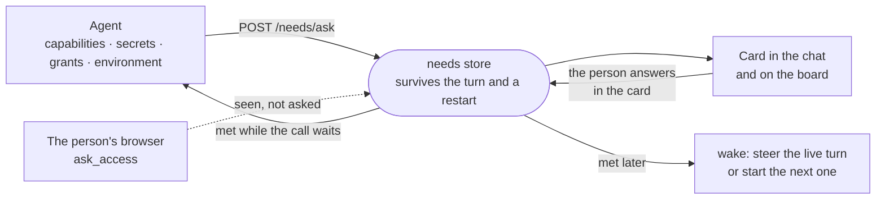

# Needs

A need is something an agent cannot finish its task without and only a person can provide: a connection, a secret's value, wider access, a tool in the image. The agent raises it once, the sandbox keeps it until someone answers, and the conversation hears the answer whenever it comes.

## Why a need is not a parked card

A parked card (plan, question, permission, payment, a per-use credential) holds a turn at one moment: when the turn ends, the card ends. Connecting GitHub or pasting an API key takes minutes, and the person often answers after the agent has finished everything else. So a need is stored on its own ([`needs-store.ts`](../../_sandbox/sandbox/src/needs/needs-store.ts)), keeps its card answerable after the turn ends and across a restart, and wakes the conversation when it is met ([`needs.ts`](../../_sandbox/sandbox/src/needs/needs.ts)), through the same door a condition watch uses ([`wake-delivery.ts`](../../_sandbox/sandbox/src/seams/wake-delivery.ts)).

## The agent's side

Every ask is one CLI call that answers in under 100 seconds, below the shell's 110-second cutoff:

| Command | Raises | Met when |
| --- | --- | --- |
| `capabilities request <entry> [--target T] [--set k=v] [--remove] --why …` | `capability`: connect, reconnect a refused credential, change a setting on a connected one (a device switch, a Docker engine option), or remove one; a linked sandbox is paired in the card itself | an instance of the entry (matching the target) comes live, the change is applied, or the connection is gone |
| `secrets ask NAME --why … [--host H]… [--where …] [--link URL]` | `secret`: a value the person pastes into the card; each `--host` the person keeps starts its host guard on | the name resolves |
| `grants request capability\|folder\|shelf <what> --why …` | `grant`: something this conversation's role withholds (an account it does not speak through, or a profile listing it leaves out), with the roles that have it; refused, with no card, when the people or service the conversation acts for are held back, or no role it could wear has it ([access.md](access.md)) | the person switches the conversation to one of those roles |
| `secrets request <id> --why …` | `release`: a gated account or connector for the rest of the conversation | a named approver releases it |
| `environment propose <tool> --why …` | `environment`: overlay steps for the sandbox image; with `--pack`, the steps of an opt-in image pack of that name (`office`), met at once when the image already bakes it | the running container was built from an overlay carrying the tool, however it was approved (its card, the Environment card, one of several approvals before one rebuild); declined when it was rejected, removed or thrown away elsewhere |
| `automations propose <id> <source, --guard or --on <provider>> --prompt … --why …` | `automation`: a watch, schedule or listener (`--on`, with `--event`, `--channel`, `--mentioned`, `--from`; `automations sources` reads the catalogue) to run unattended, held to the Automations page's own rules before the card goes up; the card shows what a ready-made source's check sees today ([`automation-need.ts`](../../_sandbox/sandbox/src/needs/kinds/automation-need.ts)) | a person approves it, which saves it switched on |
| `instructions propose --text … [--file <repo>] --why …` | `instruction`: a lasting rule the owner stated, for the workspace's `AGENTS.md` or a repository's, with the exact change as a diff on the card ([`instruction-need.ts`](../../_sandbox/sandbox/src/needs/kinds/instruction-need.ts)); met at once when the file already says it | a person approves it, which appends it to that file on the main tree and commits that file on its own (left uncommitted only when it already held the owner's own edits), or someone writes the same words there by hand |
| `projects claim <project> [--why …]` | `claim`: the project claimed for this sandbox, so the owner's other sandboxes report its problems here ([account-routing.md](account-routing.md)); only the owner may press it, since the platform takes a claim from their own sign-in alone, and the press calls the platform from their browser before answering ([`claim-need.ts`](../../_sandbox/sandbox/src/needs/kinds/claim-need.ts)); met at once when this sandbox already claims it | the platform lists the project for this sandbox, however it was claimed |
| `projects allow <sandbox> [--scopes drop,read,task] [--why …]`, or raised by a send that finds no pairing | `route`: one person's leave for this sandbox to act as them in another of their sandboxes, for a drop, a read or a task ([account-routing.md](account-routing.md)); only that person may press it, and the press mints the pairing at the target from their own editor, signed in to both, then keeps the secret here ([`route-need.ts`](../../_sandbox/sandbox/src/needs/kinds/route-need.ts)); met at once when the pair is already held | this sandbox holds a pairing secret for the target and that person |
| `agents redirect <sandbox> \| --project <repo> [--why …]` | `redirect`: a person's message that reached the wrong one of their sandboxes, offered on to the one it was meant for, found by name or by the project's claim among the sandboxes they are in ([account-routing.md](account-routing.md)); the words are the daemon's copy of what the person typed, and only they may press it: their editor answers the need, then opens a chat in the target and sends the words there ([`redirect-need.ts`](../../_sandbox/sandbox/src/needs/kinds/redirect-need.ts)). The kind wakes on a no (`wakesOn: "declined"`): kept here, the agent is woken to carry on; sent on, nobody is woken | the person sends it on |
| `secrets grant-stack <repo> <stack> <device> NAME... [--why …]` | `deploy`: a managed stack (the Deployments extension's) let receive these secrets, from that repository, on that computer by its device card ([`deploy-need.ts`](../../_sandbox/sandbox/src/needs/kinds/deploy-need.ts), the grants in the auth root: [`stack-grants.ts`](../../_sandbox/sandbox/src/secrets/stack-grants/stack-grants.ts)); only the owner or Full access, signed in, may press it, and a yes grants exactly the names the card showed; met at once when the grant on file already covers them | the owner's grant on file covers every name the card showed |
| the browser extension's `ask_access` | `grant` of a `site`, raised by the daemon as the call goes by ([`webext-peer.ts`](../../_sandbox/sandbox/src/webext/webext-peer.ts)) | that browser reports the site allowed, which only the person's click there can do |
| no command: work booked for a time (a scheduled send, a Continue for later, a timed automation) | `host-power`: the computer this sandbox runs on would sleep through it, raised by the daemon itself (below) | its settings as last read no longer show what the card named, or a person's yes changed them |
| no command: a person's turn while the PC this sandbox runs on says its WSL VM is too big for it | `wsl-memory`: a smaller `memory=` for that PC's `.wslconfig`, raised by the daemon itself (below) | its `.wslconfig` as last read gives the VM no more than the card proposed, or a person's yes wrote it |

`secrets generate NAME [--bytes N] [--format hex|base64url|alnum]` is not a need: a value the task can make for itself (a session key, a signing secret, a password it sets up) is made and kept by the daemon (`POST /secrets/generate`), and the agent gets its reference and length, never the value. Proposed environment steps are checked before a card goes up: an apt install without both build-cache mounts is refused with the shape to use ([`environment.ts`](../../_sandbox/sandbox/src/environment/environment.ts) `cacheProblem`).

The call holds while the person decides (90 seconds by default, never on an unattended turn) and answers one of three ways: met (exit 0, with what works in this turn and what arrives on the next), refused (exit 1, with a sentence to act on), or still open (exit 3). Still open means carry on with other work: the answer arrives in the conversation by itself, so the agent neither polls nor asks twice. Misuse, transport failures and unreadable answers exit 2 with the error on stdout: no verdict was reached, so correct the command or restore the daemon before retrying. `needs` lists a conversation's needs; `needs cancel <id>` withdraws one; `needs done <id> --how …` closes one as met on the agent's word, refused for every need except one no check can see met: a `--reconnect` for a credential the agent reported refused while its connection still probes fine. There the person often fixes the credential in place (the same token given more scopes) and says so in the chat rather than on the card, so the agent retries, and once that works closes the card with what it saw; the card shows that sentence, and nobody is woken, since the agent closing it already knows (2026-10-27: a Cloudflare token's scope was widened, the owner said so in the chat, and the card stayed up with nothing the agent could do but withdraw it as unneeded).

Before raising a card the daemon checks what the turn can already reach ([`turn-standing.ts`](../../_sandbox/sandbox/src/conversations/actor/turn-standing.ts), recorded as each turn is planned), so a capability that is connected but withheld by the role, gated to an approver, or rejecting its credential is answered as exactly that, and the card offers the fix rather than a second connection.

## A card the sandbox raises itself

2026-11-22: two sandboxes on rog, the owner's Windows laptop, had sends booked for the night. rog's power plan slept it five hours after the last keypress, every sandbox on it froze until the lid was opened, a send booked for 07:10 went out at 10:01, and nothing had said this would happen. The owner's call was not to hold the computer awake from software, but to say so at the moment it matters and, on a yes, change the computer's own settings.

So whenever work is booked for a time (a scheduled send or its new time, a Continue booked for later, an automation on a schedule or a one-time wake being saved or switched on), the daemon reads what the computer it runs on says its OS would do to work left running: the machine agent's `DeviceFacts.power` findings, asked for again with an 8-second deadline ([`host-power.ts`](../../_sandbox/sandbox/src/hosts/power/host-power.ts)). Only the native side of a PC says this, so a sandbox whose engine sits in a WSL distro asks its Windows side. A finding counts when it would act before the work is due: an idle sleep or hibernate timer on mains power that runs out first, a lid or a standby that cuts the network or an OS suspend at any lead, a Windows Update restart whose hours the span crosses on the computer's own clock. Battery sleep never raises a card by itself, and nothing is said for work due within 15 minutes. A sandbox on a runner or in the cloud, a computer whose agent is older than the field, and a booking that waits on another conversation's work rather than a time raise nothing.

The card is a `host-power` need, put up with `observe` in the conversation that booked the work, holding every finding and when the work is due ([`host-power-need.ts`](../../_sandbox/sandbox/src/needs/kinds/host-power-need.ts)); an automation with neither a conversation it continues nor one that proposed it has nowhere to put one, and is left to the Devices view. It differs from every other need in three ways:

- Its agent never hears of it (the kind's `tellsAgent: false`). However it ends, no running turn is steered and no turn is woken, at the answer, at a turn's end or at boot: a woken turn spends an allowance, and here it would run the booked work hours early, the very thing the card is about. `needs` does not list it, and `needs cancel` and `needs done` refuse it.
- Only a maintainer or the owner, signed in, may answer it, yes or no, as at the Devices view's door that runs the same op (`runDeviceAgentFlow`, `requireMaintainer`): the answer route's floor admits an operator panel's or an extension's token with nobody behind it, so the route says whether the request's own bearer clears that floor (`Answerer.maintainer`), and the kind refuses anyone it does not. Its push goes to the sandbox's operators, never to the conversation's other people or the channel it came from.
- It is said once per computer, from the needs already stored: no card goes up while one for that computer is open in any conversation, nor for a week after one was declined that already named every finding now in the way. Something new in the way raises it again.

A yes runs the computer's `power-stay-on` agent op, which changes the settings that are its to change on mains power and leaves battery as it is: a laptop in a bag must still sleep. It is refused, the card left waiting, when the computer is not connected, when its agent does not advertise the `power` feature ("update it from the Devices view, then press again"), when nothing on the card is the op's to change, and with the computer's own words when the op fails. The computer's facts are then read again, so the Devices view's warning clears too, and the card is met with the op's last lines. The card also closes by itself when the settings as last read no longer show what it named: the owner changed them by hand.

### A WSL VM too big for its PC

2026-11-26: rog (31.4 GiB) gives its WSL VM `memory=22GB` in `.wslconfig`, the VM keeps what it is given, and Windows sat at 2-5 GiB available for hours, under its 3.1 GiB low line, while the VM held 16.6 GiB. Dropping the VM's cache gave back a fifth of a gigabyte a drop: the size did not fit. The Windows side's machine agent now reads Windows' available memory and vmmemWSL's working set every five minutes and, when Windows was under its low line in most of four hours of readings while the VM held a third of the RAM or more, proposes the `memory=` that leaves Windows its own use (the 90th percentile over those hours), its low line and half a GiB, rounded down, never under the 8 GB one sandbox's heaviest work needs ([`wsl-memory-fit.ts`](../../_devices/machine/src/environments/wsl-memory-fit.ts), `DeviceFacts.wslMemory`). On rog's readings that is 15 GB. It also names the sandboxes whose container cap is past that size.

Nothing booked raises this card: it is about the PC, not about a piece of work. It goes up in the conversation a person just spoke in, the next time one does while the finding stands, from the facts already held ([`wsl-memory.ts`](../../_sandbox/sandbox/src/hosts/wsl-memory/wsl-memory.ts)). It is a `wsl-memory` need ([`wsl-memory-need.ts`](../../_sandbox/sandbox/src/needs/kinds/wsl-memory-need.ts)) and, like a power card, its agent never hears of it, only a maintainer or the owner, signed in, may answer it, and its push goes to the operators. It is said once per PC: none while one is open anywhere, and none for 30 days after a no unless the PC got worse (a smaller size fits, or Windows is short in 15 points more of the readings).

The card says what was measured, the change (`memory=22GB` to `memory=15GB`), and that nothing changes until WSL restarts, which restarts every sandbox on that PC, this one included. A yes runs the PC's `wsl-memory` agent op with the size the card shows: it copies `.wslconfig` to `.wslconfig.bak.<date>` beside it, rewrites only the `memory=` line of `[wsl2]` (or adds one), and puts a dated line above it saying who changed it and why ([`wslconfig-memory.ts`](../../_devices/machine/src/environments/wslconfig-memory.ts)). Restarting WSL is left to the owner: nothing in Intentic restarts a PC's WSL, at a quiet time or otherwise, so the card offers no "restart when quiet". It is refused, the card left waiting, when the PC is not connected or its agent does not advertise `wsl-memory`.

## The person's side

- The card draws the need live, wherever it is: in the dock above the conversation's composer while it is open, beside every other ask the conversation waits on in the order asked (the transcript keeps a one-line stub where it was raised, and the settled card once answered), and on its agent's card on the board, whose tile counts it.
- It is answered in place. A connection's form opens inside the card with everything the agent could fill already filled and only the credential empty; a secret has one masked field whose value goes straight to the store and never into the transcript; a grant offers the roles the conversation could be switched to, and the pick puts it on that one from its next turn; an environment proposal shows its steps with Approve and Rebuild; a rule shows the diff to its `AGENTS.md` with Add.
- Who may answer: a maintainer or the owner, as the routes an answer writes through are (`/needs/{id}/answer`); a `host-power` card asks that of the request's own sign-in, not of a machine credential the route also admits (above). A release is the exception: its gate names its approvers from the whole roster, so it has its own door, `/needs/{id}/release`, open to every member and taking nothing but a release, where the need admits exactly the people it names ([`release-need.ts`](../../_sandbox/sandbox/src/needs/kinds/release-need.ts)). Anyone else sees whom a card waits on, not answer buttons that would be refused. 2026-10-26: a viewer could be named an approver but not reach the answer route.
- A push names the conversation and what it needs, and is sent to the people who are away, not to nobody because someone else has a tab open.
- A conversation that came from a channel (Slack, Telegram, Discord…) hears it there too ([`need-channel.ts`](../../_sandbox/sandbox/src/needs/need-channel.ts)), with where to answer it and, for a secret, a warning not to paste it into the channel. A visitor's chat never does: nothing a need asks for is a stranger's to give.
- A pending plan names the conversation's open needs under itself, so the person answers them in the same sitting as the plan rather than one interruption at a time.
- Every yes still standing (which credentials were released, whether its installs run unasked, a secret allowed past its host guard) is listed on Sandbox ▸ Access ▸ Allowed under Conversation permissions, one row per conversation saying whether it is live or archived (an archived one uses none of it until it is brought back), each yes in words with its own Revoke and the whole set with Revoke all ([`standing-grants.ts`](../../_sandbox/sandbox/src/needs/standing-grants.ts), drawn by [`StandingGrants.vue`](../../_editor/web/src/features/sandbox/access/StandingGrants.vue)); it applies from the conversation's next turn, and for installs from its next install. A yes is kept until a person takes it back or the conversation is gone: a restart forgets none of them. Above it, Sandbox-wide permissions lists the yeses that name no conversation, each with its own Revoke: a command policy line allowed with Always, an approved Claude Code hook set, an approved workspace extension. Revoking a policy line applies from the next turn's judge; a hook set is held off again and asked about at the next turn that finds it; an extension goes back to waiting for its yes with its processes stopped and nothing deleted, until a later land that touches its folder approves it again.
- That includes a credential gateway card's "Allow requests like this with <name> in this conversation", listed in the card's own words ("Requests like GET api.github.com/… with GitHub") and taken back by capability and rule. A yes a card writes mid-turn closes no need, so the daemon pushes a `grants` runtime change whenever a conversation's grants or releases move, and the list reads again.

## Where a person finds it

There is no one inbox. Each wait badges the rail tile of the place it is answered, so the tile a reader picks already says what kind of thing waits:

| Waiting | Counted on | Answered |
| --- | --- | --- |
| an open need, or a turn parked on a person (a plan, a question, a permission, a setup, a release, a hand-off) | the Agents tile, and the agent's own card on the board | in the card, in place or in the chat |
| a held automation wake with no countdown | the Agents tile; a card on the board | Start it or Drop it on that card, or in Approvals |
| a proposal, a failure or a hook set in the Approvals queue | the Approvals tile, on the desktop's rail and the phone's ([`owed.ts`](../../_extensions/approvals/src/owed.ts)) | on the Approvals page |
| an extension written in the workspace waiting for its yes | the sandbox chip ([`sandboxAttention.ts`](../../_editor/web/src/features/sandbox/overview/sandboxAttention.ts)) | on the Extensions tab, where its powers are read in full |

- Standing conditions of the sandbox (no backup, no AI account) stay on the sandbox chip too: they are health, not asks.
- 2026-10-04 to 2026-10-12 a Needs you inbox gathered all of these on one page and one rail tile, with `ViewRegistration.asks` letting an extension view add its rows; the Approvals tile badged nothing so the inbox could hold the one count. It left the editor: the rail already badged every place a wait is answered, and a tile for everything said less than the tile it duplicated. The store, the cards and the routes are unchanged. The page lives on, read-only, as the installable `intentic.needs` debugging extension (`extensions/needs` in the workspace, outside this repository), a Sandbox hub tab that lists every need open and answered, the standing grants, the held wakes and the extensions waiting, each with its raw record.

## After the answer

- Met while the call still waits: the call answers, and nothing else happens.
- Met after the call answered: a live turn is steered with the outcome; a finished conversation is continued with it (the `continueWhenNeedMet` setting, on by default, since the person just asked for exactly this); a busy one queues it.
- Declined: a live turn is told; a finished conversation is not woken to hear a no.
- A `host-power` or `wsl-memory` card, met or declined, is told to nobody: its outcome is the person's alone (above).
- A grant, a release or a connection that only mounts on the next turn says so, and the conversation is continued as soon as its current turn ends. A site allowed in the person's browser is live at once, so the running turn hears it.
- A grant is answered by switching the conversation to one of the roles the card offers (`agents-registry.ts` `wearRole`): its next wake wears that role, and its panes' role pill follows. Until 2026-11-18 a grant lifted what the role withheld instead, for the conversation or onto the card; a role's limits are access now ([access.md](access.md)), which no card lifts, and the capability, folder and shelf grants already given were dropped with that change.

## State

| Place | Holds |
| --- | --- |
| `.intentic/records/needs.json` | every open need and the recent closed ones, with who answered and how the agent was told |
| `sandbox-secrets.json` (auth root) | secrets a person pasted into a card or added on the Secrets view, and ones `secrets generate` made |
| `conversation-grants.json` (auth root) | what a person allowed one conversation inside its access: "allow installs for this conversation" from an install card, "allow <secret> anywhere in this conversation" from a host guard card, "allow everything in this conversation" from any permission card's Allow menu, the auto-approve mark put on from a conversation's card (`autoApprove`, POST /agents/auto-approve), and the credential gateway rules a card's "allow requests like this" stopped asking |
| `credential-releases.json` (auth root, [`credential-grants.ts`](../../_sandbox/sandbox/src/secrets/credential-grants.ts)) | credentials a named approver released to a conversation, until a take-back; mirrored in memory, loaded at boot |
| `owner-grants.json` (auth root, [`owner-grants.ts`](../../_sandbox/sandbox/src/roles/owner-grants.ts)) | the command policy lines a person allowed with a permission card's Always, for every conversation, with who allowed each and when; the judge reads them after the owner's own `safety.md` |
| `automation-holds/` and `automation-holds.key` (history root, [`held-wakes-store.ts`](../../_sandbox/sandbox/src/automations/held-wakes-store.ts)) | automation wakes held for a person, and the key the daemon signs a countdown with; a hold it did not sign waits for a person. The person's release is recorded in `approval-decisions.json` against the hold's digest and spent once |
