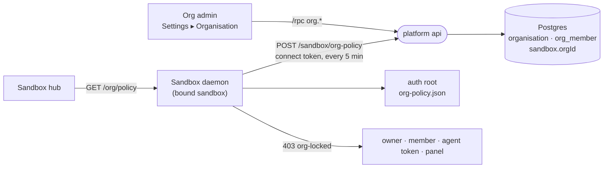

# Organisations

An organisation is a set of people and the sandboxes they run, all held to one policy that the organisation's admins write. It exists for an office of 20 to 200 people who do not write code, with a small IT department: a Polish municipal office is the case it was designed against. Personal sandboxes stay exactly as they are. Nothing here applies to a sandbox unless an admin who owns it has added it to an organisation.

## As built

Phase 1 (2026-10-13) built the model, the console, delivery and section locks. The governance pass of 2026-10-15 added pinned settings, a member fence for leavers, a fail-closed holder and the ownership guards. Both are described here as one system.

### Data model

[`schema.prisma`](../../_platform/prisma/schema.prisma), migrations `20261013120000_organisations`, `20261015120000_org_policy_reset` and `20261015130000_org_bound_sandbox_guard`:

- `Organisation`: a name, the policy rules as JSON (`policy`), and `policyVersion`, which goes up by one on every save.
- `OrgMember`: a person in an organisation, keyed by lowercased email like `SandboxMember`, so a person can be listed before they ever sign in. `role` is `admin` or `member` (`OrgRoleSchema`, stored as a string, so adding a role needs no migration).
- `Sandbox.orgId`: the organisation a sandbox belongs to. Null means personal, which is every existing sandbox. If the organisation is deleted, the column is set back to null, so its sandboxes become personal again rather than disappearing. A database trigger (`sandbox_org_bound_guard`) refuses to delete a sandbox row while `orgId` is set, whatever deletes it, including the cascade from deleting its owner's account row. `Sandbox.orgPolicyApplied` records the policy version the sandbox's daemon last reported holding. `Sandbox.orgPolicyResetAt` records when that daemon last came back holding less than it had reported (see Delivery).

The sandbox owner is still a person. An organisation does not own the machine or the connect token. It holds the sandbox to a policy, and the owner is held to that policy like everyone else.

### Who can do what

The routes are `org.*` in [`api-contract/organisations.ts`](../../_shared/api-contract/src/organisations.ts), served by [`org.routes.ts`](../../_platform/api/src/org/org.routes.ts).

| Action | Who |
| --- | --- |
| Start an organisation | The deployment's operators (`ADMIN_EMAILS`, proven the way `ADMIN_SIGN_IN` requires), or anyone signed in when `ORGS_CREATION=anyone`. The creator becomes its first admin. |
| Read the policy | Any member. Only admins also see the member list and the sandboxes. |
| Save a new policy version | Admins. Each save names the version it was edited from. If someone saved in between, the save is refused with `CONFLICT`, so one admin cannot silently undo another's change. |
| Add or remove people | Admins. The last admin can be neither removed nor demoted by adding them again as a member. Removing a person also deletes their platform grants (`SandboxMember`) to every sandbox the organisation holds. |
| Add a sandbox (bind) | An admin who owns that sandbox. Binding constrains the owner, so it is never done to a sandbox by someone else. |
| Release a sandbox (unbind) | Admins. If the owner could unbind alone, every lock would be optional. |
| Delete a bound sandbox | Nobody until an admin releases it. `sandbox.delete` answers `CONFLICT`, because a deleted sandbox restored from the trash comes back personal, which would be a way out of every lock. |
| Erase an account that owns a bound sandbox | Nobody until an admin releases it, the owner and the platform's operators alike ([`account-erase.ts`](../../_platform/api/src/account-erase.ts) `OwnsOrganisationSandboxes`). Erasing deletes the account's sandboxes with no recovery window and destroys their hosted apps at once. |

A caller who is not in an organisation gets the same `NOT_FOUND` as for one that does not exist, so an id reveals nothing.

These rules hold when requests race. Every admin change runs in one transaction that locks the organisation's row first and reads the caller's role under that lock. Two admins removing or demoting each other at the same moment are therefore taken one after the other: the second finds its caller gone or no longer an admin, and the last-admin check counts what the first committed. A bind also takes the sandbox's row lock, after the organisation's. `sandbox.delete` and an account erasure take the same sandbox lock and read `orgId` under it, so a bind and a delete (or an erase) end with exactly one of them done. The trigger above backs this with the database's own refusal. [`e2e/org-concurrency.e2e.test.ts`](../../_platform/api/src/e2e/org-concurrency.e2e.test.ts) races each pair on a real Postgres. Without the locks and the trigger, every case failed on its first round.

### The policy

[`schemas/organisation.ts`](../../_shared/sandbox-contract/src/schemas/organisation.ts) defines the policy. It has three kinds of rule.

**Section locks.** For each lockable part of a sandbox, one mode:

- `open`: works the same as in a personal sandbox. A part the policy leaves out is open.
- `locked`: anyone can read it, but every change is refused, including the sandbox owner's and the agent's.
- `hidden`: locked, and also removed from the sandbox hub and the command palette. Reads that would show a value to a person (`secrets.reveal`, `privacy.reveal`) are refused too. Hidden controls what people see, not what the sandbox uses: the agent still uses the secrets of a hidden Secrets section.

The lockable parts are the hub sections `models`, `agent`, `environment`, `secrets` (secrets and connections), `data-protection`, `extensions`, `access`, `areas` and `personas`, plus `updates`, the auto-update switch on Overview. The `agent` lock also holds the hub's Privacy shield, Guardrails and Retention pages: they write the privacy policy, the safety policy and settings, which are the `agent` section's routes, and the editor maps them to it (`useOrgPolicy.ts`). Overview, Usage, Activity and Audit are not lockable: they report on the sandbox and change nothing an organisation needs to hold.

[`policy/org-locks.ts`](../../_shared/sandbox-contract/src/policy/org-locks.ts) lists which daemon routes each part covers, route by route rather than by contract group. A group mixes the changes a lock is meant to stop with operations it should leave alone: probing a connection, asking a named person to release a credential (`secrets.request`), confirming your own AI-literacy notice, leaving a sandbox (`DELETE /members/self`), and teaching the privacy shield more values. The side effect is that a route added later stays open until someone lists it, and that omission shows up in the file's diff. A test checks every listed name against the route tables, so renaming a route cannot leave a lock pointing at nothing. One route is refused on every bound sandbox whatever the sections say (`ORG_BOUND_ROUTES`): `POST /system/access/disable`, which closes the daemon to every browser. Deleting an account calls it on each owned sandbox, and on a bound one it would lock a whole department out.

A platform reads a stored mode it does not recognise as `locked`, so a newer platform's stricter setting is never read as open.

**Pins (`preset`).** The organisation names groups of the public-office preset ([`compliance/preset.ts`](../../_sandbox/sandbox/src/compliance/preset.ts)): `privacy`, `retention`, `audit`, `analytics`, `notice`, `actions`, `admission`, `judge`. Every preset item in a named group holds in every bound sandbox. A pin is not a lock on a page. It is applied to what the daemon reads, so people can still change the settings page, and they can make a pinned setting stricter but never looser. The wire carries group names as plain strings: a daemon skips a group it does not know and reports it as `unenforced` rather than refusing the whole policy, and the platform validates the names an admin saves.

**Members only (`membersOnly`).** The organisation's member list becomes the outer fence of every bound sandbox's roster. The platform sends the members as `people`, each a sha256 of the organisation id and the lowercased address (`orgPersonPreimage`), so a daemon can test an address without being handed the staff list in clear. A policy without `people` fences nothing. When this is on, adding or removing a person raises the policy version, so the console's applied or waiting state shows the change reaching each sandbox.

### Delivery

The policy reaches a sandbox over the same channel as its announce: the sandbox's own connect token, on the ingress route `orgPolicy` (`POST /sandbox/org-policy`). The daemon ([`org/org-policy.ts`](../../_sandbox/sandbox/src/org/org-policy.ts)) asks at boot and every five minutes after, and says which version it already holds. The platform records that in `orgPolicyApplied`, and the console shows each sandbox as "in force" or "waiting". A separate route is used instead of the announce answer because the announce repeats only every hour and is shared by every daemon release. A lock an admin sets reaches every sandbox within five minutes.

- The answer is `{ policy }` or `{ policy: null }`. Null is the platform saying the sandbox belongs to no organisation, and it is the only answer that unbinds one. A refusal, an answer that cannot be read, or a platform that cannot be reached all keep the policy the daemon already holds. Cutting a bound sandbox off from the platform never loosens it.
- The platform's answer is the policy. It replaces the held one whenever the two differ, including when its version is lower. Refreshes run one at a time, so an older answer never lands after a newer one.
- The daemon keeps the policy in `org-policy.json` in the auth root and reads it once, at boot. The policy in force is the copy in memory, which no file edit reaches while the daemon runs. A restart while the platform is down still enforces the last version.
- A held file that exists but does not read is a bound sandbox whose record broke. Until the platform answers, the daemon enforces a provisional policy with every section read-only (`provisional: true` in `GET /org/policy`), and reports no version to the platform.
- With no held file, the daemon cannot tell a bound sandbox whose file was deleted from a personal one. A change to a lockable route that arrives before the platform's first answer since boot waits up to five seconds for it (`ORG_POLICY_FIRST_ANSWER_MS`). A personal sandbox pays that wait once per boot, and only for the round trip that answers `null`.
- When a bound daemon asks holding no version, an older one than it last reported, or one the platform never issued, the platform sets `orgPolicyResetAt`, and the console shows "came back without its policy copy on …". Binding resets `orgPolicyApplied`, so a legitimate new binding never counts as a reset. This detects a deleted, broken, restored or renumbered file; it does not prevent one, and an edit that keeps the version number is replaced by the next answer without being recorded.

> 2026-10-15: phase 1 replaced a held policy only with a newer version. A held file edited to a huge version with empty sections then outlived every later answer, and a platform restored from a backup could never govern its sandboxes again. The platform is now authoritative instead.

### Enforcement

Section locks: [`org-locks.middleware.ts`](../../_sandbox/sandbox/src/org/org-locks.middleware.ts) is mounted in the daemon's [`app.ts`](../../_sandbox/sandbox/src/app.ts) after authentication. It applies to every credential the same way: the owner, a member, the agent's token, a panel token, a control token, and a loopback daemon with no sign-in at all. A refused request gets `403 { error, reason: "org-locked", section, org }`. A personal sandbox holds no policy, so the middleware costs it one resolved promise and then passes the request on. The only way to lift a lock is to change the policy on the platform. Nothing inside the sandbox can.

Pins: [`compliance/org-pins.ts`](../../_sandbox/sandbox/src/compliance/org-pins.ts), threaded into the settings store and the privacy shield's policy store by the daemon's composition. Every read of `.intentic/config/settings.json` and of the privacy policy comes back with the pinned items applied, so the agent's turn, the action gate, the audit trail, the retention sweep and the privacy gateway act on the pinned value whatever the file says. Applying a preset item never loosens anything and applying it twice changes nothing, which is what makes reading through it safe. A read that finds the file looser:

- writes the pinned value back, under the file's own write queue, so a program that reads the file itself (an extension's CLI) sees it too. A change to `settings.json` is read once by a file-watcher reaction ([`bootstrap/platform-presence.ts`](../../_sandbox/sandbox/src/bootstrap/platform-presence.ts)), so this happens within the watcher's latency rather than at the next read;
- records `org.pins.held` in the audit trail, once per change rather than once per read.

A save through `settings.set` or `privacy.setPolicy` that would undo a pin is refused with `403 { reason: "org-pinned", items }`, rather than stored pinned and left on the page as a value that did not stick. Writes from anywhere else (a `sandbox.toml` definition, a program) are stored with the pins applied. Because pinned values are written into the files, releasing a pin or the sandbox leaves the stricter value in place; the owner can loosen it again from the settings page.

Members only: [`org/org-roster.ts`](../../_sandbox/sandbox/src/org/org-roster.ts). The daemon's roster stays the copy that is enforced; the organisation narrows it in two places. Every read of the roster leaves out a person the policy does not admit, so every sign-in, session and token of theirs is refused on its next request, and a row written into `members.json` by hand is no way back in. Each policy that arrives (and the one read at boot) also takes such people off the roster file, closes their live sockets and tickets, and records `member.revoke` in the audit trail. A grant to someone the organisation does not list is refused with `403 { reason: "org-members-only" }`. The sandbox owner is not on a roster, so none of this reaches them.

The platform enforces the policy in one place of its own. The invite routes (`invite.create`, `resend`, `setRole`, `revoke`) refuse a sandbox whose organisation holds Access. Without that, the platform's copy of the roster could drift away from the daemon's frozen one.

### The editor

- The sandbox hub reads the policy from the daemon (`GET /org/policy`, [`useOrgPolicy.ts`](../../_editor/web/src/features/organisations/useOrgPolicy.ts)) rather than from the platform, so it draws what the daemon will actually refuse. A hidden section is removed from the hub index and the palette. A locked section is wrapped in [`OrgHeldSection.vue`](../../_editor/web/src/features/organisations/OrgHeldSection.vue), which shows "{org} manages this part of the sandbox" and puts the section inside a disabled `<fieldset>`. That disables every control in the section at once, without each page having to know about organisations. A daemon too old to have the route reads as unbound.
- Settings ▸ Organisation ([`OrgConsole.vue`](../../_editor/web/src/features/organisations/OrgConsole.vue), [`OrgDetailPanel.vue`](../../_editor/web/src/features/organisations/OrgDetailPanel.vue)) is the organisation admin's console. It lists the organisations you are in, lets you start one where the platform allows it, edits the policy (sections, required settings and the members-only switch) and saves it as a new version, manages the people, and binds and releases sandboxes with each one's applied or waiting state and any policy reset. A member sees the policy read-only.
- The `updates` lock has no UI of its own yet. The Overview switch is still drawn, and the daemon refuses the change. A pinned setting is not marked on the settings pages either: the page shows the pinned value, and a save that would loosen it is refused with a message naming the item.

### What the protection does not cover

Agents run as root in the sandbox container today: the unprivileged agent domain is refused until it is finished ([`agent-domain-rollout.ts`](../../_sandbox/sandbox/src/workload/domain/agent-domain-rollout.ts)). Anything stored in the container, the auth root included, is therefore within reach of an agent's shell and of anyone with a terminal there. What holds against that:

- The policy in force is in the daemon's memory. Editing or deleting `org-policy.json`, `privacy-shield.json`, `settings.json` or `members.json` changes nothing the running daemon enforces, and pinned values are written back.
- A restart is where the file matters. A broken file holds every section read-only. A deleted file waits for the platform's first answer. An edited one is replaced by the platform's next answer. The platform records each of these as a policy reset, except an edit that keeps the version number.

What does not hold:

- The platform guards are row locks and a trigger in the platform's database. Someone with direct database access can still clear `orgId` and then delete the row.
- Erasing an account is two steps: Better Auth's `beforeDelete` runs the erase in one transaction, then deletes the account row. If the same person creates and binds a new sandbox between the two, the row delete is refused by the trigger after the erase has committed. The account is then left without its other sandboxes until an admin releases the new one and the deletion is retried.

- Root can replace the daemon itself, kill it and run something else, or block the platform and then delete the held file and restart. A sandbox that cannot reach the platform after such a restart runs unbound until it can. Nothing inside a container protects against its own root; that needs the agent domain, or a host-side copy of the binding (for example `ic` carrying it into the container environment).
- An extension's CLI that reads `settings.json` itself (the IMAP and Microsoft 365 senders today) reads whatever is on disk between an edit and the write-back. The window is the file watcher's latency, not zero.
- Hiding a section refuses the reveal routes, but other reads still answer. That is deliberate: other parts of the editor depend on those reads.
- The member fence reaches the roster, not the owner. An owner who leaves keeps the daemon's ownership (it is fixed at the first sign-in, `owner.json`), and can still change every part of the sandbox the policy leaves open. Their account and the sandbox cannot be deleted until an admin releases it, which keeps the department's work in place, but handing the sandbox to a colleague has no route yet.
- Removing a person from an organisation without `membersOnly` removes their platform grants only. The daemon's roster keeps them until someone in the sandbox removes them, and with Access locked nobody inside can.

## Later phases

### Phase 2: what is left of hardening

Pinned settings, read-time enforcement with write-back and drift records, the member fence and the fail-closed holder are built (above). What remains:

- Per-key pins beyond the public-office preset (for example the agent execution domain, once the agent domain ships).
- Marking pinned controls on the settings pages, so a person sees the hold before a save is refused.
- A host-side copy of the binding, so a container restarted without its held file and without the platform still starts bound.

> 2026-10-15: signing the policy with the platform's identity key was planned here and is not built. The policy already arrives over the authenticated channel to the platform. At rest, a signature only stops a held file being forged, and anyone who can forge it can also delete it, which loosens it just as much. The signature would protect nothing until the agent domain takes the auth root out of an agent's reach. Detection on the platform (`orgPolicyResetAt`) and the authoritative refresh were built instead.

### Phase 3: central personas and assistant templates

An organisation keeps persona cards and kits on the platform as a versioned bundle, in the same shape as `.intentic/config/personas.json`. Bound daemons fetch it beside the policy and install the cards as org-owned and read-only (`origin: org`), next to the sandbox's own cards. The `personas` lock then means "only the organisation's cards".

### Phase 4: provisioning

- Bulk invite: paste or upload a CSV of addresses with a department and a role. The platform creates the `OrgMember` rows and sends one email each.
- From organisation member to sandbox access: an admin sets a department's default sandbox, role and area. The platform sends the grant to the daemon through a new admin-signed route, so a locked Access section has a managed way in. `SandboxMember` and the daemon's roster stay the enforced copies.
- Ownership handover: an admin hands a bound sandbox to another member when its owner leaves. The daemon's owner is fixed at first sign-in, so this needs a daemon route that takes a platform-signed handover for a bound sandbox, and a decision about how far the platform may then reassign a machine it does not run.
- Sessions on removal: a removed member's daemon session is refused by the roster check, but it stays valid for its 30 days and works again if they are re-added. Revoking it outright needs per-session revocation, which the daemon does not have.
- Sandbox creation for the organisation: `sandboxes` / `fleet.provision` take an `orgId`, so IT can create one sandbox per clerk, already bound, without creating them one by one.
- Identity: `Organisation` gets an optional identity-provider binding (OIDC issuer, allowed email domains). SSO is decided separately; the model leaves room for it.

### Phase 5: usage attribution and budgets

- The spend ledger ([`providers/usage.ts`](../../_shared/sandbox-contract/src/schemas/providers/usage.ts)) gains the member email and department on each turn. The daemon already knows who started a turn.
- A bound daemon reports daily per-member totals over the connect token. The organisation console shows them by member, department and sandbox.
- Budgets per member and per department, delivered in the policy and enforced at turn admission, the same place the trial allowance is checked. A turn over budget is refused before it starts, with a message naming the budget. `maxSpendUsd` on loops stays as it is.

### Phase 6: update control

Policy fields `updates: { channel, freeze, rolloutPercent }`. The daemon's update policy ([`update-policy.ts`](../../_sandbox/sandbox/src/system/updates/update-policy.ts)) reads them before its own switch, and the platform answers `ic` with the pinned image for a frozen organisation. A staged rollout starts with an organisation's pilot sandboxes, chosen by a tag.

## Decisions taken without the owner

These were decided while building and are open to revision:

- **Organisations exist on the hosted platform and on a self-hosted one alike, but only operators can start them by default** (`ORGS_CREATION=operators`). The feature is in the product, but it does not appear on app.intentic.dev for everyone until pricing is decided. A self-hosted office sets `anyone` or lists its IT staff in `ADMIN_EMAILS`. Pricing and plan limits are not modelled.
- **The organisation does not own the sandbox.** Ownership and the connect token stay with a person. An organisation controlling the machine is a larger change, possibly with phase 4's creation-for-the-organisation. Since 2026-10-15 deletion does not stay with the person while the sandbox is bound: deleting it, or erasing the account that owns it, waits for an admin to release it.
- **Pins are whole preset groups, not single settings.** An admin chooses "outgoing messages wait for approval", not twenty action keys. Per-key pins can follow when a buyer needs one.
- **The member fence sends digests, not addresses.** Every bound sandbox gets the whole organisation's member list, so it is sent salted and hashed. A digest of a known address can still be confirmed by anyone who holds the list, so this hides the list, not whether a given person is in it.
- **Locks are per section, not per member tier.** A section an organisation hides is hidden from everyone in the sandbox, the owner included. Organisation admins manage it from the console, not from inside the sandbox.

## Migration

The migrations only add things. Existing sandboxes have `orgId` null, and their daemons are answered `{ policy: null }`, so nothing changes for them. A daemon older than phase 1 never asks for a policy, and the platform holds it to nothing. Before binding a sandbox, check that its daemon reports holding the policy. A platform older than phase 1 answers the daemon's fetch with 404, which the daemon reads as "keep what is held", so a personal sandbox stays personal.

`preset` and `membersOnly` are optional, and the platform leaves them out of a policy that uses neither, so such a policy reads and travels exactly as before. A phase 1 daemon drops both fields when it parses the answer: it enforces the section locks and none of the pins or the member fence. The console cannot tell such a daemon apart yet, so update a sandbox before relying on pins there. A held `org-policy.json` from phase 1 reads unchanged.
