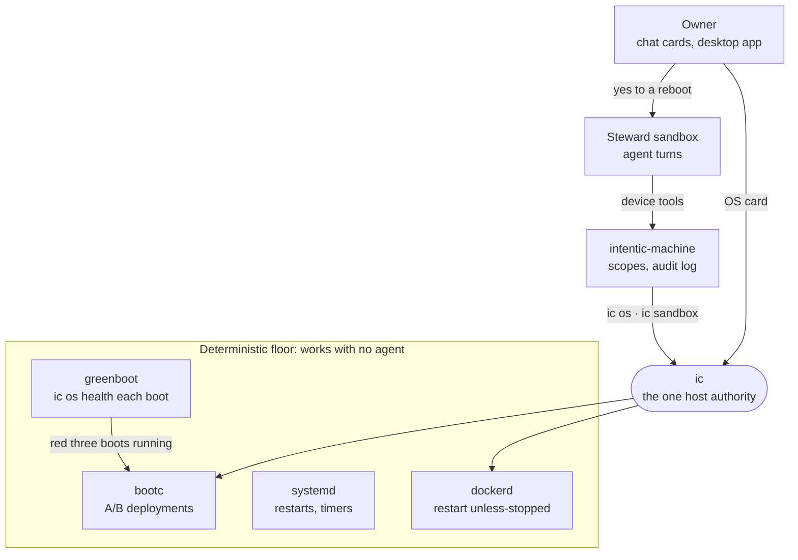
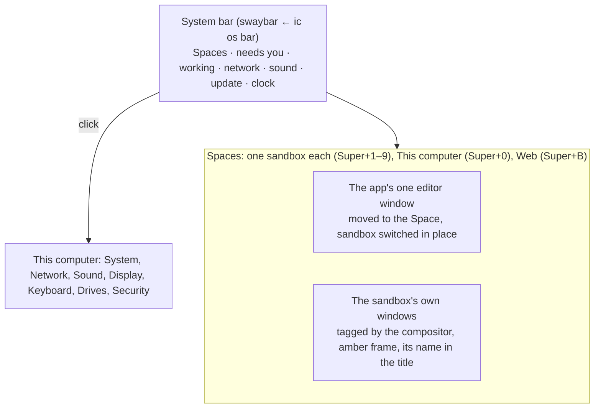

# Intentic OS

How intentic runs as the whole operating system of a machine: what the OS image is, who may change it, and how a bad
update or a misbehaving agent is undone without a person at the box.

## What it is

On a PC, a sandbox sits on Windows, WSL's VM and Intentic's engine distro ([`_sandbox/ic/engine`](../../_sandbox/ic/engine)).
Intentic OS removes everything under the engine: the machine boots a bootc image of Fedora
([`_os/os-image`](../../_os/os-image)) whose `/usr` is the image, read-only, with `/etc` and `/var` kept across
updates. Docker is a plain systemd unit, `ic` is in `/usr/bin`, and the machine agent runs as the `intentic` user's
systemd user service, started at boot rather than at a login.

The first boot asks for a setup code (on the screen and on a page on port 80) and runs `ic sandbox connect`, which
starts the first sandbox and connects the machine to it as a device. That sandbox is the **steward**: its agent manages
the machine through the device tools, which are the machine agent's thin callers of `ic`, as every other door is.

## Who may change what

The design rule is that **the agent sits above the deterministic floor and never is it**. The floor keeps a machine
converging when the agent gets something wrong, the agent is down, or the machine has no network:

- dockerd restarts every sandbox after a reboot (`--restart unless-stopped`), and the machine agent's minute tick runs
  `ic sandbox watch`, which puts a failed sandbox update back on its own.
- An OS update is staged by a daily timer and never applied by it. The reboot that applies it is `ic os update
  --apply`, which the steward may run only after the owner's yes in chat (its device skill says so, and the "Manage
  sandboxes" switch gates the verb).
- greenboot runs `ic os health` as a required check on every boot: Docker answers, and every sandbox that ran before
  the reboot runs again with its daemon answering. Three red boots in a row roll the machine back to the previous
  deployment. This is the OS's form of the sandbox update probation ([`update-probation.ts`](../../_shared/sandbox-contract/src/state/update-probation.ts)).
- The steward never receives the Docker socket. What it may do is what the device's scopes allow, enforced on the
  machine ([`policy.ts`](../../_devices/machine/src/device/policy.ts)) and logged there.

The `intentic` user is in the `docker` group, which is root on the machine in all but name, and has sudo for `bootc`
and reboot, plus the narrow helper that changes its local screen PIN. So the boundary that matters is the device scopes, not Unix permissions: an owner who switches
"Run commands" on for the steward has given it the machine.

## Isolation between sandboxes

A sandbox with the Docker capability runs privileged, which under runc is the host's root. On Intentic OS, `ic`
applies the machine's isolation policy (`/etc/intentic/os.json`) to the run command the image hands it: `auto` adds
`--runtime=kata` to a privileged sandbox, so its nested Docker runs inside a microVM with its own kernel. The image's
run contract is untouched: this is a host decision `ic` makes, and only on Intentic OS. A sandbox whose run command asks
for something a microVM cannot honour (the host's network or PID namespace) runs on runc with a warning rather than not
at all.

The image ships `isolation: container` for now. Kata is installed and wired into Docker, but on the only machine it was
tried on (a nested VM under WSL2) its guest dies at boot (`kvm run failed Bad address`), so turning it on by default
would trade a known risk for an unverified one. Flipping the shipped default to `auto` waits for a sandbox seen running
under Kata on bare metal.

## The screen

The desktop edition answers "shared UI layer over sandboxes, or a browser on the OS?" with the existing desktop app as
the shell. Boot, pairing, recovery and switching between sandboxes have to work when no sandbox is up, so they cannot
live inside one. The app already has a local face that needs no sandbox (This device, the engine card, Repair).
Everything else is the editor web app it already loads. The machine agent drives that screen through sway's IPC like
any Linux desktop.

On Windows, Intentic is a guest and Windows provides the shell around it. On Intentic OS nothing else does, so the
session provides what a person sitting at the machine expects of an operating system (2026-10-16). Its users are
everybody, not only developers, so nothing on screen says sway, bootc or polkit:

- **The bar belongs to the session, not to a sandbox.** swaybar is a layer-shell bar that stays above every Space,
  which a Tauri window cannot be. Its status line is `ic os bar`, which counts what needs the owner across every sandbox
  on this machine (`ic sandbox attention`, below), not only the sandbox on screen. Clicks reach the app through a
  navigation-only `intentic://shell` link. mako shows the app's notifications.
- **A Space is a sandbox.** The app follows sway's binding and window events (`src-tauri/src/shell/`): Super+N moves
  its one editor window to that sandbox's workspace and switches the sandbox in place, the way Alt+N does inside the
  editor. A sandbox's own windows join its Space. Super+Space starts a new chat on the sandbox in front.
- **Sandboxes may draw windows on the physical screen.** `ic os screen serve` gives each running sandbox its own
  Wayland socket through security-context-v1, the mechanism Flatpak uses. The compositor tags every window from it
  with the sandbox's slug and withholds the powers that would let a sandbox read or drive anything else: screen
  capture, synthetic input, layer surfaces, other windows' lists, session lock. Every such window wears an amber frame
  and its sandbox's name, and may not go fullscreen, since that would hide both and let it imitate the system. Inside
  the sandbox, `on-screen <program>` runs a program there. The agent cannot see that screen and checks its work on its
  own virtual desktop first. The socket's directory is bind-mounted by `ic`'s run policy, so a sandbox gets it at its
  next recreate. Under Kata a socket cannot cross the VM boundary, so a microVM sandbox draws nothing. The
  [os-image README](../../_os/os-image/README.md) lists the withheld protocols as checked against Fedora 44's sway.
- **Settings are verbs first** (below): This computer's cards and the steward's device tools run the same `ic os`
  verbs. A USB drive plugged in raises a notification, and the Drives card copies it into the sandbox chosen.
- **The screen locks with a PIN, once the owner sets one.** The PIN becomes the `intentic` user's local password
  through a root helper that can change nothing else, swayidle locks with swaylock after the idle time, and SSH never
  accepts that password.

With no internet the screen still works. The editor the app loads lives at app.intentic.dev, so when that address does
not answer, the app shows its own copy of the editor instead, built into its bundle, on this machine's sandboxes. Each
one is reached on its loopback port with a session the machine minted for its owner through `docker exec` (`ic sandbox
session`). The daemon accepts that as proof because whoever holds the machine is root over the container already.
netd marks requests that arrived on the loopback port, and only those may come from the app's own page origin; the
bearer session stays the boundary. Whatever needs the platform (billing, sharing, a new sandbox) says in plain words
that it needs the internet, and the face offers the online workspace again when it answers. The same session lets
`ic sandbox attention` ask each daemon's `GET /agents/attention`, which counts with the editor's own rules (moved into
the contract package), so the bar and the board agree. The first sign-in to a sandbox still needs the internet.

The risk is the renderer: Tauri on Linux is WebKitGTK, which trails Chromium (WebTransport, WebGPU, codecs). The app
reaches the OS only through `ic os … --json`, so moving the shell onto a Chromium kiosk later means a loopback service
in front of those verbs, not a rewrite.

## The machine's settings

A person and the steward change the machine the same way. The Wi-Fi, the sound, the screens, the keyboard layout and
the USB drives plugged in are each an `ic os` verb (the [host interface](../../_os/README.md#settings)); the desktop app's
This computer cards run them, and every one is also a device tool, so "connect to the guest Wi-Fi" or "copy the stick
into my sandbox" is something the steward can do. ic does them as the `intentic` user through the tools any Linux
desktop's settings use (NetworkManager, WirePlumber, sway, udisks), and a polkit rule lets that user change exactly
those things with no seat session and no password: the machine agent that calls ic has neither.

## Channels and releases

`ghcr.io/intentic/os` and `ghcr.io/intentic/os-desktop` carry `beta` (built from main) and `stable` plus `<version>`
(built from a release's own `ic` and desktop app). [`os.yml`](../../.github/workflows/os.yml) boots the server edition
in a VM before it pushes anything, so a tag never points at an image that did not boot. `ic os channel` moves a
machine between them, within intentic's own repositories (the sudo rule allows nothing else).

## How it is checked

[`smoke.sh`](../../_os/os-image/smoke.sh) boots the server edition in a VM and checks Docker, the Kata runtime, the
pairing page, `ic os status` and a green `ic os health` under greenboot; `os.yml` runs it before every push.
[`install-test.sh`](../../_os/os-image/install-test.sh) runs the installer ISO onto a blank disk with Secure Boot and a
software TPM, then checks that the first boot opens the encrypted root by itself; `os.yml` runs it for every release.
What neither can reach: a real pairing (it needs a setup code from an account), a sandbox under Kata (the VMs these run
in are nested), and physical hardware. The [os-image README](../../_os/os-image/README.md) keeps the table of
machines tried.

## Not done yet

- Kata on bare metal: the shipped isolation default moves to `auto` once a privileged sandbox has run under it.
- A device-code pairing (the box shows a short code, the owner types it in the editor) would replace the setup code;
  it needs a platform route and an editor page.
- Machine owner keys for out-of-tree kernel modules (NVIDIA), so GPU boxes keep Secure Boot.
- The hosted plan on bare metal: the same image with `isolation: vm` could replace the per-sandbox Fly machine.
- The desktop shell on physical hardware: the bar, Spaces, sandbox windows, the lock and the settings cards were checked
  piece by piece (a headless sway 1.10 for security contexts, recorded tool output for the settings parsers), never
  together on a screen, and never on sway 1.11, which first matches windows by their security context.
- A microVM sandbox's windows: waypipe over vsock would carry its Wayland socket across the VM boundary.
- Agent-built sites in the offline face: netd already routes preview hosts on the loopback port, but the editor builds
  preview addresses from the public zone.
- X11-only programs on the physical screen: `on-screen --x11` needs `xwayland-satellite`, which the sandbox image's
  distribution does not package yet.
