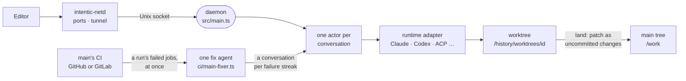

# The sandbox daemon

The Node process inside every sandbox that owns the workspace, runs each agent conversation in its own git worktree, lands the result onto the main tree, and keeps its records beyond the agents' reach.

## The process

- `docker-entrypoint.sh` starts sshd, then [`intentic-netd`](../../_sandbox/netd) (Rust), which owns every port and the ingress tunnel and supervises `node dist/main.js`: a crashed daemon is restarted with backoff once whatever it left in its process group is ended with it, and one that has not answered netd's ping for 5 minutes is killed and restarted the same way. The daemon listens only on a Unix socket, so a daemon restart drops no connection.
- **netd owns sockets and bytes; the daemon owns policy.** Every listener, the tunnel, every upgrade splice, a terminal's WebSocket and tmux client, and a preview's relay are netd's, and none of their bytes pass through Node. Every decision about them is Node's, asked once over the control socket ([`netd-wire`](../../_sandbox/netd/crates/netd-wire/src/lib.rs)): whether a terminal may open and onto which session, created where (netd composes the tmux command), and what becomes of a preview request, an upstream to relay, a page Node rendered to write, or the outbox to hand back. Either side asks the other under one envelope, an id answered or refused within five seconds. The git change feed ([`feed.rs`](../../_sandbox/netd/crates/netd/src/feed.rs)) is the one piece of netd that is neither: a counter with no policy in it, since Node names each checkout and decides what a generation is worth, kept native because its inotify fan-out over every `.git` is cheapest there.
- [`main.ts`](../../_sandbox/sandbox/src/main.ts) loads config, builds every service in [`composition.ts`](../../_sandbox/sandbox/src/composition.ts), runs the boot steps and opens the readiness gate.
- The container's secrets arrive as environment variables, and every child inherits its parent's environment, so right after loading config the daemon deletes every secret one from its own ([`sealed-env.ts`](../../_sandbox/sandbox/src/seams/sealed-env.ts)): the names the config schema marks `secret` (`CONFIG_SECRET_ENV`) and the runner's replayed ones it classifies secret (`REPLAY_SECRET_ENV` in [`sandbox-run`](../../_shared/sandbox-run/src/index.ts)), whose overlap a test keeps in agreement. The tmux server's global environment is scrubbed of the same names. A provider fallback key reaches only the runtime it authenticates, handed over by name (`containerKeyEnv`). 2026-10-06: chosen over filtering each of the 32 sites that spread `process.env`, since a site written later is covered too.
- The wire is the oRPC contract in [`_shared/sandbox-contract`](../../_shared/sandbox-contract) (one `*.contract.ts` per route group), served by [`router.ts`](../../_sandbox/sandbox/src/router.ts). `/events` and `/agent/attach` stream; the browser view is a WebSocket opened with a one-shot ticket. The daemon does not serve the editor itself.
- Terminals are served by intentic-netd, one tmux control-mode client per session shared by every viewer, always as a WebSocket, over TCP or spoken by the editor on a stream of the edge's WebTransport session where the edge declares one ([`term/`](../../_sandbox/netd/crates/netd/src/term/mod.rs)); the daemon only answers whether a socket may open and onto what ([`terminal-plan.ts`](../../_sandbox/sandbox/src/terminal/terminal-plan.ts)).
- The sandbox's proof of life is netd's own as well: `GET /system/vitals` ([`vitals.rs`](../../_sandbox/netd/crates/netd/src/vitals.rs)) never reaches the daemon and never waits for it. It says whether the daemon's control link is starting, up or restarting, how far its event loop lags (the round trip of a ping netd sends over the control socket every 2 s, which the daemon's link answers at once), how often netd restarted it in the last 10 minutes, the container's uptime and its cgroup pressure. The heartbeat on `/events` comes from the daemon's event loop, so a sandbox too busy to send it would otherwise read as a dead one. The editor reads the body with `parseVitals` ([`vitals.ts`](../../_shared/sandbox-contract/src/protocol/vitals.ts)).
- Each top-level directory of `src/` is a subsystem, placed in one layer of [`layers.json`](../../_sandbox/sandbox/layers.json) (foundation, host, connections, agent, orchestration, composition), and imports only its own layer and those below. What a lower layer needs from above arrives as a port composition fills: the environment's fragment sources ([`environment-sources.ts`](../../_sandbox/sandbox/src/seams/environment-sources.ts)), a device gate's cards, turn and judge ([`host-guard-deps.ts`](../../_sandbox/sandbox/src/hosts/host-guard-deps.ts)), the runtime table the providers slice is handed. The sandbox definition, `sandbox.toml` ([`definition/`](../../_sandbox/sandbox/src/definition/definition.ts)), is its own subsystem among the connections: derived from the live stores for an export or a runner's hello, applied item by item on an arrival or a boot seed. What the image carries, its feature packs and the binaries on its PATH ([`image/`](../../_sandbox/sandbox/src/image/packs.ts)), is foundation. 2026-10-06: until then the definition lived in `portability/` (bundles and arrivals, orchestration), so the runner and device code that ships settings reached up into it.
- The file tree is held in memory by the workspace watcher's thread ([`resident-tree.ts`](../../_sandbox/sandbox/src/workspace/files/resident-tree.ts)) and re-listed only in the folders a batch touched; the tree route answers from it, and `/events` carries each batch as a `treeChanged` delta tabs patch their tree with.

## Agents

- A conversation is the durable unit and a turn is one run inside it. One actor per conversation ([`conversation-actors.ts`](../../_sandbox/sandbox/src/conversations/actor/conversation-actors.ts)) decides whether a new message starts a turn, steers the running one, or waits in the queue.
- A person's message may carry `sendAt` or `sendAfter`, the composer's Send later: a time the person picked (or the reopen of an account it reads as spent), or another conversation whose work it builds on. It starts no turn and reaches no provider: it waits in the queue carrying its own booking, that instant as `until` or that conversation as `after` ([`turn-admission.ts`](../../_sandbox/sandbox/src/agent/run/turn/turn-admission.ts), `bookingFor`), where every window draws it as scheduled with when it goes, a Change that re-times it (`agent.queueSchedule`, naming its `ids`), a Send now (`agent.queueResume`, naming its `ids`), and the one door every queued message has: a person's is edited by taking it back into the composer, anyone else's is removed (`agent.queueRemove`). Each booked message goes at its own time: booking another never re-times it, and neither a plain send nor a Stop touches it. The queue-level `paused: "scheduled"` with `until` or `after` is only the soonest booking, derived on every write ([`conversation-queue.ts`](../../_sandbox/sandbox/src/conversations/actor/conversation-queue.ts), `next`), for editors older than per-message bookings (an editor reads which kind of queue it has from whether any message carries a booking) and for a rollback, where an older daemon then holds everything until that soonest time rather than sending every booking at its boot. A Stop or a refusal holds only the messages with no booking (`stopped` or `refused` there, while one is left); a person's send lets that hold go, and so does a booking coming due, which takes what the hold kept with it. A message that opens its conversation writes the conversation's entry with the booking, so its card is on the board from the press and the booking survives a restart; a turn running when it is booked does not let it go when that turn ends. Taking that message back while nothing else has happened in the conversation (no turn run or tried, no record, nothing else waiting, no booking elsewhere waiting on it) takes the conversation with it: the entry is forgotten under the conversation's own lock, `agent.queueRemove` answers `unopened`, and the editor puts the words, files and booking back in that chat's composer as a new chat ([`turn-admission.ts`](../../_sandbox/sandbox/src/agent/run/turn/turn-admission.ts), `unopened`). Any person's message taken back comes back to the composer it was written in, ahead of what was typed since, and an empty box gets its booking back too, so pressing again books it as it was ([`turnClient.ts`](../../_editor/web/src/models/conversations/session/turnClient.ts), `takenBack`). The editor does that at the press, not at the answer, which for a conversation being forgotten comes seconds later: until then the message is left out of the chat's queue and the board draws the card as that composer's draft where it stood, never the idle row on its way out (`takingBack`, `leavesWithItsMessage`); a refusal puts the composer back as it was unless the words were changed meanwhile. The resume pass lets each message go at its `until`, or once the conversation it waits on has nothing running, queued or armed, nothing left on its branch and no land broken, and either its last turn ended clean or work of it landed after the booking ([`work-landed.ts`](../../_sandbox/sandbox/src/conversations/land/work-landed.ts)); it first waits out that land's version commit, so the turn it starts reads that work committed under its own subject, and then lets go only the messages still booked as they were ([`turn-resume.ts`](../../_sandbox/sandbox/src/agent/run/turn/turn-resume.ts), `releaseBooked`). Archiving a conversation by hand cancels the messages booked in it, before its checkout is retired, since an archived conversation refuses every turn and a booking left there would only be refused at its time; what waits unbooked (held by a Stop or a refusal) stays ([`archive.ts`](../../_sandbox/sandbox/src/conversations/registry/archive.ts), `cancelBookings`). The card's Archive says so on hover, and nothing that does not name the card takes one: neither the aged sweep (`archivable`) nor the board's Clear or a parent's family (`clearable`). An instant already past, or a conversation with nothing left to land, sends it the ordinary way; a conversation that is unknown, archived or a spawned child (whose work lands into its parent) is refused; a booking is clamped to a month ahead. A nearby booked instant keeps a hosted machine up; a distant one needs a durable platform alarm before idle-stop.
  - 2026-09-30: a scheduled send used to be an ordinary send with the limit answer set to resend. Rejected: the provider refused it, so the person who had just chosen to wait saw their message go out, a "usage limit reached" line, and only then a card saying it was scheduled.
  - 2026-10-02: a booking used to go the ordinary way for a conversation not on record yet and under a live turn, which suited a spent account and not a moment somebody chose. Waiting on another conversation by subscribing to `agent.landed` was rejected: the pass's reading of what the daemon holds answers the same after a restart, and covers a turn that ended with nothing to land.
  - 2026-10-06: the queue used to hold one booking for every message in it, the latest booked winning, so booking a second message re-timed the first, a plain send let every booking go early, and a booking held back the sandbox's own wakes. Each message now carries its own. A per-message Stop hold was rejected: a Stop still holds the unbooked messages as one, and a booking coming due lets that hold go, so there is one hold model, not two. Records written before convert on read, each message given the queue's booking ([`agents-store.ts`](../../_sandbox/sandbox/src/conversations/registry/agents-store.ts)).
- The message that opens a conversation may carry `conversationAutoLand`, its own standing answer to whether finished work lands by itself, which its entry latches as `agents.autoLand` would set it later; only a maintainer's is taken, since a collaborator's work waits for a land.
- [`runtime-table.ts`](../../_sandbox/sandbox/src/runtimes/runtime-table.ts) picks an adapter per provider and harness: the Claude Agent SDK, Codex, OpenCode, Cursor, ACP agents and pi. What each runtime supports is declared in [`agent-runtimes.ts`](../../_shared/sandbox-contract/src/models/agent-runtimes.ts), so the editor never offers a control the runtime would ignore.
- Claude Code 2.1.287 runs mods: plugins whose hooks are functions loaded into the CLI process, which can answer or rewrite any event before the daemon's SDK callbacks see it. Three settings keep a Claude turn the daemon's own:
  - The image installs managed settings ([`claude-policy/`](../../_sandbox/sandbox/claude-policy)) that load Intentic's policy mod first. It sends `tool.check` and every `classic.*` event past the mods someone installed, so the daemon's guards (the command gate, secret rewriting and redaction, action rules, persona scope) run, and their refusals hold. The same settings seat Claude Code's own guard, `sec-default`, which keeps those mods off the system prompt. [`claude-policy.integration.test.ts`](../../_sandbox/sandbox/src/runtimes/claude/claude-policy.integration.test.ts) runs both routes against the bundled CLI.
  - Every Claude process the daemon starts sets the built-in `agents-md` mod to `claude-md` ([`claude-builtins.ts`](../../_sandbox/sandbox/src/agent/providers/claude/claude-builtins.ts)). The daemon composes AGENTS.md for every runtime itself, and the mod would load it a second time and attach nested ones only Claude sees.
  - The CLI's `plugin-authoring` skill is hidden, since nothing a mod draws shows under the Agent SDK.
  - 2026-10-04: Claude Code's `sec-default` guard alone was rejected. It holds only hooks that managed settings declare, and the daemon's are SDK callbacks, so a mod answering `tool.check` with allow still ran a refused command.
- A turn nobody is watching when it starts (an automation, a loop, a spawned child) carries `policy.unattended`: the safety judge and the prompt are told, and nothing else changes. Every card it raises, a question, a plan, a held command, a credential's release, an install, waits for the owner like any other (conventions.md, A person's answers).
- What every request of a Claude Code turn carries is kept small and stable, since cache reads are most of a turn's token cost (70% on this sandbox's ledger, 07-28 to 10-13) and every call of a turn reads the whole prefix again. Each part is measured against a holdout of whole conversations ([`experiments.ts`](../../_sandbox/sandbox/src/agent/run/decide/experiments.ts)), read on Sandbox ▸ Agent ▸ Tools.
  - Tool search (`toolSearch`): the CLI turns its own tool search off whenever `ANTHROPIC_BASE_URL` is not Anthropic's host, which the privacy shield's loopback gateway never is, so every shielded native Claude turn sent every MCP schema with every request (a median 83k-token prompt before the first tool ran). The gateway relays `tool_reference` blocks and the beta header untouched, so a native Claude turn now sets `ENABLE_TOOL_SEARCH` itself, `true` on the arm and `false` on the holdout ([`agent.ts`](../../_sandbox/sandbox/src/agent/run/agent.ts), `toolSearchEnv`); the servers marked `alwaysLoad` (ui, subagents, code, watch) stay loaded. Judged on the opening request's prompt and on failed calls.
  - A stable prompt (`stableSystemPrompt`): the guidance paragraphs whose condition moves between turns (whether anyone is watching; which of the owner's computers, browsers and phones are online) leave the system block and ride the message under "Connected right now", said on a turn where they changed and again after a restart or a compaction ([`surroundings.ts`](../../_sandbox/sandbox/src/agent/prompt/surroundings.ts)). In the system block, 46% of back-to-back turns inside the cache window opened under a different prompt and wrote 46.7k tokens against 19.3k; and where Claude Code records a session's system prompt once (the SDK's `snapshot`), a change never reached the model. Judged on what a follow-up turn's first request writes to the cache, and on failed calls.
  - 2026-10-18: a chosen "hot set" per tool (Headroom's `hr_hot`, which beat both all-loaded and all-deferred in its benchmark) was not built: `alwaysLoad` already is that set, and the holdout says whether deferring the rest pays.
- A scheduled automation whose moment passed while the daemon was down (for example, while its host or platform was unavailable) fires once as the scheduler starts, however many moments it missed, late and saying so, through the same sessions bar, guard and hold as any fire ([`scheduler.ts`](../../_sandbox/sandbox/src/automations/scheduler.ts) `catchUp`). What it owed is measured from the later of its last run and how far the scheduler has accounted for its clock (`.intentic/records/automation-schedule.json`), so one created or switched back on while nothing ran owes nothing from before.
- Automation work survives a restart from the moment it is accepted. A fire is journalled in `/history/conversations.db` when it is admitted, before it waits behind a running fire or for a thread slot, and the boot runs the queued ones in the order they were admitted, after the fire that was cut ([`fire-admission.ts`](../../_sandbox/sandbox/src/automations/durable/fire-admission.ts), [`fire-resume.ts`](../../_sandbox/sandbox/src/automations/fire-resume.ts)). A channel message still in its debounce or waiting behind a running turn, and a workspace event waiting on its chore, are kept in an inbox under `/history` (`automation-listener-inbox.json`, `automation-workspace-inbox.json`, [`inbox-store.ts`](../../_sandbox/sandbox/src/automations/durable/inbox-store.ts)) until the fire that takes them is journalled, and are replayed at boot. An approved hold leaves `/history/automation-holds/` only after its fire is journalled, and waits behind a busy automation rather than being dropped. A re-fired fire from a channel or a Visitor chat answers where its sender is, as an approved hold does. A watch's check that passed is written onto the fire's row before its baseline moves or a first-fire automation retires, and a one-time wake retires only once its fire is journalled, so a crash in between replays that fire rather than losing it or firing it twice.
- A watch is an automation with a check that decides, with no model, whether anything happened: a guard command, or a ready-made source the daemon checks itself, the newest version of an npm package, a GitHub repository's newest release, or a web page's text ([`watch-sources.ts`](../../_sandbox/sandbox/src/automations/watch/watch-sources.ts)). Only a passing check spends anything, and what it saw goes with the wake ([`watch-condition.ts`](../../_sandbox/sandbox/src/automations/watch/watch-condition.ts)).
  - What each check saw last is kept in `.intentic/records/automation-watch.json`. `fireOn: change` fires only when that differs, and its first check only records a baseline. A quiet check writes nothing into the run history, so a watch every few minutes does not bury the runs that mattered.
  - A guard keeps its own file between runs (`$AUTOMATION_STATE`, under `.intentic/records/automation-state/`), reads what it printed last time (`$AUTOMATION_LAST`), and runs with the connector credentials an unattended turn of the same automation would have, narrowed by its persona, with gated ones left out ([`guard-env.ts`](../../_sandbox/sandbox/src/automations/watch/guard-env.ts)).
  - It retires on its own: `until: first-fire` switches it off as it fires, the way a one-time wake does, and `expiresAt` switches it off at a deadline and tells whoever it was for, since a watch that stops silently reads like one still waiting.
  - What a passing check sets off is its `target` ([`fire-targets.ts`](../../_sandbox/sandbox/src/automations/watch/fire-targets.ts)): a new agent (the default), an existing conversation continued on its own model with the same notice a condition watch wakes it with, or only a push to the owner with what the check saw, which runs no model at all.
  - An agent proposes one with `automations propose`, which raises an `automation` need; a person's approval saves it, held to the Automations page's own rules (needs.md). The conversation watch (`watch start`) stays the short form: up to a day, held by one conversation.
  - 2026-10-07: chosen over a model that checks on every tick (Claude Code routines, ChatGPT tasks, Grok automations), which made a frequent watch the most expensive thing a sandbox could run while nothing happened; OpenClaw and Hermes Agent arrived at the same split of a script that decides and a model that acts.
- A turn runs detached from any client ([`turn-runs.ts`](../../_sandbox/sandbox/src/agent/run/turn/turn-runs.ts)). It is journaled in `/history/conversations.db` and resumed after a restart when the owner's **Resume turns after a restart** is on, or when the owner asked that one restart to pick up what it cut (the rebuild dialog, or a rebuild the sandbox held until its agents were idle; [`restart-resume.ts`](../../_sandbox/sandbox/src/system/restart-resume.ts)); otherwise it is recorded as interrupted. Transcripts live in `/history/conversations/<id>/`.
- A journalled turn's rows are on disk as it draws them ([`run-log.ts`](../../_sandbox/sandbox/src/sessions/run-log.ts)), not only in the live fold. Every patch the run publishes goes to `running.jsonl` in the conversation's unit, after the rows the run opened on. Patches are written a second apart, and at once when a card parks the turn. A running card is logged without its output, which it gets whole once it settles. A boot that finds the turn cut folds the log back into the rows any window was showing, for every runtime ([`cut-turn-rows.ts`](../../_sandbox/sandbox/src/agent/run/turn/recovery/cut-turn-rows.ts)). Before this, a cut Codex, Cursor or Gemini turn kept only its prompt, and a Claude one whatever the CLI's own session held, which stays the fallback when there is no log. A run whose rows are already on the record, because the daemon died between the append and the journal's clear, is not written again (`alreadyRecorded`, by the run id every row carries). What was said into the cut turn while it ran rides its re-run's note, since the CLI may never have read it. A settled turn whose record write failed is no longer let go. Its journal entry stays, marked `run.settled`, and its log is kept as `unrecorded-<run>.jsonl`. The next writer of that conversation's record (the next turn's settle, or the boot) writes it first, so turns stay in order, and the boot never runs it again ([`turn-transcript.ts`](../../_sandbox/sandbox/src/sessions/turn-transcript.ts) `recordUnrecordedRuns`).
- A card a turn waits on comes back after a restart whoever raised it ([`turn-runs.ts`](../../_sandbox/sandbox/src/agent/run/turn/turn-runs.ts) `run.watch`, [`restored-offers.ts`](../../_sandbox/sandbox/src/agent/run/turn/recovery/restored-offers.ts)). The journal takes every restorable card off the run itself, so a gate's card pushed onto the run from outside the turn generator is kept as the turn's own plan, question and permission cards are. Restorable cards are those three plus a page ask (`ask_page`) and a capability, payment or credential offer; browser and terminal help stay out, since what they wait on dies with the container. A restored card goes back up under its own id, and its answer is told to a turn of its own, in the words its call would have answered with. A credential card still takes its answer only from the people it names. What a gate's yes would release, a payment or a secret, is not released by the restored card: the agent makes the call again, and the gate asks once more, so the one answer that moves money or a secret is still the gate's own.
- Every held turn but a refused credential's is kept on its entry, as a spent allowance's was ([`limit-hold.ts`](../../_sandbox/sandbox/src/conversations/actor/limit-hold.ts)). That covers a door's, a stopped turn's ladder with the rungs it has climbed (`tries`), an outage's wait for its provider, an overflow's fresh session, and a flagged turn's fork point before the stopped response (`forkAt`). Without the fork point, a press after a restart sent the classifier its stopped response again. The boot puts each back on its actor before anything can start a turn, and the resume pass acts on it as the daemon that made it would have. A refused credential's hold has a minute to re-mint, and the token it must supersede is never written to disk, so it stays memory.
- (2026-10-05) `ic` writes the same ask before every restart it makes, so the turns a keeper's restart cuts come back too. A boot that is the third within 30 minutes (`/history/boot-history.json`, [`boot-history.ts`](../../_sandbox/sandbox/src/system/boot/restarts/boot-history.ts), written before anything can fail, a boot that dies before the gate included) honours neither the ask nor the setting: every cut turn stays interrupted, the log says why, and the owner's settings-problems card names the boot record until the next boot. A turn parked on a card is put back at every boot, but one whose cards cannot come back (its conversation archived) spends a try each time and is given up as interrupted after three.
- A loop or a workflow run the restart cut picks up where its record ends, under the same answer ([`loop-runner.ts`](../../_sandbox/sandbox/src/loops/loop-runner.ts) `resumeLoops`, [`workflow-runner.ts`](../../_sandbox/sandbox/src/workflows/workflow-runner.ts) `resumeWorkflowExecution`). Its iteration count, its spend against `maxSpendUsd` and its stall streak (the trailing unchanged rounds, `trailingStalls`) are rebuilt from `.intentic/records/loops.json`, so a loop with a stall limit of 3 and two idle rounds behind it gets one more round, not three. A workflow step that was mid-flight carries on its own loop record (`strandedLoopOf`) rather than opening a new one, so round 15 of 20 goes on at 16 and the step's cost and ceiling include what it already spent. The round the restart cut is not on the record and runs again as the same round; what it spent is not counted, since a turn's cost arrives only as it ends. A loop's rounds run unjournalled, so the turn-resume pass never re-runs one beside the loop's own next round.
- A turn the provider's safety classifier stops (Claude Code's "safeguards flagged this message/session", `stop_reason: "refusal"`) is coded `safeguard-flagged` and held for a person, never re-run by a clock ([`refusal-fork.ts`](../../_sandbox/sandbox/src/agent/run/refusal-fork.ts), [`classify-failure.ts`](../../_sandbox/sandbox/src/agent/run/frames/classify-failure.ts)). The turn interrupts the CLI as the flag lands: left alone, a CLI whose stopped response held a tool call answers it and asks again into the same refusal, over and over. The hold keeps the last session entry before the stopped responses, and the chat's card offers **Retry on** the same model or **Continue on…** another one, which the conversation then stays on. Either press resumes the same session with `resumeSessionAt` at that entry, so the model never reads what was stopped. The CLI's own automatic switch to another model is off (`CLAUDE_CODE_DISABLE_REFUSAL_FALLBACK`); its single same-model retry within the turn stays.
- 2026-09-30: a flagged turn used to read as an uncoded death, so the stop ladder and Continue resent it into the session still carrying the stopped response (one conversation was flagged twelve times running). Automatic switching to a fallback model and re-seeding a fresh session were considered and rejected: the owner asked to choose each time, and changing the model by hand already covers both.

## Worktrees

- An isolated conversation works on branch `agent/<id>`, with one git worktree per repository under `/history/worktrees/<id>/` ([`worktrees.ts`](../../_sandbox/sandbox/src/conversations/worktrees/worktrees.ts)). Parallel agents cannot collide.
- A conversation may move its copy to another branch (a CI branch to push, a pull request it was asked to work on), and it stays there. Review and land read only `agent/<id>`, so each turn's close copies the commits that turn made there onto `agent/<id>` without moving the copy ([`stray-work.ts`](../../_sandbox/sandbox/src/conversations/worktrees/stray-work.ts)). A commit counts as the turn's own when no branch or remote-tracking ref named it as the turn opened, so the other branch's own history never lands. Sync leaves such a copy alone rather than rebasing that branch onto the owner's HEAD. A commit that will not copy cleanly moves nothing: the review says the work there is not carried, and the `stray-work-reaches-its-own-branch` invariant names it. Uncommitted edits there are not carried until they are committed.
- 2026-09-30: a copy standing elsewhere used to be reported and never repaired, and its work was stranded (a CI fix committed on a branch the agent cut from `origin/main` never reached Land). Refusing the switch was rejected, since an owner may ask an agent to work on another branch. Pulling the copy back at the turn's end was rejected for the same reason.
- Where the runtime supports it (`isolation: "namespace"`), [`isolation.ts`](../../_sandbox/sandbox/src/conversations/worktrees/isolation.ts) binds the worktree over `/work` in a mount namespace and puts the real tree at `/mnt/intentic-main`; other runtimes (OpenCode, ACP agents, pi) only start in the worktree. Each namespace runtime's process is born there through `nsenter`: the Claude CLI, Codex's app-server, and for Cursor, whose SDK runs its shell and edits files in whatever process loads it, a runtime process ([`cursor-host.ts`](../../_sandbox/sandbox/src/runtimes/cursor/cursor-host.ts)) that drives the SDK while the daemon keeps its tools and hook gate. A container that cannot build a namespace runs every runtime cwd'd in, Cursor's SDK back in the daemon. `node_modules`, `.venv` and `dist` are overlay mounts of the main tree's, so a worktree needs no install.
- A fenced conversation, one started by a member who holds areas, has a sparse checkout cut to those areas, and runs in a bubblewrap sandbox rather than a mount namespace ([`turn-sandbox.ts`](../../_sandbox/sandbox/src/conversations/worktrees/turn-sandbox.ts)). The sandbox's user is unprivileged and holds no capabilities, it has its own pid namespace, and it cannot create user namespaces. Its filesystem holds only what is listed, and every workspace part of the list is decided by the fence's folders rather than by what the checkout holds ([`isolation.ts`](../../_sandbox/sandbox/src/conversations/worktrees/isolation.ts) `planFor`): the system read-only; the conversation's checkout at `/work`, with every directory in it the fence neither admits nor leads to covered by an empty layer (whatever a failed narrowing or an area edit left there); build-output mirrors only inside the fence, and dependency mirrors on the way down to it; the conversation's own session store; the reference shelf read-only, only as far as the fence names folders in it; the package store behind a layer of the conversation's own; a private home with a few dotfiles; and one directory of its own for temp files, its tmux socket and terminal logs. Every `.git` pointer in the checkout reads as empty, since a repository holds every folder's history; the daemon commits for the turn as it already does at checkpoint, sync and land. Processes enter through the same helpers as an unfenced turn's ([`namespace-entry.ts`](../../_sandbox/sandbox/src/workload/namespace-entry.ts)), joining as the sandbox's user. Its Bash panes run on a tmux server inside the sandbox, so they do not show in the owner's terminal list. When its turn ends the sandbox is released, not killed: it ends once nothing the turn started is still running.
- What a member may do is three answers on their roster row, not one rung of a ladder ([`members.ts`](../../_shared/sandbox-contract/src/schemas/members.ts) `memberAccess`): whether their conversations run agents (`agents`: off, chat, run), where they see (`areas`, the fence above) and where they edit by hand (`edit`, inside what they see), plus managing the sandbox (the maintainer tier, every answer at once). The row's `role` is the tier those answers make (`tierOf`), so every route's floor, the platform's invite record and presence keep reading a tier. Two checks read the answers themselves: a collaborator-floor route (driving agents) refuses a writer whose `agents` is off ([`role-floor.ts`](../../_sandbox/sandbox/src/auth/role-floor.ts)), and every route that writes the tree is held to the edit fence rather than the see fence ([`area-scope.ts`](../../_sandbox/sandbox/src/areas/area-scope.ts) `callerEditFence`). A row written before the answers reads as its role meant. 2026-10-13: a person who sees everything but edits one folder, or edits without running agents, had no tier to be granted.
- A fenced turn is refused rather than run unfenced: on a runtime other than Claude Code (Codex and Cursor keep one home holding every conversation's sessions, and OpenCode, ACP and pi never enter a namespace), on a runner (it is told nothing of the fence), and in a container where bubblewrap cannot build the sandbox. A fenced watch check runs in a sandbox of its own.
- Known gaps: the sandbox shares the container's network, loopback included, so a service listening there is reachable from a fenced turn. Cone mode keeps the files at the top of each folder on the way to an area. The sandbox's user maps to root outside, so a path it reaches is readable and writable as root's; its view of the filesystem is what keeps everything else out. That makes every directory it shares with root a place it can plant links: the daemon reaches its own files in a run's capture dir through the directory as opened and never through a link ([`run-files.ts`](../../_sandbox/sandbox/src/agent/tools/jobs/run-files.ts)), and `bin/queue-run` never opens a slot through one. Other daemon reads of what a fenced turn wrote (its session store, its checkout) still follow links.
- 2026-10-07: the sandbox's workspace mounts were derived from the checkout (any folder the sparse checkout left, every mirror whose parent existed, the whole shelf) and the package store was bound writable, where the turn owns its files and they are hard links into every checkout's dependencies. Now they are derived from the fence, the store is layered, and the daemon's run files and the queue's slots refuse links.
- 2026-10-06: a fenced turn used to run in the same mount namespace as any other, as root with every capability, so the fence held only for an agent that did not try to leave it. A container per turn was considered and rejected: it is the same kernel boundary with far more plumbing to cross (stdio, tmux panes, hooks, previews).

## Land

- Landing applies a conversation's changes to the main tree as **uncommitted changes**. `HEAD` never moves; the owner's commit is the review boundary ([`land.ts`](../../_sandbox/sandbox/src/conversations/land/land.ts), `landAgent`).
- It rebases the branch onto main ([`sync.ts`](../../_sandbox/sandbox/src/conversations/land/sync.ts)), reconciles the lockfile, and checks every repository's patch before writing any: one conflict and nothing is written. The `merge` mode writes conflict markers instead, and `measure` is a dry run.
- A land that breaks rather than refuses (git fails, or the checkout lost its link to its repository) is kept on the conversation's record (`landing.failure`, the card's `landFailure`) by every door a land goes through: the turn's own, a press of Land, the books a stopped or remote turn settles, a child's land into its parent. It stands until a land runs to a verdict, whatever turns run meanwhile. Before 2026-09-29 it lived only as the turn's failure, which the next turn cleared, so the card went back to a check mark with the work still stuck on its branch. One kind is kept apart (`check`): the end-of-turn pass that only measures held work failing to read it (a passing `index.lock`) is cleared by the next pass that reads it, and never replaces a land's own failure.
- Landed work later taken out of the main tree is read live ([`landed-presence.ts`](../../_sandbox/sandbox/src/conversations/land/landed-presence.ts)), and the reading names who took it out when one party acted on the tree between two readings: a person noted by a discard in the Changes panel, or a main-tree conversation at work. Two candidates, or none, name nobody. The name is kept on the record (`landing.removedBy`) until a reading finds nothing missing, and the card offers no Land again when an agent took the work out.
- No land carries a file the repository's ignore rules exclude, and the review lists what the conversation wrote there apart from scratch (`AgentChanges.ignored`, [`ignored-outputs.ts`](../../_sandbox/sandbox/src/git/changes/ignored-outputs.ts)): every ignored file of its live copy (`git status --ignored=matching`, each ignored folder walked) of a type a person opens (media, documents, tables, archives, installers) that the main tree lacks or holds with other bytes. Everything else an ignore rule hides is build output the landed source regenerates, so code, maps and declarations are left out, as are a folder tagged `CACHEDIR.TAG` (Cargo's `target/`), dependencies (`node_modules`), Python's `__pycache__`, anything hidden, and logs and dumps. A repository lists 200 by name and counts the rest, looking at no more than 5,000 files. `agents.copyIgnored` copies each named file to the same path in the main tree, with its modification time, beside git: nothing is staged, and the copy keeps its own. A path that leaves the repository, through `..` or a link on either side, is refused. 2026-10-13: whose file it is comes from the main tree, not from a record of the turn's writes. A copy starts with tracked files only, so every ignored file in it was written since, and the daemon keeps no lasting record of a turn's writes: the workspace watcher skips agent copies, and the shell-edit tracker reads git, which lists no ignored file. Copied rather than staged, because an ignored file is ignored for a reason (a render past GitHub's size limit). 2026-10-15: deliverables by type only. Listing every ignored file offered each agent's build output (Prisma's generated client, extension `dist/`, Cargo `target/`, up to a thousand files a copy) and no render in any copy surveyed; the review drew 200 copy buttons for it.
- After a land the one thing that runs is the dependency reconciler ([`reconcile-deps.ts`](../../_sandbox/sandbox/src/workspace/deps/reconcile-deps.ts)), which installs when the land moved a manifest or the lockfile, and installs a project the land brought that the main tree has never installed (one whose manifest the land carried; a project dropped in by hand waits to be asked for). Nothing measures the main tree: the owner commits and pushes, and CI measures the commit. A boot step deletes what the retired check after landing left behind (`.intentic/records/verify.json`, `.intentic/local/verify/`).
- What a land leaves to happen later survives a restart ([`land-marks.ts`](../../_sandbox/sandbox/src/conversations/registry/land-marks.ts), the record's `landMarks`). A land into the main tree marks its record as owing the version commit in the same write that records the land, and the settle that commits it clears the mark ([`version-landed.ts`](../../_sandbox/sandbox/src/conversations/land/version-landed.ts)). A boot step after the fleet loads (`pendingVersions`, before the gate opens) settles every marked land again, holding its repos as a fresh land does. A turn opening waits for those commits before it commits the owner's remainder ("Your edits"), and the remainder leaves out every path a marked land still claims. So the landed paths are committed under the land's own subject and `Conversation-Id` trailer even when the daemon died during the subject's draft. The land a turn's close skipped because a wake was armed is kept on the record too (`landMarks.wakeHeld`, [`wake-held.ts`](../../_sandbox/sandbox/src/conversations/land/wake-held.ts)), so when a watch the boot restored is disarmed, the skipped land still runs, once. Before 2026-10-19 both lived in memory only.
- A spawned child works for its parent the way the parent's in-process subagents do ([`land-target.ts`](../../_sandbox/sandbox/src/conversations/land/land-target.ts)). Its worktree is cut from a checkpoint of the parent's current work (`placement.parent`), every sync rebases it onto the parent's checkout instead of main (the parent's remainder committed first, only the child's own commits replayed), and its delta is measured from the parent commit it stands on. Its land goes into the parent's own checkout as uncommitted changes, with no landing rule asked and none of the main tree's after-land (`placement.landedInto`, which origins, presence and the version commit skip), under the child's land lease and then the parent's. The whole family reaches the main tree with the parent's one land. A clash with the parent's edits holds the land whole; the parent's report and `wait` answer say so (`childLandingWords`), and its `merge` tool (`agents merge <id>`) writes the work with conflict markers. A child of a parent in the main tree lands there with no rule asked; a parent archived, gone or on a runner leaves the child to land as any conversation does. A child on a runner is cut from the main line, since the runner rebases it onto its own copy, and still lands into its parent once the runner delivers it.
- A person can open a fresh session on another conversation's work: a code review, a test pass or an ask of their own, started from that work as it stands and with none of its messages, the way Claude Code's `/code-review` runs in a forked subagent and Codex's `/review` in a thread of its own, so it judges the diff rather than the reasoning behind it ([`fresh-session.ts`](../../_sandbox/sandbox/src/agent/context/fresh-session.ts)). Its first turn names the origin (`freshOf`), which must be a live conversation with a copy of its own on this machine; the conversation must be new. The daemon latches `startedBy` as the origin's child and `fresh` beside it, so it is cut from the origin's current work, lands back into it and folds under its card, but it is never reported to the origin, and never woken for it, whoever starts its turn. Its opening turn (and the one after a compaction) is told the work as exact `git diff <from>...HEAD` ranges for each repo the origin changed, `from` being where the origin's whole output starts as its own review lists it; a bare `/review` on Codex reviews those ranges, since Codex's reviewer reads none of the notes. It is mapped like any person's conversation.
- A parent whose turn is live hears when a child's work lands in the main tree and when a press of Land on one meets a conflict ([`child-lands.ts`](../../_sandbox/sandbox/src/conversations/land/child-lands.ts)). A parent with no live turn is not woken for either. A turn that starts on a child without its parent (the sandbox's own re-run of a failed turn, a watch it left, another conversation's message) is announced as `run.started` and taken into the parent's supervision ([`children.ts`](../../_sandbox/sandbox/src/agent/subagents/children.ts) `adoptChildTurn`): its roster row reopens and counts as live, and its ending reaches the parent like any other. A failed child turn the sandbox has booked a re-run for settles as `paused` rather than failed, so the parent's `wait` keeps covering it and a parent that hands the task elsewhere cancels it first (`cancelChild`, which drops the hold); a pause whose hold goes away without a run ends as failed. Child turns start through the turn port's `run` door with `journalled: true`, so a container recreate resumes them; only a loop's iterations run unjournalled, marked so for the `live-turns-are-journalled` invariant.
- A child that stops on a question its parent can answer wakes that parent, unless a `wait` the parent has parked took the move ([`children.ts`](../../_sandbox/sandbox/src/agent/subagents/children.ts) `askParent`): the questions, their options and the `answer` call go into its live turn, or a turn of its own when it has none, and the move is filed as handed over so a later `wait` does not return it again. A permission or plan card is the owner's and never wakes the parent.
- Children going onto one provider pass the fan-out governor first ([`fan-out-governor.ts`](../../_sandbox/sandbox/src/agent/subagents/fan-out-governor.ts)). A provider and model that no turn has been answered on in the last 30 minutes take one child first; its siblings wait as `pending`, keeping their seats, until it is answered. If it is refused before answering, each sibling is checked against the records, which now hold that refusal: one that is still askable goes next, one the records call spent comes back unstarted, having spent nothing. A child slow to answer releases its siblings after three minutes. A provider whose best account has under 30% room left runs one child per 10 points of room, and the rest start as one ends. The spawn result names any sibling on the provider refused in the last ten minutes, and a start that waited over 30 seconds for memory checks the records again before it runs.
- A child refused on its provider keeps its work. `send` with a provider and model moves a child that is not mid-turn (finished, failed or paused) onto another provider in the same worktree ([`children.ts`](../../_sandbox/sandbox/src/agent/subagents/children.ts) `sendToChild`). The move drops any re-run booked on the old provider, and the session stays with the provider that minted it, so the next turn opens a fresh one seeded from the child's record. A spawn's `fallbacks` make that move automatic when a refusal won't clear soon (an account refused outright, a model off the plan, a spent allowance with no reset or one more than 90 minutes away). The report of the refused run is held back, and the parent is told where the child went. A child's spent turn is booked to re-run only if its reset is within its horizon (`childRerunHorizonMs` in [`child-records.ts`](../../_sandbox/sandbox/src/agent/subagents/child-records.ts), read by [`classify-failure.ts`](../../_sandbox/sandbox/src/agent/run/frames/classify-failure.ts)): the owner's `childRerunHorizonHours`, six hours by default, or 90 minutes (`FAR_RERUN_MS`) for a child with fallbacks, so it moves to them rather than waiting. A booked re-run goes 15 to 45 seconds after the reset, spread by the child's id, so siblings refused together do not all go in the same second. A child's turn that stops short, a vendor loop's cap (`turnCapMinutes`, 30 by default) among the causes, goes on the stop ladder. Every failed child's ending names the files it changed and the two ways to keep them: a move with `send`, or `merge`. A turn that opens on another model than the one its child was spawned on is said to the parent at once.
- What a child's parent reads ([`child-report.ts`](../../_sandbox/sandbox/src/agent/subagents/child-report.ts)): the report is what the child ended on before the end-of-turn checks were said back (their notice row, `TURN_CHECKS_SOURCE`), with its answer to them after it. The checks are measured from the commit the child was cut from (`INTENTIC_TURN_BASE`, which [`verify-turn.mjs`](../../_tools/scripts/verify/verify-turn.mjs) reads), not from main, so siblings' work is never charged to it. A child its parent cancelled is reported as stopped. `wait` takes several children (`targets`, or target `all`) and answers once, early only for a child blocked, paused, failed or stopped. A parent parked in a wait with a child failed or paused on a provider is told when an account of that provider comes back to ready ([`capacity-reopened.ts`](../../_sandbox/sandbox/src/agent/subagents/capacity-reopened.ts)).
- A parent's supervision survives a restart ([`spawned-children.ts`](../../_sandbox/sandbox/src/agent/subagents/spawned-children.ts)). Each child is written to `/history/spawned-children/<id>.json` as it starts, opens a session, settles, pauses or is cancelled: its spec, depth, session, last report and result, and the turns its parent paid a seat for. At boot, before the resume scheduler starts and before any cut turn resumes, `restoreSpawnedChildren` ([`child-restore.ts`](../../_sandbox/sandbox/src/agent/subagents/child-restore.ts)) puts back each child's record and roster row (an ending from before the restart counts as handed over, so `wait("any")` does not return it again) and counts the turns into the parent's lifetime budget. A child whose parent is gone or archived, whose registry entry names another parent, or that settled more than 14 days ago is struck off. A child that was mid-turn shows as pending until the resume pass; then a turn that came back is adopted like any other, and one that did not is settled failed (`RESTART_CUT`) and its parent told. 2026-10-18: before this the records lived in memory only, so after a restart `send`, `answer` and `cancel` answered "No such child" and a parked `wait` answered `unknown-target` while the child kept working.
- An automation's wake answers its own spent allowance ([`wake-fallback.ts`](../../_sandbox/sandbox/src/automations/wake/wake-fallback.ts)). Its conversation opens as a spawned child's does: where the sandbox waits for a press on a spent allowance, the wake goes again at the reset instead, and a turn that stopped short goes on the stop ladder. A refusal with no reset, or one more than 15 minutes off, moves the held turn whole onto the next rung of the automation's own `models` ladder that is connected, not recorded spent and not failing turn after turn, carrying that rung's effort. The run's detail says which happened, and a wake carried on this way never counts toward `automationFailureLimit`. And any agent can press a conversation's Continue from its shell: `agents resume <handle> [--provider --model --effort]` ([`fleet-resume.ts`](../../_sandbox/sandbox/src/conversations/recall/fleet-resume.ts), `POST /fleet/resume`) re-runs a held turn as the editor's Send again does, with no words said in anyone's name, or carries an ended one on in its own session. 2026-10-19: the ladder was walked only at fire time, so three marketing runs sat behind presses nobody in the sandbox could make, one of them with two unspent rungs behind it and one with its reset three minutes away.
- The hourly ceilings on turns nobody here asked for survive a restart ([`start-window.ts`](../../_sandbox/sandbox/src/store/start-window.ts)): the 20 turns an hour one conversation's `agents message` may start on others ([`fleet-message.ts`](../../_sandbox/sandbox/src/conversations/recall/fleet-message.ts)) and a link's `turnsPerHour` ([`link-tasks.ts`](../../_sandbox/sandbox/src/links/link-tasks.ts)) are booked in `/history/turn-starts.json`, one write per started turn, pruned to the hour as it is written. 2026-10-19: they were held in memory, so every boot handed two agents messaging each other a fresh 20, and a crash loop was never capped. The per-minute windows on public doors ([`rate-window.ts`](../../_sandbox/sandbox/src/store/rate-window.ts)) stay in memory on purpose.
- A spawn held before it starts survives a restart too ([`children.ts`](../../_sandbox/sandbox/src/agent/subagents/children.ts), [`child-restore.ts`](../../_sandbox/sandbox/src/agent/subagents/child-restore.ts)). A start waiting for a seat under the parent's "at once" ceiling, on its provider's lane, or on the owner's approval card is written to its file as `held`, with what it waits on and its place in line. At boot it comes back reachable by `wait`, `send`, `cancel` and `answer`; seat and lane waits go back in their original order and start by themselves (a lane hold keeps its reserved seat and budget, refunded if it is cancelled first), and an approval card is followed on the parent's resumed turn or raised again there ([`child-gates.ts`](../../_sandbox/sandbox/src/agent/subagents/child-gates.ts)). When the parent has no live turn to carry the card, the child settles failed and says why. A child's report waiting in its parent's queue carries the child's id in its message id ([`queued-reports.ts`](../../_sandbox/sandbox/src/agent/subagents/waiting/queued-reports.ts)), so a `wait` that hands over the same ending after a restart still takes the queued copy out and the parent reads it once.
- An in-process subagent's own transcript survives a restart and the roster letting it go ([`subagent-transcript.ts`](../../_sandbox/sandbox/src/agent/subagents/subagent-transcript.ts)). The roster that pairs a Claude subagent with its record beside the session is in memory and keeps the newest 100 settled children, so the pairing is also written onto the delegation's card: a `subagent_update` frame carrying `sdk` (session id and the runtime's agent id), said when SubagentStop pairs the child and again by the turn's end for any child it pairs then (`endTurnSubagents`), so the card the turn settles into names every child's record. A reader that finds no roster record takes the card's, and for a card that never said (settled before cards carried it, or a turn the daemon died under) searches the meta files beside the conversation's current session for the spawning call's id (`findSubagentRecord`). Only when none of those finds a record does the pane fall back to the calls the card holds. A conversation born fenced keeps its runtime store outside `~/.claude`, where the SDK's reader does not look, so its subagents still read from the card.
- A parent may name a JSON Schema for a child's result (`spawn`'s `schema`, [`child-result.ts`](../../_sandbox/sandbox/src/agent/subagents/child-result.ts)). The child's `subagents` server then carries a `result` tool whose input is that schema itself, so its runtime shows the model the shape and the SDK refuses a value that does not match, said back to the model while it can fix it; Cursor gets the same tool as a custom tool. A child that never calls it is read for the last fenced JSON block of its closing message. `wait` hands the value over as `result`, or why there is none as `resultError`, and the report a parent is woken with carries it too. The schema is held to a subset (types, properties, items, enums, bounds, `additionalProperties` true or false): no `pattern`, which would run an agent's regular expression in the daemon, and no `$ref`.
- Every move a parent makes on its children runs one list of named gates ([`child-admission.ts`](../../_sandbox/sandbox/src/agent/subagents/child-admission.ts) runs them, [`child-gates.ts`](../../_sandbox/sandbox/src/agent/subagents/child-gates.ts) defines them): a spawn runs `schema`, `depth`, `spent`, `rules`; a message `rules`; an answer `child-state`, `rules`; a move to another provider `child-state`, `spent`, `rules`; a fallback move `spent`, `rules`. The first refusal ends it, a hold for the owner stands only if no later gate refuses, and every move that does not simply go is logged once with the gate that decided it. A spawn past the parent's "at once" ceiling is no longer refused: it waits as pending, oldest first, and starts by itself when one of the parent's children ends (`seatLine`); the lifetime budget is still a refusal. A start held on its lane or waiting for a seat is the sandbox's to withdraw, so a parent leaving the board cancels it (only a card is the owner's).
- A parent can hand the bookkeeping of a fan-out to a workflow run ([`script-runs.ts`](../../_sandbox/sandbox/src/agent/subagents/workflows/script-runs.ts)), started with the `workflow` tool on the `subagents` server. The script is in Claude Code's Workflow shape (`export const meta = { … }`, then an async body calling `agent`, `parallel`, `pipeline`, `phase` and `log`) and runs in QuickJS compiled to WebAssembly inside the daemon ([`script-vm.ts`](../../_sandbox/sandbox/src/agent/subagents/workflows/script-vm.ts)), with no module, file, network, process, clock or randomness, bounded memory and stack, and each stretch of synchronous code cut off after a second. Each `agent()` call is a spawned child of the parent, marked as the run's worker: its own worktree, the parent's landing, the parent's gates and limits, on the provider and model the call names or the run's defaults. Its ending goes to the run, not to the parent as a report, and a worker whose result does not match its schema is sent back to fix it at most twice. The run is written to `/history/script-runs/<id>.json` as it moves. A call is keyed by what it asks (prompt, provider, model, loop, effort, schema) and how many times the run asked the same, so a restart re-runs the script and hands back every finished call, waits on a worker that was mid-turn rather than starting it again, and `resume` with an earlier run's id pays only for the calls an edited script changed. The run's ending wakes the parent once with what the script returned; `workflow_status` reads it and `workflow_stop` stops it. 2026-10-18: modelled on bb's workflow plugin, with three choices made the other way. Its workers share the origin's worktree, these have their own. Its cache is a chain of each call's key over the one before, so a pipeline whose stages finish in another order stops replaying at the first reordering; this one is keyed by content and occurrence. A restart stops its in-flight workers, this one waits for them, since a child here outlives the daemon. The owner's own Workflows ([`workflow-runner.ts`](../../_sandbox/sandbox/src/workflows/workflow-runner.ts)) are a different thing: graphs of steps the owner designs and starts from the editor.
- (2026-10-17) These came out of one parent's fan-out of 19 children across five providers. Thirteen of them never finished, and their work was rescued with hand-written prompts and hand-copied patches. A hard refusal at spawn was rejected for the unproven provider. The records said nothing yet, and refusing would have grounded every provider that publishes no allowance. Holding the siblings costs one child's wait instead.

### Delivery to the owner's folder

A folder attached to this computer's own sandbox is copied one way into `/work/<name>`, so a land there would otherwise reach the owner only when they pressed "Bring back changes" in the folder's window. The daemon delivers it instead ([`project-delivery.ts`](../../_sandbox/sandbox/src/conversations/land/project-delivery.ts)), on the projects host only and only from the daemon that owns the container.

- It reacts to `agent.landed`, so a turn's own land and a press of Land are both covered, and a child's land into its parent, which announces nothing, is not delivered. For each repository of the land whose name is a project folder's, it looks for a connected machine reporting a pairing with `remoteDir` `/work/<name>`, `deliver: "auto"` and this sandbox's id (the sanitized host of its public address, the id a machine pairs it under).
- What it sends is the land's change read off git, file by file (`git diff --raw --no-renames` from the land's start to its landed tip): both sides whole, base64, binary-safe, with the executable bit. A link or a submodule is not sent and is named with reason `link`. Past 32 MB in one delivery nothing is sent (`too-large`).
- The machine decides and writes (`deliverProject` on the device contract): a restore point first, then each file the owner left alone as landed, a three-way merge where they edited it too, and the rest left as they are and named. What it merged comes back and is written into `/work/<name>` as well, so both copies hold the same bytes, unless that file changed there since the land (a later land is never undone by an earlier one's merge).
- The outcome is kept on the conversation's record (`landing.delivery`, the card's `delivery`): delivered, partial with the paths kept out, waiting, failed in the machine's words, or too large. The next land that moves the tips clears it.
- A computer that is away, or whose agent does not advertise `project-delivery`, makes the land wait in `/history/project-deliveries.json`. It goes when a machine that can take it connects, and is tried again every five minutes. A later land of the same conversation into the same folder carries a waiting one: one delivery from the first land's start to the newest tip. A waiting land whose folder its computer no longer reports reads as failed rather than waiting for good.
- 2026-10-05: a subscriber on `agent.landed` rather than a step inside each door, so no door can be missed; the machine decides what to write rather than the daemon, since only it can see the owner's own edits; and an offline computer waits rather than failing, since it is a laptop asleep far more often than a folder gone.

## Dependency installs

- An agent's own project install (`pnpm add`, `npm install`, `uv sync`) is judged by where it writes, not by being an install ([`project-installs.ts`](../../_sandbox/sandbox/src/agent/providers/project-installs.ts); [`agent-installs.ts`](../../_sandbox/sandbox/src/agent/providers/agent-installs.ts) works out which directory each install works on). In an isolated turn it writes to the conversation's own copy: an overlay's upper layer for a directory the main tree has, the worktree's own directory for a project the branch created. Both last until the conversation is removed or archived.
- It is decided in one place for every runtime: the command gate ([`command-guard.ts`](../../_sandbox/sandbox/src/guard/command-guard.ts)) asks it first, before the safety tiers, whichever door the command came through: Claude Code's Bash hook, Codex's per-thread PreToolUse hook on the door's policy gate ([`codex-hooks.ts`](../../_sandbox/sandbox/src/runtimes/codex/codex-hooks.ts); its approval request still answers for Codex's own subagents' threads), Cursor's shell hook. The rule, the owner's safety policy, its judge, the image-install ledger and the heavy table are set on the turn once, above the provider split ([`turn-safety.ts`](../../_sandbox/sandbox/src/agent/run/turn/turn-safety.ts)). OpenCode and ACP consult the gate only on their own permission asks, which name no installs; Pi never consults it.
- An allowed install says so in the chat as it starts (the `install` event: where it writes and which projects), and, where the runtime carries text back on allow (Claude Code, Cursor), tells the model once per turn what outlasts it.
- Before an isolated install runs, a project whose install directory nothing ignores gets it added to its repo's `info/exclude`, anchored to the project (`/<project>/**/node_modules/`), so the land never carries it. Without a namespace, the install root's mirror links into the main tree are replaced with the worktree's own empty directories first.
- A main-tree turn's install writes the tree every conversation reads, so it runs in the heavy table's `dependency-install` lane (pool `install`, one at a time). The reconciler's own installs run in the same lane, so two installs never rewrite one tree at once, and a fleet of conversations installing together does not pin the sandbox's memory. Codex's app-server and Cursor's session get the heavy table as environment variables for their own shells ([`vendor-shell-env.ts`](../../_sandbox/sandbox/src/agent/run/vendor-shell-env.ts)), so their programs queue as a Claude Code line's do.
- The namespace binds the main tree's `/work/.pnpm-store` back in when there is one ([`isolation.ts`](../../_sandbox/sandbox/src/conversations/worktrees/isolation.ts) `PACKAGE_STORE`), and the root repo's `info/exclude` names it, so a conversation's first install reuses what the main tree already downloaded and `git add -A` inside the namespace never stages it.
- The owner's `projectInstalls` setting (Safety → Project installs) only decides whether a person is asked. `automatic` runs it; `ask` raises a permission card in the turn and the install waits on it for as long as the answer takes, whoever is watching; `never` refuses. "Allow installs for this conversation" is kept in the conversation's grants ([`conversation-grants.ts`](../../_sandbox/sandbox/src/personas/conversation-grants.ts) `installs`), read at every install, listed on Access ▸ Allowed under Conversation permissions and revoked there. A persona without write and shell power is always refused, and a runtime that cannot pause is refused rather than asked.
- A permission card's Allow is one split control: the press is Allow once, and its caret folds the wider yeses, narrowest first: what the card's own gate can remember (its `alwaysLabel`: a policy line, a tool, installs, a secret past its host guard), then "Allow everything in this conversation". That last one is kept in the conversation's grants (`everything`) and enforced once, in the card registry ([`parked-cards.ts`](../../_sandbox/sandbox/src/conversations/actor/parked-cards.ts) `StandingYes`): while it stands, every permission card raised in that conversation settles at once as `everything`, still drawn and frozen in the transcript. It never answers a card that says `alwaysAsks` (an owner's hard rule on the sandbox or a device, a restart other conversations would feel) or one addressed to a named person, and since a refused call raises no card, it never turns a refusal into a yes. 2026-10-02: chosen over a per-gate "allow all" because each gate would have had to read the grant itself, and the registry is the one place every card passes.
- What lasts is settled at the land: the manifest and lockfile travel with the work, the review lists the dependencies it adds, and the reconciler installs them in the main tree.
- `mcp__deps__install` asks the reconciler for a main-tree project's install and waits up to ten minutes for the outcome; for a project that exists only on the conversation's branch it names the command to run instead.
- 2026-09-29: installs used to be refused inside every turn and queued for "after the turn". Rejected: the queue never waited for turns (the reconciler starts within seconds), a project that existed only on a branch had no route at all, and the refusal sent the owner to run the same command by hand in the conversation's own worktree. The first cut gated Claude Code turns alone and held "allow for this conversation" in memory; both rejected the same day: the meta-harness answers every runtime alike, and a person's answer is never forgotten by a restart.

## When main's CI fails

Main's CI has one fix agent ([`main-fixer.ts`](../../_sandbox/sandbox/src/ci/main-fixer.ts)). It watches the main line of every workspace repository mapped to a connected GitHub or GitLab account: its default branch, as one resolver ([`main-line.ts`](../../_sandbox/sandbox/src/ci/main-line.ts)) answers it. The forge's own word comes first (the repository read at each hook reconcile, and every delivery, kept in `.intentic/secrets/ci.json` as `forges`), then the clone's `origin/HEAD`, and `main` or `master` only when neither says.

- A delivery is matched to its repository by the forge's id, not its name. A rename or a transfer changes the name every delivery carries, while git and the API keep working through redirects, so a name match would drop every delivery and raise no warning. The reconcile learns the id, and logs `ci: the repository's remote names it by an old path` when the forge's path differs from the remote's. A repository whose id is not known yet is matched by name.
- A spent API rate limit is told apart from a refusal (GitHub's 403 with `X-RateLimit-Remaining: 0` or `Retry-After`, a 429 on either forge), worded as a limit, not as missing admin rights, and the account is not asked again until it lifts: the poller, the hook reconcile and the Pipelines view's backfill all share one token with the agents' own `gh`.
- It hears each failed job as it fails and hands a run's failed jobs over together. GitHub sends a `workflow_job` webhook and GitLab a `Job Hook`, where a job allowed to fail is ignored; the webhook the daemon registers subscribes to them, and one registered before learns them. Where no webhook is live, the two-minute poller also lists the failed jobs of main's runs still in flight, and when a run finishes, any failed job not yet seen. Each heard job's log is read whole, written once under `/tmp/intentic-ci-logs/<repo>/<runId>/` (the container's `TMPDIR`; [`job-logs.ts`](../../_sandbox/sandbox/src/ci/logs/job-logs.ts) keeps each repository's newest runs and prunes the rest) so the fix agent reads it without downloading it through the forge's API, and kept as an excerpt ([`failure-digest.ts`](../../_sandbox/sandbox/src/ci/logs/failure-digest.ts): what ended its failed tasks, the errors its failed steps printed, and their last lines with the passing tests' lines dropped), and parked with its run.
- A run's parked jobs are handed over as one, when the run finishes or `RUN_SETTLE_CAP_MS` (45 minutes) after its first failure if it is still going; what fails after that follows at its end. No verification job in this repository's `ci.yml` waits on another's success, so a finished run is everything wrong with its commit. The handover is a digest, within `DIGEST_BYTES`: the failed jobs and steps, each with a `whole log:` line naming its kept file; "How failed tasks ended" (an exit code that is a signal's, a heap or memory ceiling, a timeout), with every job it happened in; every error once, with every job that printed it; then each failed step's last lines, passing tests left out. A job is `heard` only once it is handed over, so a restart loses nothing: the boot's replay of the runs since the streak began parks and hands over again what the process held. (2026-10-02: per run rather than per job. Started at the first failed job, the agent got preflight's two minutes of checks while the verify groups were still building, ended its turn, and was woken once per job that failed after; it spent its three turns that way five times in three days. The wait costs about seven minutes at the median, the time between a run's first failed job and its last. Rejected: the 09-23 repair gate's quiet window, which waited for pushes to stop and so could hold the agent back for as long as main kept moving. This waits for one run, and never past the cap.)
- A failure streak on a branch begins at its first failed job and ends once a later run of every workflow that failed on it passes: a push to GitHub starts several workflows, and one passing says nothing of another. A failure from a run older than its workflow's newest pass is not main's word, and starts nothing. The streak is kept in `.intentic/secrets/ci.json` (`failures`, beside `passes`), so a restart keeps it, and at boot the runs since it began are read again, so a webhook missed while the daemon was down is not a missed failure.
- A streak gets one conversation, `ci-fix-<repo>-<runId>`, named after the run the streak began in. It starts with that run's digest, is told whether the run had finished or its clock ran out, that one cause often fails several jobs, and that every later failure on main will be sent to it, so it never watches a run itself. Its work lands like any conversation's, as uncommitted changes on the main tree. The owner commits and pushes, and the next run measures it.
- Each later run's failures go to that conversation as one message: said into its live turn, as a new turn when it is idle, and queued otherwise. Each job of each run is sent once.
- It gets at most three turns the sandbox starts per streak, not counting words steered into a live turn: one run's failures cost one turn however many jobs failed. Once they are spent, the failure waits for the owner (decision `spent`).
- When the fix agent finished without changing anything (a failure that is not in the code: the runner's environment, a tool version, a secret), or failed, was stopped or archived, the failure waits for the owner and the next failure is not sent (decision `spent`, activity row `ci.repair_needs_you`). A lockfile or pnpm drift reaches the owner after one turn. A turn that changes nothing after an earlier one changed something found nothing left to do, and only counts against its turns.
- A failed job whose failing step is the runner's own, or whose log names the fleet, is never sent to the agent. A run whose every failure is the fleet's is re-run once, kept in the CI store (`fleetReruns`), so a restart that hears of it again does not re-run it twice.
- A person pressing Fix on a main-line run inside a streak opens or continues the streak's one fix agent and gives it its turns back.
- The Agent tab's Repair switch (`autoRepair`) governs this alone: off, main's failure is only reported (decision `reported`). On, a failing main line is the fix agent's alone: its `pipeline_failed` and `pipeline_broken` events reach no `ci` automation that listens on every branch ([`events.ts`](../../_sandbox/sandbox/src/ci/events.ts)), so the "Fix failing CI" template cannot start a second agent pushing to main. An automation that names the branch asked for exactly those events (a notice when main fails) and still hears them, and passes and every other branch's events reach all of them. (2026-10-02: skipped by the trigger's branch scope rather than by template, since an automation does not record the template it was made from; skipping every automation was rejected, since it silenced an owner's own main-failure notice.)
- The poller records a run as heard only after the fix agent has it on file, so a restart between the two hears it again rather than losing it.
- When a streak ends the daemon logs `ci repair: streak ended` with the repository, the branch, how long it lasted, its runs and turns, and the fix agent's cost and tokens, and writes the activity row `ci.repair_retired`, so what a fix agent costs can be measured. A fix agent still working then is told it may stop.
- `GET /ci/runs` serves each failing main-line branch as `failures` (`CiMainFailure` in [`ci.ts`](../../_shared/sandbox-contract/src/schemas/ci.ts): repository, branch, since, the newest failed run, the jobs failing, the fixer and the latest decision). The Pipelines view shows it above the runs.

## The owner's folders

A folder on the owner's computer can be synced into the workspace as `/work/<name>`, never into `/work` itself, which is the daemon's own. A sandbox takes such folders in one of two shapes, both set by `ic` when it creates the container and replayed by every later swap.

- A project sandbox is made for one folder (`SANDBOX_PROJECT_DIR=/work/<name>`, [`project-dir.ts`](../../_sandbox/sandbox/src/system/project-dir.ts)). Its boot makes the folder a repo with its git dir on `/history`, marked `intentic.projectFolder` in that git dir's config, and gives it a first commit holding whatever file sync has delivered ([`project-repo.ts`](../../_sandbox/sandbox/src/git/remote/project-repo.ts)), and writes a fenced note into the workspace's `AGENTS.md` telling agents the folder is the owner's and syncs both ways ([`project-note.ts`](../../_sandbox/sandbox/src/bootstrap/projects/project-note.ts)).
- A projects host is the desktop app's one sandbox per computer (`SANDBOX_PROJECTS_HOST=1`). It is made with no folder, and any number of folders attach to it later. The machine agent's sync report, filed under its own sync token, lists every pairing it holds for this sandbox; each one that syncs files into `/work/<name>` and is not attached yet is made a repo as above, then its name is added to `/history/projects.json` ([`projects-registry.ts`](../../_sandbox/sandbox/src/system/projects-registry.ts)), with where the folder is on the owner's computer (the pairing's `localDir`) and which computer that is (the report's `hostname`). Every later report keeps that place up to date, so the registry is the folder map: the note lists each `/work/<name>` beside its path on the computer, for agents to turn one into the other. After that the one note is rewritten to name every attached folder, and the editor is sent a `reposChanged` frame, since a `.git` pointer is a write the workspace watcher never sees ([`projects-host.ts`](../../_sandbox/sandbox/src/bootstrap/projects/projects-host.ts)). Attaches run one at a time, so two reports a few seconds apart cannot init one repo twice. The report is answered only once its attach settled (at most 30 s, `REPORT_LISTENER_WAIT_MS` in [`desktop-sync.ts`](../../_sandbox/sandbox/src/peers/desktop-sync.ts)), and the machine agent starts copying a newly attached folder only after a report naming it was answered, so the folder's repo stands before its first file arrives and the root repo never reads those files as its own. A report that arrives mid-boot is held until the boot's steps are done. Every boot does the same for every name in the registry (the `attachedProjects` step, placed where a project sandbox's `projectRepo` step is).
- Neither shape gets the starter site, and a sandbox given both variables refuses to boot.
- A conversation works on a project folder like any repo: its checkout carries the folder, its review lists what it changed there, Land applies that to `/work/<name>`, and delivery takes it on to the owner's computer. The folder's repo is a mirror nobody commits, so the daemon commits its remainder (what file sync delivered, and any land not yet committed) before a turn opens and before every land, whatever the version rule says ([`version-landed.ts`](../../_sandbox/sandbox/src/conversations/land/version-landed.ts) `versionProjectFolders`). The branch is then rebased onto the folder as it stands, so a file the owner and the agent both edited is a merge, not a refusal.
- A conversation that carries the whole workspace takes in, at its next turn, any repo it can now check out: a folder whose repo had no commit when it began, or a repo cloned since. Files a turn already wrote at that path, which no branch held, are carried into the new checkout as the conversation's own changes ([`checkout-aside.ts`](../../_sandbox/sandbox/src/conversations/worktrees/checkout-aside.ts)). Files a checkout holds where it carries no repo are listed on the review as `outside` ([`outside-checkout.ts`](../../_sandbox/sandbox/src/conversations/worktrees/outside-checkout.ts)), and a turn is told up front which folders no checkout can carry.
- 2026-10-15: the folder's repo used to start unborn and wait for a first commit nobody took. An unborn repo has nothing to branch from, so every conversation left the folder out of its checkout and what agents wrote there reached no branch, no review and no land: the board offered no Land and the review read as empty. Committing at boot and at each boundary was chosen over committing on the history snapshot's timer, which would commit while no agent runs and could catch a file half-synced.
- 2026-10-05: the daemon learns of an attached folder from the sync report it already receives, not from a route of its own. The report is already authenticated and arrives every few seconds, so a folder whose repo could not be made is simply tried again by the next one; for that reason a name is recorded only once its repo stands. The registry only grows: a folder detached on the computer leaves its copy, its repo and its history in the sandbox. The `/events` hello still names only a project sandbox's folder, and the editor opens an attached folder by its address (`?project=<name>`).

## Keeping up with the remote

Every workspace repository on a branch that tracks a remote one follows it ([`follow-origin.ts`](../../_sandbox/sandbox/src/git/remote/follow-origin.ts)), so what another writer pushes (a second sandbox, a colleague) reaches the main tree within minutes instead of at the owner's next pull. An agent whose work clashes with it then meets the clash in its own worktree, at its own land, where it knows why it wrote what it wrote.

- Every two minutes each repository fetches the one remote its branch tracks, bounded at 90 seconds and never prompting. What arrived is fast-forwarded when the branch has no commits of its own, and otherwise merged, with a merge commit authored `intentic <agent@intentic.dev>` ([`follow-upstream.ts`](../../_sandbox/sandbox/src/git/remote/follow-upstream.ts)).
- The merge is built in memory (`git merge-tree`, `git commit-tree`), and the checkout moves only by a fast-forward onto it. So a conflict, an uncommitted or untracked file the move would change, or a HEAD that moved in the meantime leaves the main tree exactly as it was, and never mid-merge. The repository is tried again on the next round, and the same refusal is logged once.
- It waits while a turn works in the main tree and while the owner has a merge, rebase or cherry-pick open. It moves under the repository's lock, queueing with lands and commits, and takes a history checkpoint before moving. It never pushes.
- The Agent tab's Keep up with the remote switch (`followOrigin`, on by default) governs it. Off, nothing is fetched.
- 2026-09-30: the pull used to be the owner's, by hand. A day's CI fixes pushed from elsewhere then met two hours of local commits at once, as a conflict in the owner's terminal and a merge that had silently broken an import. The Pull button's replay (rebasing local commits onto the remote) was rejected for this: agents' worktrees are cut from main's local commits and measure their work from there, so rewriting those commits would make every idle conversation's review show the owner's commits as its own work.

## A push

Nothing the sandbox runs checks a push, and nothing is kept about one. The app pushes with plain `git push` in a terminal of its own ([`push-run.ts`](../../_sandbox/sandbox/src/git/ops/push-run.ts)), so a repository's own pre-push hook still runs, and a push it refuses settles as refused by the hook, with git's last words and the terminal it ran in. The push card shows that, with Try again. What a push broke is CI's to say: this repository's `quick` job runs the push check over the pushed range ([`verify-push.mjs`](../../_tools/scripts/verify/verify-push.mjs)), and on main a failed run's jobs go to the one fix agent above, together. The record the retired push checks kept, `.intentic/records/push-checks.json`, is deleted at boot (the `push-checks-leftovers` step).

The Changes panel stages everything and commits everything as runs, the push's shape without a terminal ([`index-run.ts`](../../_sandbox/sandbox/src/git/ops/index-run.ts), routes in [`index.routes.ts`](../../_sandbox/sandbox/src/git/index.routes.ts)): `git.indexRunStart` answers at once with the run, the panel polls `git.indexRunState` for its phase and verdict, and `git.indexRunCancel` kills the git it is waiting on. One per repository: the same start again joins it, anything else is refused until it settles. Before staging, a run counts what it would take, and past 2,000 files or 100 MB it stops untouched and reports the largest top-level folders, which the panel puts to the owner before starting again with `confirmed`. Dependency and build folders (`IGNORED_DIRS`, at any depth) never reach that count: the daemon keeps them in each project repository's `info/exclude` ([`git-layout.ts`](../../_sandbox/sandbox/src/workspace/layout/git-layout.ts)). The one-request `git.stage` and `git.commit` stay for every other caller. 2026-10-17: a new user's repository grew 53,000 untracked Python files; Stage all died at the browser's 45-second header deadline with git still running, and Commit all, retried through a reconnect, swept the dependency folder into history.

## Checks

- A repository declares its checks in `.intentic/checks.json` for the moment `edit` (`RepoChecksFileSchema` in [`settings.ts`](../../_shared/sandbox-contract/src/schemas/settings.ts)). The owner adopts the file, and a changed declaration waits for re-adoption. The `turn` and `land` moments are retired: a declaration naming one still parses and is shown, but runs nothing and is no part of what the owner adopts (a repository adopted while it counted stays adopted).
- [`repo-checks.ts`](../../_sandbox/sandbox/src/rules/repo-checks.ts) turns edit checks into `file.edited` rules. They run on every file an agent writes, and their output returns in that edit's result without stopping the turn ([`file-edited.ts`](../../_sandbox/sandbox/src/rules/file-edited.ts)).
- Nothing runs when a turn ends, nothing sends it back to work, and no check holds its land. The owner's `turn.ending` rules and the built-in `verify-ui-edits` are retired like `turn`: the settings still read them, their stored conversion drops them, and a save refuses a new one (`SandboxSettingsWriteSchema`). What a turn showed of its own work is recorded as its card's `proof` ([`turn-settlement.ts`](../../_sandbox/sandbox/src/agent/run/settle/turn-settlement.ts)): verified, unproven, failing or no-code from the checks it chose to run after its last edit, and how many rendered interface files it changed without looking. The editor badges it.
- A "Checks after landing" note ([`checks-note.ts`](../../_sandbox/sandbox/src/agent/prompt/checks-note.ts)) goes out with each conversation's opening message and again after a compaction, and says the same every time. Nothing checks the work when it finishes or after it lands, so run checks scoped to what you changed and never the whole repository. CI checks what the owner pushes, and one fix agent handles main's failures. A failure in code you did not touch may be main's own.

## Heavy work elsewhere

- A program is heavy by what it is, not by what an agent typed. Every line an agent runs carries the heavy-command table down ([`heavy-commands.ts`](../../_sandbox/sandbox/src/workload/heavy-commands.ts)): each node program it starts loads a hook first ([`heavy-hook.cjs`](../../_tools/constants/src/heavy/heavy-hook.cjs), through `NODE_OPTIONS`), and pnpm's own binary, bun and cargo are reached through thin wrappers first on its PATH (`bin/heavy-shims`). Both name the program that really runs (`vitest` under `pnpm test`, `tsc` under a make target) and match `<program> <args…>` against the table ([`heavy-rules.cjs`](../../_tools/constants/src/heavy/heavy-rules.cjs), which the repository's own scripts read too). A heavy program takes the toolchain class at once, then becomes the same run behind `bin/queue-run` (a slot, and memory first); nothing it starts is judged again. Switching the queue off leaves the class. `bin/tmux-run` ends everything a command started, in every process group, when it returns.
- `.intentic/config/heavy-commands.json` holds only the owner's overrides (settings, edits to a shipped rule by its id, the owner's own rules, `queue: false`), on top of the shipped table, so a fix to a shipped rule reaches every sandbox. A file of the earlier shape (the whole table, seeded once) is converted on read into what differs from anything a release shipped. A slot held past half of its own rule's max-hold is named in the daemon log.
- An agent's command reaches its pane by file: the hook writes the line, the command and its window name into a run directory and hands `tmux-run -f <dir>/line`, so no process's command line carries the agent's words and `pkill -f` on a pattern in them cannot kill its own call.
- The owner can send a kind of heavy work to a runner on one of their machines instead (settings `offload`, Agent → Tools → Where heavy work runs). A heavy program of such a kind becomes `bin/offload-run` as it starts, keeping the queue's own prefix for when the runner cannot take it.
- `offload-run` snapshots the repository's working tree as one commit under `refs/intentic-offload/<run>`, uncommitted and untracked work included, and relays the run through [`offload.routes.ts`](../../_sandbox/sandbox/src/offload/offload.routes.ts) to the runner. The runner fetches it through the git door into `/history/offload/<repo>` ([`runner-command.ts`](../../_sandbox/sandbox/src/runners/runner-command.ts)), which it keeps between runs with its ignored files, reinstalls only when a lockfile or manifest moved, runs the repository's `offload:prepare` script when the tree changed, and runs the line behind its own queue. Output streams back as it comes, and the exit brings every file the line changed back as a patch.
- A runner that is offline, predates offloading, stays full, or cannot fetch or install hands the line back, and it runs here with one line saying why. A line that resolved a secret never leaves.

## New chats elsewhere

- Every machine is measured by one ruler ([`machine-facts.ts`](../../_sandbox/sandbox/src/runners/machine-facts.ts)): cores, the load average over them, what the resource budget has free and its limit, and CPU and memory pressure. A runner answers its parent's `describe` with it, and the parent measures itself with it. A runner's facts are re-asked when something compares machines, at most every ten seconds and with a 2.5-second deadline ([`fleet-facts.ts`](../../_sandbox/sandbox/src/runners/fleet-facts.ts)). Before this, the hub kept what a runner said in its hello for as long as it stayed connected. A fan-out's placement reads the fresh facts too.
- [`fleet-advice.ts`](../../_sandbox/sandbox/src/runners/fleet-advice.ts) rates each machine `calm`, `busy` or `full`, and names the strain: memory under what a person's turn needs, or under three agents' worth; memory stalling, at the turn door's own thresholds; CPUs saturated by load or pressure; slots taken (the fan-out's own slots, sized by the memory limit). `GET /offload/placement` answers with this sandbox, every runner, and a runner to start on instead. It suggests one only while this sandbox is not calm, only one the draft could start on (online, measured, a credential that travels, not held back by the privacy shield or an area limit), and only one strictly better off by standing and by headroom.
- Settings `offload.sessions` decides what the composer does with it (Agent → Tools → Where heavy work runs → New chats when this machine is busy). `suggest`, the default, draws one line above a new chat's composer offering the machine. `auto` places the draft there and says so, with Keep it here. `off` says nothing. The placement menu shows every machine's standing either way. A draft the fleet moved stays while that machine is no worse off than this one, so it does not bounce at a threshold. A person's pick is never moved again.
- 2026-10-12: the automatic move happens in the composer, as a visible placement on the draft, and not in the daemon at a new conversation's first turn. A conversation's machine latches with its first turn, so the person should see it before Send. A daemon-side default would also have moved automations' and channels' new conversations with nobody watching. CPU is read from load and pressure rather than `/system/metrics`'s CPU percent, which needs a baseline from the last ten seconds and so is absent from a reading taken every few seconds.

## Priority and memory

- Every process the daemon starts for a purpose gets a workload class from whoever started it, never from its command line ([`workload-class.ts`](../../_sandbox/sandbox/src/workload/workload-class.ts)). The class sets its niceness, its IO class and its `oom_score_adj`, and children inherit all three, so the whole tree carries it. When memory runs out the kernel takes, in order: builds a heavy-command rule matched (800), agent commands and dependency installs (600), services, gateways, backends and panels, the owner's browser with its display and screen video among them (500), then agent runtimes, 100 plus 100 per spawn level, so a child goes before its parent. The daemon and whatever it starts without a class stay at 0.
- `spawnAs` applies the class in the same call that spawns the child: runtimes (Claude, Codex, ACP, pi), service processes, the translator, the extension and browser backends. The iq engine is classed as it forks, and `opencode serve` is spawned by the daemon itself, stamped like the rest. A pane shell (a panel, an install) is classed before the command is typed into it. An agent's command gets the command class as a shell prefix (`nice`, `ionice`, `choom`) inside `tmux-run`, and a heavy program within it takes the toolchain class as it starts. netd still lowers every direct child of the daemon to nice 10 and never raises one: it is the floor for the plain spawns that have no class (the git fork broker, rules, runner commands, the JS tool). Process metrics still label processes by command line ([`process-scan.ts`](../../_sandbox/sandbox/src/system/resources/process-scan.ts)), and that label ranks nothing.
- Whether there is room for more work is one formula ([`memory-room.mjs`](../../_tools/constants/src/memory-room.mjs)): the limit is `memory.high` (the entrypoint sets it to 90% of the cap, and past it the kernel throttles the whole sandbox into reclaim), else `memory.max`, else the machine's memory; used is the working set plus swap (the machine's own figures at a root cgroup, which keeps neither); free is the limit less the resident part, since the limit bounds resident pages and idle swap leaves that room free, and never exceeds what the machine has available; the stall is memory pressure `full`, which holds work while swap is paged back in. Starting one more of a class needs its cost free (an agent runtime or a build 1 GiB, a test run aimed at named files 512 MiB), and work nobody waits on needs a person's turn on top. An admission that names its process (queue-run passes its own pid) hands its reservation back when that process exits, instead of holding it 90 seconds.
- The daemon's [`ResourceBudget`](../../_sandbox/sandbox/src/workload/resource-budget.ts) is the only judge. One sampler takes the reading (every ten seconds, and fresh within a second when asked), and one ledger holds what admitted work takes for ninety seconds, until the reading shows it, keyed by where the work runs: a child sent to a runner holds nothing here and never waits on this box. `admit` answers run, wait or refuse. A person on a short box is told once a spell and then let through. A turn nobody waits on (a child, an automation) is held at the door until there is room, for up to ten minutes, and then turned away. A child is admitted while it shows as waiting, and the door takes that admission instead of judging the same turn again.
- `GET /system/metrics` serves the budget's snapshot: the gauge's used and limit are the gate's, and it turns amber exactly where a person's turn would be held (below the free memory that turn needs, or at the stall limit). A killed child is blamed on memory when the OOM count moved or the sampler saw the box short in the last five minutes.
- Heavy commands and test fan-outs ask the budget on a Unix socket of their own, `/run/intentic/room.sock` ([`room-socket.ts`](../../_sandbox/sandbox/src/workload/room-socket.ts)), never the daemon's public socket: `bin/queue-run` runs `memory-room --class toolchain --wait N` before it takes a slot, and `test-workers.mjs` sizes itself to the free memory the budget reports. Where no daemon answers (CI, a plain checkout), both apply the same formula to the same files.

## Privacy shield

- Off unless the owner turns it on (Sandbox ▸ Privacy shield). Its policy is a document under the credentials root
  ([`privacy-policy.ts`](../../_sandbox/sandbox/src/privacy/privacy-policy.ts)), off the agent-editable workspace, and only the
  owner's session changes it: `watch` records what it would mask, `on` masks for every provider not on the owner's
  trusted list. A model this machine serves is trusted whatever the list says; the free trial never is, though the
  platform tunnel it is reached through listens on loopback
  ([`privacy-trust.ts`](../../_sandbox/sandbox/src/privacy/privacy-trust.ts)): only the owner's switch trusts it.
- It stands at the one place every route to a model shares, the request itself. A runtime whose model requests go to a
  base URL the daemon names is pointed at `ALL /privacy/gateway/<session>/*`
  ([`gateway-route.ts`](../../_sandbox/sandbox/src/privacy/gateway/gateway-route.ts)): the Claude Code loop for every
  provider and its helper jobs ([`harness-route.ts`](../../_sandbox/sandbox/src/privacy/harness-route.ts)), Codex for
  every provider it hosts, and OpenCode's shared server for every provider it hosts, booted again once idle when the
  policy changes under it. The
  session in the URL is signed and names the provider and the only upstream the gateway forwards to, so the runtime's
  own credential travels where it always went and nothing else can be aimed elsewhere.
- For an untrusted provider the gateway walks the wire format (Anthropic Messages, OpenAI Responses, Chat
  Completions; [`protocols/`](../../_sandbox/sandbox/src/privacy/gateway/protocols)) and masks every string that carries
  conversation: system prompt, messages, tool results and tool inputs, documents. Signed thinking and encrypted
  reasoning pass untouched. What it finds becomes a typed token (`⟦PERSON_3⟧`) from one vault per workspace
  ([`privacy-vault.ts`](../../_sandbox/sandbox/src/privacy/privacy-vault.ts)), written to disk before the request leaves, and
  the answer's tokens are turned back into values as it streams, so the agent's commands, edits and replies use the real
  data while the provider reads none of it. Every value in the vault is matched from then on, re-cased or re-spaced
  too (one plain word only as written), under the token it already has; `privacy learn` teaches a dataset's values the
  same way. An image still goes as an image: its text is read on this machine by
  PaddleOCR's PP-OCRv6 ([`_sandbox/ocr`](../../_sandbox/ocr), the `privacy` image pack's models run by
  onnxruntime-node) and every stretch the detectors find is painted over with its token
  ([`image-mask.ts`](../../_sandbox/sandbox/src/privacy/image-mask.ts)), so the model still sees the picture and can name
  what it cannot read. One that cannot be read (no pack yet, bytes that do not decode) is held back with a note, never
  sent unchecked, and an animation goes as the one frame that was read. The reader runs on a worker thread, so the half
  minute a phone photo takes to read no longer stalls the rest of the daemon. A PDF goes as its masked text where it can be read, and is otherwise withheld.
- (2026-10-07) A name is masked only as a name: a first name with a surname that is no ordinary word, in either order
  ([`names.ts`](../../_sandbox/privacy-detect/src/names.ts)), or what a title, a field for a part of a name
  (`lastName`, `nazwisko`) or a personal mail address vouches for. No single word is masked by the lists alone, and no
  single word found once is matched from the vault again ([`standalone.ts`](../../_sandbox/privacy-detect/src/standalone.ts));
  the local name model's finds are held to the same rule. Nearly every first name is a word in some language, and the
  shield's log showed list items, tool descriptions and sentence openings masked across ordinary text. An ordinary word
  is one on the hand-written lists or in [`common-words.ts`](../../_sandbox/privacy-detect/src/data/common-words.ts):
  the names the Leipzig corpora of 33 languages write in lowercase, rebuilt by `generate-common-words.mjs` beside it.
- (2026-10-13) Two more kinds of find the shield's log showed to be wrong. A name standing alone also needs a word that
  is no ordinary English word: the local name model had taken a product's two-word name for a person, the second word
  being a plain English noun no list held, and the vault then masked the product's lowercase slug in every directory
  listing. [`ordinary-words.ts`](../../_sandbox/privacy-detect/src/data/ordinary-words.ts) holds the
  English words that are no name, from the Leipzig English news corpus (`generate-ordinary-words.mjs`), and only
  `fullNameAlone` reads it, so an unlisted surname after a title or under a name field is still found. And the digits
  after a decimal point are no card number: a float prints sixteen places, and one in twenty-five random runs of
  sixteen digits passes Luhn with an issuer's prefix. Most of the cards in the vault were such places. The card
  detector and the vault's matcher both skip a run that continues a decimal, read by its point only: a comma before a
  card is a CSV cell separator far more often.
- A runtime it cannot read at all (an ACP agent, Pi, Codex on the container's own key) is
  turned away on an untrusted provider before it starts (`privacy-unshielded`), a
  child agent stays off runners, and a conversation placed on a runner runs there only on a trusted provider, since a
  runner calls its provider from its own machine. A native app's push and a public share carry the kind of data instead of the data; a share's
  pictures are painted over with it, or left out where they cannot be read, and published under numbers rather than
  their file names.
- (2026-10-02) That refusal is decided by the runtime alone, so it is said as one: the chat shows it above the composer
  before the send ([`ChatPrivacyStrip.vue`](../../_editor/web/src/features/chat/panel/privacy/ChatPrivacyStrip.vue)), and the
  daemon's sentence opens with "before reading anything". Said only after the send, as a shield finding, it read as a
  false alarm over a message that held no personal data, while the turn it would have run (a Cursor turn asked about
  sessions) went on to read `agents show` and the conversation store, which print the owner's name and email. The way
  through is narrower than trusting the provider everywhere: the owner lets it read one conversation as it is, a grant
  kept in the policy (`conversations`) and read by the turn's door, the runner gate and the gateway alike, since the
  gateway session already names its conversation. Admitting such a runtime on a clean message and stopping it at the
  first tool result carrying personal data (Cursor's `postToolUse` hook is awaited before a result goes back) was
  considered and not built: unproven against Cursor's own wire, and a conversation about sessions would have tripped it
  anyway.
- (2026-10-08) Cursor is no longer refused by its runtime: the shield reads it by content, channel by channel, through
  the hooks the daemon already owns (`privacy: "hooks"` in
  [`agent-runtimes.ts`](../../_shared/sandbox-contract/src/models/agent-runtimes.ts);
  [`cursor-shield.ts`](../../_sandbox/sandbox/src/runtimes/cursor/cursor-shield.ts)). The prompt, steering and the
  instructions the daemon hands over are masked before they are sent; Cursor's `beforeReadFile` hook refuses a file
  that holds personal data (a read can be refused, not changed) and points the model at the shell; `preToolUse` reads
  tokens in every tool input back to their values and rewrites each shell command to run through the hook script,
  which hands its output to the daemon to mask a stretch at a time
  ([`cursor-hook-script.ts`](../../_sandbox/sandbox/src/runtimes/cursor/cursor-hook-script.ts)); the built-in tools
  that read past both (grep, glob, ls, semantic search, fetch, lints) are withheld; a whole-file write over a file
  holding personal data is refused, since its result would echo the lines it replaced; `afterFileEdit` reads tokens in
  an edit's new lines back; every MCP server is reached through a masking proxy,
  `ALL /privacy/mcp/<session>` ([`mcp-route.ts`](../../_sandbox/sandbox/src/privacy/gateway/mcp-route.ts)); and the
  transcript shows Cursor's tokens restored. The one thing it can only refuse is what Cursor loads itself (AGENTS.md,
  `.cursor/rules`): read before the turn, a finding there refuses it (`privacy-instructions`), naming the files, and
  only then does the strip above the composer speak for Cursor. Both sealed requests and these channels go through one
  reader (`privacyShield` `seal` and `forTurn`). The strip had warned before a word was written that Cursor would be
  turned away, which made the shield read as a gate on a provider rather than a guard on data; the reading the
  2026-10-02 note set aside became buildable once the hooks proved to cover reads, commands and edits.
- (2026-10-11) A conversation placed on a runner is turned away by its placement alone, so the strip says so before the
  send whatever the runtime ([`privacyStanding.ts`](../../_editor/web/src/features/chat/panel/privacy/privacyStanding.ts)).
  Reported as a false alarm: a Cursor chat on a runner was refused after the send while the shield's log showed an
  unrelated phone in another conversation. That phone was a false positive too. A placeholder number (one digit throughout, or
  each digit one up or down from the last) found once beside a "tel." was matched from the vault in every folded
  spelling, a shell loop's `for i in 1 2 3 …` among them. The detector now refuses placeholder numbers
  ([`contact.ts`](../../_sandbox/privacy-detect/src/contact.ts)), so the vault stops matching those it already
  holds, and a folded match that writes a number a digit at a time is no match
  ([`known-matcher.ts`](../../_sandbox/sandbox/src/privacy/known-matcher.ts)).
- (2026-10-07) A helper job (a title, a commit subject, a verdict) is a sealed request: the turn's own arm and loop with
  `policy.sealed`, no tool, no session, nothing read past its prompt
  ([`sealed-request.ts`](../../_sandbox/sandbox/src/agent/run/sealed/sealed-request.ts)). The shield reads it whole
  instead of refusing its runtime ([`privacy-shield.ts`](../../_sandbox/sandbox/src/privacy/privacy-shield.ts) `seal`):
  where the gateway covers the runtime's wire it masks the request there as it masks a turn's; where it cannot
  (Cursor), what the prompt holds is masked here and the answer's tokens restored, logged with protocol `sealed`, and
  a prompt holding nothing goes as it is. A conversation's grant counts for the jobs about it (its land's subject, its
  title). Refused by runtime, as a turn is, Composer was turned away from every commit subject over diffs that held no
  personal data, and the refusal's "nothing was flagged" was true because nothing had been read.
- (2026-10-01) The gateway rejected masking at each source (a tool hook, a prompt composer, a channel's inbound
  message), which is how stored secrets are masked: only the Claude Code loop can rewrite a tool's result before the model
  reads it, and a source-side filter misses every door nobody listed (resume, compaction, a runtime handoff's replayed
  transcript, files a CLI loads itself, helper prompts). At the request the doors no longer matter.
- (2026-10-12) A keep-warm refresh is routed as a turn is
  ([`claude-warm.ts`](../../_sandbox/sandbox/src/runtimes/claude/claude-warm.ts)): through the gateway while the shield
  is on or watching, by the policy in force when the refresh goes, and refused when that policy cannot be read. Before,
  it rebuilt its credential without the turn's gateway and went straight to the provider. A refresh forks the session
  the CLI keeps on disk, which holds every value unmasked (the gateway gives the runtime back what it masked), so each
  refresh resent the conversation's personal data to an untrusted provider, unlogged.
- (2026-10-12) Tool-result clearing at the gateway was tried and removed. Past an estimated 100k tokens, a native Claude
  conversation's oldest tool results became a one-line placeholder, 20 kept whole, the boundary moving a 40k-token chunk
  at a time so the cache broke once per chunk; the API's own `clear_tool_uses_20250919` had been rejected first
  (2026-10-04), since its boundary moves on every call and a simulation on 543 sessions read 20% to 196% more prompt
  cost. Measured live against a half holdout (78 conversations each, 2026-10-07 to 2026-10-12, all Opus), the chunked
  form shrank the prompt per call by 25% and saved nothing: cache writes per call rose 50%, so cost per call came out
  level (+1%, 95% interval −21% to +31%), and failed tool calls per turn rose 58% (+15% to +122%) as the model reached
  for what had been cleared. Keep-warm made it worse: its refresh went straight to the provider (the bypass above), so
  it kept the uncleared prefix warm and the next real turn rewrote the cleared one (31% of a follow-up turn's opening
  prompt written to cache, against 18.5% kept). Stale `toolResultClearing` settings and `clearingArm` ledger stamps are
  dropped on read, and a gateway address still carrying the clearing flag verifies without it. Context growth is left to
  the CLI's own compaction.

Cold follow-ups can now reuse the held-turn trimmed-copy writer, behind `coldTrim` (on by default) and a
conversation-stable `coldTrimHoldout` (half held out). Only native Claude Code sessions with measured context above
`coldTrimMinTokens` (100,000 by default) qualify. Cold means strictly later than the last measured cache instant plus
its known TTL plus 30 seconds. The clock is captured before the new turn resets its readings, and includes keep-warm
refreshes. Unknown timing stays whole. Forks, bounded resumes, interrupted-request retries, held-turn hand-offs, missing sessions and transcripts
with compaction boundaries stay whole too. A daemon restart loses the clock, so it cannot claim a cold resume.

Both eligible arms inspect the same session and stamp `coldTrimArm`; treatment additionally records the number of
cleared results in `coldTrimmed` when a copy is made. A trim uses the existing transcript hand-off notice, leaves the
original session untouched and preserves unanswered user text. Reads superseded by a later read or Edit/Write/MultiEdit
of the same path clear first, even when recent; the newest ten remaining results stay whole. Read and Bash stubs name
the full path or command to recover the output. These recovery and read-lifecycle improvements also apply to held trims.
The comparison reads opening-request prompt tokens and failed tool calls on eligible turns, grouped by conversation.
It does not rewrite a live warm prefix: that is the cost the removed gateway experiment above paid.

## Leftovers and housekeeping

(2026-10-05, from the self-healing audit.) What a run of the daemon starts is either retired by a sweep with an owner,
or is meant to outlive it and is adopted; nothing is left to whoever happens to notice.

- **Every process carries the run that started it.** The daemon puts a fresh `INTENTIC_DAEMON_GEN` on its own
  environment at boot, so everything it starts inherits it, and the children it detaches into process groups of their
  own (out of netd's reach when it dies) also say what they are, `INTENTIC_DETACHED`: an isolation anchor, a watch
  check, an edit rule's command, the sign-in window's Chromium, the last three with their deadline (`INTENTIC_DEADLINE`)
  where they have one ([`workload-stamp.ts`](../../_sandbox/sandbox/src/seams/workload-stamp.ts)).
- **The boot sweep ends what an earlier run left** ([`generation-sweep.ts`](../../_sandbox/sandbox/src/system/boot/generation-sweep.ts)):
  a stamped process of an older generation goes, except what tmux holds (its sessions have their own sweep) and the
  programs meant to survive (the X displays and openbox, VPN and exit clients, dockerd and containerd, model servers).
  An isolation anchor of an older run always goes; one from before the stamp is known by its shape. Unstamped
  processes are never judged.
- **The kept stay kept.** A job an agent kept running for the person keeps its terminal across a restart (the boot's
  session sweep adopts it, as it adopts dockerd and the model panels) and never expires; before, the restart killed it
  and six hours forgot it. A conversation's subagents are cancelled with it when it is archived, purged or discarded.
- **What runs comes back after a restart (2026-10-19).** The `keep` decision is written to the job's `job.json` the
  moment it is made, so a restart before the turn ends no longer loses it. The boot session sweep now spares every
  `agent-`/`job-` terminal with an unfinished job record, not only kept ones, and `restoreBackgroundJobs` takes them
  back. A daemon-only restart therefore leaves a long build running instead of killing it and reporting it lost
  ([`background-jobs.ts`](../../_sandbox/sandbox/src/agent/tools/jobs/background-jobs.ts)). Capture dirs live in
  `/tmp`, so a container recreate still loses a kept server. A receipt in `/history/kept-jobs/` records it, and at boot
  that conversation gets a `job.lost` Activity entry instead of silence
  ([`kept-job-records.ts`](../../_sandbox/sandbox/src/agent/tools/jobs/kept-job-records.ts)). Operator panels the
  person started are saved to `/history/panels.json` (command, cwd, last port, no credentials) and restarted at boot
  with fresh daemon credentials until the person stops them
  ([`panel-records.ts`](../../_sandbox/sandbox/src/processes/panel-records.ts), called from
  [`workspace-apps.ts`](../../_sandbox/sandbox/src/bootstrap/workspace-apps.ts)). An extension update's health watch
  saves its auto-revert decision on the update record. Once extensions have started at boot, every record still
  `watching` is probed again with the same verdict and revert logic, so a restart inside the watch's minute no longer
  leaves it watching forever ([`extension-updates.ts`](../../_sandbox/sandbox/src/extensions/extension-updates.ts)).
- **The reaper's gaps** ([`reaper.ts`](../../_sandbox/sandbox/src/system/boot/reaper.ts), [`leftovers.ts`](../../_sandbox/sandbox/src/system/boot/leftovers.ts)):
  Pi turns carry their conversation, not `daemon`, so they are reaped like Claude's; a `one-shot` helper is live while
  its parent is; a forced reap (archive, discard) remembers the owner past the registry, so its SIGKILL still follows;
  an armed watch keeps its conversation for the wake but no longer shields its finished turn's processes; a watch
  check or an edit rule past its deadline is ended by the minute sweep; a tmux session an agent made by hand carries
  its conversation (tmux copies `INTENTIC_TURN_OWNER` from the creating shell) and goes once that conversation is gone,
  and a session nobody can name is left alone but shields a stamped process for a day, not for ever. `opencode serve`
  stops after 30 idle minutes, and it and the Cursor runtimes stop with the daemon.
- **Housekeeping runs on one clock that remembers across restarts** ([`chore-clock.ts`](../../_sandbox/sandbox/src/system/chore-clock.ts),
  `/history/chore-clock.json`, wired in [`boot-chores.ts`](../../_sandbox/sandbox/src/bootstrap/boot-chores.ts)): git
  maintenance hourly, which now says when a stale `maintenance.lock` stands in its way; stale `*.lock`, `tmp_pack_*`
  and `tmp_idx_*` files in the history git dirs at boot and hourly, only with no git running; `gc` with two weeks'
  grace daily while idle; parked `refs/agent/*` of conversations archived more than 90 days ago, daily; `/history/trash`
  past 14 days, hourly; checkouts and overlays no conversation owns, daily, only on the registry's word; and stopped
  containers and dangling images of the agents' dockerd, daily, only when it already runs.
- **The host sees a restart storm too.** `/run/intentic/work.json` keeps `liveTurns` (since 2026-10-05 everything a restart would cut: turns, lands, running subagents, workflow steps; [`working-now.ts`](../../_sandbox/sandbox/src/bootstrap/working-now.ts)) and `at`, and adds `bootedAt`,
  `previousBootAt`, `bootsInWindow`, `restartStorm` and `lastRestartAt` (when the restart this boot follows was asked
  for) ([`work-signal.ts`](../../_sandbox/sandbox/src/workload/work-signal.ts)). Since 2026-10-10 it also carries
  `quietSince` (when the current stretch with nobody connected, nothing in flight, no typing and no open connection to a
  workspace app began; absent while busy) and `nextWakeAt` (the soonest promised automation, scheduled message, countdown or approved action), which the computer's
  keeper puts an unused local sandbox to sleep on ([`quiet-watch.ts`](../../_sandbox/sandbox/src/system/quiet-watch.ts)).
  Since 2026-10-18 the owner can switch that off per sandbox (settings `sleepWhenUnused`, the Overview's "Sleep when
  unused" row): the signal then carries no `quietSince` and says `keepAwake: true`, so no keeper sleeps it. The same
  day a sleep began to keep the schedule: `nextWakeAt` counts crons for the sleep (promised-wakes.ts, purpose `sleep`),
  ic stores it as the sleep's alarm and starts the sandbox a few minutes ahead of it, and the scheduler sets a timer
  for the soonest moment within a poll, so a woken sandbox fires on the minute rather than at its next 30-second poll.
  `personAt` (when a person was last there since boot) lets a sandbox the alarm woke sleep again soon after.
  ic screens on that heartbeat and, for a sandbox it would sleep, asks the daemon again through the private
  `/run/intentic/sleep.sock` just before stopping; a failed answer leaves it awake, and a daemon from before the socket
  sleeps on its heartbeat as it did. Hosted idle-stop saves its distant deadline on the platform and rechecks it before
  stopping; a refused sleep retracts that alarm. Enabled, unexpired webhook and listener automations hold a local
  sandbox's sleep, having no durable inbox outside the running daemon; a hosted machine sleeps through them, since an
  always-on receiver would spend its month's hours in days. (2026-10-18: a minute-old heartbeat could miss a new
  booking.)
- **Unused helpers rest.** The code-search engine's process exits after 10 minutes nobody searched and comes back on
  the next search; the workspace's autostarted apps stop after 15 minutes with no editor connected, no preview visit and
  no open connection, and start again when somebody connects or visits one
  ([`app-rest.ts`](../../_sandbox/sandbox/src/scaffold/app-rest.ts)).
- **Children do not inherit netd's sockets.** Once the netd door has dialled them, `INTENTIC_NETD_SOCKET` and
  `INTENTIC_NODE_SOCKET` leave the daemon's environment and the tmux server's, so no agent shell can start a second
  Node that takes them over.

## State

| Place | Holds |
| --- | --- |
| `/work` | the repositories, visible to agents, on its own volume |
| `.intentic/config` | tracked configuration: settings, personas, skills, capabilities, the environment overlay |
| `.intentic/records` | ledgers: agent sessions, automation runs, chores |
| `.intentic/local` | rebuildable caches and browser profiles |
| `.intentic/identity`, `.intentic/secrets` | the workspace's id; credentials |
| `/history` | the conversation store, transcripts, worktrees, git directories, snapshots and logs; the owner, the access roster, the passkeys and the control tokens (`identity/`); the owner's approval decisions; the activity log and the audit trail (`audit/`) |

`/history` is a separate volume outside `/work`, so no command in the workspace can erase the recovery record. Who owns the sandbox, who else may reach it and the control tokens programs present sit there too, off the workspace every turn writes: until 2026-10-06 they were in `.intentic/identity`, where any member's agent could grant its person a tier ([`identity-off-workspace.ts`](../../_sandbox/sandbox/src/auth/members/identity-off-workspace.ts) copies them over once). Passkeys followed on 2026-10-07, since a passkey row an agent wrote there with the owner's email and its own key signed in as the owner; so did the owner's yes on an approval queue item, kept as a digest of what was approved so an agent can neither approve its own item nor change one after the owner said yes. [`workspace-state.ts`](../../_shared/sandbox-contract/src/state/workspace-state.ts) lists every state file and its group, and the file API refuses the daemon's own entries.

What `/history` being off the workspace does not mean: an unfenced conversation's agent runs as root in the default agent domain (`agentDomain: root`), in a mount namespace that rearranges only `/work`, so it can read and write `/history` like any other path. Only a fenced conversation's bubblewrap sandbox leaves `/history` out of its view, and `agentDomain: unprivileged`, which would show an agent a blank `/history`, is refused by this build ([`agent-domain-rollout.ts`](../../_sandbox/sandbox/src/workload/domain/agent-domain-rollout.ts)). Keeping these files there keeps them out of a bundle's workspace and out of every `git` command; it does not keep a determined agent away from them.

### Audit trail

`/history/audit/` holds who changed what and who signed in ([`audit/`](../../_sandbox/sandbox/src/audit/)): one JSON Lines file per calendar month, each record carrying the SHA-256 of its canonical JSON and the hash of the record before it. One middleware records by route name ([`audit-http.ts`](../../_sandbox/sandbox/src/audit/audit-http.ts)): changes to settings, the privacy shield, members, areas, secrets and their gates, safety policy, personas, approvals and card answers, sign-ins, exports and deletions, refused attempts included; with `settings.audit.recordReads` on, also who opened a transcript, a file, the activity log or the trail itself. A handler adds what only it knows (which settings keys changed, never their text) with `noteAudit`. Any other module records with `services.audit.record({ actor, action, target?, details? })`, which returns at once and never throws. Whole months older than `settings.audit.retentionDays` (default 365, at least 30) are deleted, after a checkpoint names the last deleted record's hash, so the chain still verifies from the first record kept. A forward address gets every record as it is written, from a persisted cursor, retried with backoff. `/audit/verify` names the first record that was changed, removed or inserted.

What each part proves: the chain shows tampering and says where; it does not prevent it, since the agent can reach `/history` (above). The forwarded copy is the one nobody inside the sandbox can change, which is why a public office sets one. `settings.json` holds the audit settings and sits in the workspace, so a change to them made by hand or by an agent is noticed within a minute and recorded as `audit.settings.changed_outside` (2026-10-13).

The activity log and every other route that hands out a conversation's words by its id (the fleet's recall, a loop's prompt, a held wake, a share link, the privacy ledger, a past session, a subagent's report, a need) are read as that conversation is: the owner and maintainers read everything, anyone else only the conversations the roster shows them ([`conversation-reader.ts`](../../_sandbox/sandbox/src/auth/scope/conversation-reader.ts)). Until 2026-10-13 they answered every member alike, so a member fenced to one area read the prompts of every other.

The Personas and capability pages commit their own writes to `.intentic/config` as they make them, exactly those paths and under the root repo's lock ([`settings-versions.ts`](../../_sandbox/sandbox/src/seams/settings-versions.ts)). Left uncommitted they read as the owner's edits, and a land touching the same file was refused as work only the owner could move (2026-09-29; leaving them for the owner's next save was the rejected alternative, since the owner never edited those files). The Agent tab's saves to `settings.json` and `safety.md` (and the checks list's, and a browser adopting its clock) are committed the same way, except when the file already held uncommitted edits before the save: both are also files an owner edits by hand, and those edits are theirs to commit.

Every stored file is read by every later release, from sandboxes that skipped any number of them. Each is declared with the conversions its shape has had ([`documents.ts`](../../_sandbox/sandbox/src/store/evolution/documents.ts)); the stores run them on every read and keep what they do not know on writes, so a store's next save persists the converted shape, and the first boot after an update moves documents and runs structural steps under a journal a rolled-back build undoes ([`state-convergence.ts`](../../_sandbox/sandbox/src/store/evolution/state-convergence.ts)). A step that throws partway is put back at once and `/health` reports the journal `failed`, and a build stamps itself the newest run only when its boot commits, so a failed update never makes the version put back look like a downgrade. The promise and the rules for a change are in [COMPATIBILITY.md](../../COMPATIBILITY.md#stored-data).

The conversation database never keeps the daemon down: one found missing or damaged at boot is set aside (never deleted), salvaged or made again, and reported to the owner (a sound one this build cannot upgrade is the exception: it is left as it is and the boot fails, for the host to put the previous version back), and the boot's sweep of conversation directories no row owns moves them to `/history/trash/conversations` for 14 days instead of deleting them, holding off altogether when the database was just made again or names no conversation at all.
