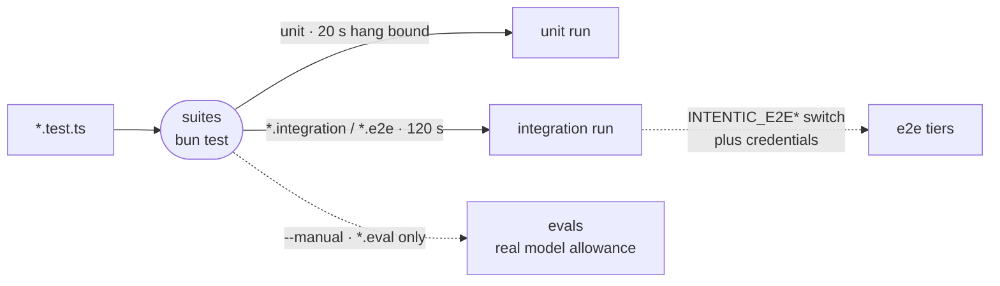

# Testing

Tests are split into tiers by file name, run through one `suites` wrapper over Bun, and run in CI on every push and by hand.

## Suites

- Every package's `test` script is `suites` ([`_tools/testing/bin/suites.mjs`](../../_tools/testing/bin/suites.mjs)). It runs `bun test --conditions=@intentic/src --isolate` twice, because one run has one timeout: unit files with a 20-second hang detector, then `*.integration.test.*` and `*.e2e.test.*` files with room for real work.
- The kind comes from the file name alone (`suiteKindOf` and `SUITE_TIMEOUTS` in [`test-suites.mjs`](../../_tools/constants/src/test-suites.mjs)). A third kind, `*.eval.test.*`, is manual (`MANUAL_MARKERS`): it drives a real model, so neither run sees it, nor do the clock reruns, mutation runs or any turn-end check. Only `suites --manual <filter>` runs it, and naming one without `--manual` is refused. Each package's `bunfig.toml` preloads [`bun-preload.ts`](../../_tools/testing/src/bun-preload.ts), so a plain `bun test` gets the same budget.
- A suite that reaches the machine (temp directories, subprocesses, real git, Docker) must be named `*.integration.test.ts`. [`test-programs.mjs`](../../_tools/checks/test-programs.mjs) recognizes one by what it imports, fixtures included. The same check requires every test file to be inside a type-check program and every `jest.mock` of a workspace package to supply every name the code under test imports.
- [`@intentic/testing`](../../_tools/testing) holds the shared seams: `unstubbed` (a fake whose unstubbed members throw with their own name), Bun helpers such as `waitFor` and `freshImport`, a DOM, and Fly and Stripe fakes. `requires(condition, why)` gates a test on something of the machine: it stands down locally, with `suites` counting what stood down, and fails on CI unless `absentOnCi` says why CI goes without it; a requirement only one CI job provides names that job's `lane` (`INTENTIC_CI_LANE`), fails there, and stands down in every other CI job. A suite takes `describe`, `test` and `expect` from the globals `bun test` defines; a value import from `bun:test` hides it from the `jest/*` lint rules, and `.oxlintrc.json` refuses one. `real-failures` makes the running runtime throw the failure a fake stands for (a refused fetch, a missing program), so the fake has the shape production meets on Node and on Bun alike instead of one runtime's sentence ([conventions](conventions.md#reading-another-programs-output)). A package's own fixtures live in its `src/testing.ts`, or in `<module>.testing.ts` beside the seam they fake where a package fakes many seams. The rules for writing tests are in [`AGENTS.md`](../../AGENTS.md).
- Other runners: Playwright for the browser and onboarding tiers, `cargo test` for the Rust crates, and `node:test` for the scripts in `_tools/scripts` and `_tools/checks`, which no turbo task reaches and `pnpm verify` runs.

On 2026-10-21, the test review removed source-spelling guards, copied presentation data, a test of Vue itself and a
warm-browser latency assertion. Prefer a failure that demonstrates incorrect product behavior: run a sandbox switch,
an operation or the shipped boot script instead of searching its source for a helper name. Configuration and wire
compatibility checks still protect real boundaries. A test's lack of recorded failures is a reason to examine it,
not proof that it is useless; the available history is incomplete. The [review record](../ops/test-pruning-2026-10-21.md)
states the evidence and decision for each removed test.

## Flake evidence and removal criteria

The 2026-11-02 CI repair review found real regressions alongside stale fixtures, host-speed assertions, asynchronous
setup races, check violations and runner failures. A failed job is not a failed test: one cause can fail several jobs,
and several runs can still be testing a commit from before its repair. Classify by the first failing assertion or
operation and the tested commit, not by the repair agent's description or the number of failing jobs.

Before removing a test, identify the product contract it protects and the evidence against its current form:

1. Keep a test that reproduces incorrect product behavior. Where practical, show that it fails on the implementation
   before the fix. A race in production remains a regression even if it only fails intermittently.
2. Repair a test that depends on scheduling: wait for a registered listener, a completed write or another explicit
   readiness signal before triggering the next step. Release every fixture and settle its pending work on exit.
3. Test timer boundaries with a controlled clock. For a file or process event, freeze the fallback timer and prove
   the event completes the wait. Real-clock limits are generous hang detectors; latency budgets belong in the perf
   lane. Bun's fake timers do not control `performance.now()` here: control that clock explicitly when it is used.
4. Remove an assertion or test only when it measures host speed, source spelling, copied fixture data, obsolete
   behavior, a dependency's own implementation, or behavior already protected by an identified retained test.
   State the removed claim and where any useful behavior remains covered in the change's `Test-Note:`.
5. A passing retry, a low failure count or an overloaded runner alone does not justify deletion, a skip, a wider
   matcher or a larger retry count. An unmet machine requirement belongs in `requires`, with its CI lane, rather
   than a silent skip. Infrastructure failures are investigated separately from test failures.

CI's core and platform verify groups retain JUnit reports as `test-results-<group>-<attempt>` artifacts for 30 days,
including failed runs. Reports identify which tests actually ran; a turbo cache hit does not execute tests or produce
a new report. Upload failure does not change the test verdict. Local `pnpm verify` reruns are recorded by
[`flakes.mjs`](../../_tools/scripts/verify/flakes.mjs); that ledger is not a history of CI's direct turbo runs.
A skipped rerun, a killed rerun or a same-file error outside the test cannot clear the original failure.

In CI the verify groups make the same re-run before a failing test fails the job
([`quarantine.mjs`](../../_tools/scripts/verify/quarantine.mjs)). A test case that passes alone, or that failed on main
and passed on a later main run with nothing it is built from changed, is quarantined: listed in
`/ci-cache/quarantine/tests.json`, and its failures stop counting towards the gate's verdict. Every gate run names each
listed test as a warning annotation and in its step summary. Nightly's `quarantine` job runs each one alone. Three nights
passed in a row release it, and one failure alone puts it back at once. An entry also expires after 14 days. Only test
cases are listed, never a file or a package, and only main's pushes write the list. The list is a CI-side holding pen,
not a fix: the rules above still say what to do with the test. Test code that waits on the wall clock, binds a fixed
port, polls in a loop of sleeps, loads a module inside a unit test's body or raises a test's timeout without a comment
saying why is held by the [`timing-hazards`](../../_tools/checks/timing-hazards.mjs) check: ratcheted, so a new one is
said back after the edit that writes it and the standing ones may only shrink.

## Tiers

| Tier | What it needs | Where it runs |
| --- | --- | --- |
| Unit | nothing outside the process | CI, by hand |
| Integration | temp trees, git, subprocesses, Docker | CI, by hand |
| `pnpm e2e` | Docker for the daemon image, plus Cloudflare, Discord, Stripe or Fly credentials; `e2eTier` makes a suite stand down without them | nightly |
| `e2e:hermetic` | Postgres, faked Stripe | CI |
| `e2e:providers` | the real agent CLIs against [`_tools/fake-model`](../../_tools/fake-model), no network | CI before a release; nightly with the newest CLIs |
| `e2e:browser` | Playwright ([`_tools/e2e`](../../_tools/e2e)) against a localhost Postgres, API, Vite and daemon container | a developer machine |
| `e2e:mobile` | Chromium over the demo build, checking every mobile route's geometry | `pnpm e2e:mobile` |
| `e2e:signin` | Chromium over the web build, the api ([`browser-api.ts`](../../_platform/api/src/e2e/browser-api.ts)) and a Postgres testcontainer, with only Google stood in for ([`_tools/e2e/signin`](../../_tools/e2e/signin)): a new person signs in with Google on the web and through the desktop app, whose half of the handoff the tier plays as `auth.rs` does | CI (`e2e-platform`), when a change reaches the api or the web, and it gates the platform deploy; `pnpm e2e:signin` |
| `e2e:compat` | the `e2e:signin` stack plus a daemon from the released `ghcr.io/intentic/sandbox:stable` ([`_tools/e2e/compat`](../../_tools/e2e/compat)): this commit's editor opens the agent board, the files, a chat and the Sandbox page with no refused call, failed read, uncaught error or "too old" page | CI (`e2e-platform`, after the sign-in tier), and it gates the platform deploy; nightly (`compat-stable`); `pnpm e2e:compat` |
| `e2e:local` | Chromium over the desktop app's built local face and the real intentic-files sidecar on a temp folder, no Tauri ([`_tools/e2e/local-face`](../../_tools/e2e/local-face)): the boot, the tree, a save reaching the disk, and no sidecar route answering 404 | CI (`local-face`), when a change reaches the desktop app; `pnpm e2e:local` |
| `eval:automations` | Docker for this checkout's sandbox image and a Claude credential (`INTENTIC_EVAL_CLAUDE_TOKEN`); real model allowance ([Evals](#evals)) | by hand; nightly only with the repository variable `INTENTIC_EVAL_AUTOMATIONS=1`, or a dispatch with `only: automation-evals` |
| Onboarding | Playwright ([`_tools/onboarding`](../../_tools/onboarding)) with [`_tools/fake-upstream`](../../_tools/fake-upstream) standing in for model endpoints | nightly |
| Desktop smoke | installed desktop builds ([`_tools/desktop-smoke`](../../_tools/desktop-smoke), [`_tools/desktop-smoke-windows`](../../_tools/desktop-smoke-windows)) | CI, release, nightly |
| Mutation | [`stryker.conf.mjs`](../../stryker.conf.mjs) over unit suites of the daemon and its contract | the daemon's `test-strength` chore |
| Perf | Valgrind for instruction counts, Chromium over the demo for render, call, layout and mutation counts ([`_tools/perf`](../../_tools/perf)) | CI, when a change reaches `@intentic/perf` or the demo |

## Evals

An eval grades what a real agent does, where every other tier checks code with the model stood in for. A prompt or
guidance change can break "set this up for me" without failing a single test, and only a real turn shows it. Evals
spend real allowance, so each is a manual suite (`*.eval.test.ts`) that no gate runs.

- `pnpm eval:automations` ([`src/evals/automation-requests`](../../_sandbox/sandbox/src/evals/automation-requests))
  sends 15 plain-English owner requests, each as a real Claude turn, to this checkout's sandbox image. The image is
  booted by the e2e harness with the shipped system prompt, skills and `automations` CLI. The requests cover
  creating an automation (a schedule or watch, a Slack, Discord or Gmail listener, a CI event), asking when the
  request is ambiguous, and doing nothing. Each turn is graded from the daemon's records, not from what the agent
  says: the automation cards the conversation raised (`/needs`) and their trigger, source, zone, narrowing and
  senders, whether it parked on a question, and whether it wrote `automations.json` itself, which fails any
  scenario. A model is asked only when an ambiguous request got no question card but the reply may ask in words.
  The judge is a separate one-word turn on the same daemon.
- It prints each scenario's pass count and reasons. It fails when a scenario passes fewer than its `minPassRate` of
  trials (default 0.5) or the whole run passes fewer than `INTENTIC_EVAL_MIN_PASS_RATE` (default 0.8).
  `INTENTIC_EVAL_ONLY=<id,…>` runs a subset, `INTENTIC_EVAL_TRIALS` repeats each, `INTENTIC_EVAL_CONCURRENCY`
  (default 3) bounds turns at once, `INTENTIC_EVAL_MODEL` picks the model and `SANDBOX_E2E_IMAGE` skips the image
  build.
- No channel traffic is played: the eval grades whether the agent arms the right automation, not what a fire does.
  A listener scenario whose source the image does not offer fails with that reason rather than passing unmeasured.

## Where they run

- **By hand**, `pnpm verify` ([`verify.mjs`](../../_tools/scripts/verify/verify.mjs)): the whole repository, the way CI's verify groups measure it. Nothing runs it unasked, and nothing runs the tests inside a turn or after a land. A failed test is re-run alone before it counts, and [`flakes.mjs`](../../_tools/scripts/verify/flakes.mjs) logs one that passes then as a flake.
- **The push check**, [`verify-push.mjs`](../../_tools/scripts/verify/verify-push.mjs): CI's `quick` job runs it on every push, and `pnpm verify:push` by hand. It runs no suite. Its assertion ratchet fails a test file the pushed range made weaker without a `test!:` subject or `Test-Note:` trailer.
- **CI**, [`.github/workflows`](../../.github/workflows): `ci.yml` builds and tests each affected area through `verify.yml`, runs the provider tier, runs the suites that need a privileged container, a browser or the canonical template checkout in their own lane (`verify-machine`), runs netd's feed suite against the binary `netd-check` just built, runs the `_devices` packages' unit suites on the Windows runner when they change (`devices-windows`, reported rather than failed for now), scans the lockfiles for known advisories when one changes (`advisories`, reported), and runs the billing, sign-in, compat, desktop and local face tiers. The billing, sign-in and compat tiers run as steps of one job, `e2e-platform`, which the platform deploy (`images-platform`) waits on. Its `quick` job runs the push check, a few minutes after the push, so a failing main's one fix agent starts early ([`sandbox.md`](sandbox.md#when-mains-ci-fails)). It gates nothing. `nightly.yml` runs `pnpm e2e`, onboarding, the desktop install, setup and update tiers on Linux and Windows, re-runs the test files that touch dates, zones or crons under two extreme time zones (`verify-clocks`, [`clock-suites.mjs`](../../_tools/scripts/verify/clock-suites.mjs)), runs each quarantined test alone (`quarantine`), and scans main's lockfiles for advisories published since (`advisories`). The desktop builds and smokes run per push only on a `desktop_smoke` or `windows_smoke` dispatch, and on a releasing push in `release.yml`. Jobs run on self-hosted runners in the `ci-base` image.
- **Perf**, the `perf-instr` and `perf-browser` jobs in `nightly.yml`: each publishes its counts against the baseline in [`_tools/perf/baselines`](../../_tools/perf/baselines) as the job summary, a report that never fails the job. What fails it is a declared budget, a one-directional claim with headroom such as "an idle clock tick redraws at most eight components" ([`browser/browser-budgets.ts`](../../_tools/perf/src/browser/browser-budgets.ts), [`instr/instr-budgets.ts`](../../_tools/perf/src/instr/instr-budgets.ts)). A baseline is re-recorded only by [`perf-record.yml`](../../.github/workflows/perf-record.yml), dispatched by hand on the CI runner class, which uploads the diff as a patch to commit with the change it describes.
- `pnpm test` fans out through `turbo run test --only`, with `TEST_WORKERS` and the task count sized to the memory free when it starts by [`test-workers.mjs`](../../_tools/scripts/verify/test-workers.mjs); `pnpm typecheck` sizes its task count the same way. On the CI fleet each `suites` run takes its workers from the host's test memory pool instead ([`test-memory-pool.mjs`](../../_tools/scripts/lib/test-memory-pool.mjs)), so the six jobs sharing the box size against what the others hold rather than against a sixth of it.
