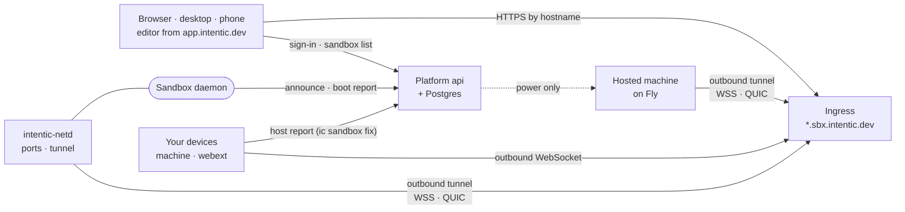

# Topology

The processes and machines intentic runs on, which way each connection is opened, and who can reach what.

## The pieces

- **The editor** ([`_editor/web`](../../_editor/web)) is a static Vue app served from `app.intentic.dev`. The desktop app ([`_editor/desktop-app`](../../_editor/desktop-app)) and the phone apps load the same URL in a webview. It reads the sandbox list from the platform, then talks to each sandbox's daemon directly.
- **The platform** ([`_platform/api`](../../_platform/api), Postgres through [`_platform/prisma`](../../_platform/prisma)) is sign-in, the sandbox registry and the hosted plan. See [platform.md](platform.md).
- **The ingress** ([`_platform/ingress`](../../_platform/ingress)) is a reverse proxy on Fly. A sandbox dials it, two WebSockets carrying yamux (one for transfers, the routes the daemon announces on the upgrade) and a QUIC connection beside them where the edge declares it serves QUIC, and it routes each browser request, as a stream of its own, to the tunnel registered for that request's host (`sandbox-<id>.sbx.intentic.dev`, plus `preview-`, `port-` and `public-` hostnames from [`hostnames.ts`](../../_shared/sandbox-contract/src/ids/hostnames.ts)). One copy of a sandbox holds its tunnel (2026-10-05): each netd names an instance minted once per container start, which its daemon also announces (`INTENTIC_INSTANCE`), and the edge refuses a second live copy started with the same grant rather than letting the two take the tunnel from each other every minute; the refused netd backs off, and after three refusals dials every 15 minutes and has its daemon say where the other copy runs.
- **A sandbox** is one Docker container plus two volumes. Inside it, [`intentic-netd`](../../_sandbox/netd) (Rust) owns every port and the ingress tunnel and supervises the Node daemon ([`_sandbox/sandbox`](../../_sandbox/sandbox)) over a Unix socket, so connections stay open across a daemon restart. See [sandbox.md](sandbox.md).
- **Where a sandbox runs**: on the user's own computer or server (started by the setup command, the desktop app or the [`ic`](../../_sandbox/ic) CLI), or on a hosted machine: one Fly app, machine and volume per sandbox. On the user's own machine `ic` is the one authority over its containers: what runs, and the shape saved for the next restart (in its channel record). The machine agent, the desktop app and the web's pasted fallback lines all call `ic`'s verbs (`list --json`, `start`/`stop`/`restart`, `shape`) rather than docker, so a restart through any of them applies a saved shape; Docker restarting a container by itself does not. A hosted sandbox dials the same tunnel, with a grant the platform puts in its machine's config, and is reached only down it: nothing on Fly routes to the machine. One that has not dialled in yet (stopped, or still booting) is answered with the `no-tunnel` verdict, which is what the editor wakes it on.
- **Which transports the edge serves** is its own declaration, read off what it binds, never probed for: on its answer to every tunnel's upgrade (`x-intentic-transports`, which netd instances read before dialling QUIC) and on its `/health`, which the platform reads each minute and relays on every sandbox row it netd instances (`edgeTransports`, which the editor reads before opening WebTransport). Undeclared means not served. The edge terminates TLS itself with the certificate the platform issues, with UDP 443 beside it ([`fly.toml`](../../_platform/ingress/fly.toml)), so it declares `quic`, `h3` and `webtransport`; behind Fly's HTTP proxy (the fallback, [`fly.edge-proxy.toml`](../../_platform/ingress/fly.edge-proxy.toml)) no UDP would reach it and it would declare nothing.
- **Your devices** ([`_devices/machine`](../../_devices/machine), the browser extension [`_devices/webext`](../../_devices/webext)) dial the sandbox's own hostname over one WebSocket each, or its loopback address when they share a machine. A machine agent carries a stable `machineId`, minted at install and shared by every OS install of one computer; a sandbox stores each device enrollment as `{ machineId, environment, card }` and joins its device doors, its sync enrollments and the rows the Devices view draws on that id, never on a hostname. The card is the grant and the name: removing or renaming it is one write over the enrollments that name it. A machine agent holds one key per sandbox, so once a newer enrollment of the same `machineId` and environment connects, the sandbox revokes the older ones that are not connected (and sweeps for them at boot); two live at once under one id are kept, and the Devices view warns that the computers share an identity.

## Which way connections go

The platform never opens a connection to a sandbox:

- The sandbox dials out: the tunnel to the ingress, and `POST /sandbox/announce` to tell the platform its URL and liveness ([`announce.ts`](../../_sandbox/sandbox/src/system/boot/announce.ts)), with `POST /sandbox/adopt` when its owner reconnects it to a platform that lost its record. No inbound port or router rule is needed.
- The machine a sandbox runs on reports on it when the sandbox cannot: `ic sandbox fix` (run by the machine agent by itself, by the recovery panel's command, or by the desktop app) posts what it found to `POST /host-report`, which is how a browser elsewhere learns that the machine is starting Docker Desktop or is out of disk. It is a report, never a request for instructions.
- The browser and the devices dial the sandbox, through the ingress or on loopback.
- A sandbox holding a `link` card dials the other sandbox's own address, like a browser would, presenting the link's token to its link doors ([links.md](links.md)). Nothing between the two relays or reads the token but the ingress, which ends TLS.
- The platform never calls a user's daemon. It flips a hosted machine's power through Fly's API, and nothing more.

## Trust model

| Party | Can | Cannot |
| --- | --- | --- |
| Platform | know accounts, sandbox addresses and liveness, and what a sandbox's own machine reports about it; sign reachability grants; vouch for an address it confirmed by email; start, stop and destroy hosted machines | relay or read ordinary agent turns; hold the credential that drives a daemon; open a sandbox on its owner's machine for anyone its owner did not opt in to email sign-in |
| Ingress | route traffic for a sandbox holding a valid grant; read the traffic it carries, since TLS ends there | make a sandbox reachable or claim a hostname without a grant signed by the platform |
| Daemon | authenticate its owner and members itself, and decide whose email sign-in it accepts; run agents with the workspace's credentials | reach a device beyond the scopes that device grants |
| Device | act on its own machine within the switches its owner set | be widened by the sandbox: scopes are enforced on the device |
| Linked sandbox (asking) | start, follow up on, answer questions in and stop the conversations its own link opened, and read their reports, under the terms the taking sandbox's owner set | read the taking sandbox's files, other conversations or settings; change its terms; land work; answer a permission or plan card |

- The daemon checks who a person is itself, binds the first owner, and mints its own session ([`auth.ts`](../../_sandbox/sandbox/src/auth/auth.ts)). It takes a Google ID token, which it verifies against Google's keys, or the platform's identity assertion. Membership and role are checked on every request. Every other credential it accepts (control tokens, agent, extension and panel tokens, device enrollments) is in [`grants.ts`](../../_sandbox/sandbox/src/auth/grants.ts). A door that checks its own credential, such as the MCP door's per-turn mount bearer, is declared `auth: "door"` beside its route.
- The identity assertion is how a person whose mail is on a domain no identity provider vouches for reaches a sandbox ([`identity-assertion.ts`](../../_shared/sandbox-contract/src/policy/identity-assertion.ts)). The platform confirms the address by mailing it a code, and the editor asks it for an assertion (`pa1.`) only for an account that signs in that way. An assertion is an Ed25519 signature under a key of the platform's own (`IDENTITY_SIGNING_KEY`, never the ingress key), naming one sandbox id and how the address was confirmed (`email` or `google`), valid for two minutes, with a nonce the daemon spends once. On a sandbox on its owner's machine the daemon accepts one only for an owner who bound by email, or for a member whose roster row says `emailSignIn: true`, which the owner sets per person. The platform therefore cannot sign in as an owner who bound with Google, or as a member nobody opted in. On a hosted machine the daemon accepts one for the owner or anyone on the roster, as it already accepts the owner ticket there. The daemon learns the platform's public key from the answer to its hourly announce (`identityKey`). A hosted machine also gets it as `PLATFORM_IDENTITY_KEY`, since it boots before it announces.
- A passkey takes the platform out of the path. Passkeys are the daemon's own, they work while the platform is down, and the editor suggests one right after a person's first email sign-in. With the "require passkey" policy on, a session needs a passkey, so the platform's word alone opens nothing. With the platform down, a person who signs in by email gets in only on a live daemon session or a passkey.
- (2026-10-20) The native Android app signs in with the same passkeys. Android's Credential Manager signs its ceremonies with `android:apk-key-hash:<certificate>` instead of a web origin, and lets the app use the editor's passkeys only when the editor's `/.well-known/assetlinks.json` grants it `get_login_creds`. The daemon admits that origin for the editor's rpId by reading the same file ([`app-origins.ts`](../../_sandbox/sandbox/src/auth/passkeys/app-origins.ts)), so the app's signing certificates are named in one place, the web image's `ANDROID_APP_FINGERPRINTS`, and a new one reaches every sandbox without recreating it. The file is the editor host's word, which the daemon already trusts with its passkeys. While that host is down, the daemon keeps the last statement it read.
- (2026-10-12) Four other designs for email sign-in were rejected. The platform vouching for everyone on every sandbox would let one key open them all. Codes the daemon sends, relayed through the platform, are the same trust with more parts. A reverse proof, where the person mails the sandbox and the daemon checks the DKIM signature, keeps the old model but is clumsy and needs inbound mail. Microsoft sign-in covers only Microsoft 365 addresses.
- The platform's grant is an Ed25519 signature the ingress checks with the public key alone ([`ingress-contract.ts`](../../_shared/sandbox-contract/src/protocol/ingress-contract.ts)). A deletion record revokes it: the registry writes one for every deleted row and rotated token, and the ingress refuses a tunnel for that alone, never for an id the platform merely has no row for ([platform.md](platform.md#when-the-platform-forgets)).
- Hosted machines are the exception: intentic's Fly token keeps access to every machine it creates ([`fly.ts`](../../_platform/api/src/sandbox/hosted/fly/fly.ts)), so a platform breach can reach hosted sandboxes. On any other sandbox it reaches only what the people its owner opted in to email sign-in may do there, and nothing where the "require passkey" policy is on. The optional free trial also routes its turns through platform-owned model accounts.
- A device enforces its scopes (`shell`, `write`, `screen`, `control` and the rest) in [`policy.ts`](../../_devices/machine/src/device/policy.ts) and logs every call on the device.
- Inside the sandbox, the daemon and the agents it runs are not separated by uid in the default agent domain: an unfenced agent runs as root and can reach the daemon's own files under `/history`, the audit trail included. The trail's hash chain shows such a change and where it was made; the copy sent to the owner's forward address is the one nobody inside the sandbox can change ([sandbox.md](sandbox.md#audit-trail)).
