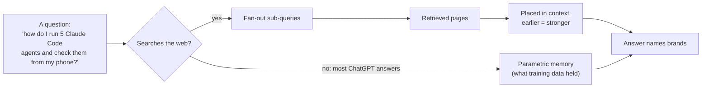

# What makes AI assistants recommend a product, and what intentic should do about it

Research date: **19 October 2026**. Companion to `marketing/STRATEGY.md` (in the workspace, outside this repo),
[awesome-lists.md](awesome-lists.md), [directories.md](directories.md) and
[article-mentions.md](article-mentions.md). Those documents plan channels. This one asks a narrower question:
when someone asks ChatGPT, Claude, Perplexity, Gemini, Google's AI Mode, or a coding agent which tool to use,
what decides whether intentic gets named, and what can we change?

## Method, and how to read the grades

Four research passes, each restricted to sources we opened:

1. Peer-reviewed and preprint research on generative engine optimisation, LLM brand bias, retrieval and tool
   selection (about 40 papers).
2. Industry studies from 2024–2026 on citations and brand mentions in AI answers (Ahrefs, Semrush, Seer,
   Profound, SparkToro, Muck Rack, Wix/Peec, BrightEdge, Amsive and others).
3. Evidence on how coding agents choose developer tools, plus what is changing (agent-driven provisioning,
   docs traffic, MCP, ads, commerce protocols).
4. An audit of intentic's own footprint and of the category as a search-backed assistant sees it: 25
   buyer-style searches and 29 recurring listicles and lists.

On 19 October 2026 we checked every arXiv ID cited here against arXiv. The main industry URLs also returned
the pages named. Muck Rack and OpenAI's help centre refused automated fetches, so those two are quoted from
the research pass and trade press.

| Grade | Means                                                                                                                  |
| ----- | ---------------------------------------------------------------------------------------------------------------------- |
| **A** | Peer-reviewed paper, or a controlled experiment (treatment against matched controls)                                   |
| **B** | Large observational study with a disclosed method. Correlation only, usually by a vendor that sells visibility tooling |
| **C** | Vendor telemetry or a CEO's claim, a small sample, or one site                                                         |

Most of this field is grade B. "Correlates with" does not mean "causes", and brand size confounds almost every
correlation below: big brands are mentioned everywhere _and_ recommended everywhere.

## The short answer

An assistant names a product when two things are true at answer time. First, text about the product is in
front of the model: it was retrieved by a search, or the model saw enough of it in training to remember it.
Second, that text answers the question as the asker phrased it, and **other people wrote it**.

For a product as new as intentic, model memory holds almost nothing. So today retrieval decides, and the text it
finds is mostly written by third parties.

The future shifts the weight in two directions:

- **Agents increasingly do the choosing.** They reward products they can read, compare and set up without a
  human.
- **Chat assistants search less often.** That makes training-data presence matter more over time.

Cosmetic GEO tactics, such as llms.txt, schema markup, keyword tuning and "authoritative tone", have weak,
null or negative evidence. Manipulation (prompt injection, optimised text sequences) works briefly, gains
shrink to zero as rivals copy it, and is increasingly detected.

## The factors, ranked by strength of evidence

### 1. Being in the retrieved set for the asker's actual question

The model can only name what it reads. When the brand is absent from retrieval, it is rarely mentioned.

- **Retrieval gates mentions (B).** A brand absent from the live retrieval path was mentioned in 2.8% of GPT
  answers and 3.8% of Gemini answers. With its own domain cited, that rose to 49.0% and 58.4%. With a branded
  follow-up search as well, it reached 91.4% and 100%. (Tannenbaum 2026, 34,960 observations, vendor,
  observational.)
- **Context position beats content rewriting (A).** Measured by citation rank, the classic content-level GEO
  methods were "largely ineffective": 3 significant gains in 54 settings. Placing a document earlier in the
  model's context outweighed every content method (C-SEO Bench, NeurIPS 2025). Other studies agree that
  earlier documents win:
    - Liu et al., "Lost in the Middle", TACL 2024.
    - Pfrommer et al., EMNLP 2024.
    - Between two identical tools, GPT-4.1 picked the first-listed 80.2% of the time and the second 13.6%
      (Faghih et al. 2025). In a preregistered test, the first-listed of two identical listings won by 72 points
      (Wang 2026).
- **Search ranking still feeds AI answers, mostly at the domain level (B).**
    - Page-one Google rankings correlated about 0.65 with ChatGPT brand mentions, and backlinks about 0.10 (Seer
      Interactive, 2025).
    - ChatGPT's citations overlap Google's top 10 at 10% by URL but 31.8% by domain (Ahrefs, Sep 2025).
      Perplexity overlaps at 65% by URL.
    - Many cited pages rank outside the top 10, because answers are built from fan-out sub-queries, not the
      user's literal query.
- **Coding agents search where their memory is weak (B).** Claude Code searched the web in about 30% of
  sessions overall, but about **80% in the sandbox category**, "where its priors are weaker". Codex searched in
  94% of sessions (Armature, 16,893 sessions, Sep 2026).

### 2. Third-party mentions: other people's words about you

This is the most consistently supported factor across every kind of study, and the one where intentic is
weakest.

- **Mentions beat links (B).**
    - Branded web mentions correlated 0.664 with Google AI Overview visibility. Raw backlinks correlated 0.218 and
      Domain Rating 0.326 (Ahrefs, 75,000 brands, May 2025).
    - In the follow-up, **YouTube mentions were the strongest correlate (~0.737)** across ChatGPT, AI Mode and AI
      Overviews (Ahrefs, Dec 2025).
- **AI search prefers earned sources (A-/B).**
    - For software products, AI search cited 72–74% earned (third-party) sources and 0% social. Google mixed in
      54% brand-owned pages (Chen et al., University of Toronto, 2025).
    - 85.7% of URL citations about brands pointed to domains the brand does not own (2026 preprint).
    - 84% of citations in ChatGPT, Claude and Gemini were earned media and 0.3% paid (Muck Rack, 25M links,
      2026).
- **"Best X" lists carry commercial questions (B).**
    - Listicles were 40.9% of commercial-intent citations (Wix Studio / Peec AI, 1.06M citations, Mar 2026). In
      the one vertical where the study split them, professional services, 80.9% of listicle citations went to
      third-party lists.
    - In developer tools, when a vendor's own ranked list was cited, that vendor appeared in the answer 74.4% of
      the time (DevTune, 126,814 citations, Jul 2026).
    - So a list on our own site helps when it gets cited, but third-party lists get cited far more.
- **Reddit is the most-cited third-party domain for developer tools (B):** 8.5% of citations (DevTune).
  Perplexity cited Reddit in 46.7% of B2B SaaS answers (Red-Engage, 2026). This swings over time: ChatGPT's
  Reddit citations fell 88% between March and September 2026 (Ahrefs, Oct 2026).
- **Being discussed counts more than market share (preprint).** How prominently a brand was recommended tracked
  search interest and online conversation, not brand salience or market share (Malthouse et al. 2026, 6 LLMs).
  This is the hopeful result for a small company: conversation is movable.

### 3. Wording that matches how the question is asked

- **Matching the prompt was the strongest page-level predictor (B).** Prompt–content match had β = +0.37, the
  strongest page-level predictor of citation. FAQ blocks, structured data and Core Web Vitals lost their
  effect once domain fixed effects were controlled for ("What Drives Citations in Production LLMs?", 2M
  citations, 2026).
- **Relevance to the question dominated what models found convincing (A).** Prefixing a page with the question
  it answers raised how often its view won (Wan, Wallace & Klein, ACL 2024).
- **Query-to-description match drove tool selection (A).** Semantic match between the query and a tool's
  metadata was the strongest driver of which tool an agent selected (BiasBusters, ICLR 2026).
- **One phrasing is not enough (B).** Two natural phrasings of the same need produced recommendation sets with
  only 0.288 overlap (Jaccard), so coverage of many phrasings matters ("Paraphrase Brittleness", 2026).

### 4. Training-data presence (parametric memory)

- **Most ChatGPT answers come from memory (B).** Only 14.4% of 66.6M logged-out ChatGPT answers searched the
  web (Ahrefs, Oct 2026). Semrush measured 34.5% of queries in Feb 2026, down from 46% in late 2024. Either way,
  most answers come from memory, and the share answered from memory is growing.
- **Models know what they saw often (A).**
    - Accuracy rises with the number of training documents about a fact, and the link is causal (Kandpal et al.,
      ICML 2023).
    - On long-tail entities, GPT-3-class models scored 16–19% (Mallen et al., ACL 2023).
- **The same applies to developer tools (A).**
    - Coding LLMs used pandas in 58% of tasks and Polars in 0% ("LLMs Love Python", ACL Findings 2026).
    - Provider choice was heavily concentrated, with a median Gini of 0.80 ("The Invisible Hand", ACL 2025).
    - LLM-chosen libraries have a median of 6,962 GitHub stars and are over 7 years old (Latendresse et al. 2025).
- **Memory lags (A).** Effective knowledge cutoffs are often earlier than the stated ones (Cheng et al., "Dated
  Data", COLM 2024). A product launched in August 2026 is absent from today's models. The model that wrote this
  report, with a June 2026 cutoff, had no prior knowledge of intentic. That is an anecdote, not a measurement.

### 5. Plain, verifiable facts on your own pages

- **A small verified edge beats brand familiarity (preprint).** With identical specs, the well-known brand was
  recommended 100% of the time. A verifiable rating edge under 0.1 star flipped it (Chu & Hou, "Incumbent
  Advantage", 2026).
- **Structured limits help, made-up claims don't (preregistered, workshop).** Structured limit fields raised
  correct tool picks from 49% to 88%. Fabricated statistics and endorsements added nothing (−2 points)
  ("Advertising to Agents", NeurIPS 2026 workshop).
- **Agents read vendor pages, and one line can lose the pick (B).** Agents chose Postmark over Mailgun after
  reading "1-day retention" on Mailgun's free plan (Armature, 2026).
- **Assistants check facts on your own site (B).** 6.8% of ChatGPT's fan-out searches are `site:` searches,
  75.9% of them on brand sites. Factual questions cited an official source 84.4% of the time (Ahrefs, Oct
  2026).
- **Complete, neutral, well-structured pages are cited more (A).** Comprehensive coverage, a neutral tone and
  clear structure transferred across engines (AutoGEO, ICLR 2026).

### 6. Real freshness

- **Newer dates move rankings (A).** Fake newer dates moved passages up to 95 ranks in LLM rerankers (Fang et
  al. 2025, ACM). So the bias exists, and Google warns against faking dates.
- **Cited pages tend to be recently updated (B).**
    - 75% of cited pages had been updated within the past year (Seer Interactive, Jul 2026, 4 brands).
    - AI assistants cite pages 25.7% fresher than Google's organic results. AI Overviews are the exception
      (Ahrefs, 17M URLs, Jul 2025).
- **Single citations decay fast (B).** The median page loses half its citation share 11 days after peaking.
  Pages cited by five or more engines were 5.5× as likely to persist (Profound, Sep 2026).

### 7. Entity clarity: one name, one description, nothing to confuse it with

- **Models merge entities that share a name (A).** Current models "often … incorrectly merge information
  belonging to different entities" with the same name (AmbigDocs, Lee et al. 2024).
- **Models lean on what they know about a product's name (A).** GPT-4 Turbo and Llama 3 leaned heavily on
  prior knowledge of a product _name_ when ranking (Pfrommer et al., EMNLP 2024).
- **Caveat:** No study measures how much a brand-name collision costs in recommendations. This factor rests on
  the mechanism, not on a measured effect.

### 8. Agent operability: the agent can read, compare and set up the product itself

This factor matters for the future. The trend evidence is strong, though most of it is vendor telemetry.

- **Agents already provision much of the infrastructure (C, vendor telemetry).**
    - Coding agents triggered over 50% of Vercel deployments by September 2026.
    - AI tools created 70% of new Supabase databases in October 2026.
    - Agents created over 80% of new Neon databases by May 2025.
- **Agents avoid signup friction by building it themselves (B).** With no tool named, Claude Code's single most
  common pick was "build it yourself": 12% of picks on Sonnet 4.5, 21.4% on Fable 5. The authors partly blame
  signup friction: "Supabase needs an account and API keys only you can create." (Amplifying, Feb and Jul 2026.)
  The causal reading is the authors' opinion.
- **Agents now read most docs pages (C).** Agents made 66% of requests to Mintlify-hosted docs in July 2026.
  Direct `.md` fetches rose from 25% to 54% of agent routes. Markdown plus llms.txt cut 404s per retrieval from
  2.23 to 0.11 in a 2,400-run test (Mintlify, 2026).
- **Description and schema quality decides which tool an agent calls (A/B).**
    - Tool descriptions meeting a quality standard reached 72% selection against a 20% baseline (arXiv
      2602.18914).
    - Parameter schemas were the strongest factor in a controlled test (arXiv 2610.14334).
    - This governs selection among tools already connected, not discovery.

### Not a factor, but it decides how to measure everything above

- **Recommendations are unstable (B).**
    - The same prompt returned the same brand list less than once in 100 runs (SparkToro/Gumshoe, Jan 2026).
    - Only about 35% of cited sources overlapped from one day to the next ("Don't Measure Once", 2026).
    - Model upgrades reshuffle picks: one product's share in an agent-shopping study went from 45% to 77% between
      two Claude versions (Allouah et al. 2025).
- **Cited is not the same as named (B).** In 61.7% of appearances a domain was cited without its brand being
  named (Semrush, Jun 2026).
- **What to track:** visibility is a share across many prompts, paraphrases, runs and engines, measured over
  time. Mentions and citations are tracked separately. Rank position in a single answer is noise.

## What the evidence says does not work, or is unproven

| Tactic                                                                  | Evidence                                                                                                                                                                                                                                                                                                                                     |
| ----------------------------------------------------------------------- | -------------------------------------------------------------------------------------------------------------------------------------------------------------------------------------------------------------------------------------------------------------------------------------------------------------------------------------------- |
| **llms.txt as a citation lever**                                        | 97% of 137K sites' llms.txt files got zero requests in a month (Ahrefs, Jun 2026). No correlation with citations across ~300K domains (SE Ranking). Google: "neither harm nor help". The one real use is coding agents fetching Markdown pages (Mintlify), which intentic's `.md` mirrors already serve.                                     |
| **Adding schema markup**                                                | The controlled test found −4.6% in AI Overviews (significant), and +2.4% and +2.2% in AI Mode and ChatGPT (both indistinguishable from zero) (Ahrefs, May 2026, 1,885 pages against 4,000 controls). Google: "no special schema.org markup" needed.                                                                                          |
| **Keyword stuffing, "authoritative tone"**                              | Stuffing scored below baseline, and −10% on Perplexity. Authoritative tone: "no significant improvement" (GEO, KDD 2024).                                                                                                                                                                                                                    |
| **Statistics and quotation rewrites**                                   | +30–40% on word-share metrics (KDD 2024), but no effect or negative effects on citation rank in 51 of 54 settings (C-SEO Bench, NeurIPS 2025). Useful only as writing hygiene.                                                                                                                                                               |
| **Backlinks and Domain Rating**                                         | Correlations of 0.10–0.33 with AI visibility, the weakest of the measured signals (Ahrefs, Seer).                                                                                                                                                                                                                                            |
| **Prompt injection, optimised text sequences, puffery aimed at agents** | Short-term lifts of 2.5–7× (Nestaas et al., ICLR 2025). Gains depend on product order and model version, and collapse when everyone does it (a prisoner's dilemma). Frontier models increasingly resist it (Magentic Marketplace). For a product that asks to be trusted with people's machines, one exposure would cost more than any lift. |
| **Self-published "alternatives" pages as citation sources**             | 0.29% of citations (Wix/Peec). They still serve visitors who search for them, and they make the site the official source for facts.                                                                                                                                                                                                          |
| **Paid placement in assistants**                                        | ChatGPT ads (Free and Go tiers) and Google AI Mode ads are kept separate from the organic answer by policy. Perplexity dropped ads. No evidence shows money buys organic recommendations.                                                                                                                                                    |
| **Directory and registry listings as discovery drivers**                | The official MCP Registry has 43K servers, mostly a long tail. No study shows a listing increases recommendations. Listing pages (SaaSHub, AlternativeTo) do count as third-party mentions under factor 2.                                                                                                                                   |
| **Review volume (G2)**                                                  | R² ≈ 0.01 against AI citations (Indig/G2, 2025). This is also not a channel for developer tools.                                                                                                                                                                                                                                             |
| **Posts on X as citable sources**                                       | We found no study placing X posts among cited sources for software questions. The one study that separated social sources found AI search cited 0% social for software products (Chen et al.). X matters only when it leads to an article, a thread, a video or a list entry written by someone else.                                        |
| **Agentic commerce protocols, AI browsers**                             | OpenAI ended Instant Checkout in March 2026 and retired the Atlas browser in August 2026. x402 volume is small and partly test traffic. These are not factors yet.                                                                                                                                                                           |

## What changes next

Each of these is backed by a measured trend, not a forecast:

1. **The chooser becomes an agent.** Provisioning by agents (Vercel, Supabase, Neon) and agent docs traffic
   (Mintlify) are already a majority in the places that measure it. The factors that rise with this are
   operability (#8), plain facts (#5) and query–description match (#3). Puffery declines as defences ship.
2. **Memory matters more for everyday chat.** ChatGPT's web-search share is falling: 46% → 34.5% (Semrush), or
   14.4% on the free tier (Ahrefs). Its citations are shifting toward partner publishers: 7.5% → 12.5–15.8%
   (Ahrefs, 2026). Text that ends up in training data compounds:
    - GitHub READMEs and code
    - Reddit, which has licensing deals with Google and OpenAI
    - Hacker News
    - docs
    - transcripts
3. **Sources churn.** Reddit's and Wikipedia's share of ChatGPT citations fell 80–88% in six months. Being
   present across many independent domains holds up better than betting on one platform. Pages cited by five
   or more engines were 5.5× as likely to persist.
4. **Model upgrades reshuffle picks.** Measure monthly, and recheck after every major model release.
5. **Personalisation is real but small and hard to act on.** A 16-point brand divergence linked to user
   history (press release, not peer-reviewed). In practice, people who already use intentic and talk
   to their assistant about it become part of the signal.

## Where intentic stands today (audit, 19 October 2026)

| Factor                    | Status                    | Evidence                                                                                                                                                                                                                                                                                                                                                                                                                                                                                                                                                                                                                      |
| ------------------------- | ------------------------- | ----------------------------------------------------------------------------------------------------------------------------------------------------------------------------------------------------------------------------------------------------------------------------------------------------------------------------------------------------------------------------------------------------------------------------------------------------------------------------------------------------------------------------------------------------------------------------------------------------------------------------- |
| 1. Retrieval              | **Weak**                  | Surfaced in **2 of 25** buyer-style category searches. One hit was its own guide at #6 for "best tools for running parallel coding agents"; the other was via an awesome-list. It surfaced for none of the phone, remote-control, "laptop closed", background-agent or Devin-alternative searches. That is despite existing guides on [keeping an agent running after the laptop closes](https://intentic.dev/guides/keep-a-coding-agent-running-after-you-close-your-laptop/) and [self-hosted background agents](https://intentic.dev/guides/self-hosted-background-coding-agents/). 21 Google visits a week (STRATEGY.md). |
| 2. Third-party mentions   | **Weakest**               | 3 awesome-lists (andyrewlee, ai-for-developers, bradAGI). 6 submissions open since August, including awesome-claude-code #2666 (56K★). **0 editorial articles, 0 Reddit threads, 0 YouTube videos**. 2 HN posts, both by the founder. One of them pitches revenue sharing, contradicting today's "intentic is free", and links to `/earn/`, which returns 404. The live SaaSHub listing publishes a **model's refusal** as intentic's feature text. 85 GitHub stars.                                                                                                                                                          |
| 3. Query match            | **Mixed**                 | Good: the title "Open-source workspace for parallel coding agents", 20 compare pages and 9 guides. Gaps: the H1 is the brand line, with no category words. "Orchestrator", used by 26 of the 29 category pages, is absent from the title and H1. "Background agents", "remote control" and "agent fleet" are rare on the site. **Emdash, the most-listed orchestrator (14 of 29 pages), has no compare page**, nor do Orca (11), Pane (10), Paseo (8), Warp/Oz (8) or Factory (8).                                                                                                                                            |
| 4. Training-data presence | **Absent, and opted out** | The repo was created 4 Aug 2026, after current models' cutoffs. `robots.txt` sends `Content-Signal: ai-train=no` ("Index and quote these pages; do not train on them"). Search still indexes old taglines from the repo and its forks ("Workstation for your agent. A window for you.", "You delegate. Agents work. You approve."). The unscoped `intentic` names on npm and PyPI are unclaimed.                                                                                                                                                                                                                              |
| 5. Plain facts            | **Good, scattered**       | Pricing page, a sourced compare shelf with "pick them" sections, FAQ schema, `.md` mirrors. There is no single dated fact sheet. The homepage HTML is 398 KB, with 152 KB of inline CSS: the H1 starts at **byte 222,751** (verified). A fetcher that truncates raw HTML would see no content. The `.md` mirrors soften this.                                                                                                                                                                                                                                                                                                 |
| 6. Freshness              | **Strong**                | 656 commits in the last 30 days, a public changelog, sitemap `lastmod` from git, and IndexNow. Exception: the FAQPage `dateModified` is still 2026-08-20.                                                                                                                                                                                                                                                                                                                                                                                                                                                                     |
| 7. Entity clarity         | **At risk**               | **Augment Code's "Intent"** is a multi-agent workspace in the same category and appears in listicles and orchestrator lists. **intent-hq/intent** sits on the line directly above intentic in andyrewlee's list. Intentic Technologies (Bengaluru) is the #2 result for "intentic". Intentico and IntentCode also exist. Organization `sameAs` lists only GitHub and Discord. There is no Wikidata item. The casing is inconsistent ("Intentic Device", "Intentic.dev").                                                                                                                                                      |
| 8. Agent operability      | **Partly there**          | `.md` mirrors, a 34.7 KB llms.txt and a 1.88 MB llms-full.txt (too large for one fetch). An OpenAPI reference, a Claude Code plugin, and agent-first CLIs (`iq`, `fileq`, `webq`). Setup needs a setup code that a person gets from the web app, so no agent can finish an install alone. We have not verified whether a device-code flow exists.                                                                                                                                                                                                                                                                             |

The marketing system's phase 1 runs `x-engage` and `clip` only (STRATEGY.md). The jobs that feed factors 1–2
(`listings`, `long-form`, `reddit-engage`, `mentions`) are switched off.

## The plan

Six rules follow from the evidence:

1. **Retrieval before memory.** Memory takes months to build, and retrieval works now.
2. **Other people's words before ours.** AI search cites third-party pages 3–6× as often as a brand's own
   Chen et al. measured 72–74% earned sources for software, and 85.7% of brand citations go to domains the
   brand does not own.
3. **Answer the exact questions** buyers and agents ask, in their words.
4. **Facts before claims.** Verifiable edges beat puffery, and puffery is being defended against.
5. **Measure share, not rank.** A single answer tells you little.
6. **No manipulation.** intentic's trust posture (positioning.md) would not survive being caught at it, and the
   gains don't last anyway.

### Phase 0: baseline measurement (week 1)

Nothing below can be judged without this.

- **A prompt set.** 48 prompts, 6 phrasings for each of 8 intents (`marketing/ai-visibility/prompts.json`):
    - parallel agents
    - agents that keep running when the laptop is closed
    - controlling agents from a phone
    - a self-hosted alternative to Claude Code on the web
    - a Devin alternative
    - a sandbox for agents
    - Conductor or Vibe Kanban alternatives
    - using my own Claude or Codex subscription
- **Engines.** Each prompt run 3× a month on ChatGPT, Claude, Perplexity and Gemini through their APIs with web
  search on (OpenAI `web_search`, Anthropic web search, Perplexity Sonar, Gemini grounding):
  `marketing/bin/ai-visibility.mjs`. Google AI Mode has no API, so it is checked by hand on a sample.
- **What to record:** intentic's mention share, its citation share (separately), the competitors named, and the
  URLs cited. The cited URLs become the outreach list for Phase 2.
- **An agent-pick test.** Run Claude Code, Codex and Cursor on neutral tasks, for example "I want four Claude
  Code sessions to keep running on my desktop and to check them from my phone: set it up". Record what each agent
  searched, which pages it fetched and what it chose. Run it on a clean machine, not inside an intentic sandbox:
  agents there start with a system prompt that describes intentic, which would bias the answer. The protocol is
  in `marketing/ai-visibility/README.md`.
- **Logs.**
    - Fetches by `OAI-SearchBot`, `ChatGPT-User`, `GPTBot`, `Claude-SearchBot`, `Claude-User`, `ClaudeBot`,
      `PerplexityBot`, `Perplexity-User` and other AI agents, of pages, `.md` mirrors, llms files and robots.txt.
      The site's Worker sends each one to PostHog as a `site_ai_fetch` event (`_site/site/src/lib/ai-fetch.ts`),
      since the Cloudflare token has no analytics permission. A `*-User` fetch is a live answer reading our page.
    - PostHog referrers from chatgpt.com, perplexity.ai, claude.ai, gemini.google.com and copilot.
- **Needs from the owner:** API keys for the engines, stored as `ANTHROPIC_API_KEY`, `OPENAI_API_KEY`,
  `PERPLEXITY_API_KEY` and `GEMINI_API_KEY`.

### Phase 1: fix what is broken in the footprint (weeks 1–2, cheap, high confidence)

1. **Claim SaaSHub and replace the refusal text.** It is a third-party page that ranks for our name and says we
   do not exist. directories.md already has the steps: `hello@intentic.dev`, then a sign-in.
2. **Repoint `/earn/`** to a page that states what changed (intentic is free, BYO subscription). The HN post
   that links there cannot be edited, but its target can.
3. **Make the entity unambiguous.**
    - Add every owned profile to the Organization `sameAs`: X, the LinkedIn company page if it is ours, the npm
      org, YouTube once it exists, and Wikidata.
    - Add one line to `/about/`: "intentic (intentic.dev) is an open-source workspace for coding agents. It is
      not Augment Code's Intent or Intentic Technologies."
    - Pick one casing and use it everywhere.
    - Create a Wikidata item for the software (official website, source repository, license, instance of
      software). This is the owner's call: Wikidata deletes items that only cite their own sources.
4. **Claim the unscoped `intentic` package names on npm (and PyPI).** Models invent package names 5–22% of the
   time (Spracklen et al., USENIX Security 2025). An agent guessing `npm i intentic` should land on us, not on
   a squatter.
5. **Decide `ai-train`.** Most ChatGPT answers never search, and new tools are under-chosen until they are in
   training data. Opting the public marketing and docs site out of training removes the one source we fully
   control from future models' memory. GitHub, Reddit and HN text flows in regardless. Whether vendors honour
   `Content-Signal` at all is unverified. **Recommendation:** `ai-train=yes` for the public site. This covers
   site pages only, not user data. It is the owner's decision, and the current line was set on purpose.
6. **Check what fetchers see.** Fetch the homepage, a guide and a compare page through Claude's and
   ChatGPT's own fetch tools and confirm the body text arrives. If it doesn't, move the 152 KB of inline CSS
   into a cached stylesheet. If it does, leave it.
7. **Date the FAQ from git**, as the sitemap already does.
8. **Refresh the repo's About text and social preview** so the indexed old taglines get replaced at their
   source.

### Phase 2: get into other people's text (weeks 2–8, the biggest gap)

This is where the evidence and the gap line up. The supporting documents already hold most of the targets.
The work is to execute them.

1. **Get the open awesome-list submissions merged.**
    - Six have been open since August. Nudge them politely, saying what changed.
    - Add [Agent-Analytics/awesome-multi-agent-orchestrators](https://github.com/Agent-Analytics/awesome-multi-agent-orchestrators):
      it has a "Parallel Coding-Agent Runners" section and has merged 64 PRs since 1 September.
    - Add [kyrolabs/awesome-ade](https://github.com/kyrolabs/awesome-ade): its gate of about 50 stars is now
      passed.
    - Put awesome-selfhosted on the calendar for 2026-12-05.
2. **Work through the listicles assistants cite in this category.** These are the sources the audit
   saw most: aq.dev guides, mindstudio, northflank, agentastic, dev.to and Medium posts, and AlternativeTo.
    - Send each non-competitor author one short note, with a 60-second clip, saying which gap intentic fills that
      their list doesn't: self-hosted, reachable by phone, MIT, many providers.
    - article-mentions.md has the messages ready.
    - Skip Nimbalyst's and Augment's own lists, since they are competitors.
    - Phase 0's cited-URL list replaces this guesswork after the first run.
3. **Reddit, from the founder's account.**
    - Answer the questions intentic answers, where they are asked: r/ClaudeCode, r/codex, r/selfhosted,
      r/LocalLLaMA.
    - Make one "I built…" post per capability, gated as STRATEGY.md says (account ≥ 30 days, ≥ 100 karma).
    - Reddit is cited heavily by Perplexity and Google and is licensed training data. Its share in ChatGPT is
      falling, so it complements the other channels and does not replace them.
4. **YouTube.** YouTube mentions are the strongest single correlate in the largest study.
    - The `clip` job already records clips. Add 3–8 minute walkthroughs, whose transcripts are retrievable text:
      "five Claude Code agents, self-hosted, steered from my phone", and "close the laptop, the agents keep
      working".
    - Seed creators, as STRATEGY.md plans. Their videos are third-party mentions.
5. **Publish original pieces on open platforms**, not only on our blog.
    - In a 2026 measurement, posts on low-barrier platforms were cited by 8 of 10 AI search engines within 7
      days. Forty posts on a self-hosted WordPress site got zero (arXiv 2610.11932).
    - Write dev.to and Hashnode pieces for those audiences: the agent-pick test, how we run our own fleet,
      worktree pitfalls. Don't duplicate the guides there.
6. **Example repositories on GitHub** (for example a parallel-agents starter, or intentic setups for common
   stacks). GitHub content is both cited and trained on.
7. **One Show HN, when a headline capability ships**, on the topics HN rewards in this category: phone and
   remote control (577 points), and parallel agents (174–189 points). STRATEGY.md already gates this.
8. **Re-weight the marketing jobs for this objective.**
    - For AI visibility, `listings`, `long-form` (an open-platform variant) and `reddit-engage` matter more than
      another `x-engage` run.
    - Keep X for relationships and borrowed audiences, but judge it by the articles, threads, videos and list
      entries it leads to, since X posts themselves are not cited.
    - This changes STRATEGY.md's phase order, so the owner decides.

### Phase 3: answer the exact questions, in the market's words (weeks 2–6, on-site)

1. **Carry the category words.**
    - Keep "More work. Less AI waste. Same subscriptions." as the tagline.
    - Put a descriptive sentence in the H1 area, using the words 26 of 29 category pages use: an open-source,
      self-hosted orchestrator for parallel coding agents (Claude Code, Codex, Gemini), each in its own sandbox
      and git worktree, still running when you close the browser.
    - This doesn't break messaging.md's "one word for the thing" rule: the object stays a **sandbox**, and
      "orchestrator" names the category. It does change a deliberate landing decision, so the owner decides.
2. **Close the compare-shelf gaps by frequency.** Add Emdash (14 pages), Orca (11), Pane (10), Paseo (8),
   Warp/Oz (8) and Factory (8). Add **Augment Code's Intent** as well: an "intentic vs Intent" page serves both
   buyers and disambiguation.
3. **Cover the questions where we have the answer but don't show up.**
    - Phone and remote control: "control Claude Code from your phone", "Claude Code remote control
      alternative". Omnara, Happy and Anthropic's own Remote Control own these queries.
    - "Background agents, self-hosted".
    - "Devin alternative, self-hosted".
    - The laptop-closed guide exists but doesn't surface. Check Google Search Console and Bing Webmaster Tools
      for impressions before writing more, because the problem may be indexing or ranking, not content.
4. **One dated fact sheet** at `/facts/` (or a section of `/about/`), linked first in llms.txt. It should give
   what intentic is, license, price, platforms, supported agents, isolation model, what the platform stores,
   the hosted plan's limits, the current version and release cadence. Put it in a table with "last checked"
   dates. Assistants run `site:` searches for exactly this, and structured limits help agents choose correctly.
5. **Keep "best tools for running parallel coding agents" current.** Update it monthly with real changes, put
   the year in the title, and keep its fair treatment of competitors. Self-published lists are cited less than
   third-party ones, but when cited, the publisher is named 74% of the time.

### Phase 4: let agents choose and install intentic (weeks 4–12, the future factor)

1. **Find where an agent gets stuck setting up intentic.**
    - Today a person must fetch a setup code from app.intentic.dev.
    - Give agents a path with exactly one human step: a CLI login that prints a device code, then non-interactive
      flags and `--json` output for `ic`.
    - Re-run the Phase 0 agent-pick test after each fix. The success measure is an agent completing setup with
      one approval.
2. **A compact agent index.** Under 10 KB, saying when intentic is the right answer and how to install it,
   served at `/llms.txt`.
    - Move today's 34.7 KB index to a linked file.
    - Leave the 1.88 MB llms-full.txt as an optional extra.
    - Agents fetch Markdown directly, and Vercel's evals found a compact index far ahead of on-demand skills
      (100% against 53–79%).
3. **Ship the agent-first tools on their own.**
    - `iq`, `fileq` and `webq` already exist for agents. Published as standalone CLIs and as Claude Code plugin
      entries, they put the intentic name inside the tool lists agents read and run every day.
    - Context7 shows the pattern: an agent-facing docs tool with 482K weekly downloads.
    - Get the plugin into Anthropic's plugin marketplace and awesome-claude-code.
4. **Expose an MCP server for the fleet** (list agents, start a task, read status) if one is not already exposed
   to outside clients. Publish it to the official MCP Registry. Write its tool descriptions and parameter
   schemas to the measured quality bar. Expect it to help agents that are already connected choose it, but don't
   expect it to drive discovery.
5. **Later, only if the hosted plan becomes provisionable by API:** evaluate catalogs that agents provision
   from, such as Stripe Projects, which already lists E2B, Daytona, Blaxel and Runloop.

### Phase 5: build training-data presence (ongoing, slow and compounding)

- **One canonical description, everywhere:** the GitHub About box, all ~20 `@intentic/*` npm READMEs, the GHCR
  image description, LinkedIn, the X bio and every directory listing.
- **Depth on GitHub:** README, docs in the repo, Discussions, example repos. Stars count as well: models favour
  popular, established packages. STRATEGY.md's target is 1,000 stars by January 2027.
- **The `ai-train` decision from Phase 1.**

## Metrics

| Metric                                                        | Baseline (19 Oct 2026)                                                                                                                  | Measured by                               |
| ------------------------------------------------------------- | --------------------------------------------------------------------------------------------------------------------------------------- | ----------------------------------------- |
| Mention share across the prompt set, per engine               | kit ready, waiting on API keys                                                                                                          | the tracker, monthly                      |
| Citation share (intentic.dev or GitHub cited)                 | not yet measured                                                                                                                        | the tracker, monthly                      |
| Category web searches with intentic in the top 10             | 2 of 25                                                                                                                                 | the audit's 25 queries, monthly           |
| Independent pages naming intentic                             | 3 awesome-lists, 0 articles, 0 threads, 0 videos                                                                                        | a mentions search, monthly                |
| Agent-pick test: agents that choose intentic / complete setup | not yet run (needs a clean machine)                                                                                                     | Phase 0 protocol, after each model release |
| AI-assistant fetches of our pages (`*-User` agents)           | counted from the next site deploy (`site_ai_fetch`)                                                                                     | PostHog, weekly                           |
| AI referrals and their conversion to sandboxes connected      | 5 of 130 site visitors (3.8%) since PostHog began counting the site on 2026-10-16: ChatGPT 2, Gemini, DeepSeek, Vertex AI Search             | PostHog, weekly                           |

Set targets after the first baseline run. A target set before any measurement would be a guess. The north star stays **sandboxes connected** (STRATEGY.md). AI visibility is one route to it.

Expect AI referrals to stay a small share of traffic: 0.24% of sessions across 54 audited sites (Amsive) and
1.08% across 1,215 domains (Conductor). Whether that traffic converts better is contested:

- Ahrefs measured 23× on one site.
- The peer-reviewed e-commerce study found worse conversion (Kaiser & Schulze, _Marketing Science_ 2026).

## Progress (2026-10-19)

The owner decided items 1–3 of the original decision list on 2026-10-19: `ai-train=yes`, the category word in the
hero, but compact, and the new phase order. Done the same day:

| Plan step | What changed |
| - | - |
| 1.2 `/earn/` | Redirects to `/pricing/` (`_site/site/worker.ts`). |
| 1.3 Entity | npm org added to the Organization `sameAs`. A `disambiguatingDescription` and one line on `/about/` say intentic is not Augment Code's Intent or Intentic Technologies. A `/compare/intent/` page and a facts row say it too. The repo topic `monorepo` became `agent-orchestrator`. |
| 1.4 npm name | Claimed 2026-10-20: `intentic` on npm, maintainer radarsu. Version 0.1.0 is a pointer package (`npx intentic` prints the install routes; no install scripts, no network) and cleared npm's review for new packages on 2026-10-20, replacing the `0.0.0-stage` placeholder as `latest`. Its three files live in `C:\Users\radar\intentic-npm-name` on rog, and `npm pack intentic` retrieves them. |
| 1.5 `ai-train` | `robots.txt` now sends `ai-train=yes`. |
| 1.7 Dates | Home, `/about/`, `/pricing/` and `/facts/` are dated from their content modules, not only the page shell (`git-lastmod.mjs`). The home page had been stuck at 2026-08-20. |
| 2.1 Lists | New PRs to awesome-multi-agent-orchestrators (#82) and awesome-ade (#12), and a nudge on steven2358 #1191, the one pending list still merging. Every submission and its status is in `.intentic/local/marketing/listings.md`. |
| 2.8 Phase order | STRATEGY.md now runs `listings`, then `long-form`, then `reddit-engage` ahead of more X. |
| 3.1 Hero | "A workspace for" became "An orchestrator for" in the subhead and meta description. The hero stays the same length. |
| 3.2 Compare | Emdash, Orca, Paseo, Pane, Warp, Factory and Intent pages (28 in all), each checked against the vendor's live pages. |
| 3.3 Phone | Guide `control-coding-agents-from-your-phone`. |
| 3.4 Facts | `/facts/`: 19 rows, each traced to source or computed at build, linked from the footer and first in llms.txt. |
| 4.2 llms.txt | 6.6 KB compact index. The full index moved to `/llms-index.txt`. |
| 0 Measure | `marketing/ai-visibility/` (48 prompts, four engines, `bin/ai-visibility.mjs`). The Worker counts AI agents' fetches into PostHog (`site_ai_fetch`). Baseline: 5 of 130 site visitors came from AI assistants since 2026-10-16. |

Waiting on the owner:

- **Accounts:**
  - `hello@intentic.dev` and sign-ins for SaaSHub (claim it and replace the refusal text), AlternativeTo,
    SourceForge and Crunchbase.
  - A founder Reddit account.
  - A YouTube channel.
  - The @intentic handle on X.
- **Keys:** `ANTHROPIC_API_KEY`, `OPENAI_API_KEY`, `PERPLEXITY_API_KEY` and `GEMINI_API_KEY` for the tracker. A
  Cloudflare token with Zone Analytics and Bot Management read, to confirm no AI crawler is blocked at the edge.
- **Decisions:** a Wikidata item for the software. A device-code login so an agent can set intentic up with one
  human step (Phase 4.1). An MCP server for the fleet (Phase 4.4).
- **Runs:** the agent-pick test on a clean machine, since agents inside an intentic sandbox are told about intentic.

## Sources

### Academic (arXiv IDs verified 2026-10-19)

- Aggarwal et al., GEO, KDD 2024: arxiv.org/abs/2311.09735
- Puerto et al., C-SEO Bench, NeurIPS 2025 D&B: arxiv.org/abs/2506.11097
- Wu, Zhong et al., AutoGEO, ICLR 2026: arxiv.org/abs/2510.11438
- Chen, Wang, Chen & Koudas, GEO: How to Dominate AI Search, 2025: arxiv.org/abs/2509.08919
- Wan, Wallace & Klein, ACL 2024: aclanthology.org/2024.acl-long.403
- Chu & Hou, Incumbent Advantage, 2026: arxiv.org/abs/2606.17443
- Malthouse et al., Brand Retrieval and Ranking in LLM Recommendations, 2026: arxiv.org/abs/2609.16304
- Kandpal et al., ICML 2023: arxiv.org/abs/2211.08411
- Mallen et al., ACL 2023: arxiv.org/abs/2212.10511
- Twist et al., LLMs' preferences for libraries and languages, ACL Findings 2026: arxiv.org/abs/2503.17181
- Zhang et al., The Invisible Hand (provider bias), ACL 2025: arxiv.org/abs/2501.07849
- Spracklen et al., package hallucinations, USENIX Security 2025: arxiv.org/abs/2406.10279
- Latendresse et al., 2025: arxiv.org/abs/2507.10818
- Cheng et al., Dated Data, COLM 2024: arxiv.org/abs/2403.12958
- Liu et al., Lost in the Middle, TACL 2024: arxiv.org/abs/2307.03172
- Pfrommer et al., Ranking Manipulation for Conversational Search Engines, EMNLP 2024: arxiv.org/abs/2406.03589
- Fang et al., recency bias in LLM reranking, 2025: arxiv.org/abs/2509.11353
- Zhang et al., Source Coverage and Citation Bias, 2025: arxiv.org/abs/2512.09483
- What Drives Citations in Production LLMs?, 2026: arxiv.org/abs/2609.35077
- Tannenbaum, Fitted Stage Model of Brand Visibility, 2026: arxiv.org/abs/2609.23162
- Paraphrase Brittleness, 2026: arxiv.org/abs/2605.27440
- Schulte et al., Don't Measure Once, 2026: arxiv.org/abs/2604.07585
- Liu et al., From Public Posts to AI-Search Citations, 2026: arxiv.org/abs/2610.11932
- Lee, Ye & Choi, AmbigDocs, 2024: arxiv.org/abs/2404.12447
- Kumar & Lakkaraju, 2024: arxiv.org/abs/2404.07981
- Nestaas, Debenedetti & Tramèr, Adversarial SEO for LLMs, ICLR 2025: arxiv.org/abs/2406.18382
- Faghih et al., Tool Preferences in Agentic LLMs are Unreliable, 2025: arxiv.org/abs/2505.18135
- Wang, Advertising to Agents, 2026: arxiv.org/abs/2605.23916
- Blankenstein et al., BiasBusters, ICLR 2026: arxiv.org/abs/2510.00307
- Allouah et al., What Is Your AI Agent Buying?, 2025: arxiv.org/abs/2508.02630
- Bansal et al., Magentic Marketplace, 2025: arxiv.org/abs/2510.25779
- MCP tool-description quality: arxiv.org/abs/2602.18914
- Tool-metadata effects on selection: arxiv.org/abs/2610.14334

### Industry

- Ahrefs:
    - AI Overview brand factors (May 2025): ahrefs.com/blog/ai-overview-brand-correlation/
    - Brand visibility correlations (Dec 2025): ahrefs.com/blog/ai-brand-visibility-correlations
    - AI search overlap: ahrefs.com/blog/ai-search-overlap/
    - ChatGPT vs Google citations: ahrefs.com/blog/chatgpt-google-citations
    - Freshness: ahrefs.com/blog/do-ai-assistants-prefer-to-cite-fresh-content
    - llms.txt: ahrefs.com/blog/llmstxt-study/
    - Query fan-out (Oct 2026): ahrefs.com/blog/query-fan-out-chatgpt/
    - AI traffic conversions: ahrefs.com/blog/ai-search-traffic-conversions-ahrefs/
- Seer Interactive:
    - Brand mentions: seerinteractive.com/insights/what-drives-brand-mentions-in-ai-answers
    - Recency: seerinteractive.com/insights/study-content-recencys-impact-on-ai-visibility-in-2026
- Semrush:
    - Topic authority: semrush.com/blog/chatgpt-topic-authority-study/
    - Ghost citations: semrush.com/blog/the-ghost-citations-study/
    - Most-cited domains: semrush.com/blog/most-cited-domains-ai/
- Profound:
    - Citation patterns: tryprofound.com/blog/ai-platform-citation-patterns
    - Citation half-life: tryprofound.com/blog/the-half-life-of-an-ai-citation-is-11-days
- SparkToro/Gumshoe, AI recommendation inconsistency (Jan 2026): sparktoro.com/blog/new-research-ais-are-highly-inconsistent-when-recommending-brands-or-products-marketers-should-take-care-when-tracking-ai-visibility/
- Muck Rack, What Is AI Reading? (May 2026): muckrack.com/blog/what-is-ai-reading-may-2026
- Wix Studio AI Search Lab, content types: wix.com/studio/ai-search-lab/research/content-types-most-cited-by-llms
- DevTune, State of AI Search for Dev Tools 2026: devtune.ai/dev-tools-state-of-ai-search
- SE Ranking, llms.txt: seranking.com/blog/llms-txt/
- Google Search Central, AI optimization guide: developers.google.com/search/docs/fundamentals/ai-optimization-guide
- Ahrefs schema test, via Search Engine Journal: searchenginejournal.com/schema-markup-didnt-move-ai-citations-in-ahrefs-test/574568/
- cloro, crawler blocks: cloro.dev/research/ai-crawler-blocks/
- BuzzStream, crawler blocks: buzzstream.com/blog/news-block-ai-bots-citations/
- Amsive, LLM conversion: amsive.com/insights/seo/does-llm-traffic-convert-better-than-organic-a-new-data-backed-study/
- Kaiser & Schulze, _Marketing Science_ 2026: papers.ssrn.com/sol3/papers.cfm?abstract_id=5585812

### Developer tools and agents

- Amplifying:
    - What Claude Code Actually Chooses: amplifying.ai/research/claude-code-picks
    - Fable Edition: amplifying.ai/research/claude-code-picks-fable
- Armature, which tools coding agents choose: armature.tech/blog/which-tools-coding-agents-install
- Mintlify:
    - State of AI: mintlify.com/blog/state-of-ai
    - Midyear docs traffic: mintlify.com/blog/state-of-docs-traffic
- Vercel:
    - AGENTS.md vs skills: vercel.com/blog/agents-md-outperforms-skills-in-our-agent-evals
    - Agentic infrastructure: vercel.com/blog/agentic-infrastructure
- Stripe Projects: docs.stripe.com/projects
- Supabase funding release (Oct 2026): prnewswire.com/news-releases/supabase-announces-150m-in-new-funding-and-turso-acquisition-302896752.html
- Databricks–Neon release: prnewswire.com/in/news-releases/databricks-agrees-to-acquire-neon-to-deliver-serverless-postgres-for-developers--ai-agents-302455021.html
- LocalCan, state of MCP servers: localcan.com/blog/state-of-mcp-server-development
