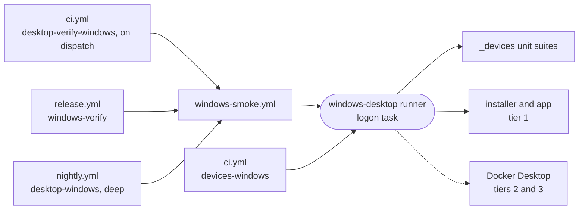

# The Windows CI runner

One interactive Windows machine, labelled `windows-desktop`, installs and drives the shipped Windows installer in a real signed-in desktop session, one job at a time.

- The installer is cross-built on the Linux fleet in `ci-desktop` with cargo-xwin. This machine only runs it, through [`desktop-smoke-windows`](../../_tools/desktop-smoke-windows). Tier 1 installs it, fires an `intentic://` link before and after launch, and uninstalls it; it starts no container, so it gates the release, and runs from `ci.yml` on a `windows_smoke` dispatch. It still needs a machine Intentic can run on: the app starts a setup only when `ic docker prepare --dry-run` answers `ready`, so the box needs Docker Desktop or Intentic's engine. Anywhere else the link opens the app's own checklist instead, and both "ran the setup" assertions fail after 120 seconds. That happened to jurek on 2026-11-24 until Virtual Machine Platform was turned on and `ic docker prepare --yes` installed the engine. Tiers 2 and 3 connect a sandbox and run a turn, so they need Docker and a connected account. Main gets all of them nightly with `deep: true`.
- `ci.yml`'s `devices-windows` job also runs here: the `_devices` packages' unit suites (`suites --unit`), whenever a `_devices` package or anything it is built from changes. It installs into the smoke tier's named pnpm store and does not pause the fleet. While it proves itself, a failing suite is a warning in a passing job, and a newer push cancels one still waiting for this machine. When the machine is away for a while, set the repository variable `WINDOWS_UNIT_LANE=off`, or every such push leaves a job queued until GitHub drops it.
- The label is its own because `runs-on` is an AND over labels: a Windows box carrying `intentic` would be handed the Linux fleet's container jobs.
- A service runs in session 0, which has no desktop, and every tier-1 assertion reads a window title. [`setup-windows-runner.ps1`](../../_tools/scripts/ci/setup-windows-runner.ps1) therefore registers a logon task that starts the listener windowless through `intentic-launch.exe` and re-runs every few minutes, so a dead listener comes back without anyone signing in.
- Every Intentic app this account starts is a test, so the script sets the user variable `INTENTIC_TELEMETRY_INTERNAL=1`, and the app tags each analytics event `internal: true` (the desktop app's README, Product analytics). A user variable, because every smoke run uninstalls the app and takes its config folder with it.
- A sleeping machine is an offline runner, and a locked one takes jobs and fails them. `-KeepAwake` sets the power and lock policy; `-AutoLogon` signs in after a reboot by storing the password in the registry. Use both only on a dedicated box.
- The box carries Git and PowerShell 7: several steps run with `shell: pwsh`, which Windows PowerShell 5.1 cannot stand in for. Install PowerShell's MSI (7.6 is the last line that ships one), not the Store package winget picks for 7.7, whose sandbox can redirect some of its writes to the user's registry and AppData. The job installs its own Node and pnpm, and only the smoke tier's subtree, so no Python or MSVC toolchain is needed, and there is no `/ci-cache` here.
- The repository variable `WINDOWS_AGENT_AUTH_VOLUME` names a Docker volume holding an AI account connected once by hand. Without it tier 3 stands down and says why.
- The same machine hosts the Linux fleet in WSL2 ([ci-runner.md](ci-runner.md)), whose reconciler also runs windowless so it never steals a window from these tiers.
- The fleet's six workers share one WSL2 VM with Docker Desktop and the engine tier's distro. Every Windows smoke run, including release tier 1, pauses them with [`wsl-workers.sh`](../../_tools/scripts/ci/wsl-workers.sh) before tool setup and dependency install: each worker stops once its current job ends, and the job's last step starts them again whatever the tiers did. The release's tier 1 waits at most 10 minutes for that (`drain-minutes`), where a full drain took a median 6 and a p90 25 minutes on the release's critical path; a worker still busy then is handed to a transient systemd unit that stops it the moment its job ends, so the tiers run beside at most the jobs already running and no worker takes a new one. Nightly's deep runs wait the whole 40. Release run 42991360694 hit pnpm's 30-second hook-worker deadline when the pause still followed the install. Release run 41071974841 exceeded the cold setup's 120-second bound and a window listing's 15-second deadline while tier 1 still skipped the pause. Deep runs also need it: on 2026-10-20 a move ran beside six typechecks, the VM could no longer open a vsock channel, and every `docker` call from Windows to the engine hung.
- A paused fleet always comes back. The pause arms a systemd timer that resumes the workers 15 minutes after the job's own timeout, so a cancelled job or a lost runner cannot strand them. Everything the pause writes is under `/run`, which a VM restart empties. By hand, from an elevated PowerShell in a checkout: `wsl -d archlinux -u root -- bash _tools/scripts/ci/wsl-workers.sh resume`.
- While paused, the fleet watchdog's three-minute pass logs `starting N runner unit(s)` and the units stay down: a runtime drop-in (`ConditionPathExists=!/run/intentic-ci/workers-paused`) turns each start into a no-op.

## Provisioning

1. Make the machine ready first: PowerShell 7 from its MSI, then `ic docker prepare --dry-run` until it answers `ready` (`ic docker prepare --yes` fixes what it can; turning on Virtual Machine Platform needs a restart).
2. Settings > Actions > Runners > New self-hosted runner (Windows x64) gives a token. An organisation token pairs with `https://github.com/intentic`, a repository token with `https://github.com/intentic/intentic`.
3. From an elevated PowerShell: `./setup-windows-runner.ps1 -Url https://github.com/intentic -Token <token> -AutoLogon -KeepAwake`.
4. The script ends with a `ready: listener in session …` line naming the account and the session it runs in.

## Repairing

1. `node _tools/desktop-smoke-windows/dist/main.js doctor` names what is wrong with the machine and prints the remedy; every job runs it before the tiers.
2. `./setup-windows-runner.ps1 -Repair` (elevated, no token) turns a service or a runner started in a console window back into the logon task. It refuses while a job is running unless you pass `-Force`.
3. A leftover install or sandbox container needs nothing: every run starts with `teardown` and ends with it.
4. A failed engine tier uploads `windows-engine-logs` for seven days. Its logs are kept outside the temporary home that teardown removes, and transfer errors include tar's diagnostic before its final summary.
