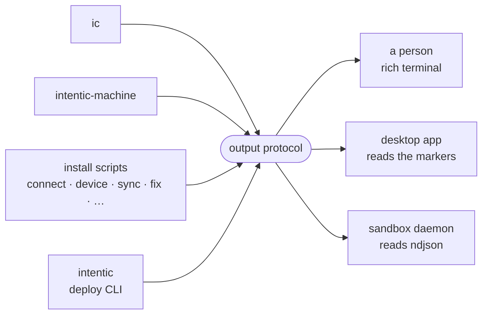

# The CLI output protocol

The rules intentic's command-line tools share for what a person types, what they see, when they are asked something, and what a program reading the output may parse.



Everything a person sees comes from one of three places, and all three draw the same shapes:

- [`_sandbox/ic/src/ui.rs`](../../_sandbox/ic/src/ui.rs) for `ic`;
- [`_devices/local-agent/src/ui.ts`](../../_devices/local-agent/src/ui.ts) for `intentic-machine`;
- the shim kit pasted into every install script, for the few lines a script prints before it hands over to one of those binaries.

The `intentic` deploy CLI adds structured output ([`_deploy/cli/src/lib/output.ts`](../../_deploy/cli/src/lib/output.ts)).

Nothing else prints to a person. The `terminal-output` check counts direct prints in `ic` and `intentic-machine` outside their renderers and fails on a new one. Machine output (a `--json` document, a marker line a parser reads) is the one right reason to write directly, and says so with `// allow(terminal-output): <reason>`.

## Choosing a mode

A tool picks its mode once, at start:

| `INTENTIC_UI` | Mode |
| --- | --- |
| `rich` | checklist, colour, one repainting status line |
| `plain` | the marker stream below, nothing repainted |
| `nested` | lines folded under a parent's running step |
| unset | `INTENTIC_PLAIN=1` means plain; otherwise rich when stdout is a terminal, plain when it is not |

`NO_COLOR` turns colour off and `FORCE_COLOR` turns it back on. ASCII glyphs replace Unicode where the console cannot draw them. `ic` sets `nested` on an agent installer it spawns only while it is drawing a checklist itself; a piped run hands the child the same pipe, and the child's own terminal test picks plain.

Every program that reads this output runs the tools on a pipe or into a file, so it only ever sees plain mode. Rich mode belongs to the person and may change freely; plain mode is a contract and changes only with its readers.

## What a person sees

### Glyphs and colour

| Glyph | ASCII | Means | Colour |
| --- | --- | --- | --- |
| `✓` | `+` | done, healthy | green, the glyph only |
| `✗` | `x` | stopped, broken | red, the glyph and the stop headline |
| `!` | `!` | needs attention, not a failure | yellow, the glyph only |
| `·` | `-` | skipped, neutral, cancelled | dim |
| `⠹` | `\|` `/` `-` `\` | running, on the one live line | cyan |
| `?` | `?` | waiting for your answer | cyan |

Colour is spent sparingly so it keeps meaning something:

- **Cyan** marks the one thing to act on: the address, the spinner, the question.
- **Dim** is for time, scope, narration and the labels of footnotes.
- **Bold** is for the header and the verdict.
- Body text keeps the terminal's own colour, and so does a command the reader may copy.

### The grid

Two spaces of margin, the glyph at column 3, text at column 6. A flow's numbered steps put a right-aligned ordinal between them. Narration under a step starts at column 9. Timings are right-aligned and dim. Long text wraps and hangs under its own first word; a single word longer than the line (a URL, a name) is never broken, because breaking it ruins the copy-paste it exists for. Only the live line truncates, because it repaints and must never wrap.

### Five shapes

Every command draws exactly one of these. Pick by what the command does, not by how long it takes.

**Flow**: several steps with a promise of scope and time. Connecting, setting up, updating, removing.

```text
  intentic · remove a sandbox                                   ic 1.42.0
  sandbox-40ebeea77f90 · recoverable for 7 days

  ✓   1  Stop its containers                                         1.2s
  ✓   2  Remove its network                                          0.1s
  ✓   3  Move /work and /history to the trash                        0.3s

  ✓  sandbox-40ebeea77f90 is removed.                           took 1.6s

     4 other sandboxes are still on this device.

     later  bring it back   ic sandbox restore sandbox-40ebeea77f90
            delete it now   ic sandbox purge sandbox-40ebeea77f90
```

The header is `intentic · <what this does>`, in the words a person would use, followed by one dim scope line. The verdict is a past-tense sentence. After it come, in this order: the one address that matters (cyan), the one instruction the reader has to act on, and then, under `later`, the commands they will want in a week.

**Action**: one thing. No header and no plan, just one live line that settles in place.

```text
  ✓  Stopped sandbox-82789f4106b4.                                   2.1s
     later  start it   ic sandbox start sandbox-82789f4106b4
```

While it runs, the same line reads `⠹  Stopping sandbox-82789f4106b4  ·  waiting for agents   1s`.

**Report**: read-only. Lists, status, versions, doctor. It uses the same glyph column as a checklist, with no timings. Sections are dim headings, and an empty report says so in a sentence.

```text
  intentic · sandboxes on this device

  ✓  sandbox-82789f4106b4   running
  ·  sandbox-1ea6479e2362   stopped
  !  sandbox-574ea8038415   running · not answering for 4m

     removed, recoverable
  ·  sandbox-40ebeea77f90   6 days left
```

**Question**: the consequence comes before the question, so the reader decides knowing what happens.

```text
  ?  Remove sandbox-40ebeea77f90?
     Its agents stop now. /work and /history stay recoverable for 7 days.
     [y/N]
```

- The safe answer is always the default, and the default is always `N`. No question asks `[Y/n]`.
- Picking from a list numbers the rows and accepts numbers, `a` for all, or `q` to cancel.
- Something that cannot be undone is confirmed by typing its name (`Type its name to confirm:`). `--yes` never answers that kind of question; only `--confirm <name>` does.
- Saying no prints one line and exits `0`: `·  Cancelled. Nothing changed.`

**Stop**: something failed. The running step settles as `✗` with its time, so the reader can see where it stopped. Then comes the stop block on stderr:

```text
  ✓   1  Check Docker                                                0.3s
  ✗   2  Download ic                                                 8.0s

  ✗  ic could not be downloaded, and no copy is installed.
     problem: github.com did not answer from this device.
     fix:     check the network, then run the same command again.
```

The headline says what did not happen. `problem:` says why, in terms of the reader's device rather than the code. `fix:` is the one thing to do, and when that is a command, the command is the whole value. Several independent failures are numbered, each with its own `problem:`/`fix:` pair.

### Words

**Voice.** `intentic` appears once, in the header. Step labels are imperatives with no full stop ("Stop its containers"). Verdicts and narration are sentences that end with one. A command the reader can run appears only as a `later` footnote or a `fix:` value, never quoted inside a sentence.

**One word per thing:**

| Say | Not | Means |
| --- | --- | --- |
| device | machine, PC, computer, host, this side | the computer the person is typing on |
| server | host, deploy target | a computer enrolled to run deployments |
| sandbox | box, container | one Intentic sandbox |
| remove | clean up, uninstall, reset | take a sandbox off the device; recoverable for 7 days with `ic sandbox restore` |
| delete | purge, remove permanently | erase for good; confirmed by typing the name |
| connect / disconnect | enroll, link, pair, attach | a device or server joining or leaving a sandbox |
| update, roll back, rebuild | recreate, swap | move a sandbox to another image |
| stop, start, restart | power off, wake | a sandbox's containers |

Command names keep their spelling (`ic machine enroll`, `ic sandbox purge`) because scripts and the desktop app call them. Only the prose follows this table.

**Typography:**

- `…` (one character) only on something still running. Never `...`.
- Plurals are spelled out ("1 sandbox", "4 sandboxes"), never `(s)` or `(es)`.
- Durations are `0.3s`, `12s` or `4m`.
- Names, paths and slugs are not quoted.
- Uppercase is not used for emphasis. The glyph and its colour carry it.

## What a person types

**One shape for every one-liner.** The editor hands out exactly one of these per action, and the two lines below are the same in every flow:

```sh
curl -fsSL https://intentic.dev/<verb>/<arg> | sh
```

```powershell
irm https://intentic.dev/<verb>/<arg> | iex
```

`<verb>` names the action and `<arg>` is one value, or two for the verbs that need them. The site's Worker checks every argument against its verb's own pattern and inserts it into the static script; anything that does not match is refused with a sentence saying so, and nothing is served. The table lives once, in [`_tools/constants/src/one-liner.ts`](../../_tools/constants/src/one-liner.ts), which the Worker and every command builder read, so the URL served and the URL handed out cannot disagree.

| Verb | Carries | Runs |
| --- | --- | --- |
| `setup/<code>[/<folder>]` | the platform's setup code, and the leaf of the default sync folder `~/intentic/<folder>` | `connect` |
| `fix/<code>` | a fix code | `fix` |
| `update/<sandbox>`, `rollback/<sandbox>`, `restart/<sandbox>`, `rebuild/<sandbox>/<hash>` | the sandbox's name | `recreate` |
| `remove[/<sandbox>]` | the sandbox's name, or nothing to pick from a list | `cleanup`, which hands over to `ic sandbox remove` |
| `device/<host>/<code>`, `sync/<host>/<code>`, `server/<host>/<code>` | the sandbox's address and a code the sandbox minted | `device`, `sync`, `connect-host` |

The PowerShell client is told apart by its User-Agent; a trailing `.ps1` or `.sh` on the last segment picks one outright. The older flat paths (`/connect`, `/device.ps1`, …) keep working for every command already pasted somewhere.

**No secrets in the command.** A pairing token, a connect token or a Cloudflare token never appears in a command, so it never lands in shell history or a leftover `$env:` variable. Where an action needs one, the command carries a code instead:

- **Setup and fix codes** come from the platform and expire within 30 minutes.
- **Device, sync and server codes** come from the sandbox itself. Each is 8 characters of Crockford base32, single-use, and expires in 10 minutes. The script spends it first, before it downloads anything, at `https://<host>/system/redeem/<code>` (rate-limited), and gets back what the old command carried.
- **A server code** stands for a single-use enroll token, so the sandbox's long-lived connect token never leaves it.
- **The Cloudflare token** is asked for on the terminal, with what is typed hidden, and is not stored on the server.

The sync folder's path never goes through the platform; only its last segment rides the URL, into a script on the person's own device. A setup that cannot be said this way (a sandbox reached on localhost, an origin other than the app's, a folder outside `~/intentic/`) keeps its environment-variable command.

**Flags** are long and kebab-case: `--yes`, `--now`, `--confirm <name>`, `--json`. PowerShell scripts spell the same flags `-Yes`, `-Now`, `-Confirm`. A one-liner carries none, because its verb implies them.

**Elevation is asked for, never baked in.** When a step needs root or administrator rights, the script asks for them at that step and says why in one sentence. The editor never puts `sudo` in front of a command. A script that needs root throughout (connecting or removing a server) re-runs itself as `curl -fsSL "$INTENTIC_SCRIPT_URL" | sudo sh`, from the URL the Worker wrote into it.

**Scripts only bootstrap.** An install script finds or downloads `ic` or `intentic-machine` and hands over. The lines it prints before that come from the shim kit and follow this page; everything after the handover is the binary's. The kit and the download blocks live once each in [`_site/site/scripts-kit/`](../../_site/site/scripts-kit/) and are pasted into every script between marker lines, because a script has to stay one file that can be piped into a shell. The `scripts-kit` check fails when a pasted copy has drifted, and `node _tools/checks/scripts-kit.mjs --fix` rewrites it. `.ps1` files stay pure ASCII, so the PowerShell kit builds its glyphs from code points and writes `...` where the rest of the system writes `…`.

**PowerShell never ends your shell.** `exit` inside `irm … | iex` ends the whole PowerShell process, and the window can close on the one message that says what went wrong. A script returns instead, and leaves its exit code in `$LASTEXITCODE`.

## Prompts

Questions go to the controlling terminal (`/dev/tty`, or `CONIN$` on Windows), never stdin, so `curl … | sh` can still ask. `INTENTIC_NO_PROMPT=1` (exactly `1`) says nobody is there: every prompt returns no answer. The desktop app sets it on every flow it runs.

A question nobody can answer is a stop, not a cancel. The run exits `1` with `problem: nobody is at this terminal to answer` and a `fix:` naming the flag that answers it (`--yes`, or `--confirm <name>`).

## The plain marker stream

Line by line, for a reader with no screen:

- `intentic: [<phase>] <sentence>` on stdout is a step. The desktop app moves its checklist cursor on these, and the phase ids are pinned by `_shared/sandbox-run/src/setup-progress.fixture.json`.
- `intentic: <text>` is narration under the running step; an indented line is a progress reading.
- `intentic-requirement: {json}` and `intentic-requirement-state: {json}` come from `ic`'s Windows setup. The different prefix keeps a requirement from reading as a phase. Two rows can be `running` at once: the Docker Desktop download moves its own row while WSL2 is being turned on.
- `intentic-prefetch: {"state","done","total"}` comes from `ic image prefetch`, about every two seconds: `state` is `fetching`, `ready`, `elsewhere` (another prefetch holds the cache), `skipped` (Docker Desktop is installed and nothing was half-fetched, so Docker pulls it) or `failed`; `done` and `total` are bytes.
- `intentic-move:`, `intentic-fix:` and `intentic-prepare-summary:` carry one JSON object each, for the desktop app and the machine agent.
- Docker's pull and build lines pass through verbatim; the desktop app reads layer states from them.
- Warnings go to stderr with the `intentic: ` prefix. A stopped run ends with `error: <message>` on stderr; the desktop app shows the text after `error: ` to the person.

A few plain sentences are read by name and must not change without their reader:

- `ic sandbox list` prints `removed   <slug> (<n> day(s) left)`.
- `ic sandbox update` narrates in `intentic: ` lines that `deviceUpdateStages.ts` follows, and ends with `sandbox updated to …`, `sandbox rolled back to …` or `no newer sandbox image is available yet`.
- `the setup code is invalid or expired`.
- `administrator permission`.

## Verdict words

In plain mode a row settles as `ok`, `warn`, `FAIL` or `skip` in one aligned column. Only the failure is upper case, so it is what the eye finds in a long log. The repository's live probes (`check-install-urls.mjs`, `check-demo-live.mjs`) use the same column. A thrown error ends a run with `error: <message>` from every tool, stricli-based ones included.

## Structured output

`--json` puts JSON, and only JSON, on stdout; every human line moves to stderr. Callers read the last stdout line that starts with `{` or `[`.

The `intentic` deploy CLI reads `INTENTIC_OUTPUT`:

- `text` (the default, and the fallback for any unknown value): prose and live apply progress.
- `json`: silent during the run, then one document.
- `ndjson`: one JSON object per line, each with a `kind` and a `t` stamp in epoch milliseconds, ending with `kind: "result"`.

Every mode passes through a redactor that masks known secret values. The sandbox daemon always runs it with `ndjson` and parses each line as `IntenticLine` from `@intentic/sandbox-contract`.

## Exit codes

| Code | Means |
| --- | --- |
| `0` | done, or the person said no to a question |
| `1` | failed, including a question nobody was there to answer |
| `2` | the command line itself was wrong (an unknown flag, a missing argument) |
| `3` | `ic docker prepare` and `ic sandbox fix`: requirements listed, nothing changed; run again with consent |
| `4` | sign out or restart, then it resumes |
| `5` | busy: another run holds what this one needs; try again when it finishes |
