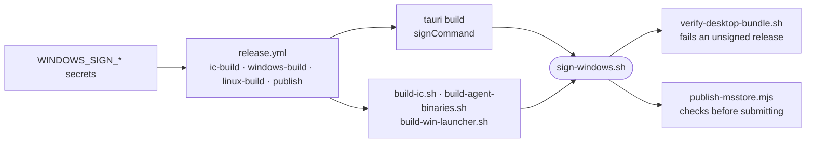

# Windows code signing

How release builds put an Authenticode signature on every Windows binary from Linux, so SmartScreen can name the publisher and the Microsoft Store certifies the installer.

- Windows warns about any program it cannot attribute to a publisher, and only an Authenticode signature from a certificate issued to a verified legal entity supplies one. `TAURI_SIGNING_PRIVATE_KEY` is a different key: minisign, read only by the app's updater.
- [`sign-windows.sh`](../../_tools/scripts/build/sign-windows.sh) does nothing when `WINDOWS_SIGN_TOOL` is unset and says so in the build log, so local and non-release builds stay unsigned and runnable. When it is set, `verify-desktop-bundle.sh` fails a build whose installer carries no signature.
- The installer is cross-built with cargo-xwin, so `signtool.exe` is not available; both supported signers run on Linux.
- Every signature is SHA-256 with an RFC 3161 timestamp (`WINDOWS_SIGN_TIMESTAMP_URL`), so it keeps verifying after the certificate expires.
- `sign-windows.sh --check <file>` reads the PE's certificate table. It proves a signature is present, not that it chains to a trusted root.

## Choosing a signer

| `WINDOWS_SIGN_TOOL` | Where the key lives | Variables it reads |
| --- | --- | --- |
| `jsign` | a service or token: Azure Artifact Signing, Azure Key Vault, AWS or Google KMS, DigiCert ONE, SSL.com eSigner, PKCS#11 | `WINDOWS_SIGN_STORETYPE`, `WINDOWS_SIGN_STORE`, `WINDOWS_SIGN_ALIAS`, `WINDOWS_SIGN_STOREPASS` (or, for Artifact Signing, `AZURE_TENANT_ID` and `AZURE_CLIENT_ID`) |
| `osslsigncode` | a `.pfx` file | `WINDOWS_SIGN_PFX`, `WINDOWS_SIGN_PFX_PASSWORD` |

CA/Browser Forum rules keep a code-signing certificate's private key on certified hardware, so a newly bought certificate means `jsign`, against a signing service or a hardware token. `osslsigncode` suits a legacy or test certificate held as a file. `jsign` is Java, so `ci-desktop` carries a headless JRE (about 90 MB) in an image every desktop job pulls.

## What the release uses: Azure Artifact Signing

The release signs with `jsign` against Azure Artifact Signing (formerly Trusted Signing). Microsoft holds the key in its HSM and issues a fresh certificate every few days, so there is nothing to buy, renew or keep on a token.

| What | Value |
| --- | --- |
| Subscription | `radarsu` (`12acf78b-6370-4a9e-b721-a069928939d1`), tenant `radarsugmail.onmicrosoft.com` (`dc2ddc63-597b-416e-868a-4532afe14fa3`) |
| Account | `intentic-signing` in resource group `rg-codesigning`, Poland Central, Basic tier (5,000 signatures a month), endpoint `https://plc.codesigning.azure.net/` |
| Identity validation | `a6c867c1-0394-4712-a217-156755679b20`, Public, expires 2029-01-13 |
| Certificate profile | `intentic-public`, Public Trust |
| Subject | `CN=Artur Kurowski, O=Artur Kurowski, L=Warsaw, S=Mazowieckie, C=PL`, issued under *Microsoft ID Verified CS AOC CA 03* |
| CI identity | app registration `intentic-github-signing` (client `6fcc84fd-2338-426e-ad3f-680c72ad5ad8`), role *Artifact Signing Certificate Profile Signer* on the profile only |

There is no client secret. The app registration trusts GitHub's OIDC tokens for pushes to `main` through two federated credentials: the default subject `repo:intentic/intentic:ref:refs/heads/main` and the immutable form the repository is set to use, `repo:intentic@312099878/intentic@1322956121:ref:refs/heads/main`. A job that signs holds `id-token: write`; for every file, `sign-windows.sh` trades the job's OIDC token for an Entra token scoped to `https://codesigning.azure.net`. A token lasts about an hour, longer than one file takes to sign and shorter than a release, which is why no secret can hold one. Outside CI the same script takes `AZURE_CLIENT_SECRET` instead, or a token given directly in `WINDOWS_SIGN_STOREPASS` (`az account get-access-token --resource https://codesigning.azure.net`), for an account that holds the signer role.

Each certificate lives three days, so the RFC 3161 timestamp is what keeps a signature valid. For this store type the script defaults `WINDOWS_SIGN_TIMESTAMP_URL` to Microsoft's `http://timestamp.acs.microsoft.com`.

The repository secrets:

| Secret | Value |
| --- | --- |
| `WINDOWS_SIGN_TOOL` | `jsign`. This one turns signing on. |
| `WINDOWS_SIGN_STORETYPE` | `TRUSTEDSIGNING` |
| `WINDOWS_SIGN_STORE` | `plc.codesigning.azure.net` |
| `WINDOWS_SIGN_ALIAS` | `intentic-signing/intentic-public` |
| `WINDOWS_SIGN_PUBLISHER` | the subject above |
| `AZURE_TENANT_ID`, `AZURE_CLIENT_ID` | the tenant and client above |

`WINDOWS_SIGN_STOREPASS` stays unset. The identity validation is renewed from the account's *Identity validations* page before 2029-01-13; the profile and everything here carry over.

## Turning it on

1. Buy the certificate or set up the signing service, and pick the signer.
2. Both signers are baked into [`_tools/ci-desktop/Dockerfile`](../../_tools/ci-desktop/Dockerfile): `osslsigncode`, and `jsign` with its JRE.
3. Add `WINDOWS_SIGN_TOOL` and the signer's variables as repository secrets, and `WINDOWS_SIGN_PUBLISHER`: the certificate's subject exactly as Windows shows it (`CN=…, O=…, L=…, S=…, C=…`). It is the publisher of the identity package behind "Open with Intentic" in Windows 11's context menu ([explorer-menu](../../_editor/desktop-app/explorer-menu)), which Windows registers only when it names who signed it. With it, that package ships signed and registers with no prompt; without it a signing build fails verification, since every user would meet a UAC prompt the certificate exists to spare them. `release.yml` passes the `jsign` set to `ic-build`, `windows-build`, `linux-build` and `publish`; the `osslsigncode` pair has to be added to those `env` blocks, and `WINDOWS_SIGN_PFX` is a path, so the job must write the certificate to a file first.
4. Cut a release. The build log shows `==> signed <file>` for each binary, and `verify-desktop-bundle.sh` prints `signed` for the installer.
5. If the Microsoft Store is waiting on a signed installer, dispatch `msstore-publish.yml` at that tag ([microsoft-store.md](microsoft-store.md)).
